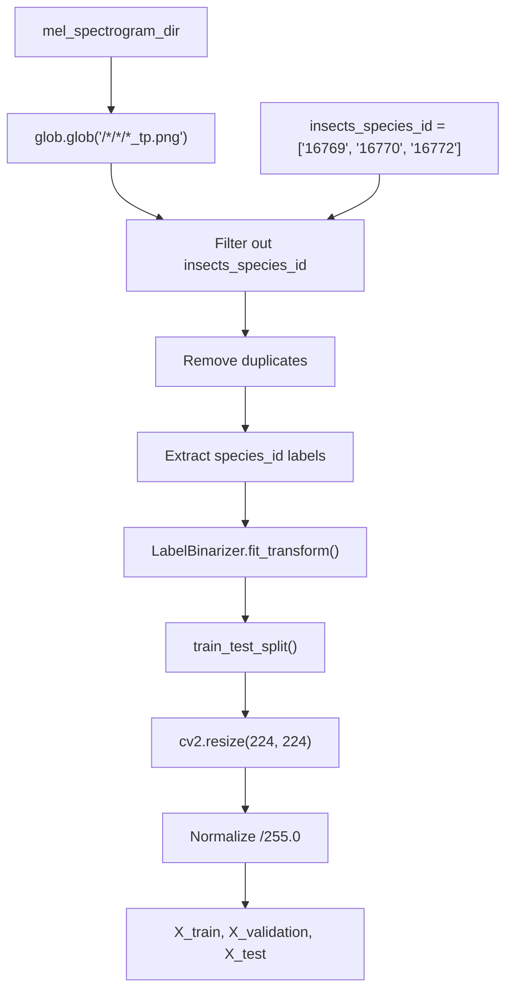
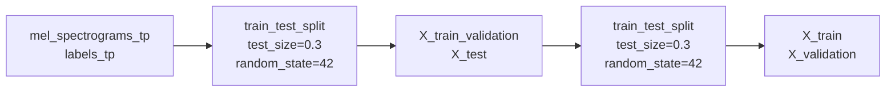
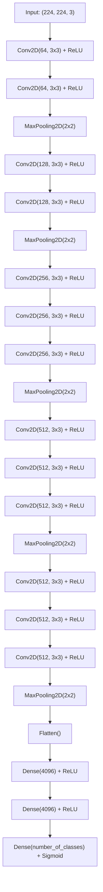
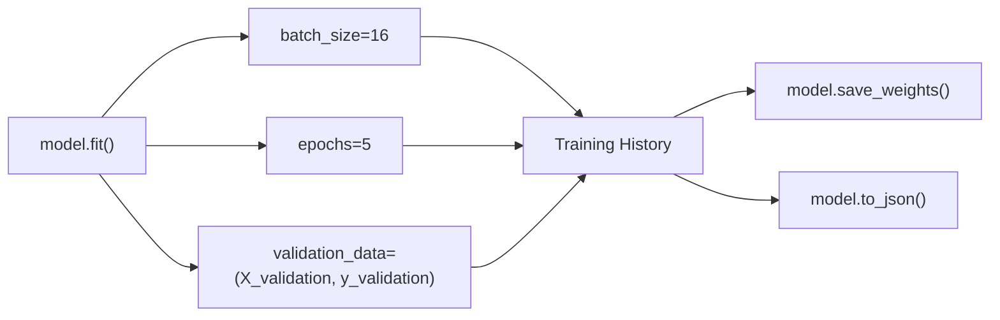
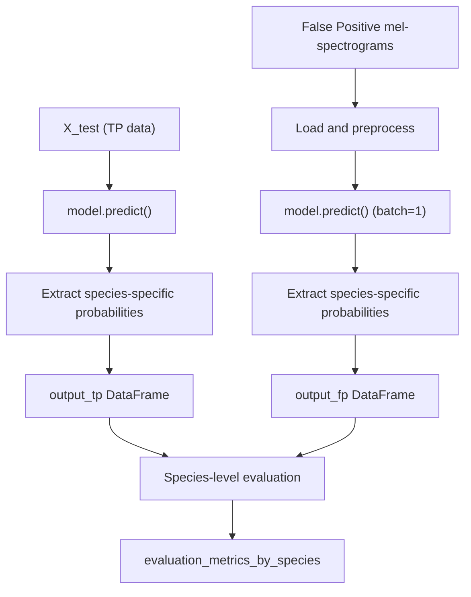
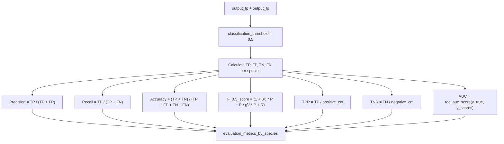

<!-- source: DeepWiki mcp.deepwiki.com · repo microsoft/Multi_Species_Bioacoustic_Classification · page 4.1 Model 1: VGG16 Baseline CNN · fetched 2026-10-26 -->

# Model 1: VGG16 Baseline CNN

<details>
<summary>Relevant source files</summary>

The following files were used as context for generating this wiki page:

- [model1_vgg16_architecture_TP_only.py](model1_vgg16_architecture_TP_only.py)

</details>


## Purpose and Scope

This document provides detailed documentation of Model 1, a VGG16 CNN architecture implementation that serves as the baseline model for multi-species bioacoustic classification. This model is trained from scratch using only True Positive (TP) labeled data and provides a foundation for comparing against more sophisticated approaches documented in Model 2 ([#4.2](#4.2)) and Model 3 ([#4.3](#4.3)). For information about the mel-spectrogram extraction process that feeds this model, see Data Processing Pipeline ([#3](#3)).

## Model 1 Overview

Model 1 implements a classic VGG16 convolutional neural network architecture trained from scratch without pre-trained weights. The model operates exclusively on True Positive labeled mel-spectrograms, representing the most straightforward deep learning approach to species classification.

### Key Characteristics

| Attribute | Value |
|-----------|-------|
| Architecture | VGG16 (Custom Implementation) |
| Training Data | True Positive only |
| Input Format | 224x224x3 mel-spectrogram images |
| Number of Species | 24 (excluding 3 insect species) |
| Loss Function | Binary Crossentropy |
| Optimizer | Adam (lr=0.0001, decay=1e-7) |

Sources: [model1_vgg16_architecture_TP_only.py:1-287]()

## Data Loading and Preprocessing Pipeline

### Mel-Spectrogram Data Loading

The model loads pre-processed mel-spectrograms from the data pipeline established in [#3](#3). The loading process filters out insect species and handles duplicate removal.



**Data Loading Process**

The preprocessing pipeline implements several critical steps:

1. **File Discovery**: Uses `glob.glob()` to locate TP mel-spectrograms
2. **Species Filtering**: Removes three insect species from the dataset
3. **Duplicate Handling**: Ensures unique mel-spectrograms per species
4. **Label Processing**: Converts species IDs to binary classification format
5. **Data Splitting**: 70% train/validation, 30% test split
6. **Image Preprocessing**: Resize to 224x224 and normalize pixel values

Sources: [model1_vgg16_architecture_TP_only.py:56-108]()

### Data Split Configuration



**Split Ratios**:
- Training: 49% (70% of 70%)
- Validation: 21% (30% of 70%)  
- Test: 30%

Sources: [model1_vgg16_architecture_TP_only.py:100-108]()

## VGG16 Model Architecture Implementation

### Network Structure

The model implements a standard VGG16 architecture using Keras Sequential API with specific layer configurations optimized for mel-spectrogram classification.



### Model Configuration Details

| Layer Block | Filters | Kernel Size | Activation | Pooling |
|-------------|---------|-------------|------------|---------|
| Block 1 | 64 | 3x3 | ReLU | 2x2 MaxPool |
| Block 2 | 128 | 3x3 | ReLU | 2x2 MaxPool |
| Block 3 | 256 | 3x3 | ReLU | 2x2 MaxPool |
| Block 4 | 512 | 3x3 | ReLU | 2x2 MaxPool |
| Block 5 | 512 | 3x3 | ReLU | 2x2 MaxPool |
| FC Layers | 4096, 4096, n_classes | - | ReLU, ReLU, Sigmoid | - |

Sources: [model1_vgg16_architecture_TP_only.py:112-135]()

### Model Compilation

The model uses binary crossentropy loss with Adam optimizer, configured for multi-label classification:

```python
optimizer = optimizers.adam(lr=0.0001, decay=1e-7)
model.compile(loss='binary_crossentropy', optimizer=optimizer, metrics=['accuracy'])
```

Sources: [model1_vgg16_architecture_TP_only.py:138-139]()

## Training Process

### Training Configuration



**Training Parameters**:
- Batch Size: 16
- Epochs: 5
- Validation: Concurrent validation on held-out data
- Monitoring: Accuracy and loss tracking

### Model Persistence

The training process saves two artifacts:
1. **Weights**: `cnn_weights.h5` - Trained model parameters
2. **Architecture**: `cnn__architecture.json` - Model structure definition

Sources: [model1_vgg16_architecture_TP_only.py:143-158]()

## Evaluation Framework

### Test Set Prediction Pipeline

The evaluation process handles both True Positive and False Positive data to generate comprehensive performance metrics.



### Prediction Process for TP Data

```python
yhat_probs_tp = model.predict(X_test)
# Extract species-specific probability for each sample
species_id = filename.split('_')[-3]
predicted_probability = yhat_probs_tp[i][species_id_class_dict[species_id]]
```

### Prediction Process for FP Data

For False Positive data, the model processes images individually due to memory constraints:

```python
for i in range(len(directory_filenames_fp_unique)):
    img = cv2.imread(directory_filenames_fp_unique[i])
    img = cv2.resize(img, (ncol, nrow)) / 255.0
    yhat_prob = model.predict(np.asarray([img]))
    predicted_probability = yhat_prob[0][species_id_class_dict[species_id]]
```

Sources: [model1_vgg16_architecture_TP_only.py:162-214]()

## Performance Metrics Calculation

### Species-Level Evaluation Framework



### Evaluation Metrics Output Structure

The `evaluation_metrics_by_species` DataFrame contains comprehensive per-species performance metrics:

| Column | Description |
|--------|-------------|
| `species_id` | Unique species identifier |
| `species_name` | Human-readable species name |
| `positive_cnt` | Number of TP samples |
| `negative_cnt` | Number of FP samples |
| `TP_cnt`, `FP_cnt`, `TN_cnt`, `FN_cnt` | Confusion matrix values |
| `Precision`, `Recall`, `Accuracy` | Standard classification metrics |
| `F_score` | F₀.₅ score (β=0.5) |
| `TPR`, `TNR` | True Positive/Negative Rates |
| `AUC` | Area Under ROC Curve |

Sources: [model1_vgg16_architecture_TP_only.py:231-286]()

### Classification Threshold

The model uses a fixed classification threshold of 0.5 for binary decisions:

```python
classification_threshold = 0.5
prediction_tp = len(output_tp.loc[output_tp.predicted_probability >= classification_threshold])
```

This threshold determines the boundary between positive and negative predictions for each species.

Sources: [model1_vgg16_architecture_TP_only.py:219-230]()

## Output Generation and File Structure

### Model Artifacts

The training process generates the following outputs in the `model_dir`:

1. **`cnn_weights.h5`** - Trained model weights
2. **`cnn__architecture.json`** - Model architecture definition

### Evaluation Outputs

The evaluation process creates DataFrames containing:

1. **`output_tp`** - TP predictions with probabilities
2. **`output_fp`** - FP predictions with probabilities  
3. **`evaluation_metrics_by_species`** - Comprehensive per-species metrics

These outputs provide the foundation for model comparison documented in Model Evaluation and Metrics ([#7](#7)).

Sources: [model1_vgg16_architecture_TP_only.py:153-287]()

---

