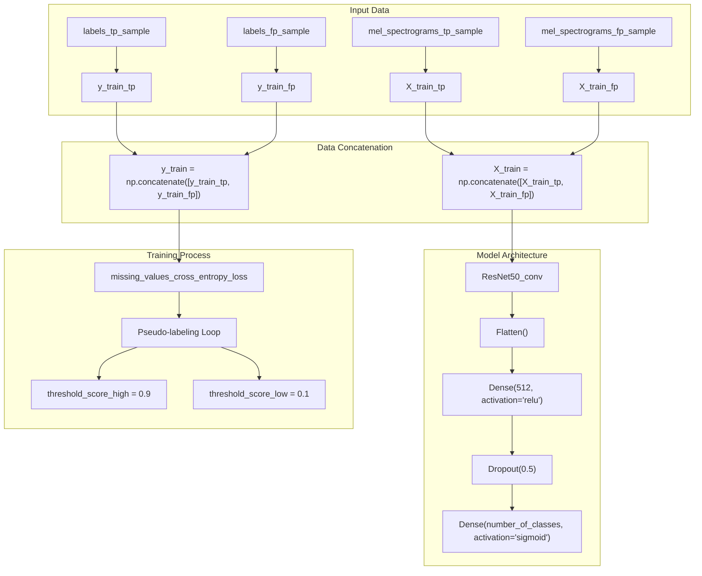
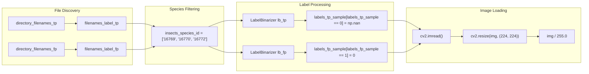
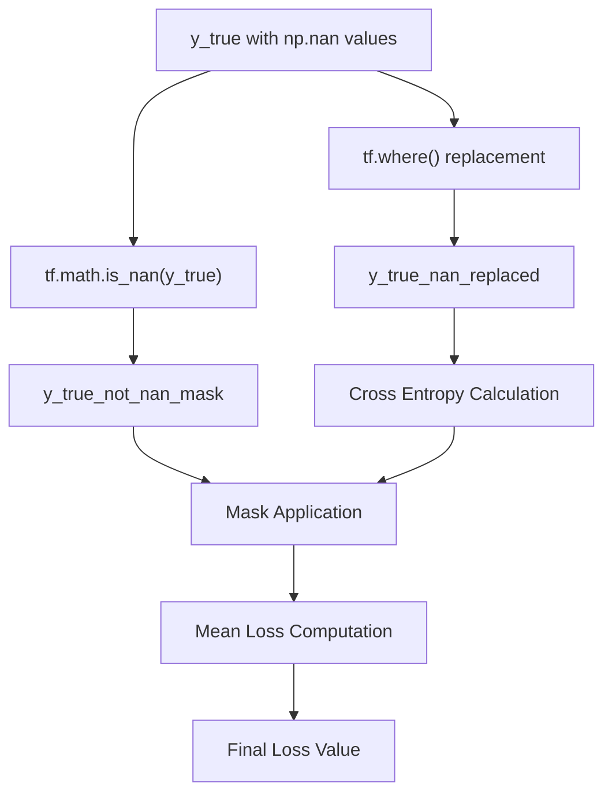
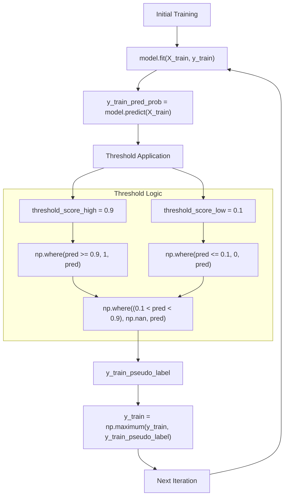
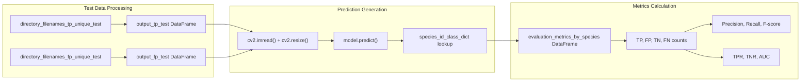

<!-- source: DeepWiki mcp.deepwiki.com · repo microsoft/Multi_Species_Bioacoustic_Classification · page 4.3 Model 3: Advanced ResNet50 with Pseudo-labeling · fetched 2026-10-26 -->

# Model 3: Advanced ResNet50 with Pseudo-labeling

<details>
<summary>Relevant source files</summary>

The following files were used as context for generating this wiki page:

- [model3_transfer_learning_pseudo_labeling.py](model3_transfer_learning_pseudo_labeling.py)

</details>


## Purpose and Scope

This document covers Model 3, the most sophisticated deep learning approach in the Multi-Species Bioacoustic Classification system. Model 3 implements a ResNet50-based transfer learning architecture enhanced with pseudo-labeling techniques and custom loss functions designed to handle both True Positive (TP) and False Positive (FP) mel-spectrogram data.

Unlike Models 1 and 2 which use only True Positive data, Model 3 leverages semi-supervised learning by incorporating False Positive samples to improve model robustness and generalization. For information about the simpler baseline approaches, see [Model 1: VGG16 Baseline CNN](#4.1) and [Model 2: ResNet50 Transfer Learning](#4.2). For details on the mel-spectrogram preprocessing pipeline that feeds this model, see [Data Processing Pipeline](#3).

## Architecture Overview

Model 3 combines transfer learning with pseudo-labeling in a semi-supervised learning framework. The architecture builds upon a pre-trained ResNet50 backbone with custom modifications for multi-species classification.

**Architecture Diagram**


Sources: [model3_transfer_learning_pseudo_labeling.py:157-171](), [model3_transfer_learning_pseudo_labeling.py:209-233]()

## Data Processing Pipeline

Model 3 processes both True Positive and False Positive mel-spectrograms with specialized label encoding to support pseudo-labeling.

**Data Processing Flow**


Sources: [model3_transfer_learning_pseudo_labeling.py:57-77](), [model3_transfer_learning_pseudo_labeling.py:104-131](), [model3_transfer_learning_pseudo_labeling.py:135-152]()

### Label Encoding Strategy

The model uses a sophisticated label encoding approach:

- **True Positive Labels**: Binary-encoded with zeros replaced by `np.nan` to indicate missing labels for other species
- **False Positive Labels**: Binary-encoded with ones converted to zeros (indicating negative examples)
- **Species Mapping**: `species_id_class_dict` maintains mapping between species IDs and class indices

| Data Type | Encoding Strategy | Purpose |
|-----------|------------------|---------|
| True Positive | `1` for target species, `np.nan` for others | Positive examples with missing labels |
| False Positive | `0` for all species | Negative examples for pseudo-labeling |

Sources: [model3_transfer_learning_pseudo_labeling.py:104-131]()

## Custom Loss Function

Model 3 implements a specialized loss function `missing_values_cross_entropy_loss` to handle the presence of `np.nan` values in the label matrix, enabling effective training with partial labels.

### Loss Function Implementation

The `missing_values_cross_entropy_loss` function handles missing values through a masking mechanism:

```python
def missing_values_cross_entropy_loss(y_true, y_pred):
    # Creates mask for non-NaN values
    y_true_not_nan_mask = tf.logical_not(tf.math.is_nan(y_true))
    
    # Replaces NaN with zeros for computation
    y_true_nan_replaced = tf.where(tf.math.is_nan(y_true), tf.zeros_like(y_true), y_true)
    
    # Applies mask to ignore loss from missing labels
    cross_entropy_loss_discarded_nan_labels = cross_entropy_loss * tf.cast(y_true_not_nan_mask, tf.float32)
```

**Loss Function Flow**


Sources: [model3_transfer_learning_pseudo_labeling.py:181-204]()

## Model Architecture

The model builds upon ResNet50 with custom classification layers optimized for multi-species audio classification.

### ResNet50 Configuration

| Component | Configuration | Details |
|-----------|--------------|---------|
| Base Model | `ResNet50(weights='imagenet')` | Pre-trained on ImageNet |
| Input Shape | `(224, 224, 3)` | RGB mel-spectrogram images |
| Trainable | `layer.trainable = True` | All layers fine-tunable |
| Top Layers | `include_top=False` | Custom classification head |

### Classification Head

The custom classification layers replace ResNet50's original top:

1. **Global Average Pooling**: Implicit through `Flatten()`
2. **Dense Layer**: 512 units with ReLU activation
3. **Dropout**: 0.5 dropout rate for regularization  
4. **Output Layer**: Multi-label classification with sigmoid activation

Sources: [model3_transfer_learning_pseudo_labeling.py:209-233]()

## Pseudo-labeling Process

Model 3 implements an iterative pseudo-labeling approach that progressively refines labels based on model predictions.

**Pseudo-labeling Workflow**


### Pseudo-labeling Parameters

The algorithm uses confidence thresholds to determine label assignments:

- **High Confidence Threshold**: `threshold_score_high = 0.9` - Predictions above this become positive labels
- **Low Confidence Threshold**: `threshold_score_low = 0.1` - Predictions below this become negative labels  
- **Uncertain Region**: Predictions between thresholds remain as `np.nan` (unlabeled)
- **Iteration Count**: 2 iterations with 5 epochs each

Sources: [model3_transfer_learning_pseudo_labeling.py:235-244]()

## Training Workflow

The training process combines standard supervised learning with iterative pseudo-labeling refinement.

### Training Configuration

| Parameter | Value | Purpose |
|-----------|-------|---------|
| Optimizer | `adam(lr=0.0001, decay=1e-7)` | Fine-tuning learning rate |
| Batch Size | 16 | Memory-efficient processing |
| Epochs per Iteration | 5 | Short iterations for label updates |
| Total Iterations | 2 | Pseudo-labeling cycles |

### Training Loop Structure

1. **Initial Training**: Model trains on original labels for 5 epochs
2. **Prediction Generation**: `model.predict(X_train)` generates confidence scores
3. **Label Update**: High/low confidence predictions become hard labels
4. **Label Merging**: `np.maximum(y_train, y_train_pseudo_label)` preserves original positive labels
5. **Iteration**: Process repeats for specified iterations

Sources: [model3_transfer_learning_pseudo_labeling.py:237-251]()

## Evaluation Framework

Model 3 implements comprehensive evaluation on both True Positive and False Positive test sets with species-level metrics.

**Evaluation Pipeline**


### Species-Level Metrics

The evaluation framework computes comprehensive metrics for each of the 24 target species:

| Metric | Formula | Purpose |
|--------|---------|---------|
| Precision | `TP / (TP + FP)` | Positive prediction accuracy |
| Recall | `TP / (TP + FN)` | True positive detection rate |
| F-score | `(1 + β²) * P * R / (β² * P + R)` | Harmonic mean with β=0.5 |
| TPR | `TP / positive_cnt` | True positive rate |
| TNR | `TN / negative_cnt` | True negative rate |
| AUC | `roc_auc_score(y_true, y_scores)` | Area under ROC curve |

### Output Data Structures

- **output_tp_test**: DataFrame containing TP test results with columns `['filename', 'tp_fp', 'species_id', 'predicted_probability']`
- **output_fp_test**: DataFrame containing FP test results with identical structure
- **evaluation_metrics_by_species**: Comprehensive metrics table for each species

Sources: [model3_transfer_learning_pseudo_labeling.py:335-391]()

## Model Persistence

The trained model artifacts are saved for deployment and further analysis:

- **Model Weights**: `resnet_weights_pseudo_label.h5` - Trained parameters
- **Model Architecture**: `resnet_architecture_pseudo_label_TP_FP_0.01_0.99.json` - Network structure

Sources: [model3_transfer_learning_pseudo_labeling.py:254-258]()

---

