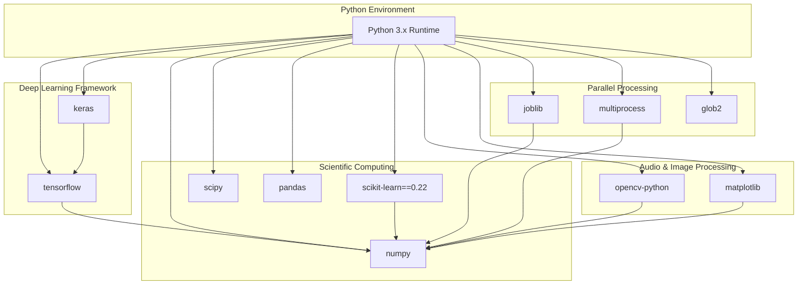
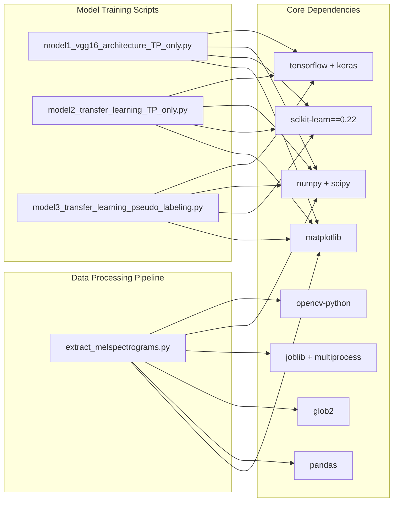
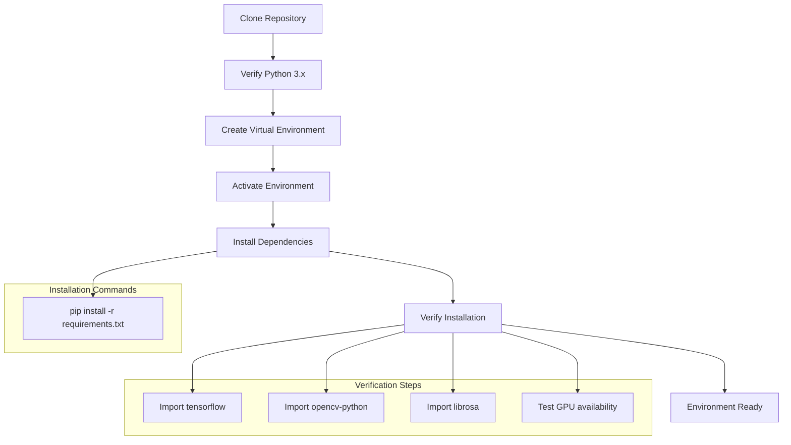

<!-- source: DeepWiki mcp.deepwiki.com · repo microsoft/Multi_Species_Bioacoustic_Classification · page 5 Environment Setup and Dependencies · fetched 2026-10-26 -->

# Environment Setup and Dependencies

<details>
<summary>Relevant source files</summary>

The following files were used as context for generating this wiki page:

- [.gitignore](.gitignore)
- [requirements.txt](requirements.txt)

</details>


This document provides comprehensive guidance for setting up the Python environment and installing dependencies required to run the Multi-Species Bioacoustic Classification system. It covers the technology stack, dependency relationships, and step-by-step installation procedures necessary for data processing, model training, and evaluation workflows.

For information about the overall system architecture and how these dependencies support different components, see [System Architecture](#2). For details about specific model implementations that utilize these dependencies, see [Deep Learning Models](#4).

## System Requirements and Technology Stack

The Multi-Species Bioacoustic Classification system requires a Python environment with specific machine learning, audio processing, and computer vision libraries. The system is designed to work with standard scientific computing infrastructure and does not require specialized hardware, though GPU acceleration is recommended for model training.

### Core Technology Stack Overview



**Dependency Stack Architecture**

This diagram illustrates the hierarchical dependency relationships where `tensorflow` and `keras` form the deep learning foundation, while scientific computing libraries provide numerical operations support, and specialized libraries handle audio/image processing and parallel execution.

Sources: [requirements.txt:1-11]()

### Dependency-to-Component Mapping



**Component-Dependency Relationships**

This diagram maps specific Python modules and scripts to their required dependencies, showing how `extract_melspectrograms.py` relies heavily on image processing and parallel computing libraries, while the model training scripts primarily use deep learning and evaluation frameworks.

Sources: [requirements.txt:1-11]()

## Dependency Analysis and Roles

The following table details each dependency's specific role within the bioacoustic classification system:

| Dependency | Version | Primary Role | Used By |
|------------|---------|--------------|---------|
| `numpy` | Latest | Numerical arrays and mathematical operations | All components |
| `pandas` | Latest | Data manipulation and CSV handling | Metadata processing |
| `glob2` | Latest | Advanced file pattern matching | File discovery |
| `matplotlib` | Latest | Visualization and plotting | Results analysis |
| `joblib` | Latest | Parallel processing and caching | Mel-spectrogram extraction |
| `keras` | Latest | High-level neural network API | All model implementations |
| `tensorflow` | Latest | Deep learning framework backend | All model implementations |
| `multiprocess` | Latest | Enhanced multiprocessing capabilities | Parallel data processing |
| `scipy` | Latest | Scientific computing functions | Signal processing |
| `scikit-learn` | 0.22 | Machine learning utilities and metrics | Model evaluation |
| `opencv-python` | Latest | Computer vision and image processing | Spectrogram manipulation |

Sources: [requirements.txt:1-11]()

### Critical Version Dependencies

The system specifies `scikit-learn==0.22` as a pinned version requirement. This specific version ensures compatibility with the evaluation metrics and preprocessing functions used throughout the model training and validation workflows.

## Installation Workflow

### Environment Setup Process



**Installation and Verification Workflow**

This diagram outlines the recommended sequence for setting up the development environment, from repository cloning through dependency verification.

Sources: [requirements.txt:1-11]()

### Step-by-Step Installation

1. **Repository Setup**
   ```bash
   git clone https://github.com/microsoft/Multi_Species_Bioacoustic_Classification
   cd Multi_Species_Bioacoustic_Classification
   ```

2. **Python Environment Creation**
   ```bash
   python -m venv bioacoustic_env
   source bioacoustic_env/bin/activate  # On Windows: bioacoustic_env\Scripts\activate
   ```

3. **Dependency Installation**
   ```bash
   pip install -r requirements.txt
   ```

4. **Installation Verification**
   ```python
   import tensorflow as tf
   import cv2
   import pandas as pd
   import numpy as np
   import sklearn
   print(f"TensorFlow version: {tf.__version__}")
   print(f"GPU available: {tf.config.list_physical_devices('GPU')}")
   ```

Sources: [requirements.txt:1-11]()

## Development Environment Configuration

### Git Configuration and Ignored Files

The repository includes comprehensive `.gitignore` configuration to exclude development artifacts, temporary files, and platform-specific directories. Key exclusions include:

- Python cache files: `__pycache__/`, `*.pyc` [.gitignore:306-307]()
- Visual Studio artifacts: `.vs/`, build directories [.gitignore:35-44]()
- Log files and temporary outputs: `*.log`, `*.tmp` [.gitignore:88-94]()
- Node.js and package directories: `node_modules/` [.gitignore:276]()

### System Compatibility

The dependency configuration supports cross-platform development:

- **Windows**: Full Visual Studio integration with extensive `.gitignore` coverage
- **Linux/macOS**: Standard Python scientific computing stack
- **GPU Acceleration**: TensorFlow with CUDA support for accelerated training

Sources: [.gitignore:1-351](), [requirements.txt:1-11]()

## Hardware Recommendations

| Component | Minimum | Recommended |
|-----------|---------|-------------|
| RAM | 8 GB | 16+ GB |
| Storage | 10 GB free | 50+ GB SSD |
| GPU | None (CPU only) | NVIDIA GPU with 4+ GB VRAM |
| CPU | 4 cores | 8+ cores |

The system can operate on CPU-only configurations, but GPU acceleration significantly improves training performance for the deep learning models, particularly the VGG16 and ResNet50 architectures.

## Environment Verification and Troubleshooting

After installation, verify the environment supports all critical operations:

```python
# Core functionality test
import tensorflow as tf
import cv2
import numpy as np
import pandas as pd
from sklearn.metrics import classification_report

# Check TensorFlow GPU availability
print("GPU Available:", tf.config.list_physical_devices('GPU'))

# Verify OpenCV image processing
test_image = np.zeros((224, 224, 3), dtype=np.uint8)
resized = cv2.resize(test_image, (224, 224))
print("OpenCV functional:", resized.shape == (224, 224, 3))

# Test parallel processing capability
from joblib import Parallel, delayed
result = Parallel(n_jobs=2)(delayed(lambda x: x**2)(i) for i in range(4))
print("Parallel processing functional:", len(result) == 4)
```

This verification script tests the core dependencies required for mel-spectrogram processing, model training, and evaluation workflows.

Sources: [requirements.txt:6-11]()

---

