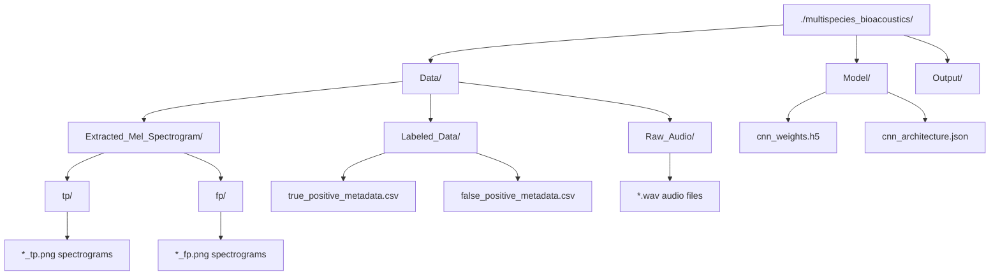
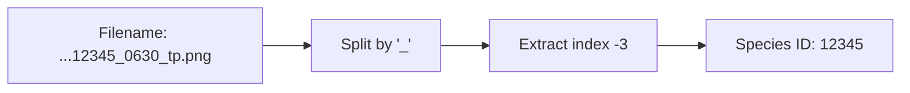
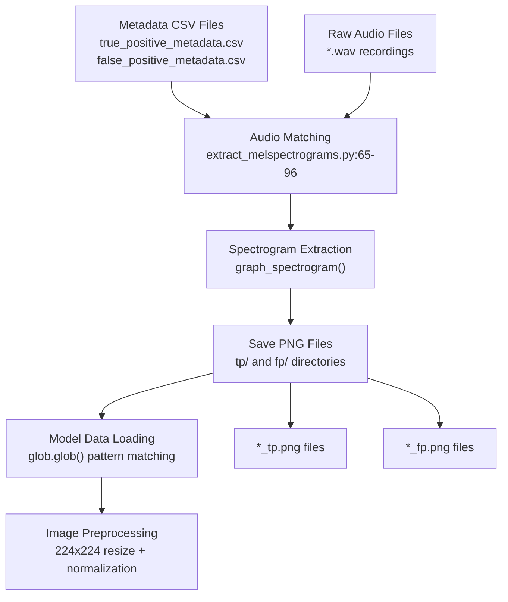

<!-- source: DeepWiki mcp.deepwiki.com · repo microsoft/Multi_Species_Bioacoustic_Classification · page 6 Data Formats and File Organization · fetched 2026-10-26 -->

# Data Formats and File Organization

<details>
<summary>Relevant source files</summary>

The following files were used as context for generating this wiki page:

- [extract_melspectrograms.py](extract_melspectrograms.py)
- [model1_vgg16_architecture_TP_only.py](model1_vgg16_architecture_TP_only.py)

</details>


This document describes the data formats, file organization, and naming conventions used throughout the Multi-Species Bioacoustic Classification system. It covers input data structures (metadata CSV files and raw audio), output formats (mel-spectrograms), and the directory hierarchy that organizes the entire data pipeline.

For information about the data processing pipeline that transforms these formats, see [Data Processing Pipeline](#3). For details about model training using these organized data formats, see [Deep Learning Models](#4).

## Directory Structure

The system follows a hierarchical directory structure that separates raw inputs, processed outputs, and model artifacts:



Sources: [extract_melspectrograms.py:27-46](), [model1_vgg16_architecture_TP_only.py:36-52]()

## Input Data Formats

### Metadata CSV Files

The system uses two primary metadata files that contain labeled detection data:

| File | Purpose | Key Columns |
|------|---------|-------------|
| `true_positive_metadata.csv` | Contains confirmed species detections | `species_id`, `uri`, `t_min`, `t_max`, `tod` |
| `false_positive_metadata.csv` | Contains false positive detections | `species_id`, `uri`, `t_min`, `t_max`, `tod` |

Each metadata record includes:
- **species_id**: Numeric identifier for the detected species
- **uri**: File path reference to the source audio recording
- **t_min/t_max**: Time boundaries of the detection in seconds
- **tod**: Time of day when the detection occurred

Sources: [extract_melspectrograms.py:50-56]()

### Raw Audio Files

Raw audio recordings are stored with a structured naming convention derived from the URI metadata:


Audio files are processed with the following specifications:
- **Sample Rate**: 48kHz (specified in `librosa.load()`)
- **Format**: WAV files
- **Duration**: Variable length recordings from field deployments

Sources: [extract_melspectrograms.py:70-75](), [extract_melspectrograms.py:108]()

## Output Data Formats

### Mel-Spectrogram Images

The system generates mel-spectrogram images as the primary input format for deep learning models:

**Image Specifications:**
- **Resolution**: 300x300 pixels at 100 DPI
- **Duration**: 2-second audio segments
- **Format**: PNG files with transparent background
- **Processing**: Power-to-dB conversion using `librosa.power_to_db()`

**Directory Organization:**
- True positives: `Extracted_Mel_Spectrogram/tp/`
- False positives: `Extracted_Mel_Spectrogram/fp/`

Sources: [extract_melspectrograms.py:118-134]()

### Mel-Spectrogram File Naming Convention

The system uses a structured naming convention that encodes multiple metadata fields:

```
{audio_filename}_{start_second}_{end_second}_{species_id}_{tod}_{label}.png
```

**Naming Components:**
- **audio_filename**: Source audio file (without extension)
- **start_second**: Start time of the audio segment
- **end_second**: End time of the audio segment  
- **species_id**: Numeric species identifier
- **tod**: Time of day (first 4 characters)
- **label**: Either "tp" (true positive) or "fp" (false positive)

**Example:**
```
project_site_2019_05_recording001_45_47_12345_0630_tp.png
```

This represents a 2-second segment (45-47 seconds) from a recording, containing species ID 12345, detected at 06:30, labeled as a true positive.

Sources: [extract_melspectrograms.py:124](), [extract_melspectrograms.py:133]()

## Species Identification System

### Species ID Extraction

The system extracts species identifiers from filenames during model training and evaluation:



**Implementation Details:**
- Species ID is extracted using `filename.split('_')[-3]`
- Insect species (IDs: 16769, 16770, 16772) are filtered out during processing
- Species IDs are mapped to class labels using `LabelBinarizer`

Sources: [model1_vgg16_architecture_TP_only.py:61](), [model1_vgg16_architecture_TP_only.py:60](), [model1_vgg16_architecture_TP_only.py:78-86]()

### Image Processing Pipeline

The mel-spectrogram images undergo standardized preprocessing before model training:

| Step | Operation | Parameters |
|------|-----------|------------|
| Load | `cv2.imread()` | Read PNG file |
| Resize | `cv2.resize()` | Target: 224x224 pixels |
| Normalize | Division by 255.0 | Convert to [0,1] range |

Sources: [model1_vgg16_architecture_TP_only.py:95-97]()

## Data Processing Workflow

The complete data transformation follows this sequence:



**Key Processing Functions:**
- `graph_spectrogram()`: Generates mel-spectrograms from audio segments
- `generate_spectrogram_tp()` / `generate_spectrogram_fp()`: Parallel processing wrappers
- File pattern matching: `mel_spectrogram_dir + '/*/*/*_tp.png'`

Sources: [extract_melspectrograms.py:107-161](), [model1_vgg16_architecture_TP_only.py:56-98]()

## Data Validation and Quality Control

### Duplicate Handling

The system implements deduplication logic to ensure unique training samples:

```python
# Create unique filename-label pairs
filenames_label_tp = list(set([(filename, species_id) for ...]))
```

### Audio File Matching

Audio files are validated against metadata through a matching process:
- Files not found in the audio directory are marked as "No Matched Audio"
- Only successfully matched files proceed to spectrogram extraction

Sources: [extract_melspectrograms.py:61-76](), [model1_vgg16_architecture_TP_only.py:61-63]()

---

