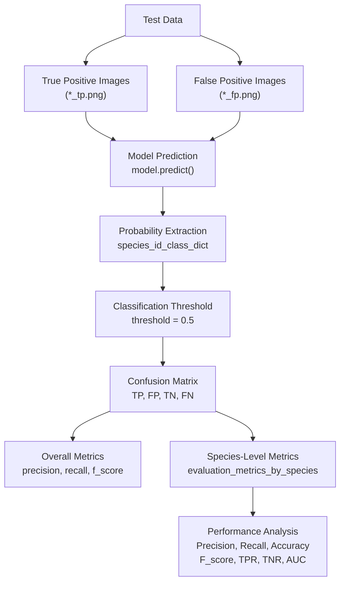
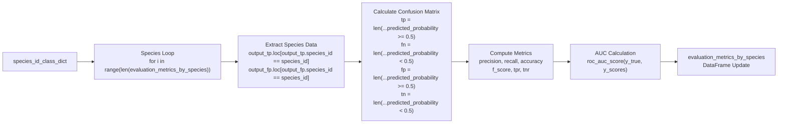
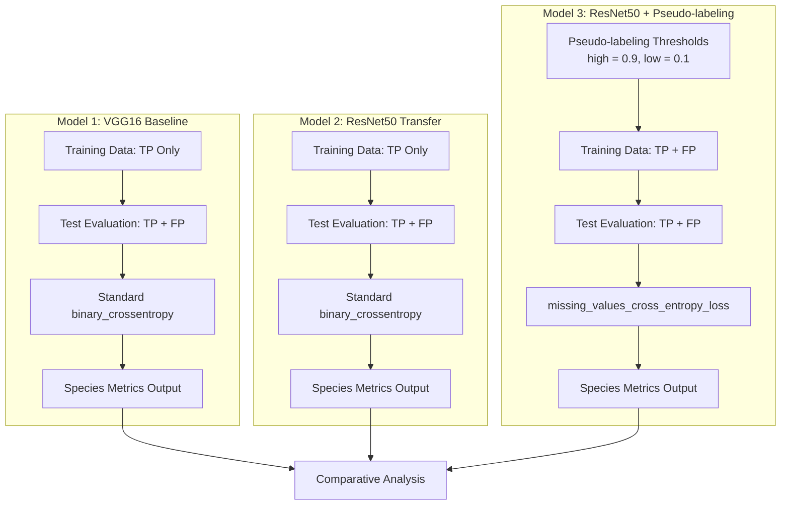
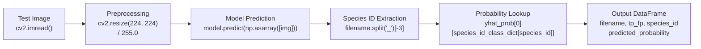

<!-- source: DeepWiki mcp.deepwiki.com · repo microsoft/Multi_Species_Bioacoustic_Classification · page 7 Model Evaluation and Metrics · fetched 2026-10-26 -->

# Model Evaluation and Metrics

<details>
<summary>Relevant source files</summary>

The following files were used as context for generating this wiki page:

- [model1_vgg16_architecture_TP_only.py](model1_vgg16_architecture_TP_only.py)
- [model2_transfer_learning_TP_only.py](model2_transfer_learning_TP_only.py)
- [model3_transfer_learning_pseudo_labeling.py](model3_transfer_learning_pseudo_labeling.py)

</details>


This document describes the comprehensive evaluation framework used to assess the performance of the three deep learning models in the Multi-Species Bioacoustic Classification System. The evaluation methodology provides both aggregate system-level metrics and detailed species-level performance analysis across 24 bird and frog species. For information about the individual model architectures being evaluated, see [Deep Learning Models](#4).

## Evaluation Framework Overview

The system implements a standardized evaluation pipeline that operates consistently across all three models (VGG16 baseline, ResNet50 transfer learning, and ResNet50 with pseudo-labeling). Each model generates predictions on held-out test data consisting of both True Positive (TP) and False Positive (FP) mel-spectrograms.



**Evaluation Pipeline Architecture**

Sources: [model1_vgg16_architecture_TP_only.py:219-286](), [model2_transfer_learning_TP_only.py:215-282](), [model3_transfer_learning_pseudo_labeling.py:324-391]()

## Metrics Definitions and Calculations

The evaluation framework calculates a comprehensive set of binary classification metrics for each species. All metrics use a fixed classification threshold of `0.5` to convert predicted probabilities into binary predictions.

### Core Metrics

| Metric | Formula | Code Implementation |
|--------|---------|-------------------|
| **Precision** | `TP / (TP + FP)` | `tp / (tp + fp)` |
| **Recall** | `TP / (TP + FN)` | `tp / (tp + fn)` |
| **Accuracy** | `(TP + TN) / (TP + FP + TN + FN)` | `(tp + tn) / (tp + fp + tn + fn)` |
| **F-Score** | `(1 + β²) × Precision × Recall / (β² × Precision + Recall)` | `beta = 0.5` |
| **TPR** | `TP / (TP + FN)` | `tp / positive_cnt` |
| **TNR** | `TN / (TN + FP)` | `tn / negative_cnt` |
| **AUC** | Area Under ROC Curve | `roc_auc_score(y_true, y_scores)` |

### F-Score Configuration

The system uses **F₀.₅ Score** (`beta = 0.5`) which emphasizes precision over recall. This choice is appropriate for conservation applications where false positives (incorrectly identifying a species) can be more costly than false negatives.

```python
beta = 0.5
f_score = (1 + beta**2) * precision * recall / (beta**2 * precision + recall)
```

Sources: [model1_vgg16_architecture_TP_only.py:225-226](), [model2_transfer_learning_TP_only.py:221-222](), [model3_transfer_learning_pseudo_labeling.py:330-331]()

## Species-Level Evaluation Process

Each model generates detailed per-species performance metrics through a systematic evaluation loop that processes each of the 24 target species individually.



**Species-Level Metrics Calculation Flow**

### Data Structure: `evaluation_metrics_by_species`

The evaluation results are stored in a standardized DataFrame with the following schema:

| Column | Type | Description |
|--------|------|-------------|
| `species_id` | string | Unique species identifier |
| `species_name` | string | Human-readable species name |
| `positive_cnt` | int | Total TP samples for species |
| `negative_cnt` | int | Total FP samples for species |
| `TP_cnt` | int | True positives at threshold 0.5 |
| `FP_cnt` | int | False positives at threshold 0.5 |
| `TN_cnt` | int | True negatives at threshold 0.5 |
| `FN_cnt` | int | False negatives at threshold 0.5 |
| `Precision` | float | Species precision score |
| `Recall` | float | Species recall score |
| `Accuracy` | float | Species accuracy score |
| `F_score` | float | Species F₀.₅ score |
| `TPR` | float | True positive rate |
| `TNR` | float | True negative rate |
| `AUC` | float | Area under ROC curve |

Sources: [model1_vgg16_architecture_TP_only.py:231-286](), [model2_transfer_learning_TP_only.py:227-282](), [model3_transfer_learning_pseudo_labeling.py:335-391]()

## Model Comparison Methodology

The three models use different evaluation strategies that reflect their training methodologies:



**Model Evaluation Strategy Comparison**

### Model 3 Custom Loss Function

Model 3 implements a specialized loss function that handles missing labels (NaN values) for pseudo-labeling:

```python
def missing_values_cross_entropy_loss(y_true, y_pred):
    epsilon = 1.0e-30
    y_true_not_nan_mask = tf.logical_not(tf.math.is_nan(y_true))
    y_true_nan_replaced = tf.where(tf.math.is_nan(y_true), tf.zeros_like(y_true), y_true)
    # ... cross entropy calculation with NaN handling
    cross_entropy_loss_discarded_nan_labels = cross_entropy_loss * tf.cast(y_true_not_nan_mask, tf.float32)
    return K.mean(K.mean(cross_entropy_loss_discarded_nan_labels, axis=1))
```

This function enables the model to train on both labeled TP data and pseudo-labeled FP data, where uncertain predictions are marked as NaN and excluded from loss calculation.

Sources: [model3_transfer_learning_pseudo_labeling.py:181-204]()

## Prediction and Probability Extraction

All models follow a consistent prediction workflow for generating species-specific probability scores:



**Prediction Pipeline for Test Data**

The `species_id_class_dict` mapping is crucial for extracting the correct probability from the model's multi-class output vector. This dictionary maps species IDs to class indices in the model's output layer.

Sources: [model1_vgg16_architecture_TP_only.py:168-172](), [model2_transfer_learning_TP_only.py:164-168](), [model3_transfer_learning_pseudo_labeling.py:287-290]()

## Output Visualization and Analysis

The evaluation framework generates probability distribution visualizations and summary statistics:

```python
plt.hist(output_tp_test['predicted_probability'])
plt.hist(output_fp_test['predicted_probability'])

classification_threshold = 0.5
prediction_tp = len(output_tp_test.loc[output_tp_test.predicted_probability >= classification_threshold])
prediction_fn = len(output_tp_test.loc[output_tp_test.predicted_probability < classification_threshold])
prediction_fp = len(output_fp_test.loc[output_fp_test.predicted_probability >= classification_threshold])
```

The histograms provide insight into the model's confidence distribution for true positive versus false positive samples, enabling assessment of the model's ability to distinguish between genuine species detections and false alarms.

Sources: [model1_vgg16_architecture_TP_only.py:216-222](), [model2_transfer_learning_TP_only.py:212-218](), [model3_transfer_learning_pseudo_labeling.py:321-327]()

---

