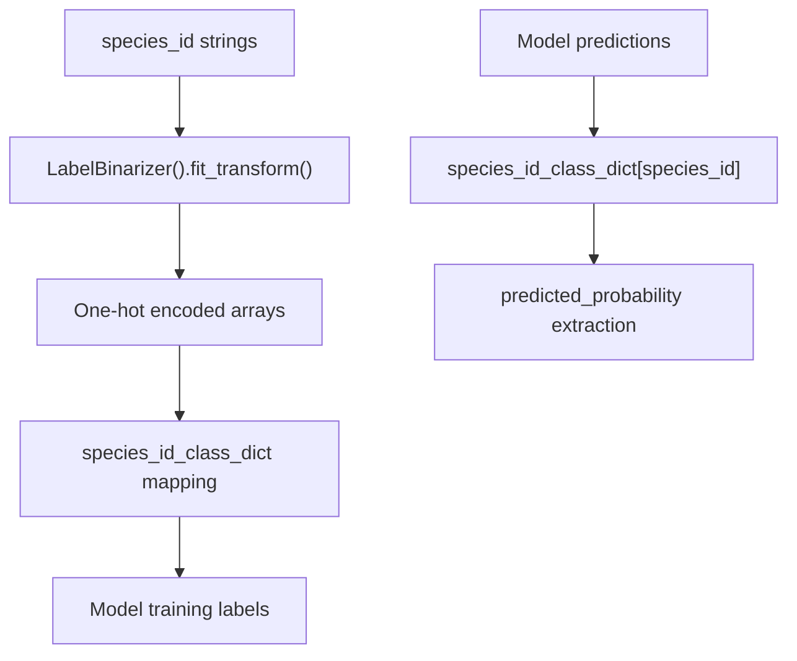
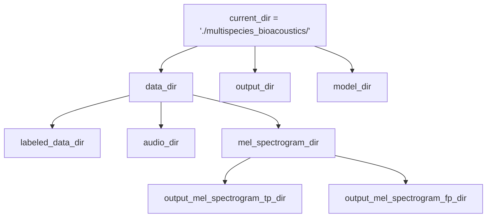
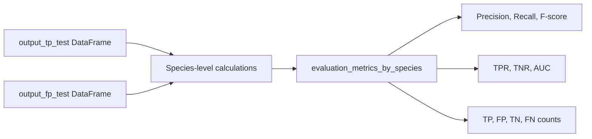

<!-- source: DeepWiki mcp.deepwiki.com · repo microsoft/Multi_Species_Bioacoustic_Classification · page 9 API Reference · fetched 2026-10-26 -->

# API Reference

<details>
<summary>Relevant source files</summary>

The following files were used as context for generating this wiki page:

- [extract_melspectrograms.py](extract_melspectrograms.py)
- [model1_vgg16_architecture_TP_only.py](model1_vgg16_architecture_TP_only.py)
- [model2_transfer_learning_TP_only.py](model2_transfer_learning_TP_only.py)
- [model3_transfer_learning_pseudo_labeling.py](model3_transfer_learning_pseudo_labeling.py)

</details>


This document provides a comprehensive technical reference for the core functions, classes, and parameters used throughout the Multi-Species Bioacoustic Classification system. It covers the mel-spectrogram extraction pipeline, the three deep learning models, data structures, and configuration parameters.

For information about system architecture and data flow, see [System Architecture](#2). For guidance on environment setup and dependencies, see [Environment Setup and Dependencies](#5). For model evaluation methodologies, see [Model Evaluation and Metrics](#7).

## Core Data Processing Functions

### `graph_spectrogram()`

The primary function for extracting mel-spectrograms from audio files and generating visual representations.

**Function Signature:**
```python
def graph_spectrogram(spectrogram_second_length, matched_labeled_data, audio_filename, label):
```

**Parameters:**
- `spectrogram_second_length`: Duration in seconds for each spectrogram (typically 2 seconds)
- `matched_labeled_data`: DataFrame containing species labels and time boundaries
- `audio_filename`: Name of the audio file to process
- `label`: Classification label ('tp' for true positive, 'fp' for false positive)

**Key Operations:**
- Loads audio at 48000 Hz sampling rate using `librosa.load()`
- Generates mel-spectrograms using `librosa.feature.melspectrogram()`
- Outputs 300x300 pixel PNG files at 100 DPI resolution
- Handles boundary conditions when audio length exceeds spectrogram duration

**Output File Naming Convention:**
```
{audio_filename}_{start_second}_{end_second}_{species_id}_{tod}_{label}.png
```

Sources: [extract_melspectrograms.py:107-137]()

### Parallel Processing Functions

**`generate_spectrogram_tp(i)` and `generate_spectrogram_fp(i)`**

Wrapper functions for parallel execution of mel-spectrogram generation across multiple CPU cores.

```python
def generate_spectrogram_tp(i):
    audio_filename = matched_audio_filename_tp[i]
    return graph_spectrogram(2, matched_truepositive_labeled_data, audio_filename, 'tp')

def generate_spectrogram_fp(i):
    audio_filename = matched_audio_filename_fp[i]
    return graph_spectrogram(2, matched_falsepositive_labeled_data, audio_filename, 'fp')
```

Uses `joblib.Parallel` with `multiprocessing.cpu_count()` for concurrent processing.

Sources: [extract_melspectrograms.py:140-161]()

## Model Architecture APIs

### Model 1: VGG16 CNN Architecture

**Sequential Model Definition:**
```python
model = Sequential([
    Conv2D(64, (3, 3), input_shape=(224, 224, 3), padding='same', activation='relu'),
    Conv2D(64, (3, 3), activation='relu', padding='same'),
    MaxPooling2D(pool_size=(2, 2), strides=(2, 2)),
    # ... additional layers
    Dense(4096, activation='relu'),
    Dense(4096, activation='relu'),
    Dense(number_of_classes, activation='sigmoid')
])
```

**Compilation Parameters:**
- Optimizer: `Adam(lr=0.0001, decay=1e-7)`
- Loss: `binary_crossentropy`
- Metrics: `['accuracy']`

Sources: [model1_vgg16_architecture_TP_only.py:112-139]()

### Model 2: ResNet50 Transfer Learning

**Base Model Configuration:**
```python
ResNet50_conv = ResNet50(weights='imagenet', include_top=False, input_shape=(224, 224, 3))
```

**Custom Top Layers:**
```python
model.add(layers.Flatten())
model.add(layers.Dense(512, activation='relu'))
model.add(layers.Dropout(0.5))
model.add(layers.Dense(number_of_classes, activation='sigmoid'))
```

All layers are set to `trainable = True` for fine-tuning.

Sources: [model2_transfer_learning_TP_only.py:112-135]()

### Model 3: Advanced ResNet50 with Custom Loss

**Custom Loss Function for Pseudo-labeling:**
```python
def missing_values_cross_entropy_loss(y_true, y_pred):
    epsilon = 1.0e-30
    y_true_not_nan_mask = tf.logical_not(tf.math.is_nan(y_true))
    y_true_nan_replaced = tf.where(tf.math.is_nan(y_true), tf.zeros_like(y_true), y_true)
    # ... cross entropy computation with NaN handling
    return mean_loss
```

**Pseudo-labeling Parameters:**
- `threshold_score_high = 0.9`: Confidence threshold for positive pseudo-labels
- `threshold_score_low = 0.1`: Confidence threshold for negative pseudo-labels
- Iterative training with 2 rounds of pseudo-label updates

Sources: [model3_transfer_learning_pseudo_labeling.py:181-204](), [model3_transfer_learning_pseudo_labeling.py:236-244]()

## Data Structures and Preprocessing

### Label Encoding System



**Species ID to Class Mapping:**
```python
species_id_class_dict = dict()
for (class_label, species_id) in enumerate(lb.classes_):
    species_id_class_dict[species_id] = class_label
```

Sources: [model1_vgg16_architecture_TP_only.py:78-86](), [model2_transfer_learning_TP_only.py:78-86](), [model3_transfer_learning_pseudo_labeling.py:112-115]()

### Image Preprocessing Pipeline


**Standard Image Processing:**
- Input resolution: 224x224 pixels (RGB)
- Normalization: Pixel values divided by 255.0
- Data type: `float32` NumPy arrays

Sources: [model1_vgg16_architecture_TP_only.py:88-98](), [model2_transfer_learning_TP_only.py:88-98](), [model3_transfer_learning_pseudo_labeling.py:134-152]()

## Configuration Parameters

### Audio Processing Constants

| Parameter | Value | Description |
|-----------|-------|-------------|
| `sampling_rate` | 48000 | Audio sampling frequency (Hz) |
| `spectrogram_second_length` | 2 | Duration of each spectrogram (seconds) |
| `dpi` | 100 | Resolution for output PNG files |
| `ncol, nrow` | 224, 224 | Target image dimensions for CNN input |

Sources: [extract_melspectrograms.py:108, 111, 118, 122]()

### Model Training Parameters

| Parameter | Model 1 | Model 2 | Model 3 |
|-----------|---------|---------|---------|
| `batch_size` | 16 | 16 | 16 |
| `epochs` | 5 | 5 | 5 (per iteration) |
| `learning_rate` | 0.0001 | 0.0001 | 0.0001 |
| `decay` | 1e-7 | 1e-7 | 1e-7 |
| `test_size` | 0.3 | 0.3 | 0.3 |
| `validation_split` | 0.3 | 0.3 | 0.3 |

Sources: [model1_vgg16_architecture_TP_only.py:138-143](), [model2_transfer_learning_TP_only.py:134-139](), [model3_transfer_learning_pseudo_labeling.py:230-238]()

### Directory Structure Configuration



**Path Variables:**
- `data_dir`: `current_dir + "Data/"`
- `labeled_data_dir`: `data_dir + 'Labeled_Data/'`
- `mel_spectrogram_dir`: `data_dir + "Extracted_Mel_Spectrogram/"`
- `model_dir`: `current_dir + "Model/"`
- `output_dir`: `current_dir + "Output/"`

Sources: [extract_melspectrograms.py:29-45](), [model1_vgg16_architecture_TP_only.py:38-51]()

## Model I/O Operations

### Model Saving APIs

**Architecture Serialization:**
```python
with open(model_dir + 'architecture_filename.json', 'w') as f:
    f.write(model.to_json())
```

**Weights Serialization:**
```python
model.save_weights(model_dir + 'weights_filename.h5')
```

**Model-Specific Filenames:**
- Model 1: `'cnn__architecture.json'`, `'cnn_weights.h5'`
- Model 2: `'resnet_architecture.json'`, `'resnet_weights.h5'`
- Model 3: `'resnet_architecture_pseudo_label_TP_FP_0.01_0.99.json'`, `'resnet_weights_pseudo_label.h5'`

Sources: [model1_vgg16_architecture_TP_only.py:153-157](), [model2_transfer_learning_TP_only.py:149-153](), [model3_transfer_learning_pseudo_labeling.py:254-258]()

## Evaluation Metrics API

### Species-Level Evaluation DataFrame



**Evaluation Metrics Schema:**
- `species_id`: Unique species identifier
- `species_name`: Human-readable species name
- `positive_cnt`, `negative_cnt`: Sample counts
- `TP_cnt`, `FP_cnt`, `TN_cnt`, `FN_cnt`: Confusion matrix values
- `Precision`, `Recall`, `Accuracy`: Standard classification metrics
- `F_score`: F₀.₅ score (β = 0.5)
- `TPR`, `TNR`: True Positive Rate, True Negative Rate
- `AUC`: Area Under ROC Curve

**Classification Threshold:**
- Default: `classification_threshold = 0.5`
- Applied to `predicted_probability` values for binary classification

Sources: [model1_vgg16_architecture_TP_only.py:231-286](), [model2_transfer_learning_TP_only.py:227-282](), [model3_transfer_learning_pseudo_labeling.py:335-390]()

### Prediction Output Format

**Test Set Prediction DataFrames:**
```python
output_tp_test = pd.DataFrame()
output_tp_test['filename'] = directory_filenames_tp_unique_test
output_tp_test['tp_fp'] = 'tp'
output_tp_test['species_id'] = ''
output_tp_test['predicted_probability'] = 0.0
```

Each row contains:
- `filename`: Full path to mel-spectrogram image
- `tp_fp`: Label indicating true/false positive
- `species_id`: Extracted from filename
- `predicted_probability`: Model confidence score [0.0, 1.0]

Sources: [model2_transfer_learning_TP_only.py:159-168](), [model3_transfer_learning_pseudo_labeling.py:272-290]()