# Page: Project Overview

# Project Overview

<details>
<summary>Relevant source files</summary>

The following files were used as context for generating this wiki page:

- [README.md](README.md)
- [bioacoustics_monitoring.jpg](bioacoustics_monitoring.jpg)

</details>


## Purpose and Scope

This document provides a comprehensive introduction to the Multi-Species Bioacoustic Classification repository, explaining its conservation objectives, core methodology, and system architecture. The project implements deep learning techniques to automatically identify 24 bird and frog species from audio recordings collected across Puerto Rico's rainforests.

For detailed information about the data processing pipeline, see [Data Processing Pipeline](#3). For specific model implementations, see [Deep Learning Models](#4). For environment setup instructions, see [Environment Setup and Dependencies](#5).

## Project Background

The Multi-Species Bioacoustic Classification system is a collaborative research initiative between Microsoft's [AI for Earth](https://aka.ms/aiforearth) team, the [AI for Good Research Lab](http://aka.ms/aiforgood), and [Sieve Analytics](https://www.sieve-analytics.com/). The project addresses critical biodiversity monitoring needs in Puerto Rico by automating the detection of species of Greatest Conservation Need as defined by the State Wildlife Action Plan.

### Conservation Objectives

The system targets 24 species of birds and frogs, with primary focus on endangered and threatened species while also including common species for baseline comparison:

| Species Category | Examples | Conservation Status |
|------------------|----------|-------------------|
| Greatest Conservation Need | Various endemic birds and frogs | Protected/Threatened |
| Common Baseline Species | Common coqui, Pearly-eyed thrasher, Scaly-naped pigeon | Stable populations |

The automated classification enables large-scale biodiversity monitoring across Puerto Rico's mountainous regions, providing conservation managers with actionable data for species population assessment and habitat protection decisions.

**Sources:** [README.md:1-37]()

## Data Collection Framework

Audio data collection spans 2015-2019 across approximately 700 sampling sites throughout Puerto Rico's mountain ecosystems. The systematic data collection protocol ensures comprehensive temporal and spatial coverage:

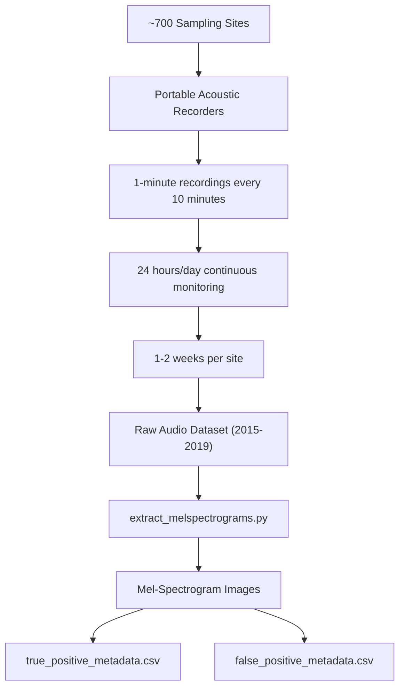

**Data Collection Parameters**
- **Temporal Resolution**: 1-minute segments every 10 minutes
- **Coverage**: 24-hour continuous monitoring
- **Duration**: 1-2 weeks per sampling location  
- **Geographic Scope**: Mountain regions across Puerto Rico
- **Collection Period**: 2015-2019

**Sources:** [README.md:12-13]()

## System Architecture Overview

The system implements a three-tier deep learning architecture that progressively increases in sophistication, from baseline CNN implementation to advanced semi-supervised learning with pseudo-labeling:

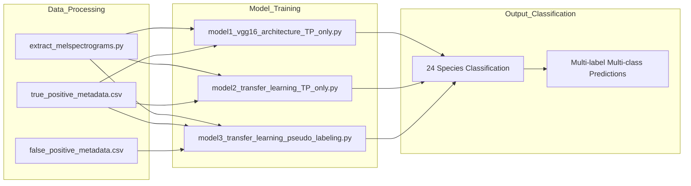

### Core System Components

| Component | File | Purpose | Data Input |
|-----------|------|---------|------------|
| Mel-Spectrogram Extraction | `extract_melspectrograms.py` | Convert audio to visual representations | Raw audio recordings |
| Baseline CNN | `model1_vgg16_architecture_TP_only.py` | VGG16 from scratch training | True positives only |
| Transfer Learning | `model2_transfer_learning_TP_only.py` | ResNet50 fine-tuning | True positives only |
| Advanced Semi-Supervised | `model3_transfer_learning_pseudo_labeling.py` | ResNet50 + pseudo-labeling | True positives + false positives |

**Sources:** [README.md:17-21]()

## Model Development Progression

The system implements three increasingly sophisticated deep learning approaches, enabling comparative analysis of different CNN architectures and training methodologies:

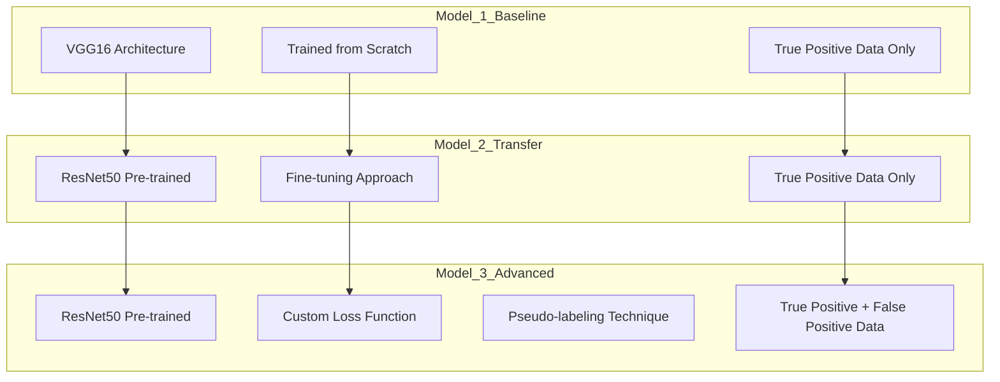

### Model Characteristics

**Model 1: VGG16 Baseline CNN**
- Architecture: Custom VGG16 implementation trained from scratch
- Training Data: True positive mel-spectrograms only
- Purpose: Establish baseline performance metrics

**Model 2: ResNet50 Transfer Learning**  
- Architecture: Pre-trained ResNet50 with fine-tuning
- Training Data: True positive mel-spectrograms only
- Purpose: Leverage pre-trained features for improved performance

**Model 3: Advanced ResNet50 with Pseudo-labeling**
- Architecture: Pre-trained ResNet50 with custom loss functions
- Training Data: True positive + false positive mel-spectrograms
- Purpose: Semi-supervised learning to maximize data utilization

**Sources:** [README.md:19-21]()

## Input Data Specifications

The system processes mel-spectrogram images derived from validated audio detections, implementing a multi-label multi-class classification framework:

### Data Format Requirements

| Data Type | File Extension | Resolution | Content |
|-----------|----------------|------------|---------|
| True Positive Spectrograms | `_tp.png` | 224x224 pixels | Confirmed species presence |
| False Positive Spectrograms | `_fp.png` | 224x224 pixels | Confirmed species absence |
| Metadata | `.csv` | Tabular | Species labels and validation status |

### Classification Framework
- **Task Type**: Multi-label multi-class classification
- **Target Species**: 24 bird and frog species
- **Input Format**: Mel-spectrogram images (224x224 RGB)
- **Output Format**: Species presence probability scores

**Sources:** [README.md:17-18]()

## Technology Stack and Dependencies

The system leverages a comprehensive technology stack optimized for audio processing and deep learning:

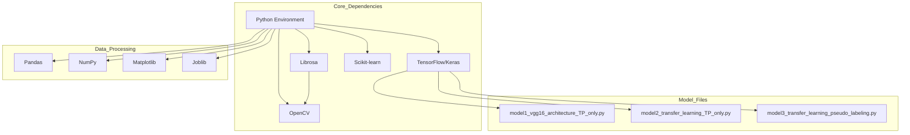

### Key Technology Components
- **Audio Processing**: Librosa for mel-spectrogram extraction
- **Image Processing**: OpenCV for spectrogram manipulation
- **Deep Learning**: TensorFlow/Keras for CNN implementation
- **Data Management**: Pandas and NumPy for data handling
- **Parallel Processing**: Joblib for performance optimization

**Sources:** [README.md:1-37]()

## Collaborative Framework

The project operates within a structured collaborative framework involving multiple Microsoft AI initiatives and external conservation partners:

### Partnership Structure
- **Microsoft AI for Earth**: Primary platform and infrastructure support
- **Microsoft AI for Good Research Lab**: Research methodology and validation
- **Sieve Analytics**: Data collection and domain expertise

### Open Source Contribution
The project welcomes contributions under the Microsoft Open Source Code of Conduct, requiring Contributor License Agreement (CLA) compliance for all submissions.

**Sources:** [README.md:5-6](), [README.md:24-36]()

---

# Page: System Architecture

# System Architecture

<details>
<summary>Relevant source files</summary>

The following files were used as context for generating this wiki page:

- [README.md](README.md)
- [extract_melspectrograms.py](extract_melspectrograms.py)
- [requirements.txt](requirements.txt)

</details>


This document provides a comprehensive overview of the Multi-Species Bioacoustic Classification system architecture, including core components, data flow patterns, and the relationship between the three deep learning models. For detailed information about individual models, see [Deep Learning Models](#4). For environment setup details, see [Environment Setup and Dependencies](#5).

## Overview

The system implements a multi-stage pipeline that transforms raw audio recordings into species classifications through mel-spectrogram extraction and deep learning models. The architecture consists of three primary subsystems: data processing, model training, and evaluation frameworks.

## Core System Components

### Data Processing Pipeline Architecture

The central component of the system is the mel-spectrogram extraction pipeline implemented in `extract_melspectrograms.py`. This module orchestrates the transformation from raw audio data to visual representations suitable for CNN processing.

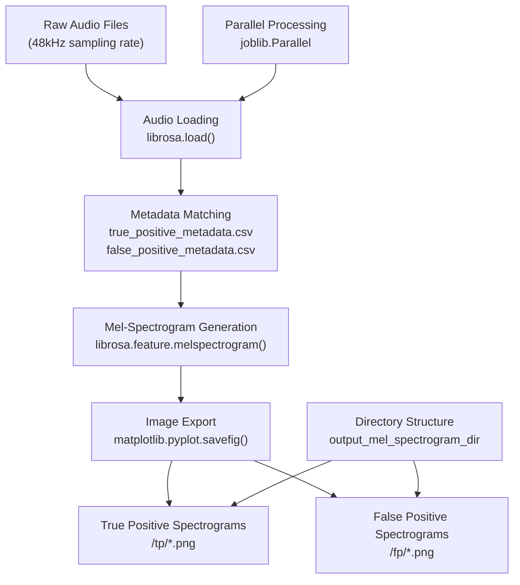

**Data Processing Pipeline Components**

The pipeline processes two distinct data types through parallel execution paths:

Sources: [extract_melspectrograms.py:50-56](), [extract_melspectrograms.py:147-161]()

### Model Training Architecture

The system implements three distinct model training approaches that operate on the same mel-spectrogram inputs but use different architectures and training strategies.

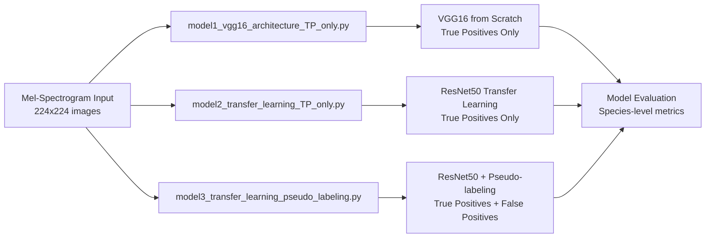

**Model Training Components**

Each model represents increasing sophistication in training methodology:

1. **Model 1**: Baseline CNN implementation using VGG16 architecture
2. **Model 2**: Transfer learning approach with pre-trained ResNet50
3. **Model 3**: Advanced semi-supervised learning with custom loss functions

Sources: [README.md:17-22]()

### Technology Stack Architecture

The system dependencies form a layered architecture supporting audio processing, machine learning, and parallel computation.

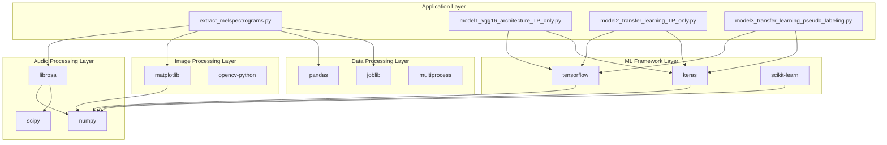

**Technology Stack Components**

The stack is organized into functional layers with clear dependencies between components.

Sources: [requirements.txt:1-11]()

## Data Flow Architecture

### Audio Processing Data Flow

The core data processing follows a systematic pipeline from raw audio files to labeled spectrograms ready for model training.

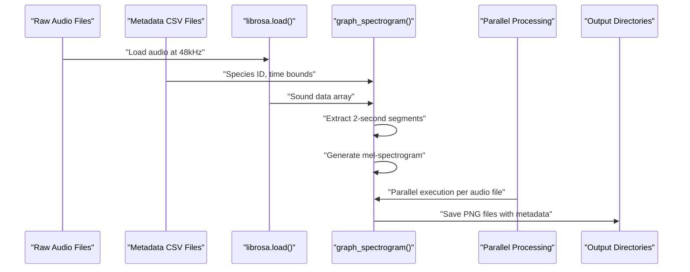

**Data Flow Implementation Details**

Key processing functions handle the transformation pipeline:

- `graph_spectrogram()`: Core spectrogram generation function [extract_melspectrograms.py:107-137]()
- `generate_spectrogram_tp()`: True positive processing wrapper [extract_melspectrograms.py:140-145]()
- `generate_spectrogram_fp()`: False positive processing wrapper [extract_melspectrograms.py:152-157]()

Sources: [extract_melspectrograms.py:107-161]()

### File Organization Structure

The system maintains a structured directory hierarchy that separates raw data, processed spectrograms, and model outputs.

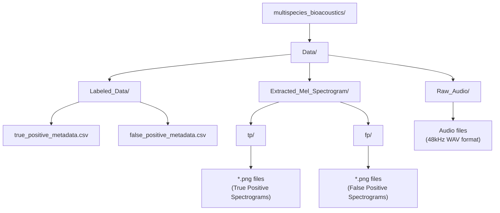

**Directory Structure Configuration**

The path configuration defines the complete file organization:

| Directory Variable | Purpose | Path |
|-------------------|---------|------|
| `current_dir` | Root project directory | `./multispecies_bioacoustics/` |
| `data_dir` | Main data directory | `Data/` |
| `labeled_data_dir` | Metadata CSV files | `Data/Labeled_Data/` |
| `audio_dir` | Raw audio recordings | `Data/Raw_Audio/` |
| `output_mel_spectrogram_dir` | Processed spectrograms | `Data/Extracted_Mel_Spectrogram/` |

Sources: [extract_melspectrograms.py:27-46]()

## Processing Configuration

### Spectrogram Generation Parameters

The mel-spectrogram extraction uses standardized parameters to ensure consistency across all model training:

| Parameter | Value | Purpose |
|-----------|-------|---------|
| Sampling Rate | 48,000 Hz | Audio loading resolution |
| Spectrogram Duration | 2 seconds | Fixed-length segments |
| Image Resolution | 300x300 pixels | CNN input size |
| DPI | 100 | Image quality setting |
| Audio Segment Extraction | `floor(t_min)` to `ceil(t_max)` | Time boundary calculation |

Sources: [extract_melspectrograms.py:108-124]()

### Parallel Processing Implementation

The system leverages multi-core processing for efficient spectrogram generation across large audio datasets.

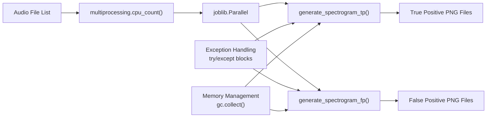

**Parallel Processing Configuration**

The implementation uses joblib for distributed processing with automatic core detection and memory management.

Sources: [extract_melspectrograms.py:147-161]()

## Model Integration Architecture

The three models operate independently but share common input formats and evaluation frameworks, enabling direct performance comparison.

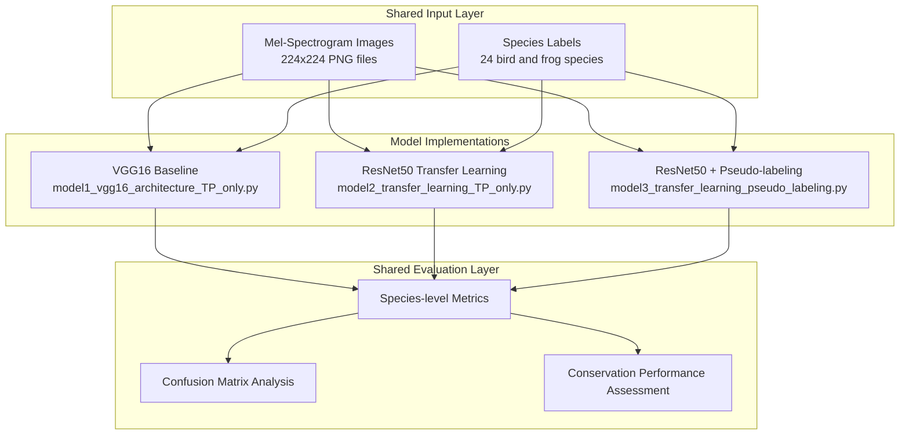

**Model Integration Points**

The architecture enables systematic comparison through standardized interfaces and shared evaluation metrics.

Sources: [README.md:17-22]()

---

# Page: Data Processing Pipeline

# Data Processing Pipeline

<details>
<summary>Relevant source files</summary>

The following files were used as context for generating this wiki page:

- [extract_melspectrograms.py](extract_melspectrograms.py)

</details>


## Purpose and Scope

This document covers the mel-spectrogram extraction pipeline, which serves as the foundational data processing component of the Multi-Species Bioacoustic Classification system. The pipeline transforms raw audio recordings and labeled metadata into standardized mel-spectrogram images suitable for deep learning model training and inference.

For information about the deep learning models that consume these spectrograms, see [Deep Learning Models](#4). For details about the input data formats and file organization requirements, see [Data Formats and File Organization](#6).

## Pipeline Overview

The data processing pipeline implemented in `extract_melspectrograms.py` performs three primary functions: metadata loading and matching, audio segment extraction, and mel-spectrogram generation. This pipeline processes both true positive (species present) and false positive (species absent) labeled data to create balanced training datasets.

### Data Flow Architecture

```mermaid
flowchart TD
    subgraph "Input_Data"
        A["`true_positive_metadata.csv`"]
        B["`false_positive_metadata.csv`"]
        C["`Raw_Audio/` directory"]
    end
    
    subgraph "Processing_Functions"
        D["`pd.read_csv()` metadata loading"]
        E["`audio filename matching`"]
        F["`graph_spectrogram()` function"]
        G["`librosa.feature.melspectrogram()`"]
    end
    
    subgraph "Output_Structure"
        H["`Extracted_Mel_Spectrogram/tp/` directory"]
        I["`Extracted_Mel_Spectrogram/fp/` directory"]
        J["`*.png spectrogram files`"]
    end
    
    A --> D
    B --> D
    C --> E
    D --> E
    E --> F
    F --> G
    G --> H
    G --> I
    H --> J
    I --> J
```

**Sources:** [extract_melspectrograms.py:48-57](), [extract_melspectrograms.py:107-137](), [extract_melspectrograms.py:139-161]()

## Input Data Processing

### Metadata Loading and Structure

The pipeline begins by loading two primary metadata files that contain labeled detection events with temporal and species information.

| Metadata File | Purpose | Key Columns |
|---------------|---------|-------------|
| `true_positive_metadata.csv` | Species presence detections | `species_id`, `uri`, `t_min`, `t_max`, `tod` |
| `false_positive_metadata.csv` | False alarm detections | `species_id`, `uri`, `t_min`, `t_max`, `tod` |

**Sources:** [extract_melspectrograms.py:50-56]()

### Audio File Matching Process

The pipeline implements a sophisticated matching algorithm to associate metadata records with corresponding raw audio files:

```mermaid
flowchart LR
    subgraph "URI_Parsing"
        A["`row['uri']`"]
        B["`project/site/year/month/filename`"]
        C["`audio_filename construction`"]
    end
    
    subgraph "Matching_Logic"
        D["`all_audio_filenames list`"]
        E["`filename in all_audio_filenames`"]
        F["`matched_audio_filename assignment`"]
    end
    
    subgraph "Time_Extraction"
        G["`floor(t_min)` -> sound_start_second"]
        H["`ceil(t_max)` -> sound_end_second"]
    end
    
    A --> B
    B --> C
    C --> E
    D --> E
    E --> F
    A --> G
    A --> H
```

**Sources:** [extract_melspectrograms.py:65-76](), [extract_melspectrograms.py:86-96]()

## Core Spectrogram Generation

### The `graph_spectrogram` Function

The central processing function `graph_spectrogram` handles the conversion from audio segments to mel-spectrogram images:

| Parameter | Purpose | Default Value |
|-----------|---------|---------------|
| `spectrogram_second_length` | Duration of audio segment | 2 seconds |
| `matched_labeled_data` | Filtered metadata DataFrame | - |
| `audio_filename` | Target audio file | - |
| `label` | Output directory designation | 'tp' or 'fp' |

**Key Processing Steps:**
1. **Audio Loading**: Uses `librosa.load()` with 48kHz sampling rate
2. **Segment Extraction**: Extracts 2-second audio windows based on detection timestamps
3. **Mel-Spectrogram Computation**: Applies `librosa.feature.melspectrogram()`
4. **Image Generation**: Saves 300x300 pixel PNG files with 100 DPI resolution

**Sources:** [extract_melspectrograms.py:107-137]()

### Audio Segment Boundary Handling

The pipeline implements intelligent boundary condition handling for audio segments that extend beyond file limits:

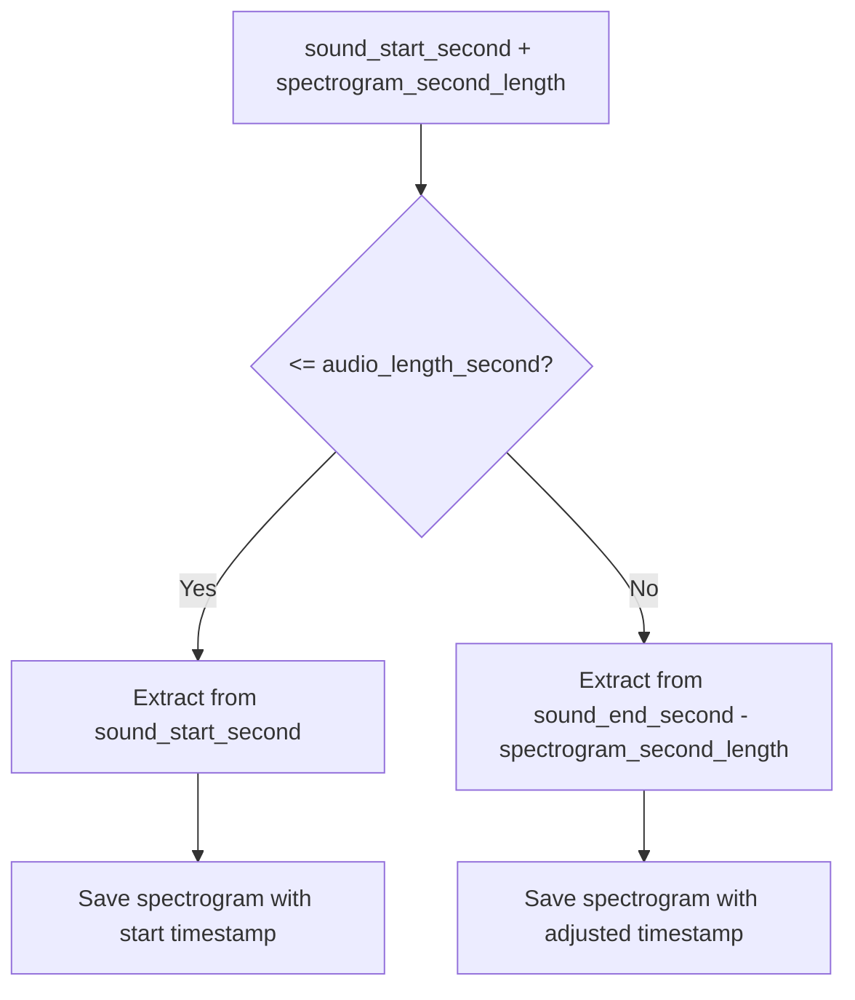

**Sources:** [extract_melspectrograms.py:117-134]()

## Parallel Processing Implementation

### Multi-Core Spectrogram Generation

The pipeline leverages `joblib.Parallel` for efficient multi-core processing of spectrogram generation:

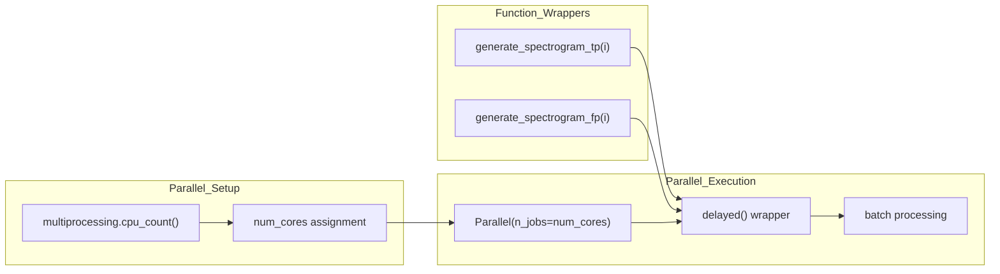

**Sources:** [extract_melspectrograms.py:147-149](), [extract_melspectrograms.py:159-161]()

## Output File Organization

### Directory Structure Creation

The pipeline automatically creates the required output directory structure:

```
Extracted_Mel_Spectrogram/
├── tp/                    # True positive spectrograms
└── fp/                    # False positive spectrograms
```

**Sources:** [extract_melspectrograms.py:34-45]()

### File Naming Convention

Generated spectrogram files follow a standardized naming pattern that preserves metadata:

```
{audio_filename_base}_{start_second}_{end_second}_{species_id}_{tod}_{label}.png
```

**Example:** `project_site_2020_01_recording_120_122_species_001_1200_tp.png`

**Sources:** [extract_melspectrograms.py:124](), [extract_melspectrograms.py:133]()

## Performance and Memory Management

### Memory Optimization

The pipeline implements several memory management strategies:

- **Garbage Collection**: Explicit `gc.collect()` calls after processing each audio file
- **Exception Handling**: Try-catch blocks prevent memory leaks from failed processing
- **Batch Processing**: Processing audio files in parallel rather than loading all simultaneously

**Sources:** [extract_melspectrograms.py:136](), [extract_melspectrograms.py:144-145](), [extract_melspectrograms.py:156-157]()

### Processing Requirements

| Resource | Requirement | Notes |
|----------|-------------|-------|
| CPU Cores | All available (`multiprocessing.cpu_count()`) | Parallel processing |
| Memory | ~48MB per audio file | 48kHz sampling rate |
| Storage | ~50KB per spectrogram | 300x300 PNG files |
| Dependencies | `librosa==0.6.3`, `joblib==0.12.0` | Version-specific |

**Sources:** [extract_melspectrograms.py:18](), [extract_melspectrograms.py:22](), [extract_melspectrograms.py:108]()

---

# Page: Deep Learning Models

# Deep Learning Models

<details>
<summary>Relevant source files</summary>

The following files were used as context for generating this wiki page:

- [README.md](README.md)
- [model1_vgg16_architecture_TP_only.py](model1_vgg16_architecture_TP_only.py)
- [model2_transfer_learning_TP_only.py](model2_transfer_learning_TP_only.py)
- [model3_transfer_learning_pseudo_labeling.py](model3_transfer_learning_pseudo_labeling.py)

</details>


This document provides a comprehensive overview of the three deep learning models implemented for multi-species bioacoustic classification. Each model represents a different approach to convolutional neural network (CNN) design and training methodology, progressing from baseline implementation to advanced semi-supervised learning techniques.

For information about the mel-spectrogram extraction process that feeds these models, see [Data Processing Pipeline](#3). For detailed implementation specifics of each individual model, see [Model 1: VGG16 Baseline CNN](#4.1), [Model 2: ResNet50 Transfer Learning](#4.2), and [Model 3: Advanced ResNet50 with Pseudo-labeling](#4.3).

## Model Architecture Overview

The system implements three distinct modeling approaches that enable comparative analysis of different CNN architectures and training strategies for bioacoustic classification tasks.

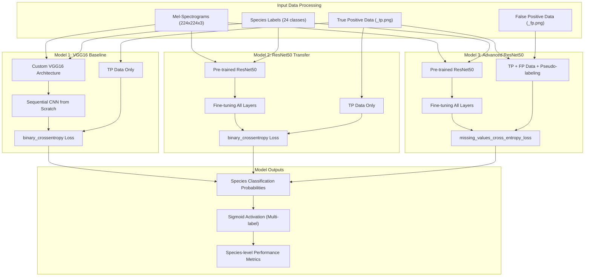

**Sources:** [README.md:17-21](), [model1_vgg16_architecture_TP_only.py:112-135](), [model2_transfer_learning_TP_only.py:112-135](), [model3_transfer_learning_pseudo_labeling.py:208-231]()

## Data Processing and Label Management

All three models utilize a consistent data preprocessing pipeline with species-specific label encoding and image standardization.

| Component | Implementation | File Reference |
|-----------|---------------|----------------|
| Image Dimensions | `ncol, nrow = 224, 224` | [model1_vgg16_architecture_TP_only.py:89]() |
| Normalization | `img = cv2.resize(img, (ncol, nrow)) / 255.0` | [model1_vgg16_architecture_TP_only.py:96]() |
| Label Encoding | `LabelBinarizer()` for multi-label classification | [model1_vgg16_architecture_TP_only.py:78]() |
| Species Filtering | Exclude insects: `['16769', '16770', '16772']` | [model1_vgg16_architecture_TP_only.py:60]() |
| Species Mapping | `species_id_class_dict` for class index lookup | [model1_vgg16_architecture_TP_only.py:83-86]() |

The species identification system extracts `species_id` from filenames using the pattern `filename.split('_')[-3]`, enabling automatic label assignment during both training and evaluation phases.

**Sources:** [model1_vgg16_architecture_TP_only.py:56-86](), [model2_transfer_learning_TP_only.py:56-86](), [model3_transfer_learning_pseudo_labeling.py:56-131]()

## Model Implementation Comparison


**Sources:** [model1_vgg16_architecture_TP_only.py:112-135](), [model2_transfer_learning_TP_only.py:112-135](), [model3_transfer_learning_pseudo_labeling.py:208-231]()

## Training Configuration and Optimization

All models share common training hyperparameters while differing in loss functions and data utilization strategies:

| Parameter | Value | Implementation |
|-----------|-------|---------------|
| Optimizer | `optimizers.adam(lr=0.0001, decay=1e-7)` | All models |
| Batch Size | `16` | All models |
| Epochs | `5` | Models 1 & 2; iterative in Model 3 |
| Validation Split | `test_size = 0.3` | All models |
| Activation Function | `sigmoid` (final layer) | All models |

### Model-Specific Loss Functions

**Models 1 & 2:** Standard `binary_crossentropy` for multi-label classification
**Model 3:** Custom `missing_values_cross_entropy_loss` function that handles NaN values in pseudo-labeled data

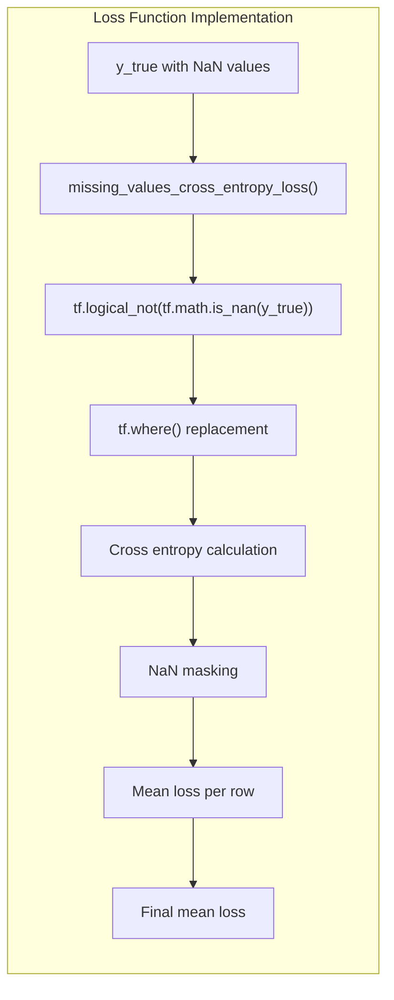

**Sources:** [model1_vgg16_architecture_TP_only.py:138-139](), [model2_transfer_learning_TP_only.py:134-135](), [model3_transfer_learning_pseudo_labeling.py:181-204]()

## Pseudo-labeling Implementation (Model 3)

Model 3 implements an iterative semi-supervised learning approach using pseudo-labeling with confidence thresholds:

| Component | Implementation | Purpose |
|-----------|---------------|---------|
| High Threshold | `threshold_score_high = 0.9` | Convert predictions ≥0.9 to positive labels |
| Low Threshold | `threshold_score_low = 0.1` | Convert predictions ≤0.1 to negative labels |
| Intermediate Range | `(0.1, 0.9)` | Maintain as `np.nan` (unlabeled) |
| Iterative Training | `for i in range(2)` | Two rounds of self-learning |
| Label Update | `y_train = np.maximum(y_train, y_train_pseudo_label)` | Merge original and pseudo labels |

The pseudo-labeling process operates on both True Positive and False Positive data, with False Positive labels initially set to 0 and updated through the iterative process.

**Sources:** [model3_transfer_learning_pseudo_labeling.py:235-244]()

## Model Persistence and Output Files

Each model saves its trained state using consistent file naming conventions:

| Model | Architecture File | Weights File |
|-------|------------------|--------------|
| Model 1 | `cnn__architecture.json` | `cnn_weights.h5` |
| Model 2 | `resnet_architecture.json` | `resnet_weights.h5` |
| Model 3 | `resnet_architecture_pseudo_label_TP_FP_0.01_0.99.json` | `resnet_weights_pseudo_label.h5` |

All models generate comprehensive evaluation metrics including species-level precision, recall, accuracy, F-score, TPR, TNR, and AUC values through the `evaluation_metrics_by_species` DataFrame.

**Sources:** [model1_vgg16_architecture_TP_only.py:153-157](), [model2_transfer_learning_TP_only.py:149-153](), [model3_transfer_learning_pseudo_labeling.py:254-258]()

## Prediction and Evaluation Pipeline

The prediction process follows a standardized approach across all models:

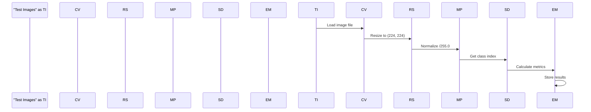

Each model extracts species predictions by indexing into the prediction array using `species_id_class_dict[species_id]`, enabling consistent species-level evaluation across different model architectures.

**Sources:** [model1_vgg16_architecture_TP_only.py:162-172](), [model2_transfer_learning_TP_only.py:158-168](), [model3_transfer_learning_pseudo_labeling.py:278-290]()

---

# Page: Model 1: VGG16 Baseline CNN

# Model 1: VGG16 Baseline CNN

<details>
<summary>Relevant source files</summary>

The following files were used as context for generating this wiki page:

- [model1_vgg16_architecture_TP_only.py](model1_vgg16_architecture_TP_only.py)

</details>


## Purpose and Scope

This document provides detailed documentation of Model 1, a VGG16 CNN architecture implementation that serves as the baseline model for multi-species bioacoustic classification. This model is trained from scratch using only True Positive (TP) labeled data and provides a foundation for comparing against more sophisticated approaches documented in Model 2 ([#4.2](#4.2)) and Model 3 ([#4.3](#4.3)). For information about the mel-spectrogram extraction process that feeds this model, see Data Processing Pipeline ([#3](#3)).

## Model 1 Overview

Model 1 implements a classic VGG16 convolutional neural network architecture trained from scratch without pre-trained weights. The model operates exclusively on True Positive labeled mel-spectrograms, representing the most straightforward deep learning approach to species classification.

### Key Characteristics

| Attribute | Value |
|-----------|-------|
| Architecture | VGG16 (Custom Implementation) |
| Training Data | True Positive only |
| Input Format | 224x224x3 mel-spectrogram images |
| Number of Species | 24 (excluding 3 insect species) |
| Loss Function | Binary Crossentropy |
| Optimizer | Adam (lr=0.0001, decay=1e-7) |

Sources: [model1_vgg16_architecture_TP_only.py:1-287]()

## Data Loading and Preprocessing Pipeline

### Mel-Spectrogram Data Loading

The model loads pre-processed mel-spectrograms from the data pipeline established in [#3](#3). The loading process filters out insect species and handles duplicate removal.

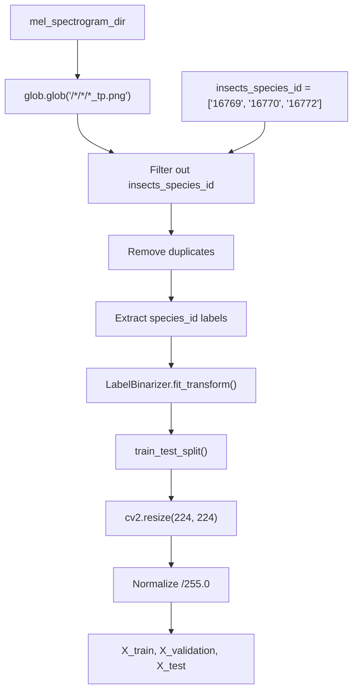

**Data Loading Process**

The preprocessing pipeline implements several critical steps:

1. **File Discovery**: Uses `glob.glob()` to locate TP mel-spectrograms
2. **Species Filtering**: Removes three insect species from the dataset
3. **Duplicate Handling**: Ensures unique mel-spectrograms per species
4. **Label Processing**: Converts species IDs to binary classification format
5. **Data Splitting**: 70% train/validation, 30% test split
6. **Image Preprocessing**: Resize to 224x224 and normalize pixel values

Sources: [model1_vgg16_architecture_TP_only.py:56-108]()

### Data Split Configuration

```mermaid
flowchart LR
    A["mel_spectrograms_tp<br/>labels_tp"] --> B["train_test_split<br/>test_size=0.3<br/>random_state=42"]
    B --> C["X_train_validation<br/>X_test"]
    C --> D["train_test_split<br/>test_size=0.3<br/>random_state=42"]
    D --> E["X_train<br/>X_validation"]
```

**Split Ratios**:
- Training: 49% (70% of 70%)
- Validation: 21% (30% of 70%)  
- Test: 30%

Sources: [model1_vgg16_architecture_TP_only.py:100-108]()

## VGG16 Model Architecture Implementation

### Network Structure

The model implements a standard VGG16 architecture using Keras Sequential API with specific layer configurations optimized for mel-spectrogram classification.

```mermaid
flowchart TD
    A["Input: (224, 224, 3)"] --> B["Conv2D(64, 3x3) + ReLU"]
    B --> C["Conv2D(64, 3x3) + ReLU"]
    C --> D["MaxPooling2D(2x2)"]
    D --> E["Conv2D(128, 3x3) + ReLU"]
    E --> F["Conv2D(128, 3x3) + ReLU"]
    F --> G["MaxPooling2D(2x2)"]
    G --> H["Conv2D(256, 3x3) + ReLU"]
    H --> I["Conv2D(256, 3x3) + ReLU"]
    I --> J["Conv2D(256, 3x3) + ReLU"]
    J --> K["MaxPooling2D(2x2)"]
    K --> L["Conv2D(512, 3x3) + ReLU"]
    L --> M["Conv2D(512, 3x3) + ReLU"]
    M --> N["Conv2D(512, 3x3) + ReLU"]
    N --> O["MaxPooling2D(2x2)"]
    O --> P["Conv2D(512, 3x3) + ReLU"]
    P --> Q["Conv2D(512, 3x3) + ReLU"]
    Q --> R["Conv2D(512, 3x3) + ReLU"]
    R --> S["MaxPooling2D(2x2)"]
    S --> T["Flatten()"]
    T --> U["Dense(4096) + ReLU"]
    U --> V["Dense(4096) + ReLU"]
    V --> W["Dense(number_of_classes) + Sigmoid"]
```

### Model Configuration Details

| Layer Block | Filters | Kernel Size | Activation | Pooling |
|-------------|---------|-------------|------------|---------|
| Block 1 | 64 | 3x3 | ReLU | 2x2 MaxPool |
| Block 2 | 128 | 3x3 | ReLU | 2x2 MaxPool |
| Block 3 | 256 | 3x3 | ReLU | 2x2 MaxPool |
| Block 4 | 512 | 3x3 | ReLU | 2x2 MaxPool |
| Block 5 | 512 | 3x3 | ReLU | 2x2 MaxPool |
| FC Layers | 4096, 4096, n_classes | - | ReLU, ReLU, Sigmoid | - |

Sources: [model1_vgg16_architecture_TP_only.py:112-135]()

### Model Compilation

The model uses binary crossentropy loss with Adam optimizer, configured for multi-label classification:

```python
optimizer = optimizers.adam(lr=0.0001, decay=1e-7)
model.compile(loss='binary_crossentropy', optimizer=optimizer, metrics=['accuracy'])
```

Sources: [model1_vgg16_architecture_TP_only.py:138-139]()

## Training Process

### Training Configuration

```mermaid
flowchart LR
    A["model.fit()"] --> B["batch_size=16"]
    A --> C["epochs=5"]
    A --> D["validation_data=(X_validation, y_validation)"]
    B --> E["Training History"]
    C --> E
    D --> E
    E --> F["model.save_weights()"]
    E --> G["model.to_json()"]
```

**Training Parameters**:
- Batch Size: 16
- Epochs: 5
- Validation: Concurrent validation on held-out data
- Monitoring: Accuracy and loss tracking

### Model Persistence

The training process saves two artifacts:
1. **Weights**: `cnn_weights.h5` - Trained model parameters
2. **Architecture**: `cnn__architecture.json` - Model structure definition

Sources: [model1_vgg16_architecture_TP_only.py:143-158]()

## Evaluation Framework

### Test Set Prediction Pipeline

The evaluation process handles both True Positive and False Positive data to generate comprehensive performance metrics.

```mermaid
flowchart TD
    A["X_test (TP data)"] --> B["model.predict()"]
    B --> C["Extract species-specific probabilities"]
    C --> D["output_tp DataFrame"]
    
    E["False Positive mel-spectrograms"] --> F["Load and preprocess"]
    F --> G["model.predict() (batch=1)"]
    G --> H["Extract species-specific probabilities"]
    H --> I["output_fp DataFrame"]
    
    D --> J["Species-level evaluation"]
    I --> J
    J --> K["evaluation_metrics_by_species"]
```

### Prediction Process for TP Data

```python
yhat_probs_tp = model.predict(X_test)
# Extract species-specific probability for each sample
species_id = filename.split('_')[-3]
predicted_probability = yhat_probs_tp[i][species_id_class_dict[species_id]]
```

### Prediction Process for FP Data

For False Positive data, the model processes images individually due to memory constraints:

```python
for i in range(len(directory_filenames_fp_unique)):
    img = cv2.imread(directory_filenames_fp_unique[i])
    img = cv2.resize(img, (ncol, nrow)) / 255.0
    yhat_prob = model.predict(np.asarray([img]))
    predicted_probability = yhat_prob[0][species_id_class_dict[species_id]]
```

Sources: [model1_vgg16_architecture_TP_only.py:162-214]()

## Performance Metrics Calculation

### Species-Level Evaluation Framework

```mermaid
flowchart TD
    A["output_tp + output_fp"] --> B["classification_threshold = 0.5"]
    B --> C["Calculate TP, FP, TN, FN per species"]
    C --> D["Precision = TP / (TP + FP)"]
    C --> E["Recall = TP / (TP + FN)"]
    C --> F["Accuracy = (TP + TN) / (TP + FP + TN + FN)"]
    C --> G["F_0.5_score = (1 + β²) * P * R / (β² * P + R)"]
    C --> H["TPR = TP / positive_cnt"]
    C --> I["TNR = TN / negative_cnt"]
    C --> J["AUC = roc_auc_score(y_true, y_scores)"]
    
    D --> K["evaluation_metrics_by_species"]
    E --> K
    F --> K
    G --> K
    H --> K
    I --> K
    J --> K
```

### Evaluation Metrics Output Structure

The `evaluation_metrics_by_species` DataFrame contains comprehensive per-species performance metrics:

| Column | Description |
|--------|-------------|
| `species_id` | Unique species identifier |
| `species_name` | Human-readable species name |
| `positive_cnt` | Number of TP samples |
| `negative_cnt` | Number of FP samples |
| `TP_cnt`, `FP_cnt`, `TN_cnt`, `FN_cnt` | Confusion matrix values |
| `Precision`, `Recall`, `Accuracy` | Standard classification metrics |
| `F_score` | F₀.₅ score (β=0.5) |
| `TPR`, `TNR` | True Positive/Negative Rates |
| `AUC` | Area Under ROC Curve |

Sources: [model1_vgg16_architecture_TP_only.py:231-286]()

### Classification Threshold

The model uses a fixed classification threshold of 0.5 for binary decisions:

```python
classification_threshold = 0.5
prediction_tp = len(output_tp.loc[output_tp.predicted_probability >= classification_threshold])
```

This threshold determines the boundary between positive and negative predictions for each species.

Sources: [model1_vgg16_architecture_TP_only.py:219-230]()

## Output Generation and File Structure

### Model Artifacts

The training process generates the following outputs in the `model_dir`:

1. **`cnn_weights.h5`** - Trained model weights
2. **`cnn__architecture.json`** - Model architecture definition

### Evaluation Outputs

The evaluation process creates DataFrames containing:

1. **`output_tp`** - TP predictions with probabilities
2. **`output_fp`** - FP predictions with probabilities  
3. **`evaluation_metrics_by_species`** - Comprehensive per-species metrics

These outputs provide the foundation for model comparison documented in Model Evaluation and Metrics ([#7](#7)).

Sources: [model1_vgg16_architecture_TP_only.py:153-287]()

---

# Page: Model 2: ResNet50 Transfer Learning

# Model 2: ResNet50 Transfer Learning

<details>
<summary>Relevant source files</summary>

The following files were used as context for generating this wiki page:

- [model2_transfer_learning_TP_only.py](model2_transfer_learning_TP_only.py)

</details>


## Purpose and Scope

This document covers the ResNet50 transfer learning implementation for multi-species bioacoustic classification. Model 2 represents an intermediate approach between the baseline VGG16 CNN (see [Model 1: VGG16 Baseline CNN](#4.1)) and the advanced pseudo-labeling methodology (see [Model 3: Advanced ResNet50 with Pseudo-labeling](#4.3)). 

Model 2 leverages pre-trained ResNet50 weights from ImageNet and fine-tunes the entire network using only True Positive labeled mel-spectrogram data. This approach demonstrates the effectiveness of transfer learning for bioacoustic classification tasks while maintaining a simpler training paradigm compared to semi-supervised learning methods.

For information about the mel-spectrogram extraction that feeds this model, see [Data Processing Pipeline](#3). For details about model evaluation metrics and comparison methodology, see [Model Evaluation and Metrics](#7).

## Model Architecture

Model 2 implements a transfer learning approach using ResNet50 as the feature extraction backbone with custom classification layers appended for the 24-species classification task.

### ResNet50 Base Architecture

```mermaid
flowchart TD
    subgraph "Pre-trained ResNet50 Base"
        A[Input: "224x224x3 mel-spectrograms"]
        B[ResNet50_conv: "weights='imagenet'"]
        C[include_top: "False"]
        D[Trainable: "True for all layers"]
    end
    
    subgraph "Custom Classification Head"
        E[Flatten]
        F[Dense: "512 units, ReLU activation"]
        G[Dropout: "0.5 rate"]
        H[Dense: "number_of_classes, sigmoid activation"]
    end
    
    subgraph "Training Configuration"
        I[Loss: "binary_crossentropy"]
        J[Optimizer: "Adam lr=0.0001"]
        K[Metrics: "accuracy"]
    end
    
    A --> B
    B --> C
    C --> D
    D --> E
    E --> F
    F --> G
    G --> H
    
    H --> I
    H --> J
    H --> K
```

**ResNet50 Transfer Learning Architecture**

Sources: [model2_transfer_learning_TP_only.py:112-137]()

### Key Architecture Components

| Component | Implementation | Purpose |
|-----------|---------------|---------|
| `ResNet50_conv` | Pre-trained ImageNet weights, `include_top=False` | Feature extraction backbone |
| `Flatten` | Standard Keras layer | Convert 2D feature maps to 1D |
| `Dense(512)` | ReLU activation | Feature dimensionality reduction |
| `Dropout(0.5)` | Regularization layer | Prevent overfitting |
| `Dense(number_of_classes)` | Sigmoid activation | Multi-label classification output |

The model uses `layer.trainable = True` for all ResNet50 layers, enabling full fine-tuning rather than feature extraction only.

Sources: [model2_transfer_learning_TP_only.py:114-132]()

## Data Preprocessing Pipeline

### Mel-Spectrogram Loading and Species Filtering

```mermaid
flowchart LR
    subgraph "Data Discovery"
        A[glob.glob: "mel_spectrogram_dir/*/*_tp.png"]
        B[Filter: "Remove insects_species_id=['16769','16770','16772']"]
        C[Extract: "species_id from filename"]
    end
    
    subgraph "Image Processing"
        D[cv2.imread: "Load PNG files"]
        E[cv2.resize: "224x224 dimensions"]
        F[Normalize: "Divide by 255.0"]
    end
    
    subgraph "Label Processing"
        G[LabelBinarizer: "Species ID to one-hot"]
        H[Counter: "Class distribution analysis"]
        I[species_id_class_dict: "ID to class mapping"]
    end
    
    A --> B
    B --> C
    C --> D
    D --> E
    E --> F
    
    C --> G
    G --> H
    G --> I
```

**Model 2 Data Preprocessing Flow**

The preprocessing pipeline implements species filtering to remove insect species and standardizes image dimensions to match ResNet50 input requirements.

Sources: [model2_transfer_learning_TP_only.py:56-99]()

### Train/Validation/Test Split Strategy

```mermaid
flowchart TD
    subgraph "Data Split Configuration"
        A[Total_TP_Data: "mel_spectrograms_tp"]
        B[train_test_split: "test_size=0.3, random_state=42"]
        C[X_train_validation: "70% of total"]
        D[X_test: "30% of total"]
    end
    
    subgraph "Training Split"
        E[train_test_split: "test_size=0.3, random_state=42"]
        F[X_train: "49% of total"]
        G[X_validation: "21% of total"]
    end
    
    A --> B
    B --> C
    B --> D
    C --> E
    E --> F
    E --> G
```

**Train/Validation/Test Data Splitting Strategy**

| Split | Percentage | Purpose |
|-------|------------|---------|
| Training | 49% | Model parameter optimization |
| Validation | 21% | Hyperparameter tuning and early stopping |
| Test | 30% | Final model evaluation |

Sources: [model2_transfer_learning_TP_only.py:100-107]()

## Training Process

### Model Compilation and Training Configuration

The training process uses Adam optimizer with a low learning rate suitable for fine-tuning pre-trained networks:

```python
optimizer = optimizers.adam(lr=0.0001, decay=1e-7)
model.compile(loss='binary_crossentropy', optimizer=optimizer, metrics=['accuracy'])
```

Training parameters:
- **Batch size**: 16
- **Epochs**: 5 
- **Loss function**: `binary_crossentropy` (multi-label classification)
- **Learning rate**: 0.0001 with decay rate 1e-7

Sources: [model2_transfer_learning_TP_only.py:134-139]()

### Model Persistence

```mermaid
flowchart LR
    subgraph "Model Saving"
        A[model.save_weights: "resnet_weights.h5"]
        B[model.to_json: "resnet_architecture.json"]
    end
    
    subgraph "Training History"
        C[model_history.history: "Training metrics"]
        D[plt.plot: "Accuracy visualization"]
    end
    
    A --> B
    C --> D
```

**Model Persistence and Training Monitoring**

Sources: [model2_transfer_learning_TP_only.py:148-153]()

## Evaluation Methodology

### Prediction Pipeline for Test Data

Model 2 evaluates performance on both True Positive and False Positive test data to assess real-world classification capability:

```mermaid
flowchart TD
    subgraph "TP Test Evaluation"
        A[X_test: "True Positive test spectrograms"]
        B[model.predict: "yhat_probs_tp"]
        C[species_id_class_dict: "Map species to probability"]
    end
    
    subgraph "FP Test Evaluation"
        D[directory_filenames_fp: "False Positive spectrograms"]
        E[cv2.imread + cv2.resize: "Individual image processing"]
        F[model.predict: "yhat_prob per image"]
    end
    
    subgraph "Output DataFrames"
        G[output_tp: "TP predictions with probabilities"]
        H[output_fp: "FP predictions with probabilities"]
    end
    
    A --> B
    B --> C
    C --> G
    
    D --> E
    E --> F
    F --> H
```

**Test Data Prediction Pipeline**

Sources: [model2_transfer_learning_TP_only.py:158-209]()

### Species-Level Metrics Calculation

The evaluation framework computes comprehensive metrics for each of the 24 species:

| Metric | Formula | Purpose |
|--------|---------|---------|
| `Precision` | TP / (TP + FP) | Positive prediction accuracy |
| `Recall` | TP / (TP + FN) | True positive detection rate |
| `F_score` | F_0.5 score with β=0.5 | Weighted harmonic mean favoring precision |
| `TPR` | TP / positive_cnt | True positive rate |
| `TNR` | TN / negative_cnt | True negative rate |
| `AUC` | Area under ROC curve | Overall discrimination ability |

```mermaid
flowchart LR
    subgraph "Metric Calculation Loop"
        A[evaluation_metrics_by_species: "DataFrame initialization"]
        B[species_id: "Iterate through species"]
        C[classification_threshold: "0.5"]
    end
    
    subgraph "Confusion Matrix Elements"
        D[tp: "TP predictions >= threshold"]
        E[fn: "TP predictions < threshold"]
        F[fp: "FP predictions >= threshold"]
        G[tn: "FP predictions < threshold"]
    end
    
    subgraph "ROC Calculation"
        H[y_true: "Combine TP/FP ground truth"]
        I[y_scores: "Combine prediction probabilities"]
        J[roc_auc_score: "Calculate AUC"]
    end
    
    A --> B
    B --> C
    C --> D
    C --> E
    C --> F
    C --> G
    
    D --> H
    E --> H
    F --> I
    G --> I
    H --> J
    I --> J
```

**Species-Level Evaluation Metrics Computation**

Sources: [model2_transfer_learning_TP_only.py:227-282]()

## Key Implementation Details

### Memory Management

The implementation includes explicit memory cleanup to handle large mel-spectrogram datasets:

```python
## free-up memory
del mel_spectrograms_tp
del labels_tp
```

This occurs after training completion and before False Positive evaluation to prevent memory overflow.

Sources: [model2_transfer_learning_TP_only.py:170-172]()

### False Positive Processing Strategy

Unlike training which processes all TP data in batches, FP evaluation processes images individually to accommodate memory constraints:

```python
for i in range(len(directory_filenames_fp_unique)):
    temp = []
    img = cv2.imread(directory_filenames_fp_unique[i]) 
    img = cv2.resize(img, (ncol, nrow)) / 255.0
    temp.append(img)   
    yhat_prob = model.predict(np.asarray(temp))
```

This approach enables evaluation on large FP datasets without memory limitations.

Sources: [model2_transfer_learning_TP_only.py:197-204]()

### Species ID to Class Label Mapping

The model maintains bidirectional mapping between species IDs and class indices:

```python
species_id_class_dict = dict()
for (class_label, species_id) in enumerate(lb.classes_):
    species_id_class_dict[species_id] = class_label
```

This mapping enables extraction of species-specific probabilities from the multi-class output during evaluation.

Sources: [model2_transfer_learning_TP_only.py:83-86]()

---

# Page: Model 3: Advanced ResNet50 with Pseudo-labeling

# Model 3: Advanced ResNet50 with Pseudo-labeling

<details>
<summary>Relevant source files</summary>

The following files were used as context for generating this wiki page:

- [model3_transfer_learning_pseudo_labeling.py](model3_transfer_learning_pseudo_labeling.py)

</details>


## Purpose and Scope

This document covers Model 3, the most sophisticated deep learning approach in the Multi-Species Bioacoustic Classification system. Model 3 implements a ResNet50-based transfer learning architecture enhanced with pseudo-labeling techniques and custom loss functions designed to handle both True Positive (TP) and False Positive (FP) mel-spectrogram data.

Unlike Models 1 and 2 which use only True Positive data, Model 3 leverages semi-supervised learning by incorporating False Positive samples to improve model robustness and generalization. For information about the simpler baseline approaches, see [Model 1: VGG16 Baseline CNN](#4.1) and [Model 2: ResNet50 Transfer Learning](#4.2). For details on the mel-spectrogram preprocessing pipeline that feeds this model, see [Data Processing Pipeline](#3).

## Architecture Overview

Model 3 combines transfer learning with pseudo-labeling in a semi-supervised learning framework. The architecture builds upon a pre-trained ResNet50 backbone with custom modifications for multi-species classification.

**Architecture Diagram**
```mermaid
flowchart TD
    subgraph "Input Data"
        A["mel_spectrograms_tp_sample"] --> B["X_train_tp"]
        C["mel_spectrograms_fp_sample"] --> D["X_train_fp"]
        E["labels_tp_sample"] --> F["y_train_tp"]
        G["labels_fp_sample"] --> H["y_train_fp"]
    end
    
    subgraph "Data Concatenation"
        B --> I["X_train = np.concatenate([X_train_tp, X_train_fp])"]
        D --> I
        F --> J["y_train = np.concatenate([y_train_tp, y_train_fp])"]
        H --> J
    end
    
    subgraph "Model Architecture"
        K["ResNet50_conv"] --> L["Flatten()"]
        L --> M["Dense(512, activation='relu')"]
        M --> N["Dropout(0.5)"]
        N --> O["Dense(number_of_classes, activation='sigmoid')"]
    end
    
    subgraph "Training Process"
        P["missing_values_cross_entropy_loss"]
        Q["Pseudo-labeling Loop"]
        R["threshold_score_high = 0.9"]
        S["threshold_score_low = 0.1"]
    end
    
    I --> K
    J --> P
    P --> Q
    Q --> R
    Q --> S
```

Sources: [model3_transfer_learning_pseudo_labeling.py:157-171](), [model3_transfer_learning_pseudo_labeling.py:209-233]()

## Data Processing Pipeline

Model 3 processes both True Positive and False Positive mel-spectrograms with specialized label encoding to support pseudo-labeling.

**Data Processing Flow**
```mermaid
flowchart LR
    subgraph "File Discovery"
        A["directory_filenames_tp"] --> B["filenames_label_tp"]
        C["directory_filenames_fp"] --> D["filenames_label_fp"]
    end
    
    subgraph "Species Filtering"
        E["insects_species_id = ['16769', '16770', '16772']"]
        B --> E
        D --> E
    end
    
    subgraph "Label Processing"
        F["LabelBinarizer lb_tp"]
        G["LabelBinarizer lb_fp"]
        H["labels_tp_sample[labels_tp_sample == 0] = np.nan"]
        I["labels_fp_sample[labels_fp_sample == 1] = 0"]
    end
    
    subgraph "Image Loading"
        J["cv2.imread()"]
        K["cv2.resize(img, (224, 224))"]
        L["img / 255.0"]
    end
    
    E --> F
    E --> G
    F --> H
    G --> I
    H --> J
    I --> J
    J --> K
    K --> L
```

Sources: [model3_transfer_learning_pseudo_labeling.py:57-77](), [model3_transfer_learning_pseudo_labeling.py:104-131](), [model3_transfer_learning_pseudo_labeling.py:135-152]()

### Label Encoding Strategy

The model uses a sophisticated label encoding approach:

- **True Positive Labels**: Binary-encoded with zeros replaced by `np.nan` to indicate missing labels for other species
- **False Positive Labels**: Binary-encoded with ones converted to zeros (indicating negative examples)
- **Species Mapping**: `species_id_class_dict` maintains mapping between species IDs and class indices

| Data Type | Encoding Strategy | Purpose |
|-----------|------------------|---------|
| True Positive | `1` for target species, `np.nan` for others | Positive examples with missing labels |
| False Positive | `0` for all species | Negative examples for pseudo-labeling |

Sources: [model3_transfer_learning_pseudo_labeling.py:104-131]()

## Custom Loss Function

Model 3 implements a specialized loss function `missing_values_cross_entropy_loss` to handle the presence of `np.nan` values in the label matrix, enabling effective training with partial labels.

### Loss Function Implementation

The `missing_values_cross_entropy_loss` function handles missing values through a masking mechanism:

```python
def missing_values_cross_entropy_loss(y_true, y_pred):
    # Creates mask for non-NaN values
    y_true_not_nan_mask = tf.logical_not(tf.math.is_nan(y_true))
    
    # Replaces NaN with zeros for computation
    y_true_nan_replaced = tf.where(tf.math.is_nan(y_true), tf.zeros_like(y_true), y_true)
    
    # Applies mask to ignore loss from missing labels
    cross_entropy_loss_discarded_nan_labels = cross_entropy_loss * tf.cast(y_true_not_nan_mask, tf.float32)
```

**Loss Function Flow**
```mermaid
flowchart TD
    A["y_true with np.nan values"] --> B["tf.math.is_nan(y_true)"]
    B --> C["y_true_not_nan_mask"]
    A --> D["tf.where() replacement"]
    D --> E["y_true_nan_replaced"]
    E --> F["Cross Entropy Calculation"]
    C --> G["Mask Application"]
    F --> G
    G --> H["Mean Loss Computation"]
    H --> I["Final Loss Value"]
```

Sources: [model3_transfer_learning_pseudo_labeling.py:181-204]()

## Model Architecture

The model builds upon ResNet50 with custom classification layers optimized for multi-species audio classification.

### ResNet50 Configuration

| Component | Configuration | Details |
|-----------|--------------|---------|
| Base Model | `ResNet50(weights='imagenet')` | Pre-trained on ImageNet |
| Input Shape | `(224, 224, 3)` | RGB mel-spectrogram images |
| Trainable | `layer.trainable = True` | All layers fine-tunable |
| Top Layers | `include_top=False` | Custom classification head |

### Classification Head

The custom classification layers replace ResNet50's original top:

1. **Global Average Pooling**: Implicit through `Flatten()`
2. **Dense Layer**: 512 units with ReLU activation
3. **Dropout**: 0.5 dropout rate for regularization  
4. **Output Layer**: Multi-label classification with sigmoid activation

Sources: [model3_transfer_learning_pseudo_labeling.py:209-233]()

## Pseudo-labeling Process

Model 3 implements an iterative pseudo-labeling approach that progressively refines labels based on model predictions.

**Pseudo-labeling Workflow**
```mermaid
flowchart TD
    A["Initial Training"] --> B["model.fit(X_train, y_train)"]
    B --> C["y_train_pred_prob = model.predict(X_train)"]
    C --> D["Threshold Application"]
    
    subgraph "Threshold Logic"
        E["threshold_score_high = 0.9"]
        F["threshold_score_low = 0.1"]
        G["np.where(pred >= 0.9, 1, pred)"]
        H["np.where(pred <= 0.1, 0, pred)"]
        I["np.where((0.1 < pred < 0.9), np.nan, pred)"]
    end
    
    D --> E
    D --> F
    E --> G
    F --> H
    G --> I
    H --> I
    I --> J["y_train_pseudo_label"]
    J --> K["y_train = np.maximum(y_train, y_train_pseudo_label)"]
    K --> L["Next Iteration"]
    L --> B
```

### Pseudo-labeling Parameters

The algorithm uses confidence thresholds to determine label assignments:

- **High Confidence Threshold**: `threshold_score_high = 0.9` - Predictions above this become positive labels
- **Low Confidence Threshold**: `threshold_score_low = 0.1` - Predictions below this become negative labels  
- **Uncertain Region**: Predictions between thresholds remain as `np.nan` (unlabeled)
- **Iteration Count**: 2 iterations with 5 epochs each

Sources: [model3_transfer_learning_pseudo_labeling.py:235-244]()

## Training Workflow

The training process combines standard supervised learning with iterative pseudo-labeling refinement.

### Training Configuration

| Parameter | Value | Purpose |
|-----------|-------|---------|
| Optimizer | `adam(lr=0.0001, decay=1e-7)` | Fine-tuning learning rate |
| Batch Size | 16 | Memory-efficient processing |
| Epochs per Iteration | 5 | Short iterations for label updates |
| Total Iterations | 2 | Pseudo-labeling cycles |

### Training Loop Structure

1. **Initial Training**: Model trains on original labels for 5 epochs
2. **Prediction Generation**: `model.predict(X_train)` generates confidence scores
3. **Label Update**: High/low confidence predictions become hard labels
4. **Label Merging**: `np.maximum(y_train, y_train_pseudo_label)` preserves original positive labels
5. **Iteration**: Process repeats for specified iterations

Sources: [model3_transfer_learning_pseudo_labeling.py:237-251]()

## Evaluation Framework

Model 3 implements comprehensive evaluation on both True Positive and False Positive test sets with species-level metrics.

**Evaluation Pipeline**
```mermaid
flowchart LR
    subgraph "Test Data Processing"
        A["directory_filenames_tp_unique_test"] --> B["output_tp_test DataFrame"]
        C["directory_filenames_fp_unique_test"] --> D["output_fp_test DataFrame"]
    end
    
    subgraph "Prediction Generation"
        E["cv2.imread() + cv2.resize()"]
        F["model.predict()"]
        G["species_id_class_dict lookup"]
    end
    
    subgraph "Metrics Calculation"
        H["evaluation_metrics_by_species DataFrame"]
        I["TP, FP, TN, FN counts"]
        J["Precision, Recall, F-score"]
        K["TPR, TNR, AUC"]
    end
    
    B --> E
    D --> E
    E --> F
    F --> G
    G --> H
    H --> I
    I --> J
    I --> K
```

### Species-Level Metrics

The evaluation framework computes comprehensive metrics for each of the 24 target species:

| Metric | Formula | Purpose |
|--------|---------|---------|
| Precision | `TP / (TP + FP)` | Positive prediction accuracy |
| Recall | `TP / (TP + FN)` | True positive detection rate |
| F-score | `(1 + β²) * P * R / (β² * P + R)` | Harmonic mean with β=0.5 |
| TPR | `TP / positive_cnt` | True positive rate |
| TNR | `TN / negative_cnt` | True negative rate |
| AUC | `roc_auc_score(y_true, y_scores)` | Area under ROC curve |

### Output Data Structures

- **output_tp_test**: DataFrame containing TP test results with columns `['filename', 'tp_fp', 'species_id', 'predicted_probability']`
- **output_fp_test**: DataFrame containing FP test results with identical structure
- **evaluation_metrics_by_species**: Comprehensive metrics table for each species

Sources: [model3_transfer_learning_pseudo_labeling.py:335-391]()

## Model Persistence

The trained model artifacts are saved for deployment and further analysis:

- **Model Weights**: `resnet_weights_pseudo_label.h5` - Trained parameters
- **Model Architecture**: `resnet_architecture_pseudo_label_TP_FP_0.01_0.99.json` - Network structure

Sources: [model3_transfer_learning_pseudo_labeling.py:254-258]()

---

# Page: Environment Setup and Dependencies

# Environment Setup and Dependencies

<details>
<summary>Relevant source files</summary>

The following files were used as context for generating this wiki page:

- [.gitignore](.gitignore)
- [requirements.txt](requirements.txt)

</details>


This document provides comprehensive guidance for setting up the Python environment and installing dependencies required to run the Multi-Species Bioacoustic Classification system. It covers the technology stack, dependency relationships, and step-by-step installation procedures necessary for data processing, model training, and evaluation workflows.

For information about the overall system architecture and how these dependencies support different components, see [System Architecture](#2). For details about specific model implementations that utilize these dependencies, see [Deep Learning Models](#4).

## System Requirements and Technology Stack

The Multi-Species Bioacoustic Classification system requires a Python environment with specific machine learning, audio processing, and computer vision libraries. The system is designed to work with standard scientific computing infrastructure and does not require specialized hardware, though GPU acceleration is recommended for model training.

### Core Technology Stack Overview

```mermaid
graph TB
    subgraph "Python Environment"
        A["Python 3.x Runtime"]
    end
    
    subgraph "Deep Learning Framework"
        B["tensorflow"]
        C["keras"]
    end
    
    subgraph "Scientific Computing"
        D["numpy"]
        E["scipy"]
        F["pandas"]
        G["scikit-learn==0.22"]
    end
    
    subgraph "Audio & Image Processing"
        H["opencv-python"]
        I["matplotlib"]
    end
    
    subgraph "Parallel Processing"
        J["joblib"]
        K["multiprocess"]
        L["glob2"]
    end
    
    A --> B
    A --> C
    A --> D
    A --> E
    A --> F
    A --> G
    A --> H
    A --> I
    A --> J
    A --> K
    A --> L
    
    B --> D
    C --> B
    G --> D
    H --> D
    I --> D
    J --> D
    K --> D
```

**Dependency Stack Architecture**

This diagram illustrates the hierarchical dependency relationships where `tensorflow` and `keras` form the deep learning foundation, while scientific computing libraries provide numerical operations support, and specialized libraries handle audio/image processing and parallel execution.

Sources: [requirements.txt:1-11]()

### Dependency-to-Component Mapping

```mermaid
graph LR
    subgraph "Data Processing Pipeline"
        A["extract_melspectrograms.py"]
    end
    
    subgraph "Model Training Scripts"
        B["model1_vgg16_architecture_TP_only.py"]
        C["model2_transfer_learning_TP_only.py"] 
        D["model3_transfer_learning_pseudo_labeling.py"]
    end
    
    subgraph "Core Dependencies"
        E["tensorflow + keras"]
        F["opencv-python"]
        G["numpy + scipy"]
        H["pandas"]
        I["joblib + multiprocess"]
        J["matplotlib"]
        K["scikit-learn==0.22"]
        L["glob2"]
    end
    
    A --> F
    A --> G
    A --> I
    A --> L
    
    B --> E
    B --> G
    B --> K
    
    C --> E
    C --> G
    C --> K
    
    D --> E
    D --> G
    D --> K
    
    A --> H
    A --> J
    
    B --> J
    C --> J
    D --> J
```

**Component-Dependency Relationships**

This diagram maps specific Python modules and scripts to their required dependencies, showing how `extract_melspectrograms.py` relies heavily on image processing and parallel computing libraries, while the model training scripts primarily use deep learning and evaluation frameworks.

Sources: [requirements.txt:1-11]()

## Dependency Analysis and Roles

The following table details each dependency's specific role within the bioacoustic classification system:

| Dependency | Version | Primary Role | Used By |
|------------|---------|--------------|---------|
| `numpy` | Latest | Numerical arrays and mathematical operations | All components |
| `pandas` | Latest | Data manipulation and CSV handling | Metadata processing |
| `glob2` | Latest | Advanced file pattern matching | File discovery |
| `matplotlib` | Latest | Visualization and plotting | Results analysis |
| `joblib` | Latest | Parallel processing and caching | Mel-spectrogram extraction |
| `keras` | Latest | High-level neural network API | All model implementations |
| `tensorflow` | Latest | Deep learning framework backend | All model implementations |
| `multiprocess` | Latest | Enhanced multiprocessing capabilities | Parallel data processing |
| `scipy` | Latest | Scientific computing functions | Signal processing |
| `scikit-learn` | 0.22 | Machine learning utilities and metrics | Model evaluation |
| `opencv-python` | Latest | Computer vision and image processing | Spectrogram manipulation |

Sources: [requirements.txt:1-11]()

### Critical Version Dependencies

The system specifies `scikit-learn==0.22` as a pinned version requirement. This specific version ensures compatibility with the evaluation metrics and preprocessing functions used throughout the model training and validation workflows.

## Installation Workflow

### Environment Setup Process

```mermaid
flowchart TD
    A["Clone Repository"] --> B["Verify Python 3.x"]
    B --> C["Create Virtual Environment"]
    C --> D["Activate Environment"]
    D --> E["Install Dependencies"]
    E --> F["Verify Installation"]
    F --> G["Environment Ready"]
    
    subgraph "Installation Commands"
        H["pip install -r requirements.txt"]
    end
    
    subgraph "Verification Steps"
        I["Import tensorflow"]
        J["Import opencv-python"] 
        K["Import librosa"]
        L["Test GPU availability"]
    end
    
    E --> H
    F --> I
    F --> J
    F --> K
    F --> L
```

**Installation and Verification Workflow**

This diagram outlines the recommended sequence for setting up the development environment, from repository cloning through dependency verification.

Sources: [requirements.txt:1-11]()

### Step-by-Step Installation

1. **Repository Setup**
   ```bash
   git clone https://github.com/microsoft/Multi_Species_Bioacoustic_Classification
   cd Multi_Species_Bioacoustic_Classification
   ```

2. **Python Environment Creation**
   ```bash
   python -m venv bioacoustic_env
   source bioacoustic_env/bin/activate  # On Windows: bioacoustic_env\Scripts\activate
   ```

3. **Dependency Installation**
   ```bash
   pip install -r requirements.txt
   ```

4. **Installation Verification**
   ```python
   import tensorflow as tf
   import cv2
   import pandas as pd
   import numpy as np
   import sklearn
   print(f"TensorFlow version: {tf.__version__}")
   print(f"GPU available: {tf.config.list_physical_devices('GPU')}")
   ```

Sources: [requirements.txt:1-11]()

## Development Environment Configuration

### Git Configuration and Ignored Files

The repository includes comprehensive `.gitignore` configuration to exclude development artifacts, temporary files, and platform-specific directories. Key exclusions include:

- Python cache files: `__pycache__/`, `*.pyc` [.gitignore:306-307]()
- Visual Studio artifacts: `.vs/`, build directories [.gitignore:35-44]()
- Log files and temporary outputs: `*.log`, `*.tmp` [.gitignore:88-94]()
- Node.js and package directories: `node_modules/` [.gitignore:276]()

### System Compatibility

The dependency configuration supports cross-platform development:

- **Windows**: Full Visual Studio integration with extensive `.gitignore` coverage
- **Linux/macOS**: Standard Python scientific computing stack
- **GPU Acceleration**: TensorFlow with CUDA support for accelerated training

Sources: [.gitignore:1-351](), [requirements.txt:1-11]()

## Hardware Recommendations

| Component | Minimum | Recommended |
|-----------|---------|-------------|
| RAM | 8 GB | 16+ GB |
| Storage | 10 GB free | 50+ GB SSD |
| GPU | None (CPU only) | NVIDIA GPU with 4+ GB VRAM |
| CPU | 4 cores | 8+ cores |

The system can operate on CPU-only configurations, but GPU acceleration significantly improves training performance for the deep learning models, particularly the VGG16 and ResNet50 architectures.

## Environment Verification and Troubleshooting

After installation, verify the environment supports all critical operations:

```python
# Core functionality test
import tensorflow as tf
import cv2
import numpy as np
import pandas as pd
from sklearn.metrics import classification_report

# Check TensorFlow GPU availability
print("GPU Available:", tf.config.list_physical_devices('GPU'))

# Verify OpenCV image processing
test_image = np.zeros((224, 224, 3), dtype=np.uint8)
resized = cv2.resize(test_image, (224, 224))
print("OpenCV functional:", resized.shape == (224, 224, 3))

# Test parallel processing capability
from joblib import Parallel, delayed
result = Parallel(n_jobs=2)(delayed(lambda x: x**2)(i) for i in range(4))
print("Parallel processing functional:", len(result) == 4)
```

This verification script tests the core dependencies required for mel-spectrogram processing, model training, and evaluation workflows.

Sources: [requirements.txt:6-11]()

---

# Page: Data Formats and File Organization

# Data Formats and File Organization

<details>
<summary>Relevant source files</summary>

The following files were used as context for generating this wiki page:

- [extract_melspectrograms.py](extract_melspectrograms.py)
- [model1_vgg16_architecture_TP_only.py](model1_vgg16_architecture_TP_only.py)

</details>


This document describes the data formats, file organization, and naming conventions used throughout the Multi-Species Bioacoustic Classification system. It covers input data structures (metadata CSV files and raw audio), output formats (mel-spectrograms), and the directory hierarchy that organizes the entire data pipeline.

For information about the data processing pipeline that transforms these formats, see [Data Processing Pipeline](#3). For details about model training using these organized data formats, see [Deep Learning Models](#4).

## Directory Structure

The system follows a hierarchical directory structure that separates raw inputs, processed outputs, and model artifacts:

```mermaid
graph TD
    root["./multispecies_bioacoustics/"]
    data["Data/"]
    labeled["Labeled_Data/"]
    raw["Raw_Audio/"]
    extracted["Extracted_Mel_Spectrogram/"]
    tp["tp/"]
    fp["fp/"]
    model["Model/"]
    output["Output/"]
    
    root --> data
    root --> model
    root --> output
    data --> labeled
    data --> raw
    data --> extracted
    extracted --> tp
    extracted --> fp
    
    labeled --> csv1["true_positive_metadata.csv"]
    labeled --> csv2["false_positive_metadata.csv"]
    raw --> audio["*.wav audio files"]
    tp --> png1["*_tp.png spectrograms"]
    fp --> png2["*_fp.png spectrograms"]
    model --> weights["cnn_weights.h5"]
    model --> arch["cnn_architecture.json"]
```

Sources: [extract_melspectrograms.py:27-46](), [model1_vgg16_architecture_TP_only.py:36-52]()

## Input Data Formats

### Metadata CSV Files

The system uses two primary metadata files that contain labeled detection data:

| File | Purpose | Key Columns |
|------|---------|-------------|
| `true_positive_metadata.csv` | Contains confirmed species detections | `species_id`, `uri`, `t_min`, `t_max`, `tod` |
| `false_positive_metadata.csv` | Contains false positive detections | `species_id`, `uri`, `t_min`, `t_max`, `tod` |

Each metadata record includes:
- **species_id**: Numeric identifier for the detected species
- **uri**: File path reference to the source audio recording
- **t_min/t_max**: Time boundaries of the detection in seconds
- **tod**: Time of day when the detection occurred

Sources: [extract_melspectrograms.py:50-56]()

### Raw Audio Files

Raw audio recordings are stored with a structured naming convention derived from the URI metadata:

```mermaid
graph LR
    uri["URI: project/site/year/month/filename"]
    arrow[" → "]
    audio["Audio filename: project_site_year_month_filename"]
    
    uri --> arrow
    arrow --> audio
```

Audio files are processed with the following specifications:
- **Sample Rate**: 48kHz (specified in `librosa.load()`)
- **Format**: WAV files
- **Duration**: Variable length recordings from field deployments

Sources: [extract_melspectrograms.py:70-75](), [extract_melspectrograms.py:108]()

## Output Data Formats

### Mel-Spectrogram Images

The system generates mel-spectrogram images as the primary input format for deep learning models:

**Image Specifications:**
- **Resolution**: 300x300 pixels at 100 DPI
- **Duration**: 2-second audio segments
- **Format**: PNG files with transparent background
- **Processing**: Power-to-dB conversion using `librosa.power_to_db()`

**Directory Organization:**
- True positives: `Extracted_Mel_Spectrogram/tp/`
- False positives: `Extracted_Mel_Spectrogram/fp/`

Sources: [extract_melspectrograms.py:118-134]()

### Mel-Spectrogram File Naming Convention

The system uses a structured naming convention that encodes multiple metadata fields:

```
{audio_filename}_{start_second}_{end_second}_{species_id}_{tod}_{label}.png
```

**Naming Components:**
- **audio_filename**: Source audio file (without extension)
- **start_second**: Start time of the audio segment
- **end_second**: End time of the audio segment  
- **species_id**: Numeric species identifier
- **tod**: Time of day (first 4 characters)
- **label**: Either "tp" (true positive) or "fp" (false positive)

**Example:**
```
project_site_2019_05_recording001_45_47_12345_0630_tp.png
```

This represents a 2-second segment (45-47 seconds) from a recording, containing species ID 12345, detected at 06:30, labeled as a true positive.

Sources: [extract_melspectrograms.py:124](), [extract_melspectrograms.py:133]()

## Species Identification System

### Species ID Extraction

The system extracts species identifiers from filenames during model training and evaluation:

```mermaid
graph LR
    filename["Filename: ...12345_0630_tp.png"]
    split["Split by '_'"]
    extract["Extract index -3"]
    species["Species ID: 12345"]
    
    filename --> split
    split --> extract
    extract --> species
```

**Implementation Details:**
- Species ID is extracted using `filename.split('_')[-3]`
- Insect species (IDs: 16769, 16770, 16772) are filtered out during processing
- Species IDs are mapped to class labels using `LabelBinarizer`

Sources: [model1_vgg16_architecture_TP_only.py:61](), [model1_vgg16_architecture_TP_only.py:60](), [model1_vgg16_architecture_TP_only.py:78-86]()

### Image Processing Pipeline

The mel-spectrogram images undergo standardized preprocessing before model training:

| Step | Operation | Parameters |
|------|-----------|------------|
| Load | `cv2.imread()` | Read PNG file |
| Resize | `cv2.resize()` | Target: 224x224 pixels |
| Normalize | Division by 255.0 | Convert to [0,1] range |

Sources: [model1_vgg16_architecture_TP_only.py:95-97]()

## Data Processing Workflow

The complete data transformation follows this sequence:

```mermaid
flowchart TD
    csv["Metadata CSV Files<br/>true_positive_metadata.csv<br/>false_positive_metadata.csv"]
    audio["Raw Audio Files<br/>*.wav recordings"]
    match["Audio Matching<br/>extract_melspectrograms.py:65-96"]
    extract["Spectrogram Extraction<br/>graph_spectrogram()"]
    save["Save PNG Files<br/>tp/ and fp/ directories"]
    load["Model Data Loading<br/>glob.glob() pattern matching"]
    preprocess["Image Preprocessing<br/>224x224 resize + normalization"]
    
    csv --> match
    audio --> match
    match --> extract
    extract --> save
    save --> load
    load --> preprocess
    
    save --> tp_files["*_tp.png files"]
    save --> fp_files["*_fp.png files"]
```

**Key Processing Functions:**
- `graph_spectrogram()`: Generates mel-spectrograms from audio segments
- `generate_spectrogram_tp()` / `generate_spectrogram_fp()`: Parallel processing wrappers
- File pattern matching: `mel_spectrogram_dir + '/*/*/*_tp.png'`

Sources: [extract_melspectrograms.py:107-161](), [model1_vgg16_architecture_TP_only.py:56-98]()

## Data Validation and Quality Control

### Duplicate Handling

The system implements deduplication logic to ensure unique training samples:

```python
# Create unique filename-label pairs
filenames_label_tp = list(set([(filename, species_id) for ...]))
```

### Audio File Matching

Audio files are validated against metadata through a matching process:
- Files not found in the audio directory are marked as "No Matched Audio"
- Only successfully matched files proceed to spectrogram extraction

Sources: [extract_melspectrograms.py:61-76](), [model1_vgg16_architecture_TP_only.py:61-63]()

---

# Page: Model Evaluation and Metrics

# Model Evaluation and Metrics

<details>
<summary>Relevant source files</summary>

The following files were used as context for generating this wiki page:

- [model1_vgg16_architecture_TP_only.py](model1_vgg16_architecture_TP_only.py)
- [model2_transfer_learning_TP_only.py](model2_transfer_learning_TP_only.py)
- [model3_transfer_learning_pseudo_labeling.py](model3_transfer_learning_pseudo_labeling.py)

</details>


This document describes the comprehensive evaluation framework used to assess the performance of the three deep learning models in the Multi-Species Bioacoustic Classification System. The evaluation methodology provides both aggregate system-level metrics and detailed species-level performance analysis across 24 bird and frog species. For information about the individual model architectures being evaluated, see [Deep Learning Models](#4).

## Evaluation Framework Overview

The system implements a standardized evaluation pipeline that operates consistently across all three models (VGG16 baseline, ResNet50 transfer learning, and ResNet50 with pseudo-labeling). Each model generates predictions on held-out test data consisting of both True Positive (TP) and False Positive (FP) mel-spectrograms.

```mermaid
flowchart TD
    A["Test Data"] --> B["True Positive Images<br/>(*_tp.png)"]
    A --> C["False Positive Images<br/>(*_fp.png)"]
    
    B --> D["Model Prediction<br/>model.predict()"]
    C --> D
    
    D --> E["Probability Extraction<br/>species_id_class_dict"]
    
    E --> F["Classification Threshold<br/>threshold = 0.5"]
    
    F --> G["Confusion Matrix<br/>TP, FP, TN, FN"]
    
    G --> H["Overall Metrics<br/>precision, recall, f_score"]
    G --> I["Species-Level Metrics<br/>evaluation_metrics_by_species"]
    
    I --> J["Performance Analysis<br/>Precision, Recall, Accuracy<br/>F_score, TPR, TNR, AUC"]
```

**Evaluation Pipeline Architecture**

Sources: [model1_vgg16_architecture_TP_only.py:219-286](), [model2_transfer_learning_TP_only.py:215-282](), [model3_transfer_learning_pseudo_labeling.py:324-391]()

## Metrics Definitions and Calculations

The evaluation framework calculates a comprehensive set of binary classification metrics for each species. All metrics use a fixed classification threshold of `0.5` to convert predicted probabilities into binary predictions.

### Core Metrics

| Metric | Formula | Code Implementation |
|--------|---------|-------------------|
| **Precision** | `TP / (TP + FP)` | `tp / (tp + fp)` |
| **Recall** | `TP / (TP + FN)` | `tp / (tp + fn)` |
| **Accuracy** | `(TP + TN) / (TP + FP + TN + FN)` | `(tp + tn) / (tp + fp + tn + fn)` |
| **F-Score** | `(1 + β²) × Precision × Recall / (β² × Precision + Recall)` | `beta = 0.5` |
| **TPR** | `TP / (TP + FN)` | `tp / positive_cnt` |
| **TNR** | `TN / (TN + FP)` | `tn / negative_cnt` |
| **AUC** | Area Under ROC Curve | `roc_auc_score(y_true, y_scores)` |

### F-Score Configuration

The system uses **F₀.₅ Score** (`beta = 0.5`) which emphasizes precision over recall. This choice is appropriate for conservation applications where false positives (incorrectly identifying a species) can be more costly than false negatives.

```python
beta = 0.5
f_score = (1 + beta**2) * precision * recall / (beta**2 * precision + recall)
```

Sources: [model1_vgg16_architecture_TP_only.py:225-226](), [model2_transfer_learning_TP_only.py:221-222](), [model3_transfer_learning_pseudo_labeling.py:330-331]()

## Species-Level Evaluation Process

Each model generates detailed per-species performance metrics through a systematic evaluation loop that processes each of the 24 target species individually.

```mermaid
flowchart LR
    A["species_id_class_dict"] --> B["Species Loop<br/>for i in range(len(evaluation_metrics_by_species))"]
    
    B --> C["Extract Species Data<br/>output_tp.loc[output_tp.species_id == species_id]<br/>output_fp.loc[output_fp.species_id == species_id]"]
    
    C --> D["Calculate Confusion Matrix<br/>tp = len(...predicted_probability >= 0.5)<br/>fn = len(...predicted_probability < 0.5)<br/>fp = len(...predicted_probability >= 0.5)<br/>tn = len(...predicted_probability < 0.5)"]
    
    D --> E["Compute Metrics<br/>precision, recall, accuracy<br/>f_score, tpr, tnr"]
    
    E --> F["AUC Calculation<br/>roc_auc_score(y_true, y_scores)"]
    
    F --> G["evaluation_metrics_by_species<br/>DataFrame Update"]
```

**Species-Level Metrics Calculation Flow**

### Data Structure: `evaluation_metrics_by_species`

The evaluation results are stored in a standardized DataFrame with the following schema:

| Column | Type | Description |
|--------|------|-------------|
| `species_id` | string | Unique species identifier |
| `species_name` | string | Human-readable species name |
| `positive_cnt` | int | Total TP samples for species |
| `negative_cnt` | int | Total FP samples for species |
| `TP_cnt` | int | True positives at threshold 0.5 |
| `FP_cnt` | int | False positives at threshold 0.5 |
| `TN_cnt` | int | True negatives at threshold 0.5 |
| `FN_cnt` | int | False negatives at threshold 0.5 |
| `Precision` | float | Species precision score |
| `Recall` | float | Species recall score |
| `Accuracy` | float | Species accuracy score |
| `F_score` | float | Species F₀.₅ score |
| `TPR` | float | True positive rate |
| `TNR` | float | True negative rate |
| `AUC` | float | Area under ROC curve |

Sources: [model1_vgg16_architecture_TP_only.py:231-286](), [model2_transfer_learning_TP_only.py:227-282](), [model3_transfer_learning_pseudo_labeling.py:335-391]()

## Model Comparison Methodology

The three models use different evaluation strategies that reflect their training methodologies:

```mermaid
graph TD
    subgraph "Model 1: VGG16 Baseline"
        A1["Training Data: TP Only"] --> B1["Test Evaluation: TP + FP"]
        B1 --> C1["Standard binary_crossentropy"]
        C1 --> D1["Species Metrics Output"]
    end
    
    subgraph "Model 2: ResNet50 Transfer"
        A2["Training Data: TP Only"] --> B2["Test Evaluation: TP + FP"]
        B2 --> C2["Standard binary_crossentropy"]
        C2 --> D2["Species Metrics Output"]
    end
    
    subgraph "Model 3: ResNet50 + Pseudo-labeling"
        A3["Training Data: TP + FP"] --> B3["Test Evaluation: TP + FP"]
        B3 --> C3["missing_values_cross_entropy_loss"]
        C3 --> D3["Species Metrics Output"]
        
        E3["Pseudo-labeling Thresholds<br/>high = 0.9, low = 0.1"] --> A3
    end
    
    D1 --> F["Comparative Analysis"]
    D2 --> F
    D3 --> F
```

**Model Evaluation Strategy Comparison**

### Model 3 Custom Loss Function

Model 3 implements a specialized loss function that handles missing labels (NaN values) for pseudo-labeling:

```python
def missing_values_cross_entropy_loss(y_true, y_pred):
    epsilon = 1.0e-30
    y_true_not_nan_mask = tf.logical_not(tf.math.is_nan(y_true))
    y_true_nan_replaced = tf.where(tf.math.is_nan(y_true), tf.zeros_like(y_true), y_true)
    # ... cross entropy calculation with NaN handling
    cross_entropy_loss_discarded_nan_labels = cross_entropy_loss * tf.cast(y_true_not_nan_mask, tf.float32)
    return K.mean(K.mean(cross_entropy_loss_discarded_nan_labels, axis=1))
```

This function enables the model to train on both labeled TP data and pseudo-labeled FP data, where uncertain predictions are marked as NaN and excluded from loss calculation.

Sources: [model3_transfer_learning_pseudo_labeling.py:181-204]()

## Prediction and Probability Extraction

All models follow a consistent prediction workflow for generating species-specific probability scores:

```mermaid
flowchart LR
    A["Test Image<br/>cv2.imread()"] --> B["Preprocessing<br/>cv2.resize(224, 224)<br/>/ 255.0"]
    
    B --> C["Model Prediction<br/>model.predict(np.asarray([img]))"]
    
    C --> D["Species ID Extraction<br/>filename.split('_')[-3]"]
    
    D --> E["Probability Lookup<br/>yhat_prob[0][species_id_class_dict[species_id]]"]
    
    E --> F["Output DataFrame<br/>filename, tp_fp, species_id<br/>predicted_probability"]
```

**Prediction Pipeline for Test Data**

The `species_id_class_dict` mapping is crucial for extracting the correct probability from the model's multi-class output vector. This dictionary maps species IDs to class indices in the model's output layer.

Sources: [model1_vgg16_architecture_TP_only.py:168-172](), [model2_transfer_learning_TP_only.py:164-168](), [model3_transfer_learning_pseudo_labeling.py:287-290]()

## Output Visualization and Analysis

The evaluation framework generates probability distribution visualizations and summary statistics:

```python
plt.hist(output_tp_test['predicted_probability'])
plt.hist(output_fp_test['predicted_probability'])

classification_threshold = 0.5
prediction_tp = len(output_tp_test.loc[output_tp_test.predicted_probability >= classification_threshold])
prediction_fn = len(output_tp_test.loc[output_tp_test.predicted_probability < classification_threshold])
prediction_fp = len(output_fp_test.loc[output_fp_test.predicted_probability >= classification_threshold])
```

The histograms provide insight into the model's confidence distribution for true positive versus false positive samples, enabling assessment of the model's ability to distinguish between genuine species detections and false alarms.

Sources: [model1_vgg16_architecture_TP_only.py:216-222](), [model2_transfer_learning_TP_only.py:212-218](), [model3_transfer_learning_pseudo_labeling.py:321-327]()

---

# Page: Contributing and Development Guidelines

# Contributing and Development Guidelines

<details>
<summary>Relevant source files</summary>

The following files were used as context for generating this wiki page:

- [CODE_OF_CONDUCT.md](CODE_OF_CONDUCT.md)
- [LICENSE](LICENSE)
- [SECURITY.md](SECURITY.md)

</details>


This document provides essential guidelines for contributing to the Multi-Species Bioacoustic Classification project, including code of conduct, security reporting procedures, licensing requirements, and development practices. For information about setting up the technical environment and dependencies, see [Environment Setup and Dependencies](#5).

## Purpose and Scope

This page covers the organizational and procedural aspects of contributing to the project, including community standards, security practices, and legal requirements. The guidelines ensure consistent, secure, and collaborative development while maintaining the project's conservation mission and Microsoft's open source standards.

## Code of Conduct

The project operates under the Microsoft Open Source Code of Conduct, which establishes community standards and behavioral expectations for all contributors.

### Community Standards

| Aspect | Requirement | Contact |
|--------|-------------|---------|
| Code of Conduct | [Microsoft Open Source Code of Conduct](https://opensource.microsoft.com/codeofconduct/) | [opencode@microsoft.com](mailto:opencode@microsoft.com) |
| Questions/Concerns | FAQ available | [Microsoft Code of Conduct FAQ](https://opensource.microsoft.com/codeofconduct/faq/) |
| Enforcement | Community-driven moderation | Direct contact required for violations |

The code of conduct applies to all project spaces, including GitHub issues, pull requests, documentation, and any communication channels.

**Sources:** [CODE_OF_CONDUCT.md:1-10]()

## Security Guidelines

Microsoft maintains strict security standards for all repositories. The project follows established vulnerability disclosure and reporting procedures.

### Security Vulnerability Reporting Process

```mermaid
flowchart TD
    A["Security Issue Discovered"] --> B{"Public GitHub Issue?"}
    B -->|"No"| C["Report to MSRC"]
    B -->|"Yes"| D["DO NOT REPORT"]
    
    C --> E["https://msrc.microsoft.com/create-report"]
    C --> F["secure@microsoft.com"]
    
    E --> G["24-hour Response Expected"]
    F --> G
    
    G --> H["Provide Detailed Information"]
    
    H --> I["- Issue Type<br/>- Source File Paths<br/>- Reproduction Steps<br/>- Impact Assessment"]
    
    I --> J["Microsoft Security Response<br/>Coordinated Vulnerability Disclosure"]
    
    style D fill:#ff9999
    style C fill:#99ff99
```

### Required Security Information

When reporting security vulnerabilities, include the following details:

| Information Type | Description | Example |
|-----------------|-------------|---------|
| Issue Type | Classification of vulnerability | Buffer overflow, injection, XSS |
| Source Files | Full paths to affected files | `extract_melspectrograms.py`, `model3_transfer_learning_pseudo_labeling.py` |
| Location | Git reference or URL | Specific branch, commit, or tag |
| Configuration | Special setup requirements | Environment variables, data paths |
| Reproduction | Step-by-step instructions | Command sequences, input data |
| Proof of Concept | Exploit code if available | Minimal working example |
| Impact | Potential attack vectors | Data exposure, code execution |

### Security Response Timeline

- **24 hours**: Initial response expected from Microsoft Security Response Center
- **Follow-up**: Required if no initial response received
- **Languages**: English preferred for all communications
- **Policy**: Coordinated Vulnerability Disclosure principle

**Sources:** [SECURITY.md:1-42]()

## Licensing Requirements

The project operates under the MIT License with specific attribution requirements for Microsoft Corporation.

### License Terms

```mermaid
flowchart LR
    A["MIT License"] --> B["Copyright: Microsoft Corporation"]
    
    B --> C["Permissions"]
    B --> D["Conditions"]
    B --> E["Limitations"]
    
    C --> F["- Use<br/>- Modify<br/>- Distribute<br/>- Sublicense<br/>- Sell"]
    
    D --> G["- Include Copyright Notice<br/>- Include License Text"]
    
    E --> H["- No Warranty<br/>- No Liability<br/>- AS-IS Provision"]
```

### Attribution Requirements

All contributions and derivative works must include:

1. **Copyright Notice**: `Copyright (c) Microsoft Corporation.`
2. **License Text**: Full MIT License text must be preserved
3. **Distribution**: All copies and substantial portions must include both notice and license

### Contribution Rights

Contributors grant Microsoft Corporation the right to:
- Use contributed code under the MIT License terms
- Modify and redistribute contributions
- Sublicense contributions as part of the larger project
- Include contributions in commercial and non-commercial applications

**Sources:** [LICENSE:1-22]()

## Contributing Process

### Development Workflow

```mermaid
flowchart TD
    A["Fork Repository"] --> B["Clone Fork"]
    B --> C["Create Feature Branch"]
    C --> D["Implement Changes"]
    
    D --> E["Test Changes"]
    E --> F{"Tests Pass?"}
    F -->|"No"| D
    F -->|"Yes"| G["Commit Changes"]
    
    G --> H["Push to Fork"]
    H --> I["Create Pull Request"]
    
    I --> J["Code Review"]
    J --> K{"Review Approved?"}
    K -->|"No"| L["Address Feedback"]
    L --> D
    K -->|"Yes"| M["Merge to Main"]
    
    subgraph "Testing Requirements"
        N["Model Performance Tests"]
        O["Data Processing Validation"]
        P["Security Compliance"]
    end
    
    E --> N
    E --> O
    E --> P
```

### Code Standards

| Component | Standard | Validation |
|-----------|----------|------------|
| Python Code | PEP 8 compliance | Automated linting |
| Model Files | Consistent naming convention | File path validation |
| Documentation | Technical accuracy | Peer review |
| Data Processing | Reproducible results | Output verification |
| Dependencies | Version compatibility | Environment testing |

### Key Files and Modules for Contributors

When contributing to different aspects of the system, focus on these core modules:

| Contribution Area | Primary Files | Key Functions/Classes |
|------------------|---------------|----------------------|
| Data Processing | `extract_melspectrograms.py` | Audio processing pipeline |
| Model Architecture | `model1_vgg16_architecture_TP_only.py` | VGG16 implementation |
| Transfer Learning | `model2_transfer_learning_TP_only.py` | ResNet50 fine-tuning |
| Advanced Models | `model3_transfer_learning_pseudo_labeling.py` | Pseudo-labeling implementation |
| Evaluation | Model evaluation scripts | Metrics calculation |

### Quality Assurance Requirements

1. **Model Performance**: Contributions affecting model training must demonstrate equivalent or improved performance on existing test datasets
2. **Data Integrity**: Changes to data processing must preserve spectrogram quality and species classification accuracy
3. **Backwards Compatibility**: New features should not break existing model loading or prediction capabilities
4. **Documentation**: All new functions and classes require docstring documentation following existing patterns

## Development Environment Guidelines

### Environment Consistency

Contributions must work within the established technology stack:

```mermaid
graph TB
    A["Python Environment"] --> B["Core Dependencies"]
    A --> C["Development Tools"]
    
    B --> D["TensorFlow/Keras"]
    B --> E["Librosa"]
    B --> F["OpenCV"]
    B --> G["Scikit-learn"]
    
    C --> H["Version Control"]
    C --> I["Testing Framework"]
    C --> J["Code Quality Tools"]
    
    D --> K["Model Training"]
    E --> L["Audio Processing"]
    F --> M["Image Processing"]
    G --> N["Evaluation Metrics"]
```

### Required Development Practices

| Practice | Requirement | Implementation |
|----------|-------------|----------------|
| Dependency Management | Pin specific versions | Update `requirements.txt` |
| Code Documentation | Comprehensive docstrings | Follow existing patterns |
| Error Handling | Robust exception handling | Validate inputs and outputs |
| Logging | Informative progress tracking | Use consistent logging levels |
| File Organization | Maintain directory structure | Follow existing conventions |

### Testing Requirements

Contributors must ensure their changes:
1. **Pass existing tests**: All current functionality must remain intact
2. **Include new tests**: New features require corresponding test cases
3. **Validate model outputs**: Changes to models must verify prediction accuracy
4. **Test data compatibility**: Ensure compatibility with existing mel-spectrogram formats

## Review and Approval Process

### Review Criteria

Pull requests undergo evaluation based on:

| Criteria | Evaluation Focus | Reviewer Responsibility |
|----------|------------------|------------------------|
| Technical Accuracy | Algorithm correctness | Domain expert review |
| Conservation Impact | Species identification performance | Conservation specialist review |
| Code Quality | Standards compliance | Technical reviewer |
| Security | Vulnerability assessment | Security-focused review |
| Documentation | Clarity and completeness | Documentation reviewer |

### Approval Requirements

- **Technical Review**: At least one technical reviewer approval
- **Conservation Review**: Validation of biological/conservation accuracy
- **Security Review**: Security compliance verification for significant changes
- **Maintainer Approval**: Final approval from project maintainers

**Sources:** [CODE_OF_CONDUCT.md:1-10](), [SECURITY.md:1-42](), [LICENSE:1-22]()

---

# Page: API Reference

# API Reference

<details>
<summary>Relevant source files</summary>

The following files were used as context for generating this wiki page:

- [extract_melspectrograms.py](extract_melspectrograms.py)
- [model1_vgg16_architecture_TP_only.py](model1_vgg16_architecture_TP_only.py)
- [model2_transfer_learning_TP_only.py](model2_transfer_learning_TP_only.py)
- [model3_transfer_learning_pseudo_labeling.py](model3_transfer_learning_pseudo_labeling.py)

</details>


This document provides a comprehensive technical reference for the core functions, classes, and parameters used throughout the Multi-Species Bioacoustic Classification system. It covers the mel-spectrogram extraction pipeline, the three deep learning models, data structures, and configuration parameters.

For information about system architecture and data flow, see [System Architecture](#2). For guidance on environment setup and dependencies, see [Environment Setup and Dependencies](#5). For model evaluation methodologies, see [Model Evaluation and Metrics](#7).

## Core Data Processing Functions

### `graph_spectrogram()`

The primary function for extracting mel-spectrograms from audio files and generating visual representations.

**Function Signature:**
```python
def graph_spectrogram(spectrogram_second_length, matched_labeled_data, audio_filename, label):
```

**Parameters:**
- `spectrogram_second_length`: Duration in seconds for each spectrogram (typically 2 seconds)
- `matched_labeled_data`: DataFrame containing species labels and time boundaries
- `audio_filename`: Name of the audio file to process
- `label`: Classification label ('tp' for true positive, 'fp' for false positive)

**Key Operations:**
- Loads audio at 48000 Hz sampling rate using `librosa.load()`
- Generates mel-spectrograms using `librosa.feature.melspectrogram()`
- Outputs 300x300 pixel PNG files at 100 DPI resolution
- Handles boundary conditions when audio length exceeds spectrogram duration

**Output File Naming Convention:**
```
{audio_filename}_{start_second}_{end_second}_{species_id}_{tod}_{label}.png
```

Sources: [extract_melspectrograms.py:107-137]()

### Parallel Processing Functions

**`generate_spectrogram_tp(i)` and `generate_spectrogram_fp(i)`**

Wrapper functions for parallel execution of mel-spectrogram generation across multiple CPU cores.

```python
def generate_spectrogram_tp(i):
    audio_filename = matched_audio_filename_tp[i]
    return graph_spectrogram(2, matched_truepositive_labeled_data, audio_filename, 'tp')

def generate_spectrogram_fp(i):
    audio_filename = matched_audio_filename_fp[i]
    return graph_spectrogram(2, matched_falsepositive_labeled_data, audio_filename, 'fp')
```

Uses `joblib.Parallel` with `multiprocessing.cpu_count()` for concurrent processing.

Sources: [extract_melspectrograms.py:140-161]()

## Model Architecture APIs

### Model 1: VGG16 CNN Architecture

**Sequential Model Definition:**
```python
model = Sequential([
    Conv2D(64, (3, 3), input_shape=(224, 224, 3), padding='same', activation='relu'),
    Conv2D(64, (3, 3), activation='relu', padding='same'),
    MaxPooling2D(pool_size=(2, 2), strides=(2, 2)),
    # ... additional layers
    Dense(4096, activation='relu'),
    Dense(4096, activation='relu'),
    Dense(number_of_classes, activation='sigmoid')
])
```

**Compilation Parameters:**
- Optimizer: `Adam(lr=0.0001, decay=1e-7)`
- Loss: `binary_crossentropy`
- Metrics: `['accuracy']`

Sources: [model1_vgg16_architecture_TP_only.py:112-139]()

### Model 2: ResNet50 Transfer Learning

**Base Model Configuration:**
```python
ResNet50_conv = ResNet50(weights='imagenet', include_top=False, input_shape=(224, 224, 3))
```

**Custom Top Layers:**
```python
model.add(layers.Flatten())
model.add(layers.Dense(512, activation='relu'))
model.add(layers.Dropout(0.5))
model.add(layers.Dense(number_of_classes, activation='sigmoid'))
```

All layers are set to `trainable = True` for fine-tuning.

Sources: [model2_transfer_learning_TP_only.py:112-135]()

### Model 3: Advanced ResNet50 with Custom Loss

**Custom Loss Function for Pseudo-labeling:**
```python
def missing_values_cross_entropy_loss(y_true, y_pred):
    epsilon = 1.0e-30
    y_true_not_nan_mask = tf.logical_not(tf.math.is_nan(y_true))
    y_true_nan_replaced = tf.where(tf.math.is_nan(y_true), tf.zeros_like(y_true), y_true)
    # ... cross entropy computation with NaN handling
    return mean_loss
```

**Pseudo-labeling Parameters:**
- `threshold_score_high = 0.9`: Confidence threshold for positive pseudo-labels
- `threshold_score_low = 0.1`: Confidence threshold for negative pseudo-labels
- Iterative training with 2 rounds of pseudo-label updates

Sources: [model3_transfer_learning_pseudo_labeling.py:181-204](), [model3_transfer_learning_pseudo_labeling.py:236-244]()

## Data Structures and Preprocessing

### Label Encoding System

```mermaid
flowchart TD
    A["species_id strings"] --> B["LabelBinarizer().fit_transform()"]
    B --> C["One-hot encoded arrays"]
    C --> D["species_id_class_dict mapping"]
    D --> E["Model training labels"]
    
    F["Model predictions"] --> G["species_id_class_dict[species_id]"]
    G --> H["predicted_probability extraction"]
```

**Species ID to Class Mapping:**
```python
species_id_class_dict = dict()
for (class_label, species_id) in enumerate(lb.classes_):
    species_id_class_dict[species_id] = class_label
```

Sources: [model1_vgg16_architecture_TP_only.py:78-86](), [model2_transfer_learning_TP_only.py:78-86](), [model3_transfer_learning_pseudo_labeling.py:112-115]()

### Image Preprocessing Pipeline

```mermaid
flowchart LR
    A["Raw PNG files"] --> B["cv2.imread()"]
    B --> C["cv2.resize(224, 224)"]
    C --> D["Normalize / 255.0"]
    D --> E["np.asarray()"]
    E --> F["Model input tensors"]
```

**Standard Image Processing:**
- Input resolution: 224x224 pixels (RGB)
- Normalization: Pixel values divided by 255.0
- Data type: `float32` NumPy arrays

Sources: [model1_vgg16_architecture_TP_only.py:88-98](), [model2_transfer_learning_TP_only.py:88-98](), [model3_transfer_learning_pseudo_labeling.py:134-152]()

## Configuration Parameters

### Audio Processing Constants

| Parameter | Value | Description |
|-----------|-------|-------------|
| `sampling_rate` | 48000 | Audio sampling frequency (Hz) |
| `spectrogram_second_length` | 2 | Duration of each spectrogram (seconds) |
| `dpi` | 100 | Resolution for output PNG files |
| `ncol, nrow` | 224, 224 | Target image dimensions for CNN input |

Sources: [extract_melspectrograms.py:108, 111, 118, 122]()

### Model Training Parameters

| Parameter | Model 1 | Model 2 | Model 3 |
|-----------|---------|---------|---------|
| `batch_size` | 16 | 16 | 16 |
| `epochs` | 5 | 5 | 5 (per iteration) |
| `learning_rate` | 0.0001 | 0.0001 | 0.0001 |
| `decay` | 1e-7 | 1e-7 | 1e-7 |
| `test_size` | 0.3 | 0.3 | 0.3 |
| `validation_split` | 0.3 | 0.3 | 0.3 |

Sources: [model1_vgg16_architecture_TP_only.py:138-143](), [model2_transfer_learning_TP_only.py:134-139](), [model3_transfer_learning_pseudo_labeling.py:230-238]()

### Directory Structure Configuration

```mermaid
flowchart TD
    A["current_dir = './multispecies_bioacoustics/'"] --> B["data_dir"]
    A --> C["output_dir"]
    A --> D["model_dir"]
    
    B --> E["labeled_data_dir"]
    B --> F["audio_dir"]
    B --> G["mel_spectrogram_dir"]
    
    G --> H["output_mel_spectrogram_tp_dir"]
    G --> I["output_mel_spectrogram_fp_dir"]
```

**Path Variables:**
- `data_dir`: `current_dir + "Data/"`
- `labeled_data_dir`: `data_dir + 'Labeled_Data/'`
- `mel_spectrogram_dir`: `data_dir + "Extracted_Mel_Spectrogram/"`
- `model_dir`: `current_dir + "Model/"`
- `output_dir`: `current_dir + "Output/"`

Sources: [extract_melspectrograms.py:29-45](), [model1_vgg16_architecture_TP_only.py:38-51]()

## Model I/O Operations

### Model Saving APIs

**Architecture Serialization:**
```python
with open(model_dir + 'architecture_filename.json', 'w') as f:
    f.write(model.to_json())
```

**Weights Serialization:**
```python
model.save_weights(model_dir + 'weights_filename.h5')
```

**Model-Specific Filenames:**
- Model 1: `'cnn__architecture.json'`, `'cnn_weights.h5'`
- Model 2: `'resnet_architecture.json'`, `'resnet_weights.h5'`
- Model 3: `'resnet_architecture_pseudo_label_TP_FP_0.01_0.99.json'`, `'resnet_weights_pseudo_label.h5'`

Sources: [model1_vgg16_architecture_TP_only.py:153-157](), [model2_transfer_learning_TP_only.py:149-153](), [model3_transfer_learning_pseudo_labeling.py:254-258]()

## Evaluation Metrics API

### Species-Level Evaluation DataFrame

```mermaid
flowchart LR
    A["output_tp_test DataFrame"] --> C["Species-level calculations"]
    B["output_fp_test DataFrame"] --> C
    C --> D["evaluation_metrics_by_species"]
    
    D --> E["Precision, Recall, F-score"]
    D --> F["TPR, TNR, AUC"]
    D --> G["TP, FP, TN, FN counts"]
```

**Evaluation Metrics Schema:**
- `species_id`: Unique species identifier
- `species_name`: Human-readable species name
- `positive_cnt`, `negative_cnt`: Sample counts
- `TP_cnt`, `FP_cnt`, `TN_cnt`, `FN_cnt`: Confusion matrix values
- `Precision`, `Recall`, `Accuracy`: Standard classification metrics
- `F_score`: F₀.₅ score (β = 0.5)
- `TPR`, `TNR`: True Positive Rate, True Negative Rate
- `AUC`: Area Under ROC Curve

**Classification Threshold:**
- Default: `classification_threshold = 0.5`
- Applied to `predicted_probability` values for binary classification

Sources: [model1_vgg16_architecture_TP_only.py:231-286](), [model2_transfer_learning_TP_only.py:227-282](), [model3_transfer_learning_pseudo_labeling.py:335-390]()

### Prediction Output Format

**Test Set Prediction DataFrames:**
```python
output_tp_test = pd.DataFrame()
output_tp_test['filename'] = directory_filenames_tp_unique_test
output_tp_test['tp_fp'] = 'tp'
output_tp_test['species_id'] = ''
output_tp_test['predicted_probability'] = 0.0
```

Each row contains:
- `filename`: Full path to mel-spectrogram image
- `tp_fp`: Label indicating true/false positive
- `species_id`: Extracted from filename
- `predicted_probability`: Model confidence score [0.0, 1.0]

Sources: [model2_transfer_learning_TP_only.py:159-168](), [model3_transfer_learning_pseudo_labeling.py:272-290]()