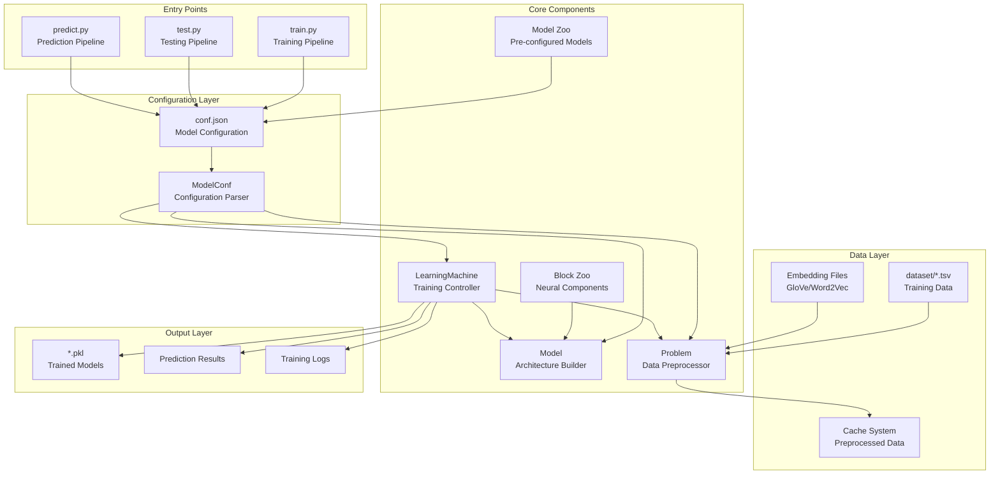
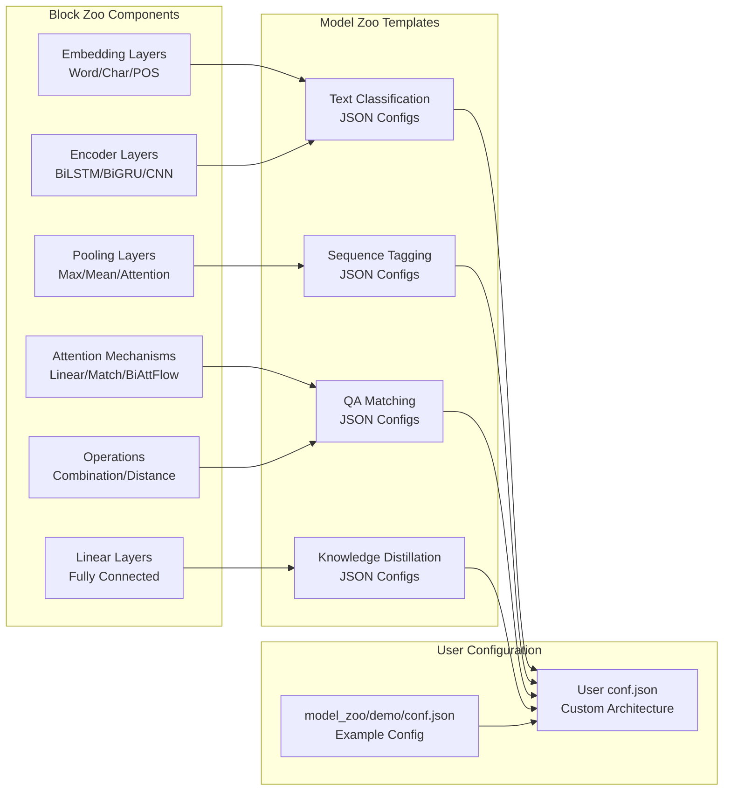
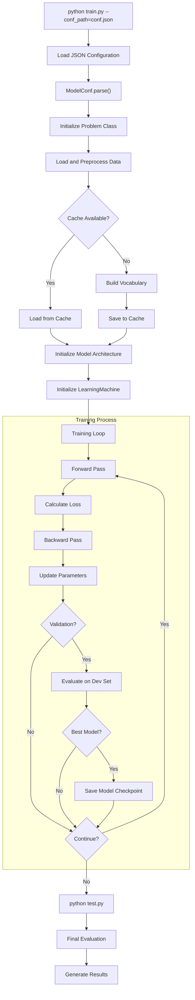

<!-- source: DeepWiki mcp.deepwiki.com · repo microsoft/NeuronBlocks · page 1 Overview · fetched 2026-10-26 -->

# Overview

<details>
<summary>Relevant source files</summary>

The following files were used as context for generating this wiki page:

- [README.md](README.md)
- [README_zh_CN.md](README_zh_CN.md)
- [requirements.txt](requirements.txt)

</details>


This document provides a comprehensive overview of NeuronBlocks, an NLP deep learning modeling toolkit designed to simplify neural network model development through modular components and JSON-based configuration. This page covers the system's architecture, core components, and fundamental concepts needed to understand how NeuronBlocks operates.

For specific installation and setup instructions, see [Getting Started](#2). For detailed information about individual neural network components, see [Block Zoo](#3.1). For pre-configured model examples, see [Model Zoo](#3.2).

## What is NeuronBlocks

NeuronBlocks is a modular NLP deep learning toolkit that enables engineers and researchers to build end-to-end neural network pipelines through JSON configuration files rather than extensive coding. The system abstracts complex neural network architectures into reusable building blocks, allowing users to construct models by combining components similar to assembling Lego blocks.

The toolkit supports both training and inference stages across multiple NLP tasks including text classification, sentiment analysis, question answering, sequence tagging, and knowledge distillation. It provides cross-platform compatibility (Linux/Windows, CPU/GPU) and supports both English and Chinese language processing.

**Sources:** [README.md:27-29](), [README.md:40-48]()

## System Architecture

The NeuronBlocks architecture consists of two main components working together through a JSON-based configuration system:

### High-Level Architecture with Code Entities



**Sources:** [README.md:30-33](), [README.md:90-100]()

### Block Zoo and Model Zoo Architecture



**Sources:** [README.md:30-33](), [README.md:50-56]()

## Core Components

### Block Zoo
The Block Zoo provides reusable neural network components that serve as building blocks for model architecture design. These components are implemented as PyTorch modules and can be combined through JSON configuration to create complex architectures.

**Key component categories:**
- **Embedding layers**: Word embeddings, character embeddings, positional encodings
- **Encoder layers**: BiLSTM, BiGRU, CNN layers for sequence processing  
- **Attention mechanisms**: Various attention types including linear attention and bidirectional attention flow
- **Pooling layers**: Max pooling, mean pooling, attention-based pooling
- **Linear layers**: Fully connected layers with configurable dimensions
- **Operations**: Combination operations, distance calculations, tensor manipulations

### Model Zoo  
The Model Zoo contains pre-configured model architectures for common NLP tasks, distributed as JSON configuration files. Users can directly use these configurations or modify them as starting points for custom models.

**Available model templates:**
- Text classification and sentiment analysis models
- Question answering and text matching models  
- Sequence tagging models for NER and slot filling
- Knowledge distillation models for model compression
- Reading comprehension models

**Sources:** [README.md:30-33](), [README.md:40-48]()

## Execution Workflow

The NeuronBlocks execution follows a consistent pattern across training, testing, and prediction phases:

### Training and Testing Pipeline



**Sources:** [README.md:90-100](), [README.md:102-114]()

## Technical Capabilities

### Platform and Environment Support

| Environment | CPU Training | Single-GPU Training | Multi-GPU Training |
|-------------|--------------|-------------------|-------------------|
| **CPU Inference** | ✓ | ✓ | ✓ |
| **Single-GPU Inference** | ✓ | ✓ | ✓ |
| **Multi-GPU Inference** | ✓ | ✓ | ✓ |

**System Requirements:**
- Python 3.6 or higher
- PyTorch 0.4.1 or higher  
- Cross-platform support (Linux/Windows)
- Optional GPU acceleration

**Sources:** [README.md:62](), [README.md:74](), [README.md:133-138]()

### Language and Task Support

**Supported Languages:**
- English (with NLTK tokenization)
- Chinese (with Jieba tokenization)

**Supported NLP Tasks:**
- Sentence classification and sentiment analysis
- Question answering and textual entailment
- Sequence tagging and slot filling
- Machine reading comprehension
- Knowledge distillation for model compression

**Sources:** [README.md:36-48]()

### Prediction Modes

NeuronBlocks supports two prediction modes through `predict.py`:

1. **Interactive Mode**: Real-time prediction with user input prompts
   ```bash
   python predict.py --conf_path=conf.json --predict_mode='interactive'
   ```

2. **Batch Mode**: Batch processing of input files
   ```bash  
   python predict.py --conf_path=conf.json --predict_mode='batch' --predict_data_path=data.tsv
   ```

**Sources:** [README.md:102-114]()

## Target Audience

NeuronBlocks addresses challenges faced by engineers and researchers working with neural networks for NLP:

**Primary Users:**
- NLP engineers building production systems with minimal deep learning expertise
- Researchers prototyping new model architectures quickly
- Teams requiring cross-platform model deployment
- Organizations needing model sharing and collaboration capabilities

**Key Benefits:**
- **Reduced coding overhead**: JSON configuration instead of implementation
- **Model sharing**: Easy distribution through configuration files
- **Code reusability**: Common blocks shared across projects
- **Platform flexibility**: Consistent behavior across environments
- **Model visualization**: Architecture validation and debugging tools
- **Extensibility**: Community contributions of new blocks and models

**Sources:** [README.md:118-141]()

---

