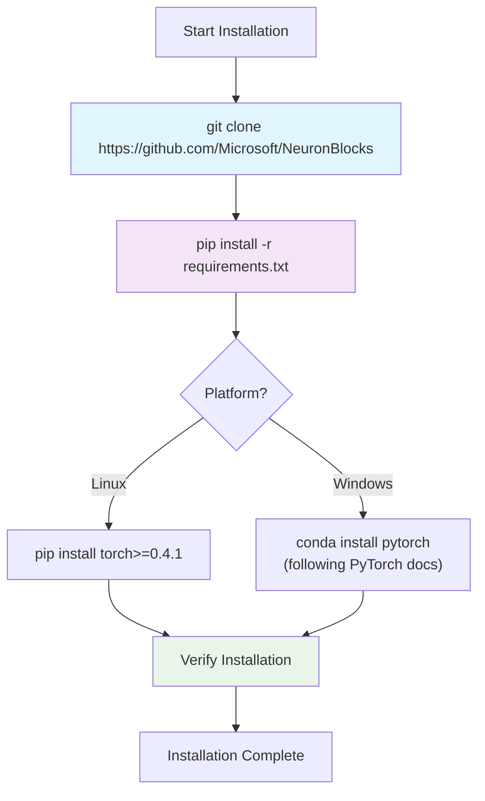
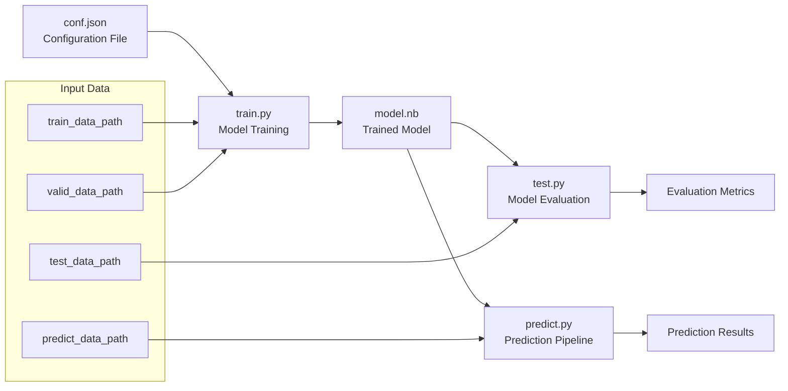
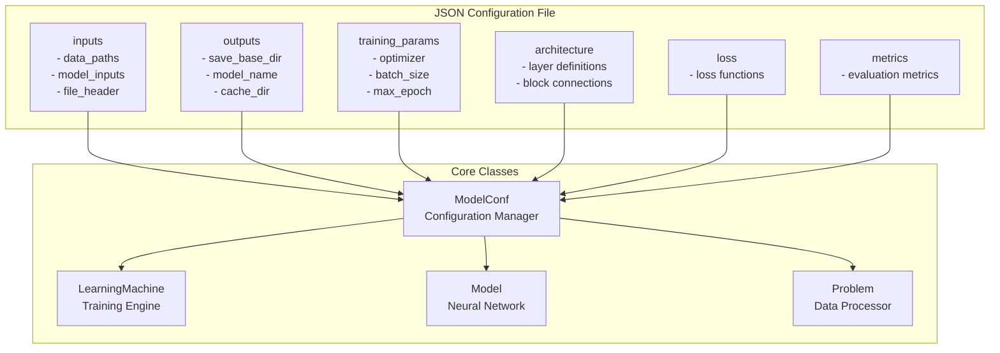
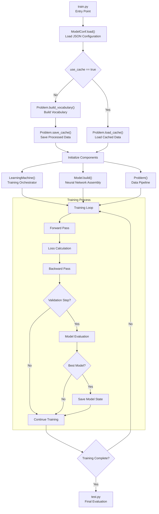
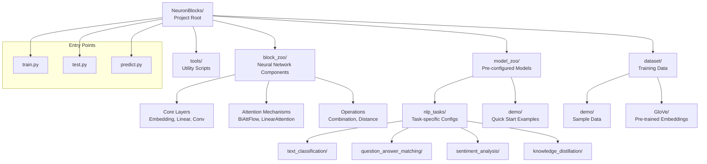

<!-- source: DeepWiki mcp.deepwiki.com · repo microsoft/NeuronBlocks · page 2 Getting Started · fetched 2026-10-26 -->

# Getting Started

<details>
<summary>Relevant source files</summary>

The following files were used as context for generating this wiki page:

- [README.md](README.md)
- [README_zh_CN.md](README_zh_CN.md)
- [Tutorial.md](Tutorial.md)
- [Tutorial_zh_CN.md](Tutorial_zh_CN.md)
- [block_zoo/Pooling2D.py](block_zoo/Pooling2D.py)
- [model_zoo/nlp_tasks/knowledge_distillation/query_binary_classifier_compression/conf_kdqbc_bilstmattn_cnn.json](model_zoo/nlp_tasks/knowledge_distillation/query_binary_classifier_compression/conf_kdqbc_bilstmattn_cnn.json)
- [requirements.txt](requirements.txt)

</details>


This document provides installation instructions, basic setup, and initial usage patterns for NeuronBlocks. It covers the essential steps to install dependencies, run your first model, and understand the core configuration system. For detailed model architecture design, see [Core Architecture](#3). For comprehensive examples of specific NLP tasks, see [Model Examples](#5).

## Prerequisites and System Requirements

NeuronBlocks requires specific software versions and system configurations to function properly.

### System Requirements

| Component | Requirement |
|-----------|-------------|
| Python | 3.6 or higher |
| PyTorch | 0.4.1 or higher |
| Operating System | Linux, Windows (PowerShell recommended) |
| Hardware | CPU or GPU (CUDA support optional) |

### Platform Compatibility Matrix

NeuronBlocks supports flexible deployment across different hardware configurations:

| Training Mode | CPU Inference | Single-GPU Inference | Multi-GPU Inference |
|---------------|---------------|---------------------|---------------------|
| CPU Training | ✓ | ✓ | ✓ |
| Single-GPU Training | ✓ | ✓ | ✓ |
| Multi-GPU Training | ✓ | ✓ | ✓ |

**Sources:** [README.md:62-82](), [README.md:133-138](), [Tutorial.md:33-52]()

## Installation Process

The installation follows a three-step process: repository cloning, Python dependencies, and PyTorch installation.



### Step-by-Step Installation

1. **Clone Repository**
   ```bash
   git clone https://github.com/Microsoft/NeuronBlocks
   cd NeuronBlocks
   ```

2. **Install Python Dependencies**
   ```bash
   pip install -r requirements.txt
   ```

3. **Install PyTorch**
   
   **For Linux:**
   ```bash
   pip install "torch>=0.4.1"
   ```
   
   **For Windows:**
   Follow the [PyTorch installation guide](https://pytorch.org/get-started/locally/) using Conda.

### Core Dependencies

The [`requirements.txt`](requirements.txt:1-7)() specifies essential packages:

| Package | Version | Purpose |
|---------|---------|---------|
| `nltk` | 3.4.1 | English tokenization |
| `jieba` | 0.39 | Chinese tokenization |
| `gensim` | 3.7.2 | Word embedding support |
| `tqdm` | 4.31.1 | Progress bars |
| `numpy` | 1.16.3 | Numerical computations |
| `scikit-learn` | 0.20.3 | Evaluation metrics |

**Sources:** [README.md:64-82](), [Tutorial.md:35-52](), [requirements.txt:1-7]()

## Quick Start Workflow

The basic NeuronBlocks workflow involves three main executables: `train.py`, `test.py`, and `predict.py`, all controlled by JSON configuration files.



### Basic Commands

Execute these commands from the project root directory:

```bash
# Training
python train.py --conf_path=model_zoo/demo/conf.json

# Testing
python test.py --conf_path=model_zoo/demo/conf.json

# Prediction
python predict.py --conf_path=model_zoo/demo/conf.json
```

### Prediction Modes

NeuronBlocks supports two prediction modes:

**Interactive Mode** - Real-time single-case prediction:
```bash
python predict.py --conf_path=model_zoo/demo/conf.json --predict_mode='interactive'
```

**Batch Mode** - File-based batch prediction:
```bash
python predict.py --conf_path=model_zoo/demo/conf.json --predict_mode='batch' --predict_data_path=dataset/demo/predict.tsv
```

**Sources:** [README.md:84-114](), [Tutorial.md:56-72]()

## Configuration System Architecture

The configuration system uses JSON files to define model architecture, data paths, training parameters, and evaluation metrics. This eliminates the need for extensive coding.



### Essential Configuration Sections

**Data Configuration (`inputs`):**
```json
{
  "inputs": {
    "use_cache": true,
    "dataset_type": "classification",
    "data_paths": {
      "train_data_path": "./dataset/demo/train.tsv",
      "valid_data_path": "./dataset/demo/valid.tsv",
      "test_data_path": "./dataset/demo/test.tsv",
      "pre_trained_emb": "./dataset/GloVe/glove.840B.300d.txt"
    },
    "file_header": {
      "question_text": 0,
      "answer_text": 1,
      "label": 2
    },
    "model_inputs": {
      "question": ["question_text"],
      "answer": ["answer_text"]
    },
    "target": ["label"]
  }
}
```

**Model Architecture (`architecture`):**
The architecture section defines neural network layers using Block Zoo components:
```json
{
  "architecture": [
    {
      "layer": "Embedding",
      "conf": {
        "word": {
          "cols": ["question_text", "answer_text"],
          "dim": 300
        }
      }
    },
    {
      "layer_id": "encoder",
      "layer": "BiLSTM",
      "conf": {
        "hidden_dim": 128,
        "dropout": 0.1
      },
      "inputs": ["question"]
    }
  ]
}
```

**Sources:** [Tutorial.md:77-204](), [model_zoo/nlp_tasks/knowledge_distillation/query_binary_classifier_compression/conf_kdqbc_bilstmattn_cnn.json:1-191]()

## Core Execution Pipeline

The training and evaluation pipeline orchestrates data processing, model building, and learning through key Python modules.



### Key Components and Their Roles

| Component | File/Class | Primary Function |
|-----------|------------|------------------|
| Configuration Loader | `ModelConf` | Parse and validate JSON configurations |
| Training Orchestrator | `LearningMachine` | Coordinate training process and optimization |
| Neural Network Builder | `Model` | Assemble Block Zoo components into networks |
| Data Processor | `Problem` | Handle data loading, preprocessing, and caching |
| Block Registry | Block Zoo classes | Provide reusable neural network components |

**Sources:** [README.md:90-100](), diagrams from high-level system overview

## Project Directory Structure

Understanding the directory layout helps navigate the codebase and organize custom models and datasets.



### Directory Organization Guidelines

**For New Projects:**
1. Create model directory: `model_zoo/your_project/`
2. Place datasets in: `dataset/your_project/`
3. Configure JSON files in your model directory
4. Reference data paths relative to project root

**Common File Patterns:**
- Configuration files: `*.json`
- Training data: `train.tsv`, `valid.tsv`, `test.tsv`
- Model outputs: `model.nb`, `*.log`
- Pre-trained embeddings: `*.txt`, `*.bin`

**Sources:** [Tutorial.md:81-84](), [README.md:30-56]()

## Language and Tokenization Support

NeuronBlocks provides built-in support for multiple languages with automatic tokenizer selection.

### Language Configuration

| Language | Configuration | Default Tokenizer | Usage |
|----------|---------------|-------------------|-------|
| English | `"language": "English"` | `nltk` | Default for most tasks |
| Chinese | `"language": "Chinese"` | `jieba` | Set explicitly in JSON config |

### Tokenizer Selection

The system automatically selects appropriate tokenizers based on the `language` setting in configuration files. Custom tokenizers can be specified using the `tokenizer` parameter in `training_params`.

**Example Chinese Configuration:**
```json
{
  "language": "Chinese",
  "training_params": {
    "tokenizer": "jieba"
  }
}
```

**Sources:** [Tutorial.md:207-211](), [README_zh_CN.md:37-39]()

## GPU and Multi-GPU Setup

NeuronBlocks automatically detects and utilizes available GPU resources with configurable device selection.

### GPU Configuration Options

```bash
# Use specific GPU
CUDA_VISIBLE_DEVICES=0 python train.py --conf_path=config.json

# Use multiple GPUs
CUDA_VISIBLE_DEVICES=0,1 python train.py --conf_path=config.json

# Force CPU usage
CUDA_VISIBLE_DEVICES= python train.py --conf_path=config.json
```

### Training Parameters for GPU

```json
{
  "training_params": {
    "use_gpu": true,
    "batch_size": 32,
    "cpu_num_workers": -1
  }
}
```

**Sources:** [Tutorial.md:140-148](), [Tutorial.md:149]()

## Next Steps

After completing the basic setup:

1. **Try the Demo Example** - Run the provided demo to verify installation
2. **Explore Model Zoo** - Review pre-configured models for your task type (see [Model Examples](#5))
3. **Understanding Architecture** - Learn about Block Zoo components (see [Core Architecture](#3))
4. **Custom Model Creation** - Design your own neural network architectures (see [Block Reference](#6))
5. **Advanced Features** - Explore visualization tools and automated testing (see [Utilities and Tools](#7))

For immediate hands-on experience, proceed with the demo example using the commands shown in the Quick Start Workflow section.

**Sources:** [README.md:115-141](), [Tutorial.md:220-230]()

---

