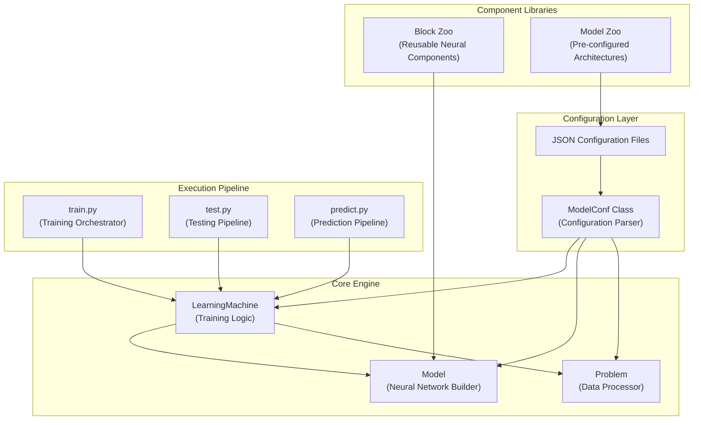
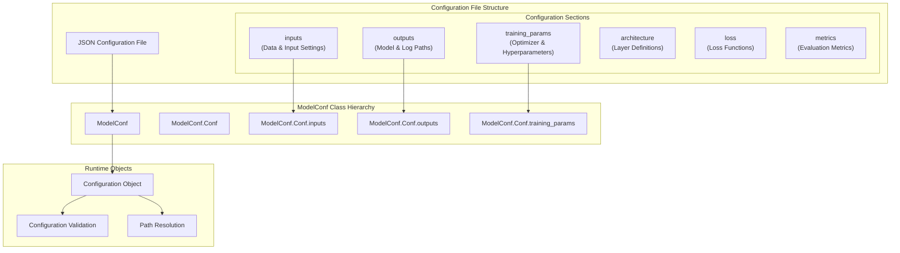
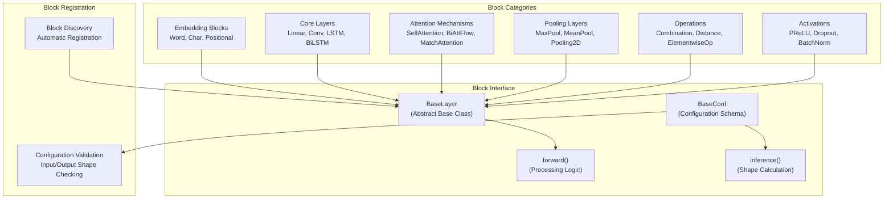
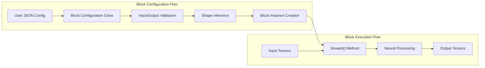
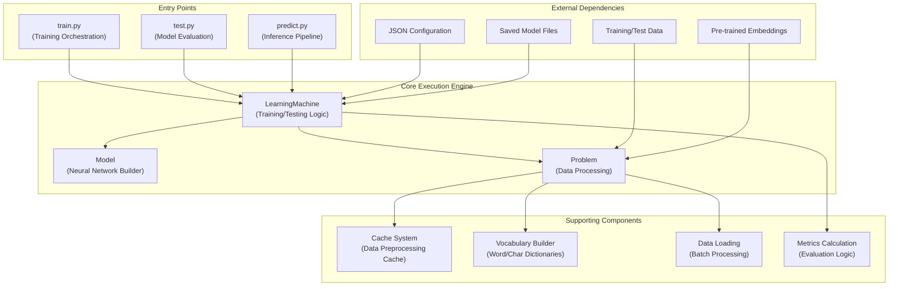
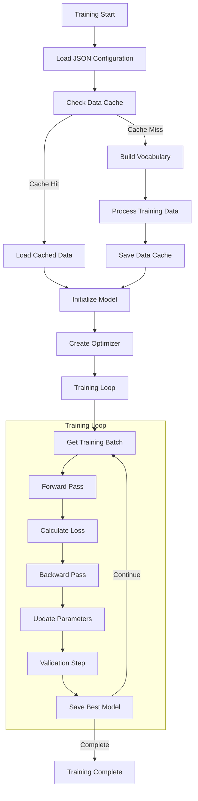
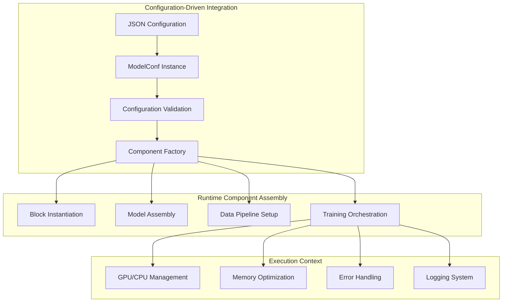

<!-- source: DeepWiki mcp.deepwiki.com · repo microsoft/NeuronBlocks · page 3 Core Architecture · fetched 2026-10-26 -->

# Core Architecture

Relevant source files

The following files were used as context for generating this wiki page:

- [.gitignore](.gitignore)
- [ModelConf.py](ModelConf.py)
- [README.md](README.md)
- [README_zh_CN.md](README_zh_CN.md)
- [Tutorial.md](Tutorial.md)
- [Tutorial_zh_CN.md](Tutorial_zh_CN.md)
- [block_zoo/Pooling2D.py](block_zoo/Pooling2D.py)
- [model_zoo/nlp_tasks/knowledge_distillation/query_binary_classifier_compression/conf_kdqbc_bilstmattn_cnn.json](model_zoo/nlp_tasks/knowledge_distillation/query_binary_classifier_compression/conf_kdqbc_bilstmattn_cnn.json)
- [requirements.txt](requirements.txt)
- [utils/common_utils.py](utils/common_utils.py)

This document describes the fundamental design principles and core components of NeuronBlocks, focusing on how the JSON configuration system, Block Zoo, Model Zoo, and execution pipeline work together to enable modular NLP model development. For specific details about individual blocks and layers, see [Block Reference](#6). For training procedures and evaluation, see [Training and Evaluation](#4).

## Design Philosophy

NeuronBlocks follows a configuration-driven architecture where models are defined entirely through JSON configuration files rather than imperative code. This design enables researchers and engineers to build complex neural networks by composing reusable components from the Block Zoo without writing PyTorch implementation code.

The architecture centers around three core principles:

1. **Modular Composition**: Neural networks are built by connecting blocks from the Block Zoo like building with Lego pieces
2. **Configuration-Driven**: All model architecture, training parameters, and data processing settings are specified in JSON files
3. **Separation of Concerns**: The Block Zoo provides reusable components, Model Zoo provides pre-configured architectures, and the execution pipeline handles training/testing/prediction

**Core Architecture Overview**

Sources: [README.md:27-56](), [Tutorial.md:75-85](), [ModelConf.py:68-100]()

## Configuration System

The configuration system is the central nervous system of NeuronBlocks, implemented primarily through the `ModelConf` class. This system transforms JSON configuration files into Python objects that drive the entire model building and training process.

**Configuration Architecture**

The `ModelConf` class uses a nested class structure with the `ConstantStaticItems` pattern to declaratively define configuration schema and validation rules. Each configuration section is represented by a nested class that handles loading and validation of its respective JSON section.

Sources: [ModelConf.py:68-100](), [ModelConf.py:101-169](), [Tutorial.md:77-205]()

### Configuration Loading Process

The configuration loading follows a structured pipeline:

1. **File Loading**: JSON configuration is loaded and parsed using `load_from_json`
2. **Schema Mapping**: The nested `ModelConf.Conf` classes map JSON structure to Python objects
3. **Path Configuration**: Input/output paths are resolved and validated
4. **Training Parameter Setup**: Optimizer settings and hyperparameters are configured
5. **Architecture Processing**: Layer definitions are validated and prepared for model building

Key methods in the loading process:

- `configurate_outputs()` - Sets up model save directories and logging paths
- `configurate_inputs()` - Processes data paths and input format specifications  
- `configurate_training_params()` - Configures optimizer and training settings
- `configurate_architecture()` - Validates layer definitions and connections

Sources: [ModelConf.py:174-185](), [ModelConf.py:186-244](), [ModelConf.py:245-356]()

## Block Zoo Architecture

The Block Zoo is the foundation of NeuronBlocks' modular design, providing a library of reusable neural network components that can be combined to build complex architectures. Each block is a self-contained PyTorch module with standardized interfaces.

**Block Zoo Component Structure**

Each block follows a standardized pattern with two main classes:
- **Configuration Class** (e.g., `Pooling2DConf`): Defines parameters, validates inputs, and calculates output dimensions
- **Implementation Class** (e.g., `Pooling2D`): Contains the actual PyTorch neural network logic

Sources: [block_zoo/Pooling2D.py:14-89](), [block_zoo/Pooling2D.py:90-125]()

### Block Interface Design

All blocks inherit from `BaseLayer` and `BaseConf` to ensure consistent interfaces:

The configuration classes handle:
- Parameter validation through `verify()` methods
- Output shape calculation through `inference()` methods  
- Input rank and dimension checking
- Default value assignment

Sources: [block_zoo/Pooling2D.py:34-78]()

## Model Zoo Architecture

The Model Zoo provides pre-configured JSON files that demonstrate best practices and enable quick experimentation with proven architectures. Each model configuration represents a complete solution for specific NLP tasks.

**Model Zoo Organization**

```mermaid
graph TB
    subgraph "Task Categories"
        TextClassification["text_classification/<br/>CNN, BiLSTM+Attention Models"]
        QuestionAnswering["question_answer_matching/<br/>ARC-I, ARC-II, BiAttFlow Models"]
        SentimentAnalysis["sentiment_analysis/<br/>BiLSTM, Attention Models"]
        SequenceTagging["slot_tagging/<br/>BiLSTM+CRF, Char+Word Models"]
        KnowledgeDistillation["knowledge_distillation/<br/>Student-Teacher Models"]
        ChineseTasks["chinese_*/<br/>Chinese Language Models"]
    end
    
    subgraph "Configuration Structure"
        ModelTemplate["Model Configuration Template"]
        
        subgraph "Standard Sections"
            DataPaths["data_paths<br/>(Dataset Locations)"]
            ModelInputs["model_inputs<br/>(Input Definitions)"] 
            ArchitectureDef["architecture<br/>(Layer Stack Definition)"]
            LossConfig["loss<br/>(Loss Function Config)"]
            MetricsConfig["metrics<br/>(Evaluation Metrics)"]
        end
    end
    
    subgraph "Usage Pattern"
        UserSelects["User Selects Model"]
        ConfigLoading["ModelConf Loading"]
        ModelBuilding["Model Construction"]
        Training["Training Execution"]
    end
    
    TextClassification --> ModelTemplate
    QuestionAnswering --> ModelTemplate
    SentimentAnalysis --> ModelTemplate
    SequenceTagging --> ModelTemplate
    KnowledgeDistillation --> ModelTemplate
    ChineseTasks --> ModelTemplate
    
    DataPaths --> ModelTemplate
    ModelInputs --> ModelTemplate
    ArchitectureDef --> ModelTemplate
    LossConfig --> ModelTemplate
    MetricsConfig --> ModelTemplate
    
    UserSelects --> ConfigLoading
    ConfigLoading --> ModelBuilding
    ModelBuilding --> Training
```

Model Zoo configurations follow standardized patterns but can be customized for specific requirements. The architecture section defines the complete layer stack using Block Zoo components.

Sources: [model_zoo/nlp_tasks/knowledge_distillation/query_binary_classifier_compression/conf_kdqbc_bilstmattn_cnn.json:61-178](), [Tutorial.md:220-622]()

### Model Configuration Pattern

A typical model configuration follows this structure:

1. **Input Configuration**: Data paths, file formats, and preprocessing settings
2. **Architecture Definition**: Sequential layer definitions with inputs and configurations
3. **Training Setup**: Optimizer, learning rate, batch size, and other hyperparameters
4. **Output Specification**: Model save paths, logging configuration, and prediction formats

The architecture section uses a layer-by-layer definition where each layer specifies:
- `layer`: The block type from Block Zoo
- `layer_id`: Unique identifier for referencing in subsequent layers  
- `conf`: Block-specific configuration parameters
- `inputs`: List of previous layer IDs that feed into this layer

Sources: [model_zoo/nlp_tasks/knowledge_distillation/query_binary_classifier_compression/conf_kdqbc_bilstmattn_cnn.json:61-178]()

## Execution Pipeline

The execution pipeline consists of three main entry points (`train.py`, `test.py`, `predict.py`) that orchestrate the model lifecycle through shared core components.

**Execution Flow Architecture**

### Core Engine Components

The execution pipeline is built around three primary classes:

**LearningMachine**: Central orchestrator that manages the training/testing lifecycle
- Coordinates between Model and Problem instances
- Handles optimization and learning rate scheduling
- Manages model checkpointing and evaluation
- Implements the main training loop with validation

**Model**: Neural network builder that constructs PyTorch modules from JSON specifications  
- Instantiates Block Zoo components based on architecture configuration
- Manages layer connections and forward pass routing
- Handles model serialization and loading

**Problem**: Data processing pipeline that handles corpus management
- Builds vocabularies from training data
- Manages data preprocessing and tokenization
- Implements caching for efficient repeated runs
- Handles batch creation and padding

Sources: [README.md:92-100](), [Tutorial.md:62-72]()

### Training Pipeline Flow

The training pipeline follows a structured execution sequence:

The training process leverages the configuration system for all parameters and uses the Block Zoo components to build the neural network dynamically at runtime.

Sources: [Tutorial.md:62-72](), [ModelConf.py:357-412]()

## Component Integration

The core architecture achieves modularity through well-defined interfaces between components. The configuration system acts as the central coordinator, while the Block Zoo and Model Zoo provide the building blocks and templates respectively.

**Integration Patterns**

This architecture enables several key capabilities:

1. **Hot-swappable Components**: Blocks can be replaced without code changes by modifying JSON configuration
2. **Composable Architectures**: Complex models are built by connecting simple, reusable blocks
3. **Reproducible Experiments**: Complete model specifications are captured in version-controllable JSON files
4. **Cross-Platform Compatibility**: The same configuration works across different hardware and operating systems

The integration relies heavily on Python's dynamic class loading and PyTorch's module system to achieve runtime flexibility while maintaining type safety through configuration validation.

Sources: [ModelConf.py:413-439](), [utils/common_utils.py:17-40](), [README.md:127-141]()

---

