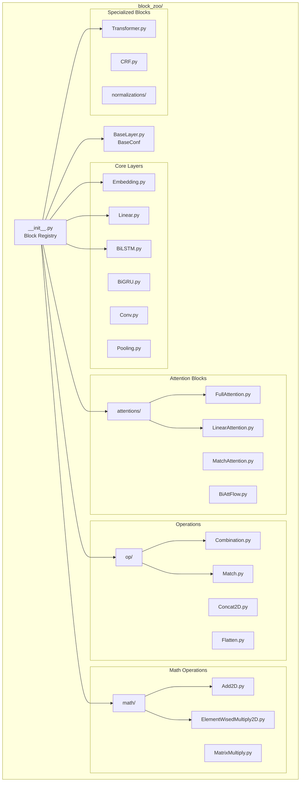
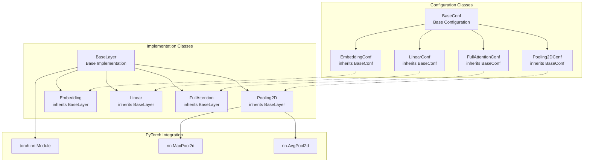
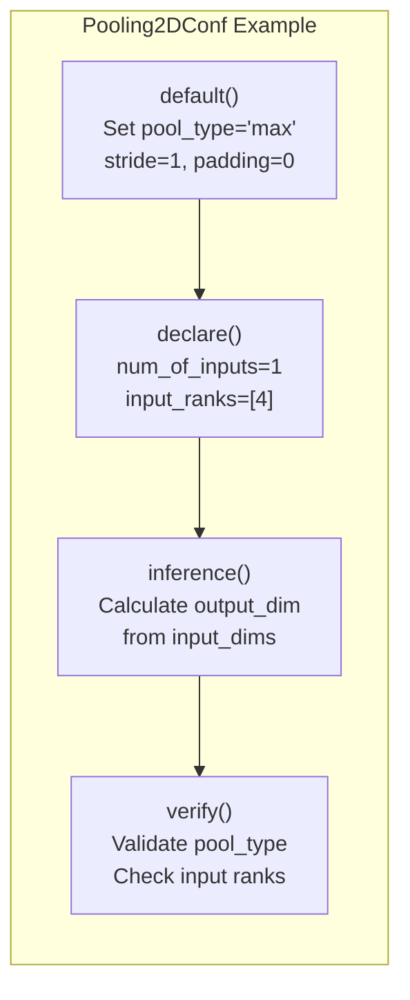
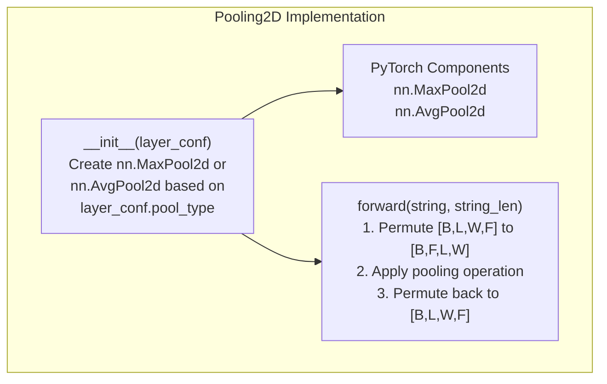
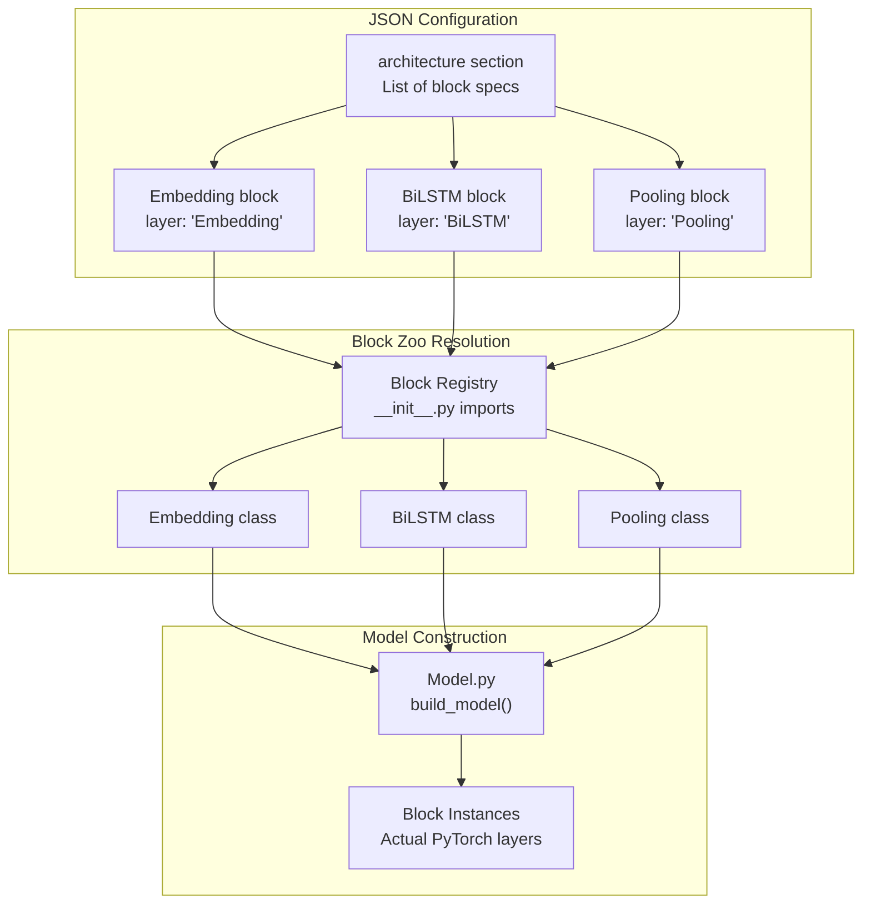
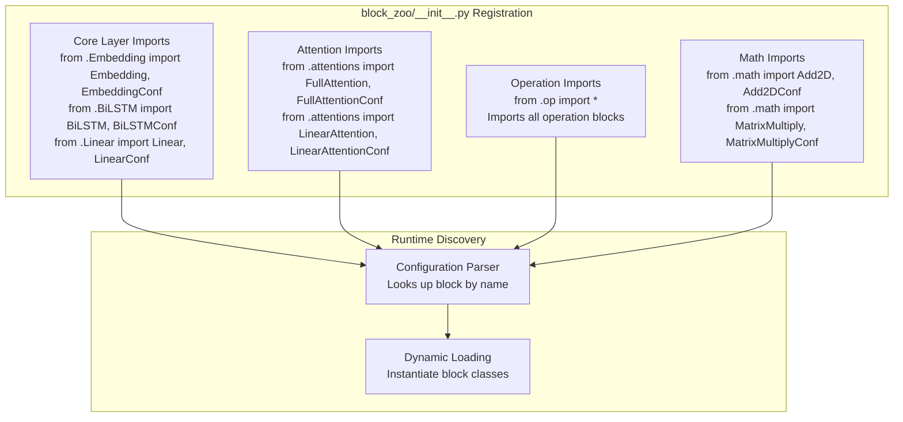

<!-- source: DeepWiki mcp.deepwiki.com · repo microsoft/NeuronBlocks · page 3.1 Block Zoo · fetched 2026-10-26 -->

# Block Zoo

<details>
<summary>Relevant source files</summary>

The following files were used as context for generating this wiki page:

- [Tutorial.md](Tutorial.md)
- [Tutorial_zh_CN.md](Tutorial_zh_CN.md)
- [block_zoo/Pooling2D.py](block_zoo/Pooling2D.py)
- [block_zoo/__init__.py](block_zoo/__init__.py)
- [block_zoo/op/__init__.py](block_zoo/op/__init__.py)
- [model_zoo/nlp_tasks/knowledge_distillation/query_binary_classifier_compression/conf_kdqbc_bilstmattn_cnn.json](model_zoo/nlp_tasks/knowledge_distillation/query_binary_classifier_compression/conf_kdqbc_bilstmattn_cnn.json)

</details>


The Block Zoo is NeuronBlocks' collection of reusable neural network components that serve as building blocks for constructing NLP models. It provides a comprehensive library of pre-implemented layers, attention mechanisms, operations, and embeddings that can be combined through JSON configuration files to create complex model architectures without writing custom code.

For information about pre-configured model templates, see [Model Zoo](#3.2). For details on the JSON configuration system that uses these blocks, see [Configuration System](#3.3).

## Architecture Overview

The Block Zoo follows a modular design where each neural network component is implemented as a self-contained block with standardized interfaces. Every block consists of a configuration class and an implementation class that inherit from common base classes.

### Block Zoo Module Structure



Sources: [block_zoo/__init__.py:1-58](), [block_zoo/Pooling2D.py:10-11](), [block_zoo/op/__init__.py:1-9]()

### Block Class Hierarchy



Sources: [block_zoo/BaseLayer.py](), [block_zoo/Pooling2D.py:14-89](), [block_zoo/__init__.py:3-58]()

## Block Categories

The Block Zoo organizes neural network components into several functional categories:

### Core Neural Network Layers

| Block Class | Configuration Class | Purpose |
|-------------|-------------------|---------|
| `Embedding` | `EmbeddingConf` | Word, character, and POS tag embeddings |
| `Linear` | `LinearConf` | Fully connected layers with activation |
| `BiLSTM` | `BiLSTMConf` | Bidirectional LSTM layers |
| `BiGRU` | `BiGRUConf` | Bidirectional GRU layers |
| `Conv` | `ConvConf` | 1D convolutional layers |
| `Conv2D` | `Conv2DConf` | 2D convolutional layers |
| `Pooling` | `PoolingConf` | 1D pooling operations |
| `Pooling2D` | `Pooling2DConf` | 2D pooling operations |

### Attention Mechanisms

| Block Class | Configuration Class | Purpose |
|-------------|-------------------|---------|
| `FullAttention` | `FullAttentionConf` | Full attention over sequence |
| `LinearAttention` | `LinearAttentionConf` | Linear attention with dimension reduction |
| `MatchAttention` | `MatchAttentionConf` | Matching-based attention |
| `BiAttFlow` | `BiAttFlowConf` | Bidirectional attention flow |
| `Attention` | `AttentionConf` | General attention mechanism |

### Operations and Transformations

| Block Class | Configuration Class | Purpose |
|-------------|-------------------|---------|
| `Combination` | `CombinationConf` | Combines multiple inputs |
| `Match` | `MatchConf` | Computes matching between sequences |
| `Concat2D` | `Concat2DConf` | Concatenates 2D tensors |
| `Flatten` | `FlattenConf` | Flattens tensor dimensions |
| `CalculateDistance` | `CalculateDistanceConf` | Computes distances between vectors |

### Mathematical Operations

| Block Class | Configuration Class | Purpose |
|-------------|-------------------|---------|
| `Add2D` | `Add2DConf` | Element-wise addition for 2D tensors |
| `ElementWisedMultiply2D` | `ElementWisedMultiply2DConf` | Element-wise multiplication |
| `MatrixMultiply` | `MatrixMultiplyConf` | Matrix multiplication operations |

Sources: [block_zoo/__init__.py:1-58](), [block_zoo/op/__init__.py:1-9]()

## Block Structure and Configuration

Each block in the Block Zoo follows a standardized structure with separate configuration and implementation classes.

### Configuration Class Pattern

Every block has a configuration class that inherits from `BaseConf` and defines:

- **Input/Output Specifications**: Tensor dimensions and ranks
- **Parameter Validation**: Checks for valid parameter values  
- **Shape Inference**: Calculates output dimensions from input dimensions
- **Default Values**: Provides sensible defaults for optional parameters



### Implementation Class Pattern

The implementation class inherits from `BaseLayer` and provides:

- **PyTorch Integration**: Uses `torch.nn.Module` components
- **Forward Pass Logic**: Implements the actual computation
- **Tensor Manipulation**: Handles shape transformations and permutations

Example from `Pooling2D`:



Sources: [block_zoo/Pooling2D.py:14-123](), [block_zoo/BaseLayer.py]()

## Usage in Model Architectures  

Blocks are used in JSON configuration files to define model architectures. Each block specification includes the block type, configuration parameters, and input connections.

### Block Specification Format

```json
{
  "layer_id": "unique_identifier", 
  "layer": "BlockClassName",
  "conf": {
    "parameter1": "value1",
    "parameter2": "value2"
  },
  "inputs": ["input_layer_ids"]
}
```

### Architecture Definition Flow



### Real Configuration Example

From the knowledge distillation example:

| Block | Purpose | Configuration |
|-------|---------|---------------|
| `Embedding` | Word embeddings | `{"word": {"cols": ["query_text"], "dim": 300}}` |
| `BiLSTMAtt` | Encoder with attention | `{"hidden_dim": 128, "dropout": 0, "num_layers": 1}` |
| `Conv` | CNN feature extraction | `{"window_size": 3, "output_channel_num": 128}` |
| `Pooling` | Max pooling | `{"pool_axis": 1, "pool_type": "max"}` |
| `Combination` | Feature combination | `{"operations": ["origin"]}` |
| `Linear` | Dense layers | `{"hidden_dim": [256, 128], "activation": "PReLU"}` |

Sources: [model_zoo/nlp_tasks/knowledge_distillation/query_binary_classifier_compression/conf_kdqbc_bilstmattn_cnn.json:61-178](), [Tutorial.md:157-188]()

## Block Registration and Discovery

The Block Zoo uses a centralized registration system to make blocks available for use in configurations.

### Import-Based Registration



### Block Naming Convention

- **Configuration Classes**: End with `Conf` (e.g., `BiLSTMConf`, `PoolingConf`)
- **Implementation Classes**: Match the layer name used in JSON configs (e.g., `BiLSTM`, `Pooling`)
- **Module Organization**: Related blocks grouped in subdirectories (`attentions/`, `op/`, `math/`)

### Extension Points

The registration system supports extensibility:

1. **New Block Addition**: Add import statement to `__init__.py`
2. **Subdirectory Support**: Use `from .subdir import *` pattern
3. **Automatic Discovery**: All imported classes become available in configurations

Sources: [block_zoo/__init__.py:1-58](), [block_zoo/op/__init__.py:1-9]()

---

