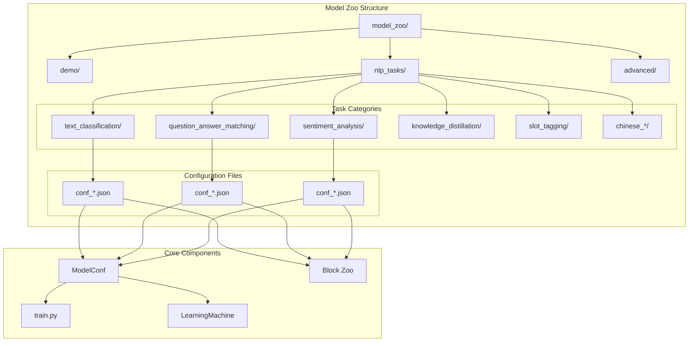
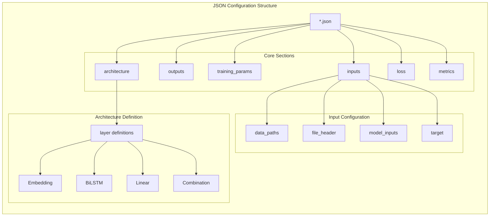
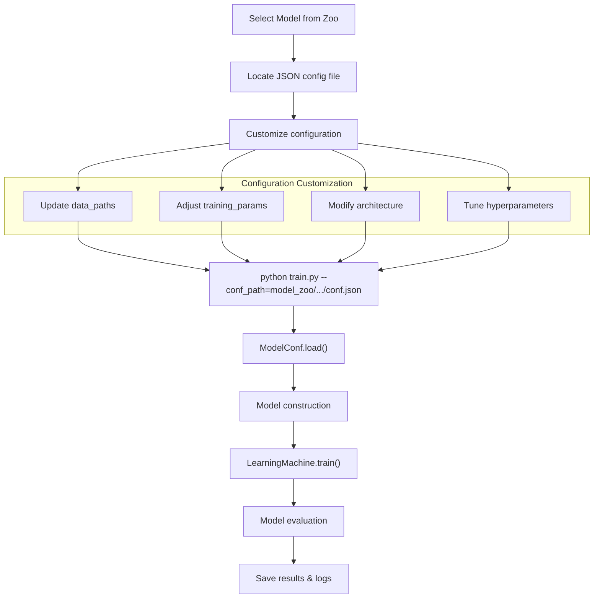

<!-- source: DeepWiki mcp.deepwiki.com · repo microsoft/NeuronBlocks · page 3.2 Model Zoo · fetched 2026-10-26 -->

# Model Zoo

<details>
<summary>Relevant source files</summary>

The following files were used as context for generating this wiki page:

- [Tutorial.md](Tutorial.md)
- [Tutorial_zh_CN.md](Tutorial_zh_CN.md)
- [block_zoo/Pooling2D.py](block_zoo/Pooling2D.py)
- [block_zoo/embedding/CNNCharEmbedding.py](block_zoo/embedding/CNNCharEmbedding.py)
- [model_zoo/advanced/conf.json](model_zoo/advanced/conf.json)
- [model_zoo/nlp_tasks/knowledge_distillation/query_binary_classifier_compression/conf_kdqbc_bilstmattn_cnn.json](model_zoo/nlp_tasks/knowledge_distillation/query_binary_classifier_compression/conf_kdqbc_bilstmattn_cnn.json)
- [settings.py](settings.py)

</details>


The Model Zoo provides a comprehensive collection of pre-configured neural network models for common NLP tasks. It serves as a starting point for practitioners to quickly begin training models without having to design architectures from scratch, while also demonstrating best practices for model configuration in NeuronBlocks.

For information about the individual neural network components used to build these models, see [Block Zoo](#3.1). For details about the JSON configuration system that defines these models, see [Configuration System](#3.3).

## Overview

The Model Zoo consists of JSON configuration files that define complete model architectures, training parameters, and data processing pipelines for specific NLP tasks. Each model configuration can be used directly for training or modified to suit custom requirements.

## Model Zoo Architecture



Sources: [Tutorial.md:220-621](), [model_zoo/advanced/conf.json:1-203]()

## Configuration Structure

Each model in the Model Zoo follows a standardized JSON configuration format that defines all aspects of the model and training process:



Sources: [Tutorial.md:77-204](), [model_zoo/advanced/conf.json:5-202]()

## Available Model Categories

The Model Zoo organizes models into several task-specific categories:

| Task Category | Directory Path | Supported Metrics | Example Models |
|---------------|----------------|-------------------|----------------|
| Text Classification | `nlp_tasks/text_classification/` | accuracy, auc, f1 | TextCNN, BiLSTM+Attention |
| Question Answer Matching | `nlp_tasks/question_answer_matching/` | auc, accuracy | BiLSTM+MatchAttention, ARC-I/II |
| Sentiment Analysis | `nlp_tasks/sentiment_analysis/` | accuracy, f1 | BiLSTM, BiLSTM+Attention |
| Sequence Tagging | `nlp_tasks/slot_tagging/` | seq_tag_f1, accuracy | BiLSTM+CRF, CCNN+WLSTM+CRF |
| Knowledge Distillation | `nlp_tasks/knowledge_distillation/` | MSE, RMSE, AUC | Student-Teacher compression |
| Chinese NLP | `nlp_tasks/chinese_*/` | task-specific | Chinese sentiment, text matching |

Sources: [Tutorial.md:230-621](), [settings.py:24-32]()

## Model Configuration Workflow



Sources: [Tutorial.md:62-72](), [Tutorial.md:240-311]()

## Advanced Configuration Features

The Model Zoo includes advanced configuration examples that demonstrate sophisticated modeling techniques:

### Multi-Feature Input Support
Models can incorporate multiple types of features beyond basic text, including POS tags, character-level features, and custom embeddings.

```json
"model_inputs": {
  "question": ["question_text", "question_postag", "question_char"],
  "answer": ["answer_text", "answer_postag", "answer_char"]
}
```

### Embedding Configuration
The embedding layer supports various types of embeddings with different parameters:

```json
"architecture": [
  {
    "layer": "Embedding",
    "conf": {
      "word": {
        "cols": ["question_text", "answer_text"],
        "dim": 300,
        "fix_weight": true
      },
      "char": {
        "cols": ["question_char", "answer_char"],
        "type": "CNNCharEmbedding",
        "dim": [30, 20, 100],
        "window_size": [3, 3, 5]
      }
    }
  }
]
```

Sources: [model_zoo/advanced/conf.json:34-101](), [Tutorial.md:629-678]()

## Knowledge Distillation Models

The Model Zoo includes specialized configurations for model compression using knowledge distillation:

### Teacher-Student Architecture
Knowledge distillation models use regression loss to minimize the difference between student and teacher model outputs:

```json
"loss": {
  "losses": [
    {
      "type": "MSELoss",
      "conf": {
        "size_average": true
      },
      "inputs": ["output", "label_score"]
    }
  ]
}
```

### Compression Performance
Student models achieve significant speedup while maintaining competitive performance:

| Model Type | AUC | Speed Improvement |
|------------|-----|------------------|
| Teacher (BERT base) | 0.9112 | 1x |
| Student (BiLSTMAttn+TextCNN) | 0.8941 | 32x-38x |

Sources: [model_zoo/nlp_tasks/knowledge_distillation/query_binary_classifier_compression/conf_kdqbc_bilstmattn_cnn.json:1-191](), [Tutorial.md:431-479]()

## Character-Level Embeddings

The Model Zoo demonstrates the use of `CNNCharEmbedding` for character-level feature extraction:

### CNNCharEmbedding Configuration
Character embeddings use convolutional operations to extract features from character sequences:

```json
"char": {
  "type": "CNNCharEmbedding",
  "dim": [30, 20, 100],
  "embedding_matrix_dim": 50,
  "stride": [1, 2, 3],
  "window_size": [3, 3, 5],
  "activation": "ReLU"
}
```

The `CNNCharEmbedding` class processes character sequences through multiple CNN layers with different window sizes to capture various n-gram patterns.

Sources: [block_zoo/embedding/CNNCharEmbedding.py:15-133](), [model_zoo/advanced/conf.json:91-101]()

## Usage Patterns

### Basic Usage
```bash
# Train a model from the zoo
python train.py --conf_path=model_zoo/nlp_tasks/text_classification/conf_text_classification_cnn.json

# Test the trained model  
python test.py --conf_path=model_zoo/nlp_tasks/text_classification/conf_text_classification_cnn.json

# Make predictions
python predict.py --conf_path=model_zoo/nlp_tasks/text_classification/conf_text_classification_cnn.json
```

### Model Customization
Users can modify existing configurations by:
1. Updating `data_paths` to point to custom datasets
2. Adjusting `training_params` for different optimization strategies
3. Modifying the `architecture` section to experiment with different layer combinations
4. Changing `loss` and `metrics` configurations for different evaluation criteria

Sources: [Tutorial.md:62-72](), [Tutorial.md:240-255]()

## Integration with Core Systems

The Model Zoo integrates seamlessly with other NeuronBlocks components:

- **Block Zoo**: Model architectures reference blocks defined in the Block Zoo
- **Configuration System**: All models use the `ModelConf` class for configuration management
- **Training Pipeline**: Models are executed through the standard `train.py`/`test.py`/`predict.py` workflow
- **Data Processing**: Models specify data preprocessing requirements through the `inputs` section

Sources: [Tutorial.md:157-189](), [settings.py:14-51]()

---

