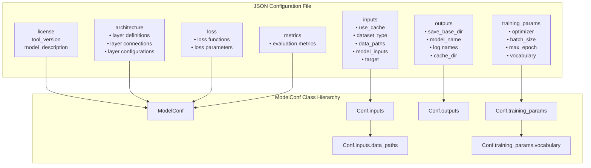
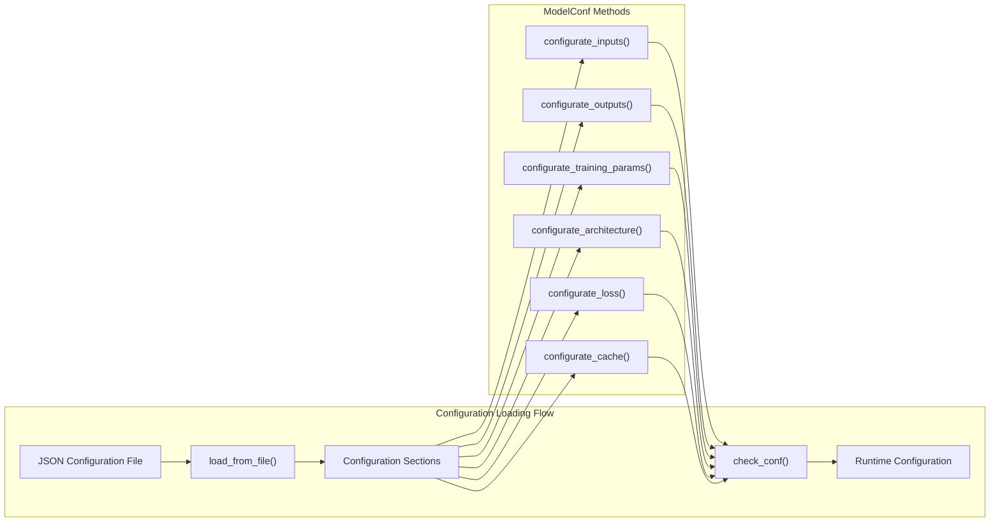
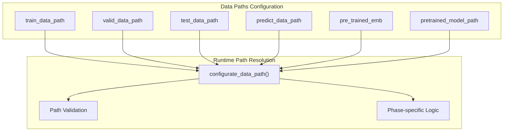
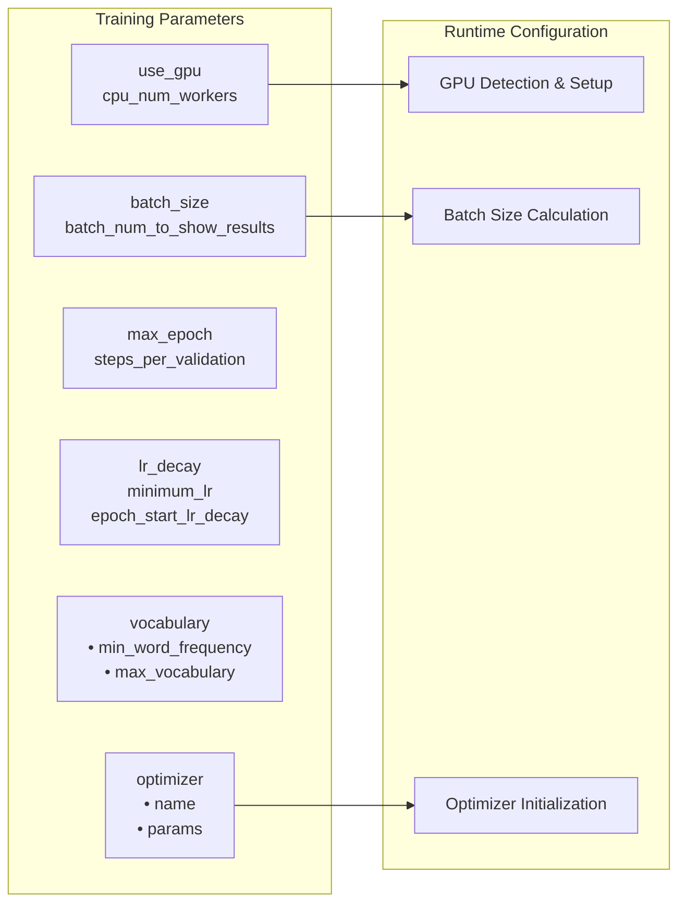
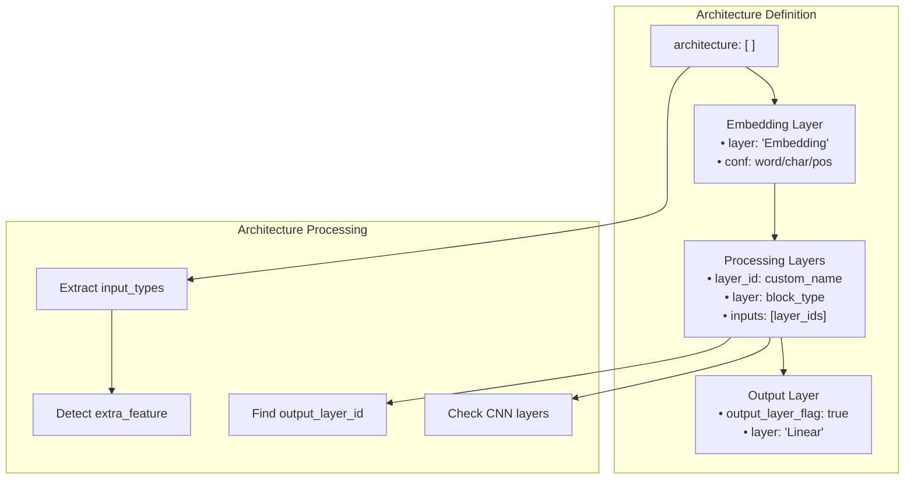
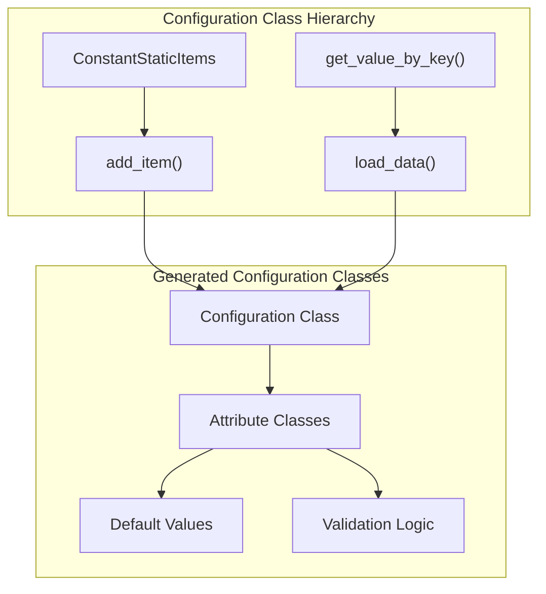
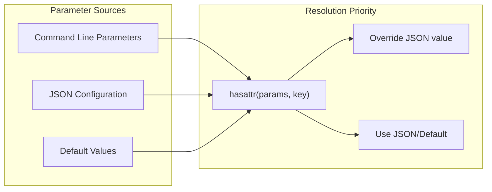

<!-- source: DeepWiki mcp.deepwiki.com · repo microsoft/NeuronBlocks · page 3.3 Configuration System · fetched 2026-10-26 -->

# Configuration System

Relevant source files

The following files were used as context for generating this wiki page:

- [.gitignore](.gitignore)
- [ModelConf.py](ModelConf.py)
- [Tutorial.md](Tutorial.md)
- [Tutorial_zh_CN.md](Tutorial_zh_CN.md)
- [block_zoo/Pooling2D.py](block_zoo/Pooling2D.py)
- [model_zoo/nlp_tasks/knowledge_distillation/query_binary_classifier_compression/conf_kdqbc_bilstmattn_cnn.json](model_zoo/nlp_tasks/knowledge_distillation/query_binary_classifier_compression/conf_kdqbc_bilstmattn_cnn.json)
- [utils/common_utils.py](utils/common_utils.py)

The Configuration System is the central mechanism in NeuronBlocks for defining model architectures, training parameters, data paths, and execution settings through JSON files. It provides a declarative approach to building and configuring neural network models without writing code, enabling users to focus on model design rather than implementation details.

For information about the specific blocks available for model architecture, see [Block Zoo](#3.1). For pre-configured model examples, see [Model Zoo](#3.2).

## Overview

The configuration system operates through JSON files that specify every aspect of model training, testing, and prediction. The system handles configuration loading, validation, and transformation into runtime objects through the `ModelConf` class and its nested configuration structures.

## Configuration File Structure

## JSON Configuration Architecture

*Sources: [Tutorial.md:86-204](), [ModelConf.py:101-169]()*

The configuration file follows a hierarchical structure with seven main sections, each mapped to corresponding classes in the `ModelConf` system for type-safe loading and validation.

## Core Configuration Management

### ModelConf Class

The `ModelConf` class serves as the primary configuration manager, handling loading, validation, and runtime configuration setup.

*Sources: [ModelConf.py:68-100](), [ModelConf.py:174-184]()*

### Configuration Loading Process

The `ModelConf` constructor handles the complete configuration loading pipeline:

1. **Phase Validation**: Validates the execution phase (`train`, `test`, `predict`, `cache`)
2. **File Loading**: Loads JSON configuration using `load_from_json`
3. **Version Compatibility**: Checks NeuronBlocks version compatibility
4. **Section Configuration**: Processes each configuration section through dedicated methods
5. **Validation**: Performs comprehensive configuration validation

*Sources: [ModelConf.py:69-92]()*

## Configuration Sections

### Inputs Configuration

The `inputs` section defines data sources, file formats, and model input specifications.

| Parameter | Type | Default | Description |
|-----------|------|---------|-------------|
| `use_cache` | boolean | `true` | Enable data caching for faster subsequent runs |
| `dataset_type` | string | required | Task type: `classification`, `regression`, `sequence_tagging` |
| `file_header` | object | required | Column mappings for train/valid/test data |
| `model_inputs` | object | required | Input field mappings to model inputs |
| `target` | array | required | Target column names for training |

*Sources: [ModelConf.py:107-129](), [Tutorial.md:92-119]()*

### Data Paths Configuration

The nested `data_paths` section specifies file locations:

*Sources: [ModelConf.py:112-118](), [ModelConf.py:247-279]()*

### Training Parameters

The `training_params` section controls model training behavior:

*Sources: [ModelConf.py:142-164](), [ModelConf.py:357-413]()*

### Architecture Configuration

The `architecture` section defines the neural network structure as a list of layer configurations:

*Sources: [ModelConf.py:414-447](), [Tutorial.md:157-189]()*

## Configuration Validation System

### ConstantStaticItems Pattern

The configuration system uses a sophisticated pattern for declarative configuration loading through the `ConstantStaticItems` class:

*Sources: [ModelConf.py:22-66]()*

### Validation Process

The configuration validation process ensures correctness across multiple dimensions:

1. **Structural Validation**: Verifies required fields exist and optional fields have defaults
2. **Type Validation**: Ensures values match expected types
3. **Value Validation**: Validates enums, ranges, and constraints  
4. **Cross-section Validation**: Checks consistency between related configuration sections
5. **Runtime Validation**: Validates file paths, GPU availability, and resource constraints

*Sources: [ModelConf.py:90-91](), [utils/common_utils.py:15-19]()*

## Configuration Usage Patterns

### Multi-phase Configuration

The configuration system supports different execution phases with phase-specific validation:

| Phase | Purpose | Required Sections | Validation Level |
|-------|---------|------------------|------------------|
| `train` | Model training | All sections | Full validation |
| `test` | Model evaluation | inputs, outputs, architecture, loss, metrics | Partial validation |
| `predict` | Inference | inputs, outputs, architecture | Minimal validation |
| `cache` | Cache verification | inputs only | Cache-specific validation |

*Sources: [ModelConf.py:79-81](), [ModelConf.py:90-91]()*

### Parameter Override System

Command-line parameters can override configuration file values through the `params` mechanism:

*Sources: [ModelConf.py:257-267](), [ModelConf.py:368-369]()*

### Configuration Caching

The system implements intelligent caching of processed configurations and computed artifacts:

- **Configuration MD5**: Tracks changes to training data and configuration
- **Problem Caching**: Serializes vocabulary and preprocessing state
- **Embedding Caching**: Caches loaded pre-trained embeddings
- **Cache Validation**: Ensures cache consistency across runs

*Sources: [ModelConf.py:460-488](), [ModelConf.py:489-497]()*

---

