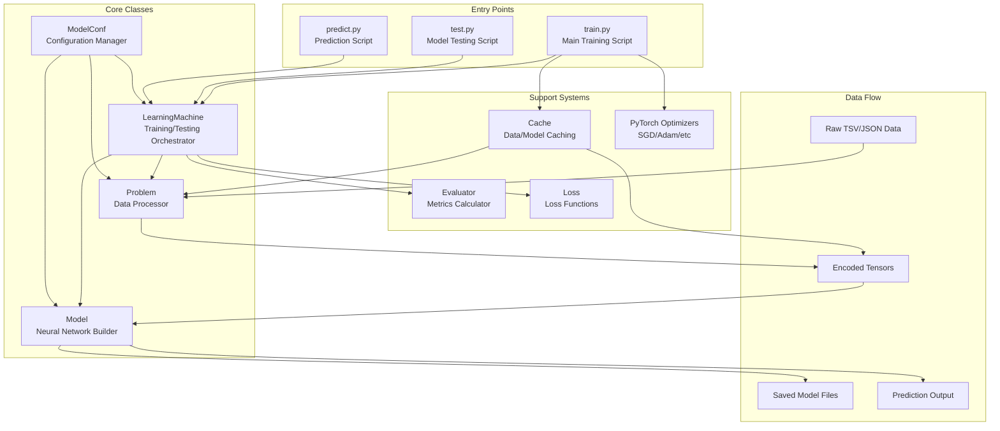
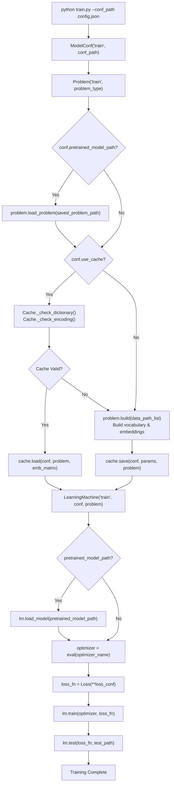
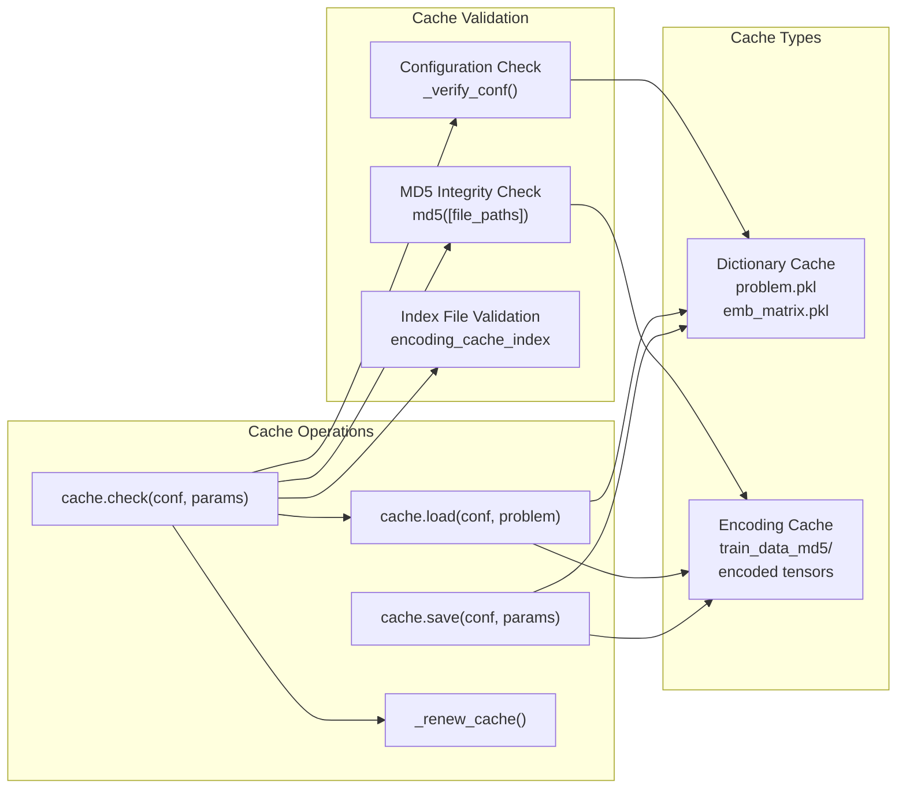
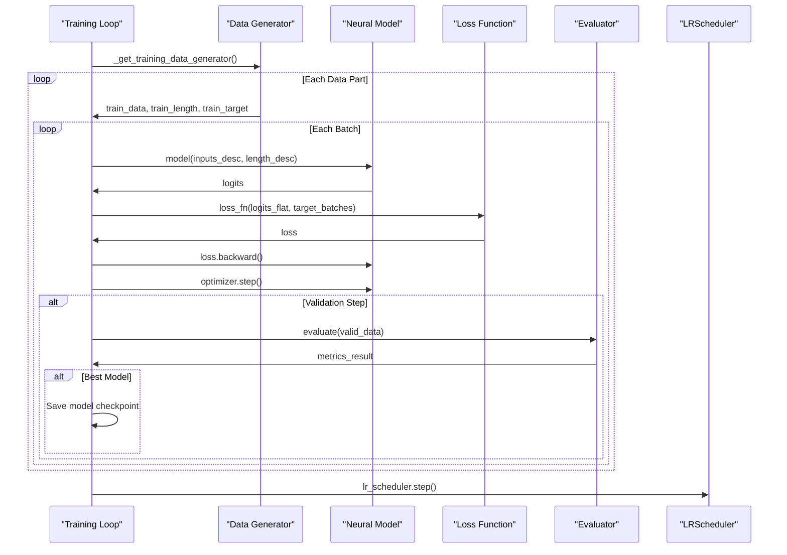
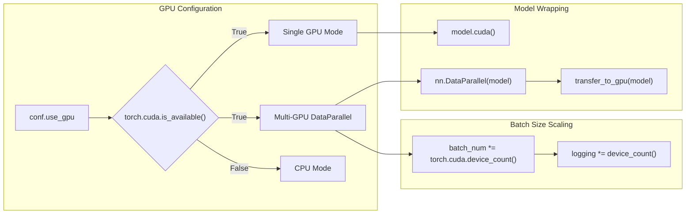

<!-- source: DeepWiki mcp.deepwiki.com · repo microsoft/NeuronBlocks · page 4 Training and Evaluation · fetched 2026-10-26 -->

# Training and Evaluation

Relevant source files

The following files were used as context for generating this wiki page:

- [LearningMachine.py](LearningMachine.py)
- [Model.py](Model.py)
- [block_zoo/Embedding.py](block_zoo/Embedding.py)
- [predict.py](predict.py)
- [test.py](test.py)
- [train.py](train.py)

This document provides a comprehensive overview of the training and evaluation system in NeuronBlocks, covering the end-to-end workflow from data preparation to model testing. The system is designed around a centralized `LearningMachine` class that orchestrates training, validation, and testing processes across different NLP task types.

For detailed information about specific components, see [Training Pipeline](#4.1), [Testing and Prediction](#4.2), [Data Processing](#4.3), and [Evaluation Metrics](#4.4). For model architecture details, see [Core Architecture](#3).

## System Overview

The training and evaluation system consists of three main entry points (`train.py`, `test.py`, `predict.py`) that all leverage the core `LearningMachine` class for model operations. The system supports caching, distributed training, and multiple problem types including classification, sequence tagging, regression, and machine reading comprehension.

### Core Components Architecture

Sources: [train.py:1-390](), [LearningMachine.py:31-92](), [test.py:17-58](), [predict.py:15-71]()

## Training Workflow

The training process follows a structured pipeline that handles data preparation, model initialization, iterative training with validation, and model persistence. The workflow supports both fresh training and fine-tuning from pretrained models.

### Training Pipeline Flow

Sources: [train.py:228-338](), [train.py:108-128](), [LearningMachine.py:93-338]()

### Cache System Architecture

The caching system optimizes training by storing preprocessed data and embeddings to avoid redundant computation across training runs.

Sources: [train.py:25-227](), [train.py:108-128](), [train.py:200-227]()

## LearningMachine Core Operations

The `LearningMachine` class serves as the central orchestrator for all model operations, handling different problem types and providing unified interfaces for training, testing, and prediction.

### LearningMachine Method Structure

| Method | Purpose | Key Parameters | Problem Types Supported |
|--------|---------|---------------|------------------------|
| `__init__` | Initialize learning machine | `phase`, `conf`, `problem`, `vocab_info` | All |
| `train` | Execute training loop | `optimizer`, `loss_fn` | All |
| `test` | Evaluate model on test data | `loss_fn`, `test_data_path` | All |
| `evaluate` | Internal evaluation method | `data`, `evaluator`, `loss_fn` | All |
| `predict` | Generate predictions | `data_path`, `output_path` | All |
| `interactive` | Interactive prediction mode | `samples`, `file_columns` | All |

Sources: [LearningMachine.py:31-89](), [LearningMachine.py:93-338](), [LearningMachine.py:339-360]()

### Training Loop Implementation

Sources: [LearningMachine.py:124-338](), [LearningMachine.py:146-336]()

## Problem Type Support

The system supports multiple NLP task types with specialized handling for each:

### Problem Type Configuration

| Problem Type | Class Constant | Prediction Output | Metrics |
|-------------|---------------|------------------|---------|
| Classification | `ProblemTypes.classification` | Class probabilities | `accuracy`, `auc`, `f1` |
| Sequence Tagging | `ProblemTypes.sequence_tagging` | Tag sequences | `seq_tag_f1`, `accuracy` |
| Regression | `ProblemTypes.regression` | Continuous values | `mse`, `rmse` |
| MRC | `ProblemTypes.mrc` | Text spans | `mrc_em`, `mrc_f1` |

Sources: [LearningMachine.py:76-88](), [LearningMachine.py:182-265]()

## Testing and Prediction

The testing system reuses the same `LearningMachine` infrastructure but operates in evaluation mode with different data flow patterns.

### Test vs Predict Workflow

```mermaid
graph TB
    subgraph "test.py Workflow"
        TEST_START["test.py --conf_path config.json"] --> TEST_CONF["ModelConf('test', conf_path)"]
        TEST_CONF --> TEST_PROBLEM["Problem('test', ...)"]
        TEST_PROBLEM --> TEST_LOAD_PROBLEM["problem.load_problem(saved_problem_path)"]
        TEST_LOAD_PROBLEM --> TEST_LM["LearningMachine('test', ...)"]
        TEST_LM --> TEST_LOAD_MODEL["lm.load_model(previous_model_path)"]
        TEST_LOAD_MODEL --> TEST_EXECUTE["lm.test(loss_fn, test_path)"]
    end
    
    subgraph "predict.py Workflow"
        PRED_START["predict.py --conf_path config.json"] --> PRED_CONF["ModelConf('predict', conf_path)"]
        PRED_CONF --> PRED_PROBLEM["Problem('predict', ...)"]
        PRED_PROBLEM --> PRED_LOAD_PROBLEM["problem.load_problem(saved_problem_path)"]
        PRED_LOAD_PROBLEM --> PRED_LM["LearningMachine('predict', ...)"]
        PRED_LM --> PRED_LOAD_MODEL["lm.load_model(previous_model_path)"]
        PRED_LOAD_MODEL --> PRED_MODE{"`predict_mode`"}
        PRED_MODE -->|batch| PRED_BATCH["lm.predict(data_path, output_path)"]
        PRED_MODE -->|interactive| PRED_INTERACTIVE["lm.interactive(samples)"]
    end
```

Sources: [test.py:17-58](), [predict.py:15-71](), [predict.py:37-70]()

## GPU and Distributed Training Support

The system supports GPU acceleration and multi-GPU distributed training through PyTorch's `DataParallel`:

Sources: [LearningMachine.py:36-48](), [LearningMachine.py:140-144](), [Model.py:405-420]()

## Integration Points

This training and evaluation system integrates with several other NeuronBlocks components:

- **Configuration System**: Uses `ModelConf` for parameter management (see [Configuration System](#3.3))
- **Block Zoo**: Leverages neural building blocks for model construction (see [Block Zoo](#3.1))
- **Data Processing**: Depends on `Problem` class for data handling (see [Data Processing](#4.3))
- **Model Architecture**: Uses `Model` class for neural network construction (see [Core Architecture](#3))

The system provides a complete training-to-deployment pipeline that handles the complexity of modern deep learning workflows while maintaining flexibility for different NLP tasks and deployment scenarios.

Sources: [train.py:1-390](), [LearningMachine.py:1-897](), [test.py:1-77](), [predict.py:1-91]()

---

