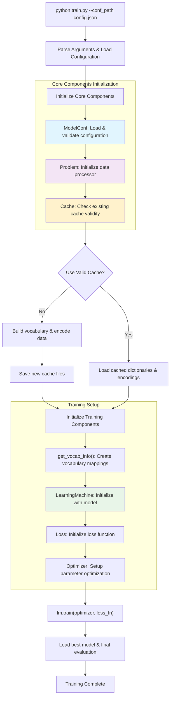
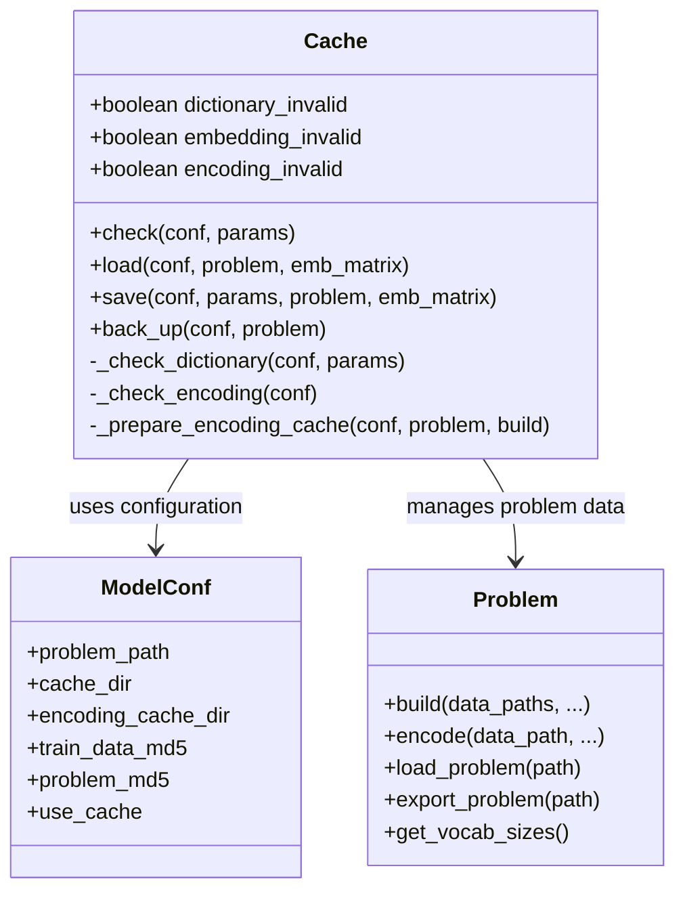
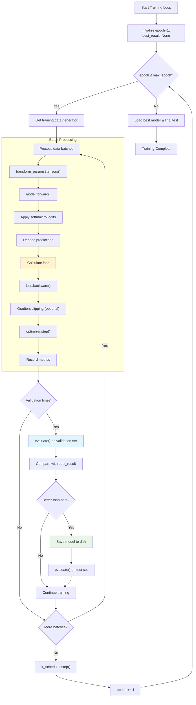
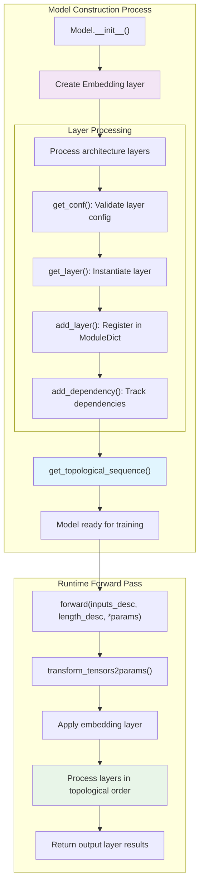
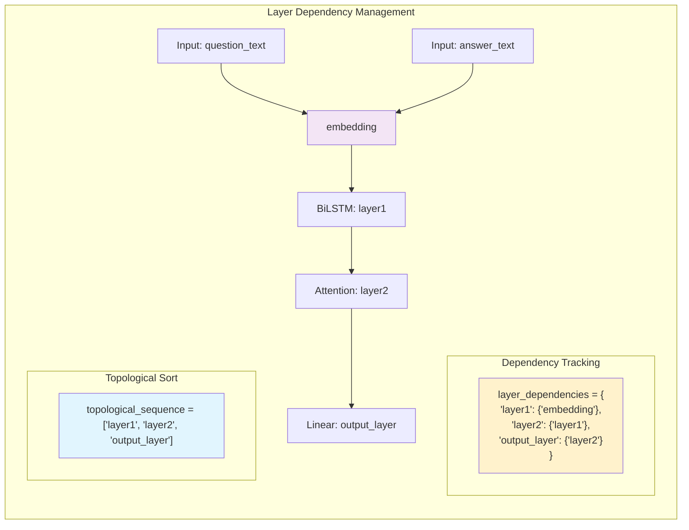

<!-- source: DeepWiki mcp.deepwiki.com · repo microsoft/NeuronBlocks · page 4.1 Training Pipeline · fetched 2026-10-26 -->

# Training Pipeline

<details>
<summary>Relevant source files</summary>

The following files were used as context for generating this wiki page:

- [LearningMachine.py](LearningMachine.py)
- [Model.py](Model.py)
- [block_zoo/Embedding.py](block_zoo/Embedding.py)
- [train.py](train.py)

</details>


This document covers the training pipeline in NeuronBlocks, which orchestrates the complete process of training neural network models from data preprocessing through model evaluation. The training pipeline handles caching, data encoding, model initialization, training loops, validation, and model persistence.

For information about testing and prediction workflows, see [Testing and Prediction](#4.2). For details about data preprocessing components, see [Data Processing](#4.3).

## Overview

The training pipeline is implemented primarily through the `train.py` script, which coordinates several key components to execute the complete training workflow. The pipeline supports various NLP tasks including text classification, sequence tagging, regression, and machine reading comprehension.

## High-Level Training Workflow



Sources: [train.py:228-338]()

## Core Components

### Cache Management

The `Cache` class handles intelligent caching of preprocessed data and model dictionaries to avoid redundant computation across training runs.



The cache system validates three levels of cache:
- **Dictionary cache**: Vocabulary mappings and embeddings
- **Encoding cache**: Pre-encoded training data
- **Configuration cache**: Model configuration consistency

Sources: [train.py:25-227]()

### Learning Machine

The `LearningMachine` class serves as the central training coordinator, managing the model, training loop, validation, and evaluation.

```mermaid
graph TB
    subgraph "LearningMachine Architecture"
        LM["LearningMachine"]
        LM --> MODEL["self.model: Model instance"]
        LM --> CONF["self.conf: ModelConf"]
        LM --> PROBLEM["self.problem: Problem"]
        LM --> EVALUATOR["self.evaluator: Evaluator"]
        LM --> METRICS["self.metrics: List of metrics"]
    end
    
    subgraph "Core Methods"
        LM --> TRAIN["train(optimizer, loss_fn)"]
        LM --> TEST["test(loss_fn, test_data_path)"]
        LM --> EVALUATE["evaluate(data, length, target, ...)"]
        LM --> PREDICT["predict(predict_data_path, output_path)"]
        LM --> LOAD_MODEL["load_model(model_path)"]
    end
    
    subgraph "Training Loop Components"
        TRAIN --> GET_BATCHES["get_batches(): Create data batches"]
        TRAIN --> FORWARD["model.forward(): Forward pass"]
        TRAIN --> LOSS_CALC["loss_fn(): Calculate loss"]
        TRAIN --> BACKWARD["loss.backward(): Backward pass"]
        TRAIN --> OPTIMIZER_STEP["optimizer.step(): Update parameters"]
        TRAIN --> VALIDATION["Periodic validation on dev set"]
        TRAIN --> MODEL_SAVE["Save best model based on validation"]
    end

    style LM fill:#e1f5fe
    style TRAIN fill:#e8f5e8
    style VALIDATION fill:#fff2cc
```



Sources: [LearningMachine.py:31-92](), [LearningMachine.py:93-338]()

## Training Loop Details

The core training loop in `LearningMachine.train()` implements a sophisticated training process with validation, early stopping, and model checkpointing.



Sources: [LearningMachine.py:93-338]()

### Problem Type Support

The training pipeline supports multiple problem types with specialized handling for each:

| Problem Type | Prediction Shape | Metrics | Special Handling |
|--------------|------------------|---------|------------------|
| `classification` | `[batch_size, num_classes]` | accuracy, auc, f1 | Softmax + argmax for predictions |
| `sequence_tagging` | `[batch_size, seq_len, num_tags]` | seq_tag_f1, accuracy | BIO/BIOES decoding, CRF support |
| `regression` | `[batch_size, 1]` | mse, rmse | Direct numeric predictions |
| `mrc` | `[batch_size, seq_len, 1]` | mrc_em, mrc_f1 | Span extraction from passages |

Sources: [LearningMachine.py:114-122](), [LearningMachine.py:182-211]()

## Model Architecture Construction

The `Model` class builds the neural network architecture based on the configuration, handling layer dependencies and data flow.



Sources: [Model.py:143-266](), [Model.py:347-403]()

### Layer Configuration and Dependencies



Sources: [Model.py:195-267](), [Model.py:313-345]()

## Data Flow and Encoding

The training pipeline processes data through multiple encoding stages before reaching the model.

```mermaid
flowchart LR
    subgraph "Data Preprocessing"
        RAW["Raw TSV Data"] --> PROBLEM_ENCODE["problem.encode()"]
        PROBLEM_ENCODE --> VOCAB_BUILD["Vocabulary Building"]
        VOCAB_BUILD --> DATA_ENCODE["Text → ID Conversion"]
    end
    
    subgraph "Batch Processing"
        DATA_ENCODE --> GET_BATCHES["get_batches()"]
        GET_BATCHES --> TRANSFORM["transform_params2tensors()"]
        TRANSFORM --> MODEL_INPUT["Model Inputs"]
    end
    
    subgraph "Model Processing"
        MODEL_INPUT --> EMBED_LAYER["Embedding Layer"]
        EMBED_LAYER --> ARCH_LAYERS["Architecture Layers"]
        ARCH_LAYERS --> LOGITS["Raw Logits"]
        LOGITS --> SOFTMAX["Softmax/Activation"]
        SOFTMAX --> PREDICTIONS["Predictions"]
    end
    
    subgraph "Training Feedback"
        PREDICTIONS --> LOSS_CALC["Loss Calculation"]
        LOSS_CALC --> GRADIENTS["Gradient Computation"]
        GRADIENTS --> PARAM_UPDATE["Parameter Updates"]
    end

    style VOCAB_BUILD fill:#f3e5f5
    style EMBED_LAYER fill:#e1f5fe
    style LOSS_CALC fill:#fff2cc
```



Sources: [train.py:247-261](), [LearningMachine.py:97-107](), [LearningMachine.py:131-134]()

## Configuration and Customization

The training pipeline is highly configurable through JSON configuration files and command-line arguments.

### Command Line Interface

```bash
python train.py \
    --conf_path configs/sentiment_classification.json \
    --train_data_path data/train.tsv \
    --valid_data_path data/valid.tsv \
    --test_data_path data/test.tsv \
    --cache_dir cache/ \
    --model_save_dir models/ \
    --max_epoch 50 \
    --batch_size 32 \
    --learning_rate 0.001
```

### Key Configuration Components

| Component | Purpose | Configuration Location |
|-----------|---------|----------------------|
| `ModelConf` | Model architecture and training params | JSON config file |
| `Problem` | Data processing and task definition | `conf.problem_type`, `conf.input_types` |
| `LearningMachine` | Training loop and evaluation | `conf.max_epoch`, `conf.batch_size_total` |
| `Cache` | Data caching and persistence | `conf.use_cache`, `conf.cache_dir` |
| Loss Function | Training objective | `conf.loss` |
| Optimizer | Parameter optimization | `conf.optimizer_name`, `conf.optimizer_params` |

Sources: [train.py:356-379](), [train.py:230-234](), [train.py:299-323]()

---

