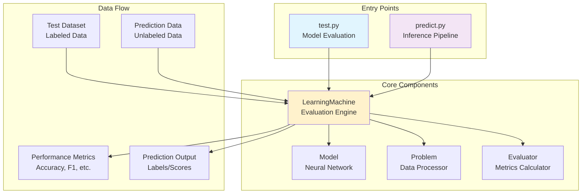
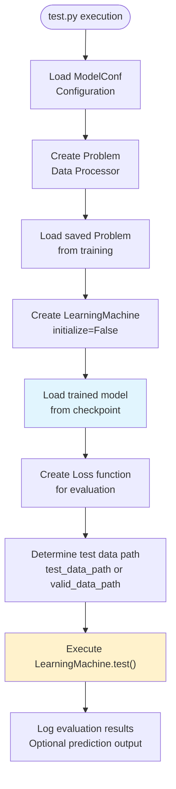
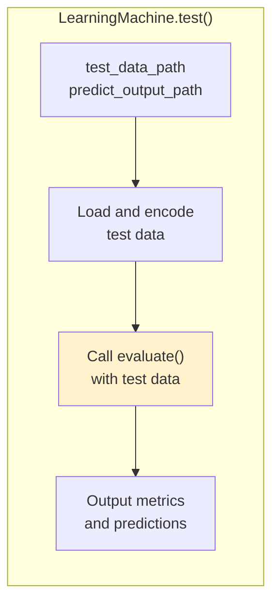
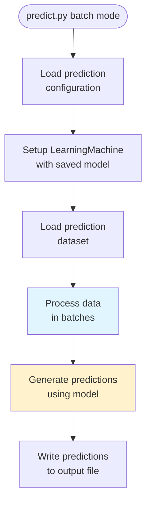
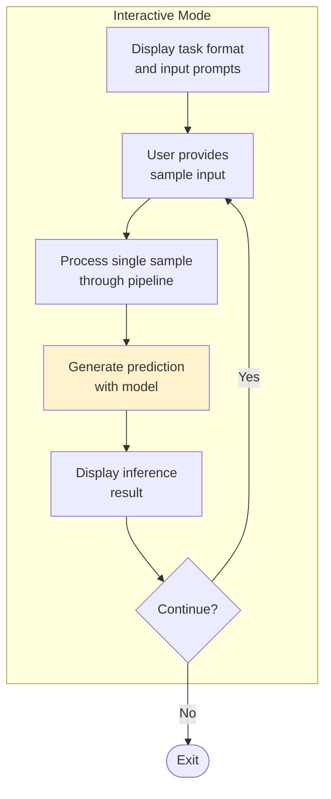
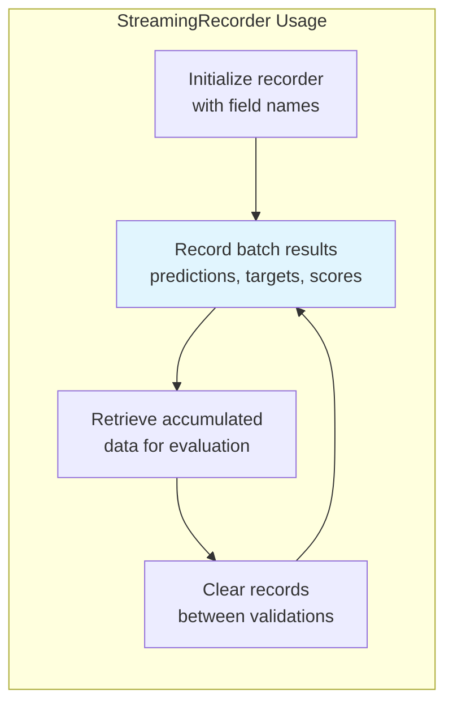

<!-- source: DeepWiki mcp.deepwiki.com · repo microsoft/NeuronBlocks · page 4.2 Testing and Prediction · fetched 2026-10-26 -->

# Testing and Prediction

<details>
<summary>Relevant source files</summary>

The following files were used as context for generating this wiki page:

- [LearningMachine.py](LearningMachine.py)
- [Model.py](Model.py)
- [block_zoo/Embedding.py](block_zoo/Embedding.py)
- [predict.py](predict.py)
- [test.py](test.py)

</details>


This page covers model evaluation and inference in NeuronBlocks. Testing evaluates trained models against labeled datasets to compute performance metrics, while prediction generates outputs for new, unlabeled data. Both processes share core evaluation logic but differ in their input requirements and output formats.

For information about the training process, see [Training Pipeline](#4.1). For details about data preprocessing, see [Data Processing](#4.3). For available evaluation metrics, see [Evaluation Metrics](#4.4).

## Overview

Testing and prediction in NeuronBlocks operate through two main entry points: `test.py` for model evaluation and `predict.py` for inference on new data. Both utilize the `LearningMachine` class's evaluation infrastructure but serve different purposes:

- **Testing**: Evaluates model performance on labeled test data and computes metrics
- **Prediction**: Generates predictions for unlabeled data in batch or interactive mode



Sources: [test.py:17-58](), [predict.py:15-71](), [LearningMachine.py:31-92]()

## Testing Workflow

The testing process evaluates trained models against labeled datasets to measure performance. The `test.py` script orchestrates this workflow by loading saved models and running evaluation.

### Test Script Execution

Testing begins with the `test.py` script, which handles configuration loading, model restoration, and evaluation orchestration:



Sources: [test.py:17-58]()

### Model Loading and Setup

The testing process requires several key components to be loaded and configured:

| Component | Purpose | Configuration |
|-----------|---------|---------------|
| `ModelConf` | Configuration management | Loaded from JSON config file |
| `Problem` | Data processing pipeline | Restored from saved state during training |
| `LearningMachine` | Evaluation orchestrator | Initialized without model building |
| `Model` | Neural network | Loaded from saved checkpoint |
| `Loss` | Loss function | Created for evaluation metrics |

Sources: [test.py:18-46](), [LearningMachine.py:32-90]()

### Core Testing Logic

The `LearningMachine.test()` method handles the core testing logic:



Sources: [LearningMachine.py:339-360]()

## Prediction Workflow

Prediction generates outputs for new, unlabeled data and supports both batch processing and interactive inference modes.

### Prediction Modes

NeuronBlocks supports two prediction modes:

| Mode | Description | Use Case |
|------|-------------|----------|
| `batch` | Process entire datasets | Production inference on large datasets |
| `interactive` | Real-time single sample inference | Development, testing, demonstrations |

Sources: [predict.py:37-70]()

### Batch Prediction

Batch mode processes entire datasets efficiently:



Sources: [predict.py:37-41]()

### Interactive Prediction

Interactive mode provides real-time inference for individual samples:



Sources: [predict.py:42-70]()

## Core Evaluation Logic

The `LearningMachine.evaluate()` method implements the shared evaluation logic used by both testing and prediction workflows.

### Evaluation Process

The evaluation process handles different problem types and supports both metric computation and prediction output:

```mermaid
graph TB
    subgraph "LearningMachine.evaluate()"
        SET_EVAL["Set model to eval mode<br/>torch.no_grad()"]
        GET_BATCHES["Create data batches<br/>get_batches()"]
        INIT_RECORDER["Initialize StreamingRecorder<br/>for predictions/targets"]
        
        subgraph "Batch Processing Loop"
            FORWARD["Forward pass<br/>model(inputs, lengths)"]
            SOFTMAX["Apply softmax<br/>to logits"]
            DECODE["Decode predictions<br/>by problem type"]
            RECORD["Record predictions<br/>and targets"]
            COMPUTE_LOSS["Compute loss<br/>for metrics"]
        end
        
        EVAL_METRICS["Evaluate metrics<br/>using Evaluator"]
        OUTPUT_PRED["Write predictions<br/>if output path provided"]
    end
    
    SET_EVAL --> GET_BATCHES
    GET_BATCHES --> INIT_RECORDER
    INIT_RECORDER --> FORWARD
    FORWARD --> SOFTMAX
    SOFTMAX --> DECODE
    DECODE --> RECORD
    RECORD --> COMPUTE_LOSS
    COMPUTE_LOSS --> FORWARD
    COMPUTE_LOSS --> EVAL_METRICS
    EVAL_METRICS --> OUTPUT_PRED
    
    style FORWARD fill:#e1f5fe
    style DECODE fill:#fff2cc
```



Sources: [LearningMachine.py:361-648]()

### Problem Type Handling

The evaluation logic adapts to different problem types with specialized prediction decoding:

| Problem Type | Prediction Format | Decoding Logic |
|--------------|------------------|----------------|
| `classification` | Class indices and confidence scores | `logits_softmax.max(1)[1]` for class prediction |
| `sequence_tagging` | Tag sequences per token | `logits_softmax.max(2)[1]` for sequence labels |
| `regression` | Continuous values | Direct output from final layer |
| `mrc` | Text spans from passages | Custom decoding for start/end positions |

Sources: [LearningMachine.py:182-266](), [LearningMachine.py:470-568]()

### Streaming Data Recording

The `StreamingRecorder` class manages prediction and target data during evaluation:



Sources: [LearningMachine.py:114-122](), [LearningMachine.py:414-422]()

## Output Formats and Results

### Testing Output

Testing produces performance metrics and optionally saves detailed predictions:

- **Metrics**: Accuracy, F1 score, AUC, RMSE depending on problem type
- **Logging**: Detailed evaluation results logged to console and files
- **Predictions**: Optional detailed prediction files with confidence scores

### Prediction Output

Prediction generates structured output files with model predictions:

| Field Type | Description | Format |
|------------|-------------|--------|
| `prediction` | Predicted class/tag/value | String or numeric |
| `confidence` | Overall prediction confidence | Float 0.0-1.0 |
| `confidence@label` | Confidence for specific label | Float 0.0-1.0 |

Sources: [LearningMachine.py:522-534]()

### Prediction File Format

Prediction output files maintain the original input format with additional prediction columns:

```
Original_Column1    Original_Column2    prediction    confidence
Sample text 1       Context 1          positive      0.87
Sample text 2       Context 2          negative      0.92
```

Sources: [LearningMachine.py:424-433](), [LearningMachine.py:578-587]()

## GPU and Performance Considerations

### Memory Management

During evaluation, the system implements several memory optimization strategies:

- **Gradient Computation**: Disabled via `torch.no_grad()` to save memory
- **Batch Processing**: Configurable batch sizes to manage memory usage  
- **Cache Clearing**: `torch.cuda.empty_cache()` called between validation steps

### Model Parallelism

The evaluation logic supports multi-GPU inference:

- **DataParallel**: Automatic handling of `nn.DataParallel` wrapped models
- **Batch Size Scaling**: Automatic batch size adjustment for multiple GPUs
- **Device Management**: Proper tensor device placement for GPU inference

Sources: [LearningMachine.py:410](), [LearningMachine.py:140-144](), [LearningMachine.py:589-592]()

---

