<!-- source: DeepWiki mcp.deepwiki.com · repo microsoft/NeuronBlocks · page 4.3 Data Processing · fetched 2026-10-26 -->

# Data Processing

Relevant source files

The following files were used as context for generating this wiki page:

- [problem.py](problem.py)
- [utils/corpus_utils.py](utils/corpus_utils.py)

This document covers the data processing pipeline in NeuronBlocks, which handles text preprocessing, vocabulary building, data encoding, and batch generation for neural network training and inference. The data processing system is primarily implemented through the `Problem` class and associated utilities.

For information about training pipeline orchestration, see [Training Pipeline](#4.1). For details about model configuration, see [Configuration System](#3.3).

## Overview

The NeuronBlocks data processing pipeline transforms raw text data into numerical representations suitable for neural network processing. The system supports multiple problem types (classification, sequence tagging, regression, MRC), multiple languages (English, Chinese), and various input modalities (words, characters, BPE tokens, POS tags).

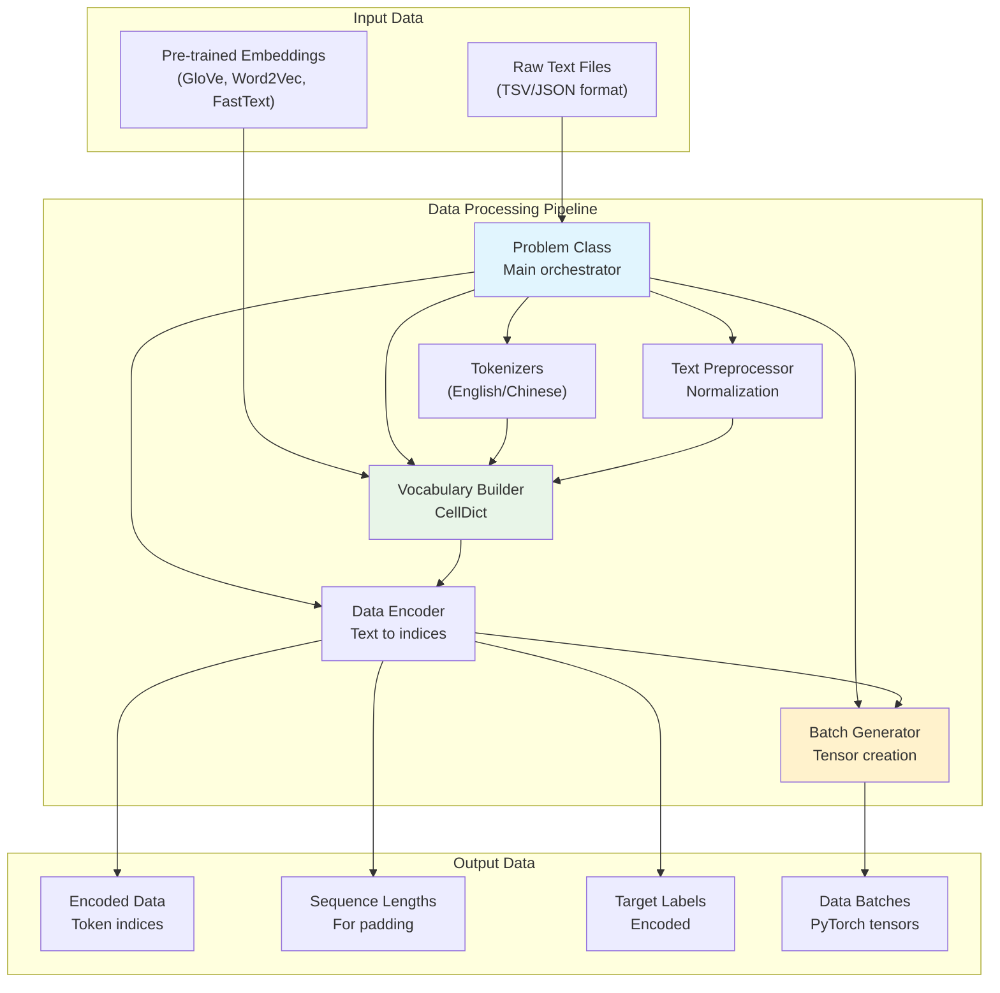

Sources: [problem.py:1-955](), [utils/corpus_utils.py:1-443]()

## Core Components

### Problem Class

The `Problem` class serves as the main orchestrator for data processing operations. It manages vocabulary construction, data encoding/decoding, and batch generation based on the problem type and configuration.

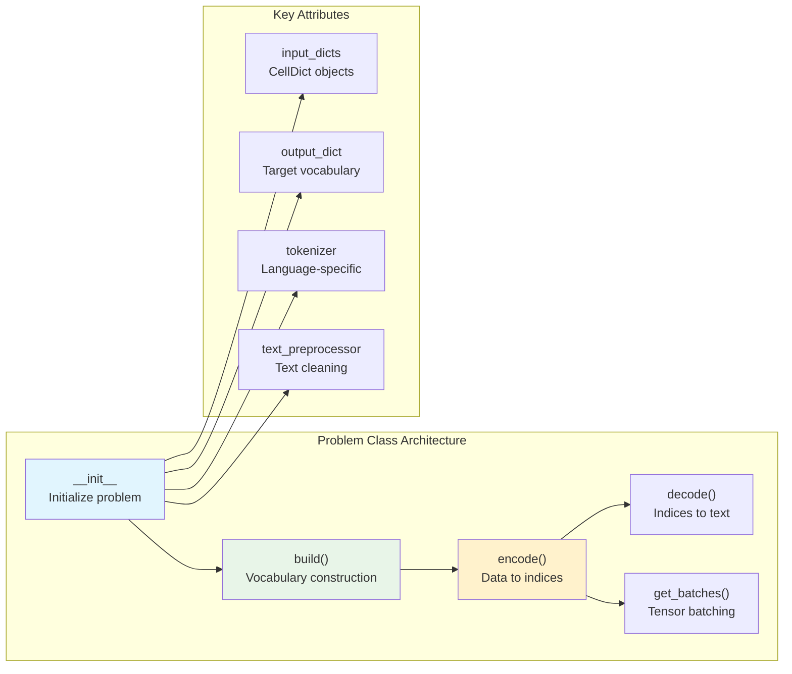

Sources: [problem.py:28-955]()

### Tokenizers and Preprocessors

The system supports language-specific tokenization through dedicated tokenizer classes:

| Component | Class | Supported Languages | Purpose |
|-----------|-------|-------------------|---------|
| English Tokenizer | `EnglishTokenizer` | English | NLTK-based tokenization with stopword removal |
| Chinese Tokenizer | `ChineseTokenizer` | Chinese | Jieba-based Chinese text segmentation |
| Text Preprocessor | `EnglishTextPreprocessor` | Multiple | Unicode normalization, DBC/SBC conversion |

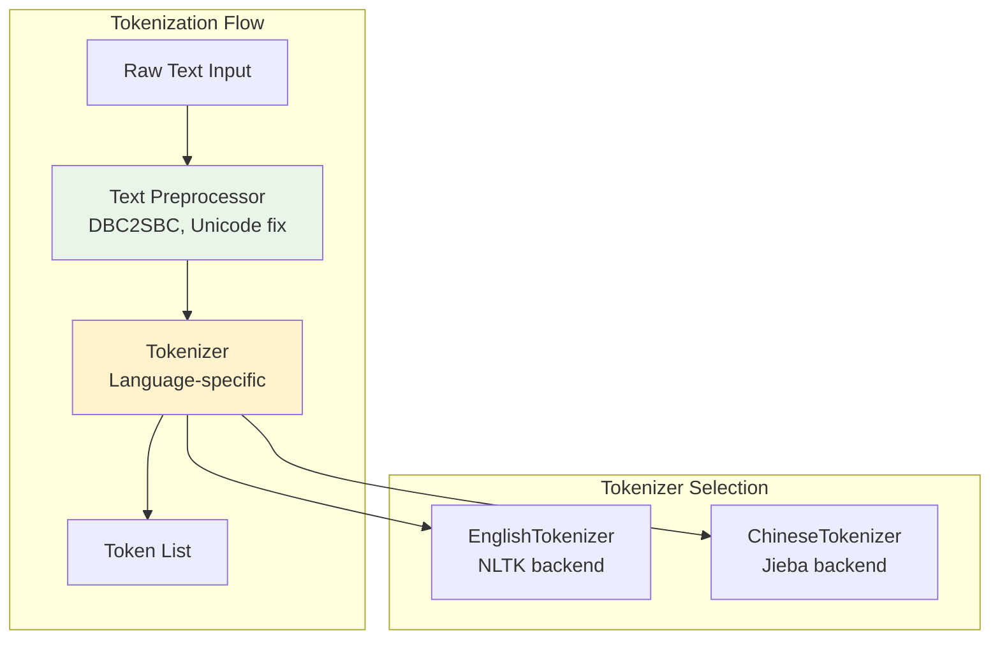

Sources: [problem.py:100-104](), [problem.py:21-24]()

## Data Formats and Input Types

### Supported Problem Types

The system handles four main problem types, each with specific data processing requirements:

| Problem Type | Target Format | Special Processing |
|--------------|---------------|--------------------|
| Classification | Single label per sample | Label encoding via `output_dict` |
| Sequence Tagging | Label sequence | BIO/BIOES tag handling, sequence alignment |
| Regression | Floating-point value | Direct numeric conversion |
| MRC (Machine Reading) | Character spans | Token offset calculation, span alignment |

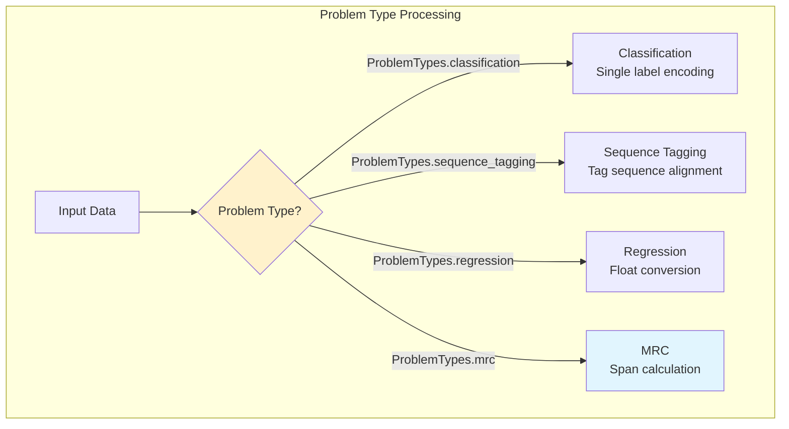

Sources: [problem.py:56-72](), [problem.py:184-191](), [problem.py:608-671]()

### Input Type Configurations

The system supports multiple input modalities that can be combined within a single model:

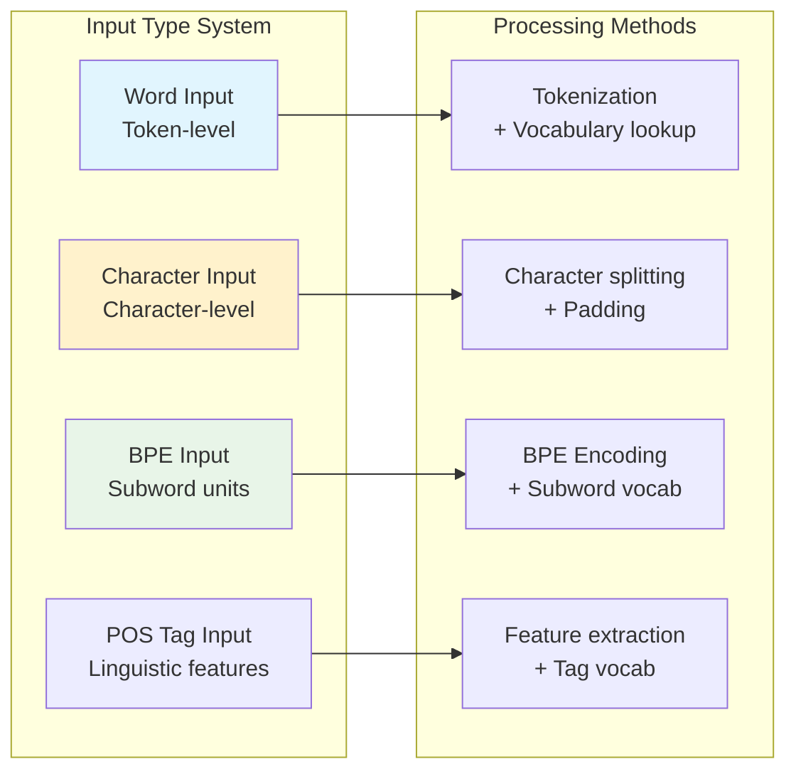

Sources: [problem.py:141-181](), [problem.py:493-519](), [problem.py:580-601]()

## Vocabulary Building

### CellDict Architecture

Vocabulary management is handled through `CellDict` objects that maintain bidirectional mappings between tokens and indices:

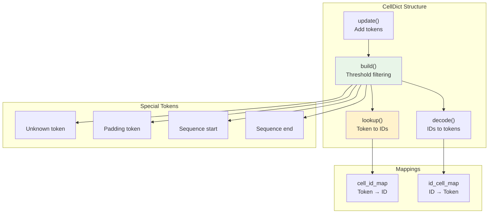

Sources: [problem.py:86-96](), [problem.py:292-304]()

### Embedding Integration

Pre-trained embeddings are loaded and integrated during vocabulary building:

| Format | Library | File Types | Usage |
|--------|---------|------------|--------|
| GloVe | Custom loader | Text files | Direct text parsing |
| Word2Vec | Gensim | Binary/Text | KeyedVectors interface |
| FastText | Gensim | Binary/Text | FastText model loading |

Sources: [utils/corpus_utils.py:28-72](), [problem.py:306-351]()

## Data Encoding Process

### Multi-Processing Pipeline

The system uses multi-processing for efficient data encoding:

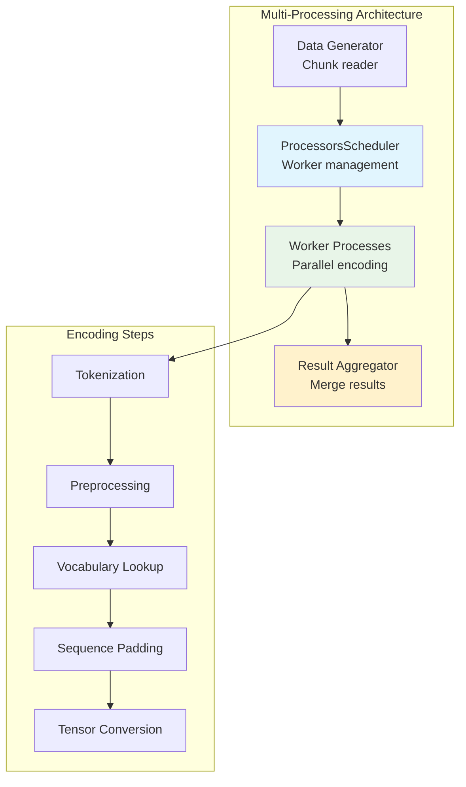

Sources: [problem.py:194-222](), [problem.py:392-410]()

### Sequence Processing

The encoding process handles variable-length sequences with appropriate padding and length tracking:

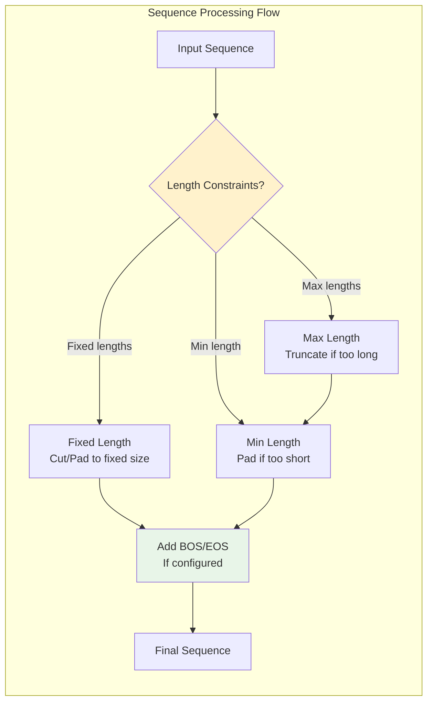

Sources: [problem.py:543-556](), [problem.py:619-630]()

## Batching and Tensor Creation

### Batch Generation Pipeline

The `get_batches` function in `corpus_utils.py` handles the conversion from encoded data to PyTorch tensors:

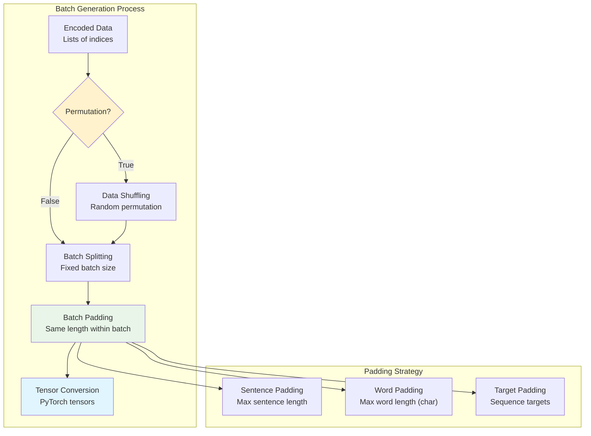

Sources: [utils/corpus_utils.py:177-399](), [utils/corpus_utils.py:306-396]()

### Character-Level Processing

For character-level inputs, the system implements nested padding (sentence-level and word-level):

| Level | Padding Strategy | Purpose |
|-------|-----------------|---------|
| Sentence | Pad to max sentence length | Uniform batch processing |
| Word | Pad to max word length | Character sequence alignment |
| Batch | Pad to batch max | Tensor compatibility |

Sources: [utils/corpus_utils.py:342-350](), [problem.py:580-598]()

## Caching Mechanisms

### Encoding Cache System

The system provides caching for encoded data to speed up repeated training runs:

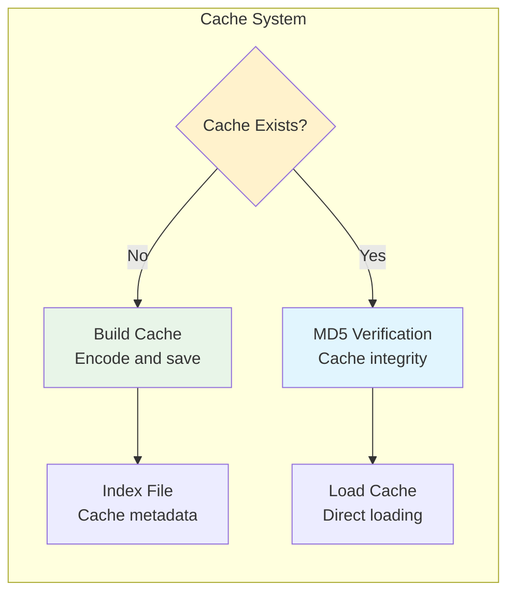

Sources: [problem.py:771-812](), [problem.py:777-812]()

## MRC-Specific Processing

### Span Alignment for Reading Comprehension

For Machine Reading Comprehension tasks, the system handles character-to-token span alignment:

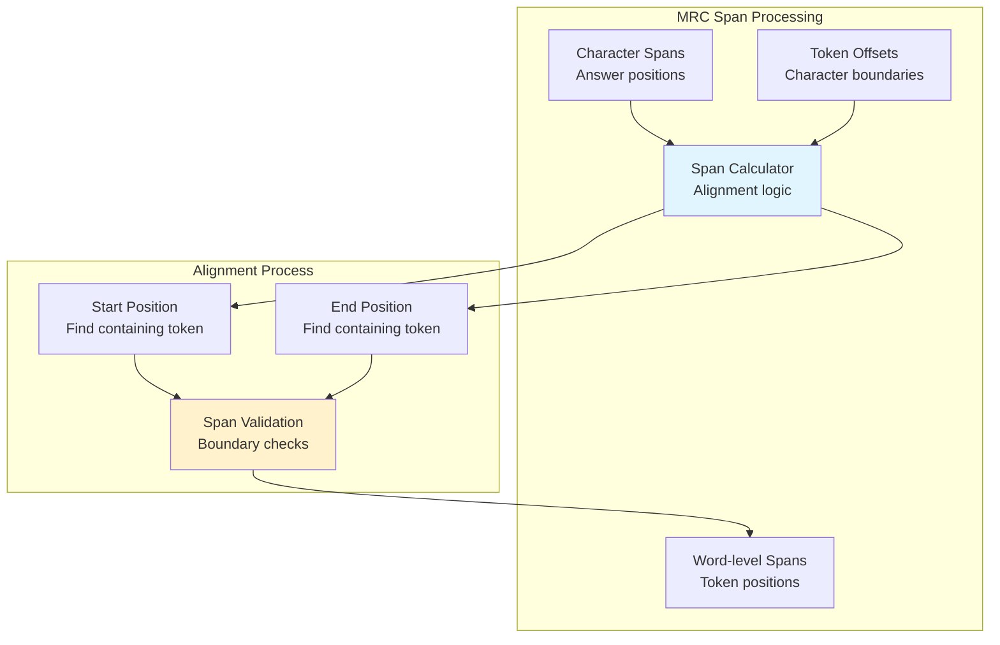

Sources: [problem.py:643-670](), [problem.py:504-510](), [problem.py:661-667]()

---

