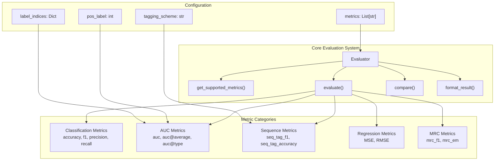
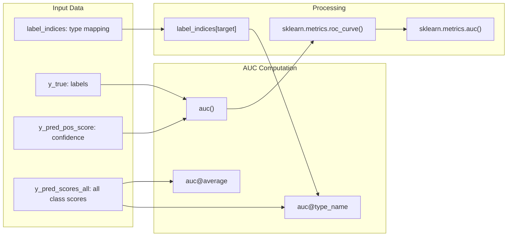
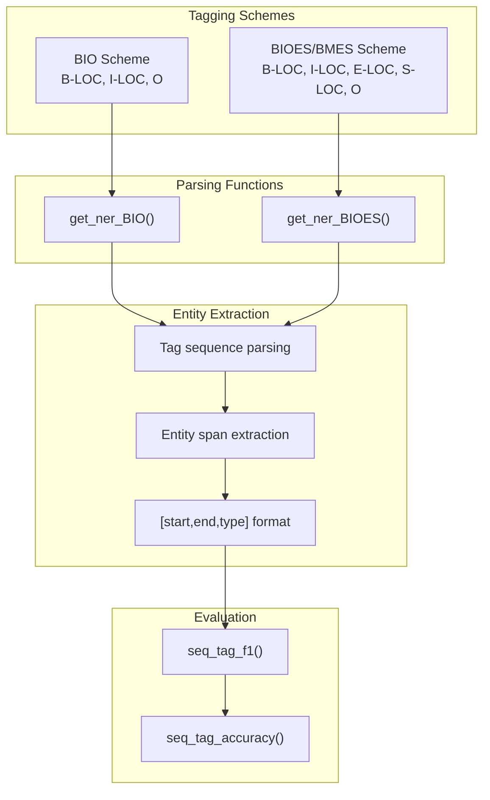
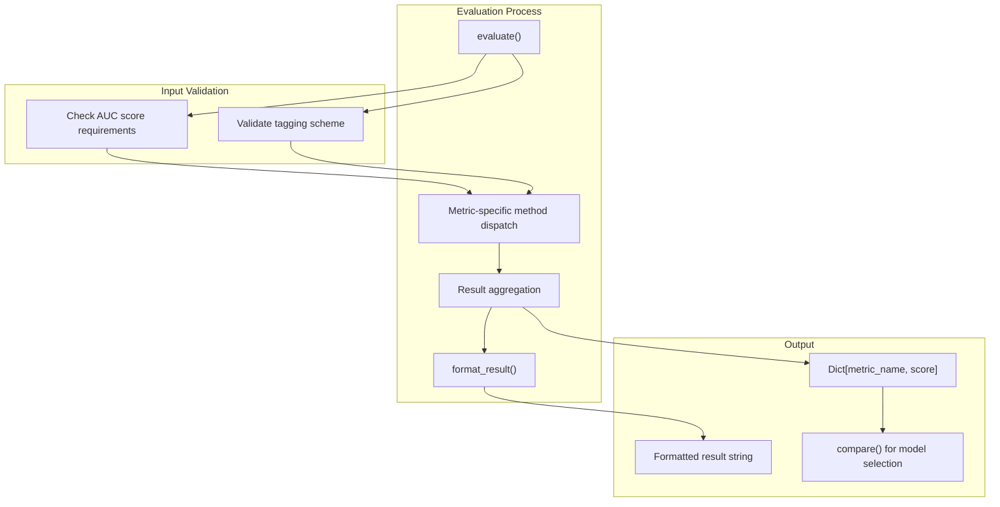

<!-- source: DeepWiki mcp.deepwiki.com · repo microsoft/NeuronBlocks · page 4.4 Evaluation Metrics · fetched 2026-10-26 -->

# Evaluation Metrics

<details>
<summary>Relevant source files</summary>

The following files were used as context for generating this wiki page:

- [core/CellDict.py](core/CellDict.py)
- [dataset/knowledge_distillation/query_binary_classifier/test.tsv](dataset/knowledge_distillation/query_binary_classifier/test.tsv)
- [dataset/knowledge_distillation/query_binary_classifier/train.tsv](dataset/knowledge_distillation/query_binary_classifier/train.tsv)
- [dataset/knowledge_distillation/query_binary_classifier/valid.tsv](dataset/knowledge_distillation/query_binary_classifier/valid.tsv)
- [dataset/slot_tagging/conll_2003/eng.testa.tsv](dataset/slot_tagging/conll_2003/eng.testa.tsv)
- [dataset/slot_tagging/conll_2003/eng.testb.tsv](dataset/slot_tagging/conll_2003/eng.testb.tsv)
- [dataset/slot_tagging/conll_2003/eng.train.tsv](dataset/slot_tagging/conll_2003/eng.train.tsv)
- [metrics/Evaluator.py](metrics/Evaluator.py)
- [metrics/slot_tagging_metrics.py](metrics/slot_tagging_metrics.py)

</details>


This document covers the evaluation metrics system in NeuronBlocks, which provides comprehensive model evaluation capabilities across different NLP tasks. The system supports classification, sequence tagging, regression, and machine reading comprehension metrics through a unified interface.

For information about the training pipeline that uses these metrics, see [Training Pipeline](#4.1). For details about data preprocessing and format requirements, see [Data Processing](#4.3).

## Core Evaluation Framework

The evaluation system is built around the `Evaluator` class, which provides a unified interface for computing various metrics across different NLP tasks. The framework supports multiple evaluation scenarios including binary classification, multi-class classification, sequence labeling, and regression tasks.

### Evaluator Architecture



Sources: [metrics/Evaluator.py:15-133]()

## Classification Metrics

The system provides comprehensive classification metrics supporting both binary and multi-class scenarios with different averaging strategies.

### Supported Classification Metrics

| Metric Type | Method Name | Description | Averaging |
|-------------|-------------|-------------|-----------|
| Accuracy | `accuracy()` | Overall classification accuracy | Global |
| F1 Score | `f1()` | F1 for binary classification | Binary only |
| Macro F1 | `macro_f1()` | Unweighted mean of per-class F1 | Macro |
| Micro F1 | `micro_f1()` | Global F1 from total TP/FP/FN | Micro |
| Weighted F1 | `weighted_f1()` | Support-weighted mean F1 | Weighted |
| Precision | `macro_precision()`, `micro_precision()`, `weighted_precision()` | Precision with different averaging | Various |
| Recall | `macro_recall()`, `micro_recall()`, `weighted_recall()` | Recall with different averaging | Various |
| AUC | `auc()` | Area under ROC curve | Binary |

### AUC Metrics with Type-Specific Support

The system supports advanced AUC computation including type-specific AUC for multi-class problems:



Sources: [metrics/Evaluator.py:134-137](), [metrics/Evaluator.py:63-71]()

## Sequence Tagging Evaluation

For sequence labeling tasks like Named Entity Recognition (NER), the system provides specialized evaluation that handles different tagging schemes and computes entity-level metrics.

### Tagging Scheme Support

The system supports multiple tagging schemes through dedicated parsing functions:



Sources: [metrics/slot_tagging_metrics.py:5-97](), [metrics/Evaluator.py:142-206]()

### Entity-Level F1 Computation

The sequence tagging evaluation converts tag sequences to entity spans and computes precision, recall, and F1 at the entity level:

```python
# Example from seq_tag_f1 implementation
golden_full = []  # All gold entities across sentences
predict_full = []  # All predicted entities
right_full = []   # Correctly predicted entities

# For each sentence, extract entities and compute overlap
for idx in range(sent_num):
    if tagging_scheme == "BIO":
        gold_matrix = get_ner_BIO(golden_list)
        pred_matrix = get_ner_BIO(predict_list)
    # Intersection gives correct predictions
    right_ner = list(set(gold_matrix).intersection(set(pred_matrix)))
```

Sources: [metrics/Evaluator.py:154-185]()

## Regression Metrics

For regression tasks, the system provides standard error metrics:

| Metric | Method | Description |
|--------|---------|-------------|
| MSE | `MSE()` | Mean Squared Error |
| RMSE | `RMSE()` | Root Mean Squared Error |

These metrics are marked as "smaller is better" in the comparison logic.

Sources: [metrics/Evaluator.py:329-351](), [metrics/Evaluator.py:103-118]()

## Machine Reading Comprehension Metrics

For MRC tasks, the system implements specialized metrics that handle text-based answers:

### MRC Evaluation Pipeline

```mermaid
graph LR
    subgraph "Input Processing"
        y_true_text["y_true: answer text"]
        y_pred_text["y_pred: predicted text"]
    end
    
    subgraph "Text Normalization"
        normalize_answer["normalize_answer()"]
        remove_articles["remove articles (a, an, the)"]
        remove_punc["remove punctuation"]
        lowercase["convert to lowercase"]
        whitespace_fix["normalize whitespace"]
    end
    
    subgraph "Scoring"
        tokenize["split into tokens"]
        token_overlap["compute token overlap"]
        f1_computation["F1 = 2*P*R/(P+R)"]
        em_computation["EM = exact match"]
    end
    
    y_true_text --> normalize_answer
    y_pred_text --> normalize_answer
    
    normalize_answer --> remove_articles
    remove_articles --> remove_punc
    remove_punc --> lowercase
    lowercase --> whitespace_fix
    
    whitespace_fix --> tokenize
    tokenize --> token_overlap
    token_overlap --> f1_computation
    token_overlap --> em_computation
```



Sources: [metrics/Evaluator.py:353-403]()

## Metric Configuration and Usage

### Evaluator Initialization

The `Evaluator` class is configured with specific parameters for different evaluation scenarios:

```python
evaluator = Evaluator(
    metrics=['accuracy', 'f1', 'auc'],
    pos_label=1,  # For binary classification
    tagging_scheme='BIO',  # For sequence tagging
    label_indices={'PER': 0, 'LOC': 1, 'ORG': 2}  # For type-specific AUC
)
```

### Evaluation Workflow



Sources: [metrics/Evaluator.py:46-81](), [metrics/Evaluator.py:131-132]()

## Integration with Training Pipeline

The evaluation system integrates with the training pipeline through the `LearningMachine` class, which uses evaluators to track model performance and determine the best model:

### Training Integration Points

| Integration Point | Purpose | Metrics Used |
|-------------------|---------|--------------|
| Validation | Monitor training progress | Task-specific metrics |
| Model Selection | Choose best checkpoint | Primary metric comparison |
| Early Stopping | Prevent overfitting | Validation metric trends |
| Final Evaluation | Test set performance | All configured metrics |

The `compare()` method enables automatic model selection by determining whether current results are better than previous ones based on the primary metric.

Sources: [metrics/Evaluator.py:82-119]()

## Data Format Requirements

The evaluation system expects specific data formats depending on the task type:

### Classification Tasks
- `y_true`: List of integer labels
- `y_pred`: List of predicted integer labels  
- `y_pred_pos_score`: List of positive class probabilities (for AUC)
- `y_pred_scores_all`: 2D array of all class probabilities (for type-specific AUC)

### Sequence Tagging Tasks
- `y_true`: List of lists of tag strings (e.g., `[['B-PER', 'I-PER', 'O'], ...]`)
- `y_pred`: List of lists of predicted tag strings

### MRC Tasks
- `y_true`: List of answer text strings
- `y_pred`: List of predicted answer text strings

Sources: [metrics/Evaluator.py:46-56](), [dataset/slot_tagging/conll_2003/eng.testb.tsv:1-10](), [dataset/knowledge_distillation/query_binary_classifier/valid.tsv:1-10]()

---

