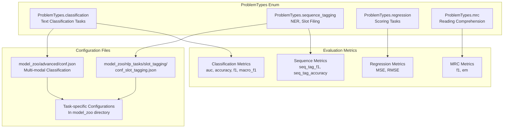
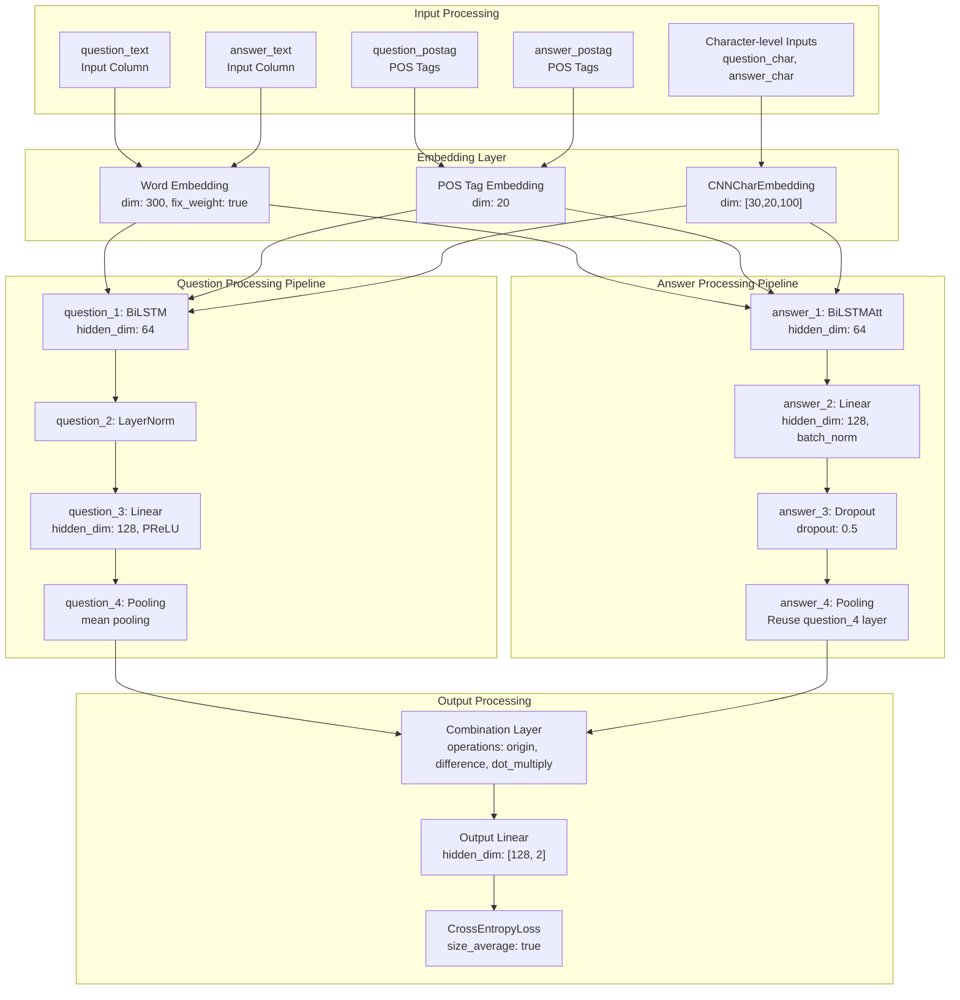
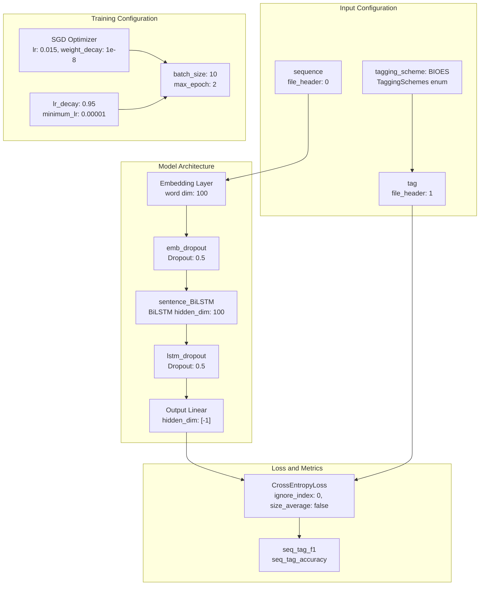
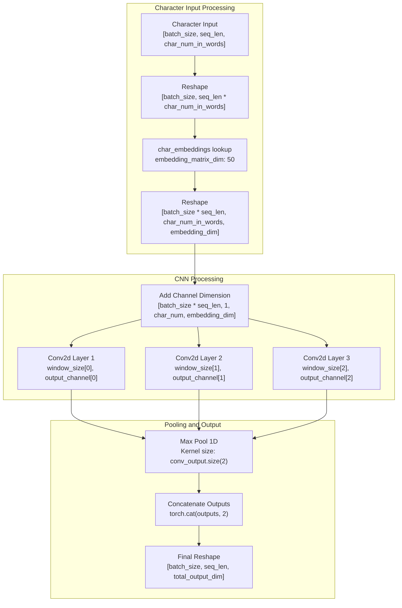
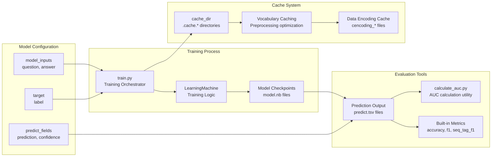
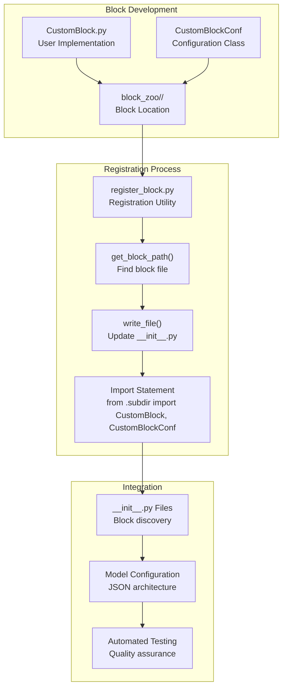

<!-- source: DeepWiki mcp.deepwiki.com · repo microsoft/NeuronBlocks · page 5 Model Examples · fetched 2026-10-26 -->

# Model Examples

<details>
<summary>Relevant source files</summary>

The following files were used as context for generating this wiki page:

- [block_zoo/embedding/CNNCharEmbedding.py](block_zoo/embedding/CNNCharEmbedding.py)
- [dataset/get_glove.sh](dataset/get_glove.sh)
- [dataset/get_glove_6B.sh](dataset/get_glove_6B.sh)
- [model_zoo/advanced/conf.json](model_zoo/advanced/conf.json)
- [model_zoo/nlp_tasks/slot_tagging/conf_slot_tagging.json](model_zoo/nlp_tasks/slot_tagging/conf_slot_tagging.json)
- [register_block.py](register_block.py)
- [settings.py](settings.py)
- [tools/calculate_auc.py](tools/calculate_auc.py)

</details>


This document provides practical examples of implementing different NLP tasks using the NeuronBlocks toolkit. It demonstrates how to configure and build models for various problem types including classification, sequence tagging, text matching, and advanced multi-modal scenarios.

For detailed information about the underlying components used in these examples, see [Core Architecture](#3), [Block Zoo](#3.1), and [Model Zoo](#3.2). For training and evaluation procedures, see [Training and Evaluation](#4).

## Overview of Model Categories

NeuronBlocks supports four primary problem types defined in `ProblemTypes` enum, each with specific model architectures and evaluation metrics:



Sources: [settings.py:18-32](), [model_zoo/advanced/conf.json](), [model_zoo/nlp_tasks/slot_tagging/conf_slot_tagging.json]()

## Text Classification and Matching Example

The advanced configuration demonstrates a sophisticated text matching model that can be adapted for classification tasks. It showcases multiple embedding types, attention mechanisms, and layer combinations.

### Architecture Overview



Sources: [model_zoo/advanced/conf.json:77-202]()

### Key Configuration Patterns

The advanced example demonstrates several important configuration patterns:

| Component | Configuration | Purpose |
|-----------|---------------|---------|
| `CNNCharEmbedding` | `dim: [30, 20, 100]`, `window_size: [3,3,5]` | Multi-scale character representation |
| `BiLSTMAtt` | `hidden_dim: 64` | Attention-enhanced recurrent processing |
| `LayerNorm` | Applied after BiLSTM | Stabilizes training |
| `Combination` | `operations: ["origin", "difference", "dot_multiply"]` | Feature interaction modeling |
| `Pooling` | `pool_type: "mean"`, `pool_axis: 1` | Sequence-to-vector conversion |

The model processes questions and answers through separate but parallel pipelines, then combines their representations using multiple operations before final classification.

Sources: [model_zoo/advanced/conf.json:78-101](), [model_zoo/advanced/conf.json:170-177]()

## Sequence Tagging Example

The slot tagging configuration demonstrates a typical sequence labeling architecture for named entity recognition using the BIOES tagging scheme.

### Sequence Tagging Architecture



Sources: [model_zoo/nlp_tasks/slot_tagging/conf_slot_tagging.json:1-119]()

### Sequence Tagging Configuration Details

The slot tagging example uses several key configuration patterns specific to sequence labeling:

```json
{
  "dataset_type": "sequence_tagging",
  "tagging_scheme": "BIOES",
  "add_start_end_for_seq": false,
  "file_header": {
    "sequence": 0,
    "tag": 1
  }
}
```

The architecture uses a straightforward BiLSTM with dropout regularization, designed for token-level classification. The `ignore_index: 0` in `CrossEntropyLoss` handles padding tokens, while `size_average: false` ensures proper loss calculation for variable-length sequences.

Sources: [model_zoo/nlp_tasks/slot_tagging/conf_slot_tagging.json:6-19](), [model_zoo/nlp_tasks/slot_tagging/conf_slot_tagging.json:106-118]()

## Character-Level Embedding Integration

The `CNNCharEmbedding` component demonstrates how to incorporate character-level information into word representations, particularly useful for handling out-of-vocabulary words and morphologically rich languages.

### CNNCharEmbedding Processing Flow



The `CNNCharEmbedding` class in `block_zoo/embedding/CNNCharEmbedding.py` implements multi-scale character convolutions with configurable window sizes and output dimensions, allowing the model to capture character patterns at different granularities.

Sources: [block_zoo/embedding/CNNCharEmbedding.py:93-132](), [model_zoo/advanced/conf.json:91-101]()

## Data Pipeline and Evaluation Integration

Model examples integrate with NeuronBlocks' data processing and evaluation systems through standardized configuration patterns and evaluation utilities.

### Model-to-Evaluation Pipeline



The evaluation pipeline supports multiple output formats and metrics. The `calculate_auc.py` utility provides external AUC calculation for binary classification tasks, while built-in metrics handle multi-class and sequence tagging scenarios.

Sources: [tools/calculate_auc.py:27-34](), [model_zoo/advanced/conf.json:45-47](), [settings.py:24-32]()

## Extension and Registration Patterns

Model examples can be extended with custom blocks using the registration system, enabling contribution of new neural network components.

### Block Registration Workflow



The `register_block.py` utility automates the process of making custom blocks discoverable by the NeuronBlocks framework, ensuring proper import statements are added to the appropriate `__init__.py` files throughout the block zoo hierarchy.

Sources: [register_block.py:8-55]()

---

