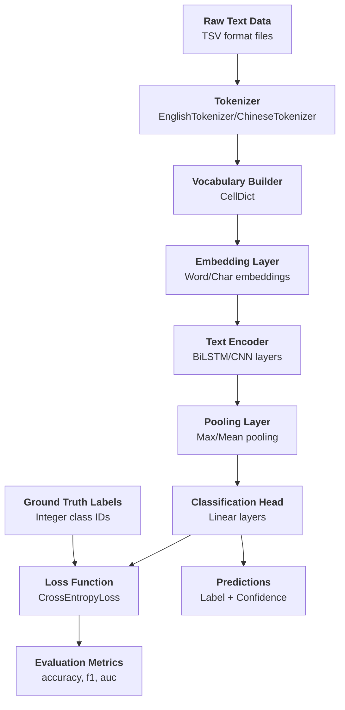
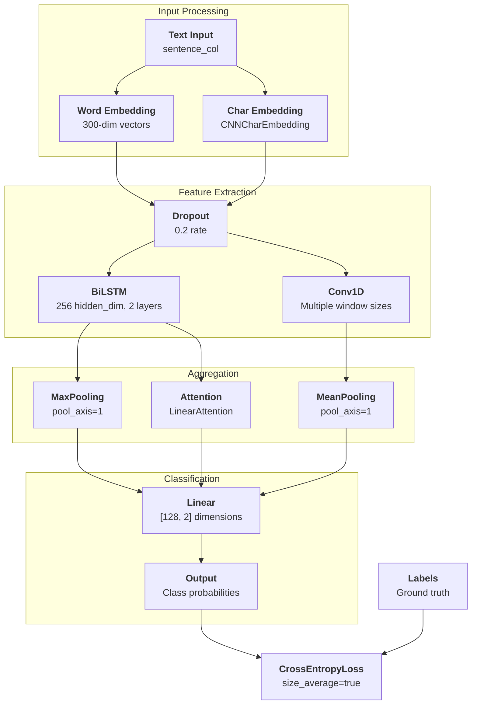

<!-- source: DeepWiki mcp.deepwiki.com · repo microsoft/NeuronBlocks · page 5.1 Text Classification · fetched 2026-10-26 -->

# Text Classification

<details>
<summary>Relevant source files</summary>

The following files were used as context for generating this wiki page:

- [block_zoo/embedding/CNNCharEmbedding.py](block_zoo/embedding/CNNCharEmbedding.py)
- [core/ChineseTokenizer.py](core/ChineseTokenizer.py)
- [core/EnglishTokenizer.py](core/EnglishTokenizer.py)
- [core/Stopwords.py](core/Stopwords.py)
- [dataset/chinese_sentiment_analysis/dev.tsv](dataset/chinese_sentiment_analysis/dev.tsv)
- [dataset/chinese_sentiment_analysis/test.tsv](dataset/chinese_sentiment_analysis/test.tsv)
- [dataset/chinese_sentiment_analysis/train.tsv](dataset/chinese_sentiment_analysis/train.tsv)
- [model_zoo/advanced/conf.json](model_zoo/advanced/conf.json)
- [model_zoo/nlp_tasks/chinese_sentiment_analysis/conf_chinese_sentiment_analysis_bilstm.json](model_zoo/nlp_tasks/chinese_sentiment_analysis/conf_chinese_sentiment_analysis_bilstm.json)
- [settings.py](settings.py)

</details>


## Purpose and Scope

This section covers text classification tasks in NeuronBlocks, including sentiment analysis, document categorization, and other classification problems where the goal is to assign discrete labels to input text. Text classification is one of the core problem types supported by the framework, defined as `ProblemTypes.classification` in the system.

For sequence labeling tasks like named entity recognition, see [Sequence Tagging](#5.2). For text similarity and matching tasks, see [Text Matching](#5.3).

## Data Format and Processing Pipeline

Text classification in NeuronBlocks follows a standardized data processing pipeline that transforms raw text into model inputs and predictions.

### Data Flow Architecture



**Sources:** [settings.py:18](), [core/EnglishTokenizer.py:9-25](), [core/ChineseTokenizer.py:10-26](), [model_zoo/nlp_tasks/chinese_sentiment_analysis/conf_chinese_sentiment_analysis_bilstm.json:107-118]()

### Input Data Format

Text classification tasks expect data in TSV format with the following structure:

| Column | Content | Example |
|--------|---------|---------|
| 0 | Text content | "酒店服务很好，房间干净整洁" |
| 1 | Label | 1 (positive) or 0 (negative) |

The file header configuration maps these columns to model inputs:

```json
"file_header": {
  "sentence_col": 0,
  "label": 1
}
```

**Sources:** [dataset/chinese_sentiment_analysis/train.tsv:1-5](), [model_zoo/nlp_tasks/chinese_sentiment_analysis/conf_chinese_sentiment_analysis_bilstm.json:17-20]()

### Language Support

The framework provides dedicated tokenizers for different languages:

- **English**: Uses `EnglishTokenizer` with NLTK word tokenization
- **Chinese**: Uses `ChineseTokenizer` with Jieba segmentation
- **Stopword removal**: Configurable for both languages

**Sources:** [core/EnglishTokenizer.py:10-24](), [core/ChineseTokenizer.py:11-25](), [core/Stopwords.py:7-9]()

## Model Architecture Components

### Core Classification Architecture



**Sources:** [model_zoo/nlp_tasks/chinese_sentiment_analysis/conf_chinese_sentiment_analysis_bilstm.json:56-106](), [block_zoo/embedding/CNNCharEmbedding.py:64-132](), [model_zoo/advanced/conf.json:77-189]()

### Embedding Strategies

The framework supports multiple embedding approaches:

| Embedding Type | Implementation | Configuration |
|----------------|----------------|---------------|
| Word-level | Standard embedding lookup | `"word": {"cols": ["sentence_col"], "dim": 300}` |
| Character-level | CNN over character sequences | `"char": {"type": "CNNCharEmbedding", "dim": [30, 20, 100]}` |
| POS tags | Part-of-speech embeddings | `"postag": {"cols": ["postag_col"], "dim": 20}` |

**Sources:** [model_zoo/advanced/conf.json:82-101](), [block_zoo/embedding/CNNCharEmbedding.py:26-36]()

## Configuration Examples

### Basic Sentiment Analysis

The Chinese sentiment analysis configuration demonstrates a typical text classification setup:

```json
{
  "dataset_type": "classification",
  "language": "Chinese",
  "tokenizer": "jieba",
  "architecture": [
    {
      "layer": "Embedding",
      "conf": {
        "word": {
          "cols": ["sentence_col"],
          "dim": 300
        }
      }
    },
    {
      "layer": "BiLSTM",
      "conf": {
        "hidden_dim": 256,
        "dropout": 0.2,
        "num_layers": 2
      }
    },
    {
      "layer": "Pooling",
      "conf": {
        "pool_type": "max"
      }
    },
    {
      "layer": "Linear",
      "conf": {
        "hidden_dim": [128, 2]
      }
    }
  ]
}
```

**Sources:** [model_zoo/nlp_tasks/chinese_sentiment_analysis/conf_chinese_sentiment_analysis_bilstm.json:4-105]()

### Advanced Multi-Feature Model

The advanced configuration shows how to combine multiple input features:

```json
{
  "model_inputs": {
    "question": ["question_text", "question_postag", "question_char"],
    "answer": ["answer_text", "answer_postag", "answer_char"]
  },
  "architecture": [
    {
      "layer": "Embedding",
      "conf": {
        "word": {"cols": ["question_text", "answer_text"], "dim": 300},
        "postag": {"cols": ["question_postag", "answer_postag"], "dim": 20},
        "char": {"type": "CNNCharEmbedding", "dim": [30, 20, 100]}
      }
    }
  ]
}
```

**Sources:** [model_zoo/advanced/conf.json:33-101]()

## Training and Evaluation

### Supported Metrics

Text classification supports comprehensive evaluation metrics:

| Metric Category | Available Metrics |
|-----------------|-------------------|
| Basic | `accuracy` |
| Precision/Recall | `f1`, `macro_f1`, `micro_f1`, `weighted_f1` |
| Class-specific | `macro_precision`, `macro_recall`, `micro_precision`, `micro_recall` |
| Ranking | `auc`, `auc@1`, `auc@0`, `auc@average` |

**Sources:** [settings.py:24-32](), [model_zoo/advanced/conf.json:202]()

### Training Configuration

Key training parameters for text classification:

```json
{
  "training_params": {
    "optimizer": {"name": "Adam"},
    "batch_size": 32,
    "max_epoch": 30,
    "lr_decay": 0.95,
    "minimum_lr": 0.0001,
    "vocabulary": {
      "min_word_frequency": 1
    }
  }
}
```

**Sources:** [model_zoo/nlp_tasks/chinese_sentiment_analysis/conf_chinese_sentiment_analysis_bilstm.json:36-55]()

### Prediction Output

Classification models generate predictions with confidence scores:

| Field | Description | Example |
|-------|-------------|---------|
| `prediction` | Predicted class label | `1` |
| `confidence` | Probability score | `0.85` |

For binary classification, `confidence@positive` provides the probability of the positive class.

**Sources:** [settings.py:35-40](), [model_zoo/advanced/conf.json:45]()

## Data Processing Pipeline

### Preprocessing Steps

The framework applies configurable text preprocessing:

```json
{
  "training_params": {
    "text_preprocessing": ["DBC2SBC"],
    "max_lengths": {
      "sentence": 100
    }
  }
}
```

Common preprocessing operations include:
- `DBC2SBC`: Convert double-byte characters to single-byte
- Length truncation and padding
- Tokenization with language-specific rules

**Sources:** [model_zoo/advanced/conf.json:71-75](), [core/EnglishTokenizer.py:18-24](), [core/ChineseTokenizer.py:19-25]()

### Caching System

The framework provides intelligent caching for faster experimentation:

```json
{
  "inputs": {
    "use_cache": true,
    "cache_dir": ".cache.chinese_sentiment_analysis/"
  }
}
```

This caches processed vocabularies and encoded data between training runs.

**Sources:** [model_zoo/nlp_tasks/chinese_sentiment_analysis/conf_chinese_sentiment_analysis_bilstm.json:7](), [settings.py:69-77]()

---

