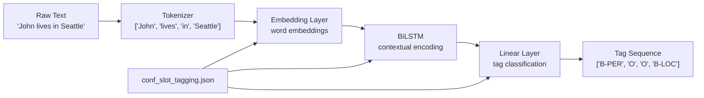
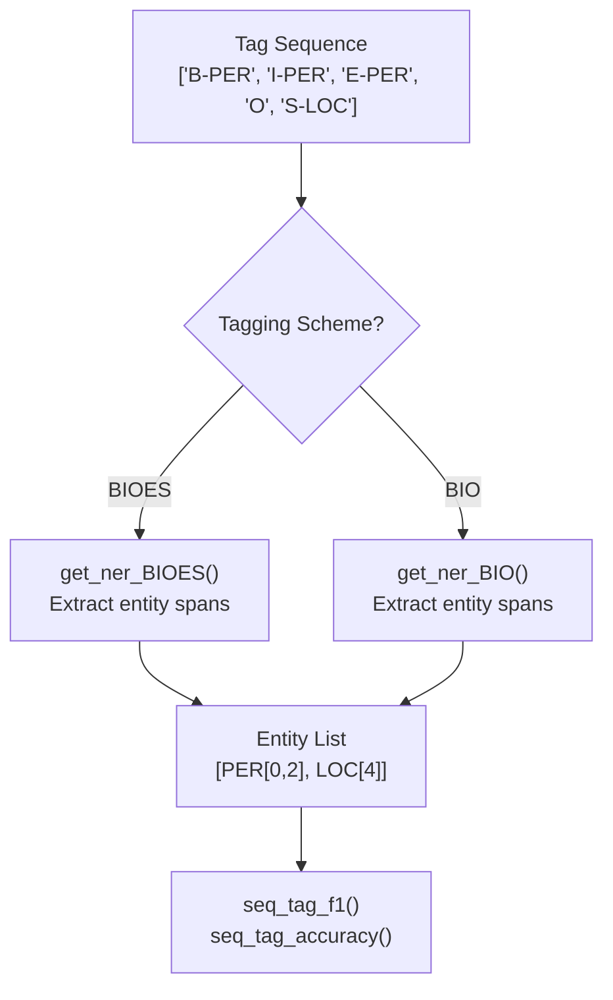
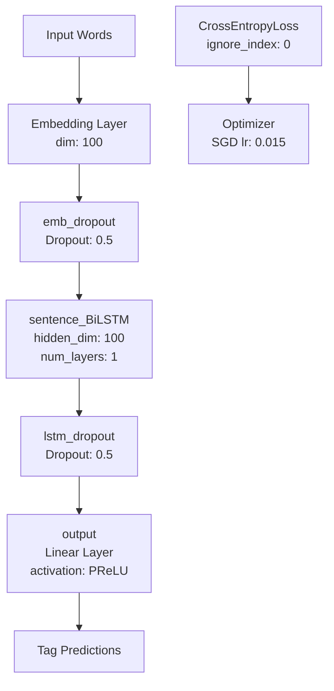
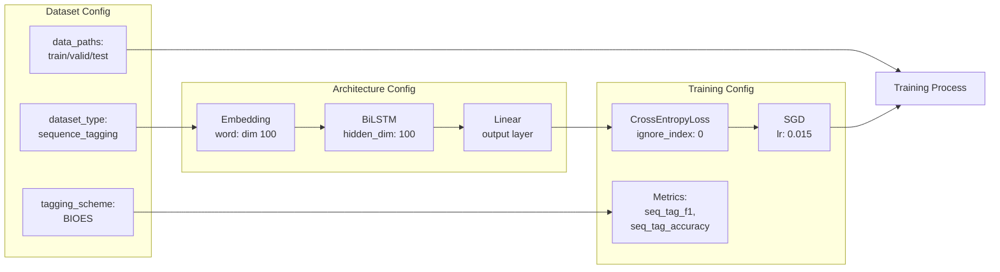
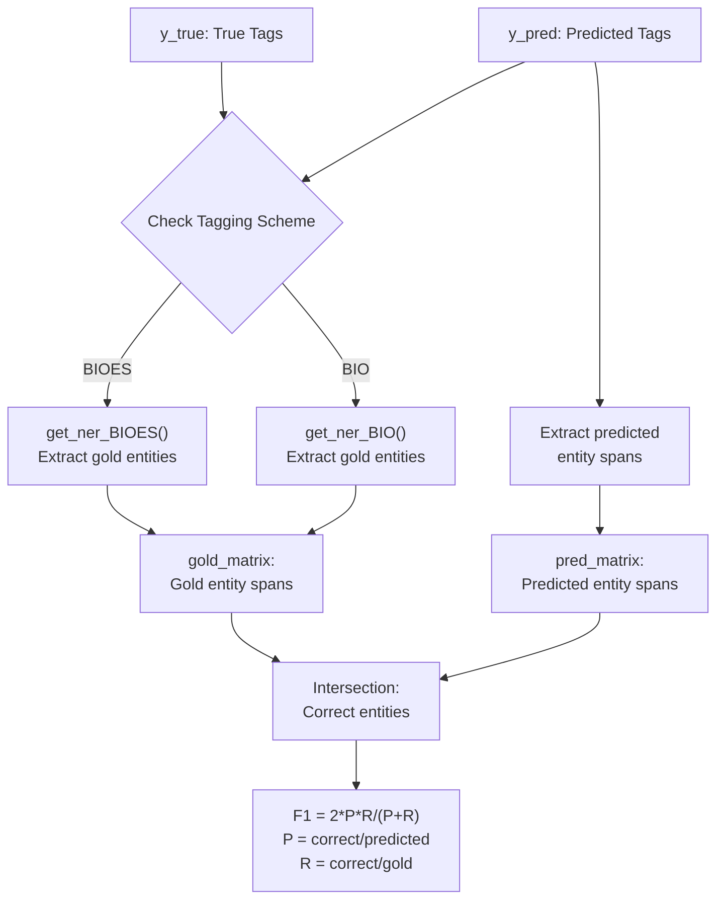

<!-- source: DeepWiki mcp.deepwiki.com · repo microsoft/NeuronBlocks · page 5.2 Sequence Tagging · fetched 2026-10-26 -->

# Sequence Tagging

<details>
<summary>Relevant source files</summary>

The following files were used as context for generating this wiki page:

- [dataset/get_glove.sh](dataset/get_glove.sh)
- [dataset/get_glove_6B.sh](dataset/get_glove_6B.sh)
- [dataset/slot_tagging/conll_2003/eng.testa.tsv](dataset/slot_tagging/conll_2003/eng.testa.tsv)
- [dataset/slot_tagging/conll_2003/eng.testb.tsv](dataset/slot_tagging/conll_2003/eng.testb.tsv)
- [dataset/slot_tagging/conll_2003/eng.train.tsv](dataset/slot_tagging/conll_2003/eng.train.tsv)
- [metrics/Evaluator.py](metrics/Evaluator.py)
- [metrics/slot_tagging_metrics.py](metrics/slot_tagging_metrics.py)
- [model_zoo/nlp_tasks/slot_tagging/conf_slot_tagging.json](model_zoo/nlp_tasks/slot_tagging/conf_slot_tagging.json)
- [register_block.py](register_block.py)
- [tools/calculate_auc.py](tools/calculate_auc.py)

</details>


This document covers sequence tagging functionality in NeuronBlocks, including Named Entity Recognition (NER) and slot filling tasks. Sequence tagging involves assigning labels to each token in a sequence, commonly used for identifying entities like persons, locations, and organizations in text.

For text classification tasks, see [Text Classification](#5.1). For text matching tasks, see [Text Matching](#5.3).

## Overview

Sequence tagging in NeuronBlocks is implemented as a token-level classification task where each word in a sequence receives a label. The framework supports multiple tagging schemes and provides specialized evaluation metrics for sequence labeling tasks.

**Sequence Tagging Pipeline:**



Sources: [model_zoo/nlp_tasks/slot_tagging/conf_slot_tagging.json:1-119](), [dataset/slot_tagging/conll_2003/eng.testb.tsv:1-10]()

## Data Format and Tagging Schemes

### Data Format

Sequence tagging data is stored in TSV format with tokens and their corresponding tags:

```
John    B-PER
lives   O  
in      O
Seattle B-LOC
```

The configuration specifies the data structure via `file_header`:

```json
"file_header": {
  "sequence": 0,
  "tag": 1
}
```

### Supported Tagging Schemes

NeuronBlocks supports two primary tagging schemes configured via the `tagging_scheme` parameter:

**BIOES Tagging Scheme:**
- `B-`: Beginning of entity
- `I-`: Inside entity  
- `O`: Outside entity
- `E-`: End of entity
- `S-`: Single token entity

**BIO Tagging Scheme:**
- `B-`: Beginning of entity
- `I-`: Inside entity
- `O`: Outside entity

**Tagging Scheme Processing:**



Sources: [model_zoo/nlp_tasks/slot_tagging/conf_slot_tagging.json:8](), [metrics/slot_tagging_metrics.py:5-97](), [metrics/Evaluator.py:157-162]()

## Model Architecture

### Standard Architecture Components

The typical sequence tagging architecture consists of several layers defined in the `architecture` section:

**Architecture Flow:**



### Layer Configuration

Key architectural components from the configuration:

- **Embedding Layer**: Maps words to dense vectors with configurable dimensions
- **BiLSTM Layer**: Captures bidirectional context with specified hidden dimensions  
- **Dropout Layers**: Regularization at multiple points (embedding and LSTM output)
- **Linear Output Layer**: Final classification layer with PReLU activation

Sources: [model_zoo/nlp_tasks/slot_tagging/conf_slot_tagging.json:56-105]()

## Configuration System

### Dataset Configuration

The sequence tagging configuration requires specific dataset parameters:

```json
{
  "dataset_type": "sequence_tagging",
  "tagging_scheme": "BIOES",
  "data_paths": {
    "train_data_path": "./dataset/slot_tagging/conll_2003/eng.train.tsv",
    "valid_data_path": "./dataset/slot_tagging/conll_2003/eng.testa.tsv", 
    "test_data_path": "./dataset/slot_tagging/conll_2003/eng.testb.tsv"
  }
}
```

### Training Configuration

Training parameters are configured for sequence tagging optimization:

- **Optimizer**: SGD with learning rate 0.015
- **Learning Rate Decay**: 0.95 per epoch starting from epoch 1
- **Batch Size**: 10 sequences per batch
- **Loss Function**: CrossEntropyLoss with `ignore_index: 0` for padding tokens

**Configuration Flow:**



Sources: [model_zoo/nlp_tasks/slot_tagging/conf_slot_tagging.json:5-55](), [model_zoo/nlp_tasks/slot_tagging/conf_slot_tagging.json:106-118]()

## Evaluation Metrics

### Sequence Tagging Metrics

NeuronBlocks provides specialized metrics for sequence tagging evaluation:

**F1 Score Calculation (`seq_tag_f1`)**:
- Extracts entity spans using tagging scheme-specific functions
- Computes precision, recall, and F1 at entity level
- Handles both BIOES and BIO tagging schemes

**Accuracy Calculation (`seq_tag_accuracy`)**:
- Token-level accuracy comparing predicted vs. true tags
- Simple per-token classification accuracy

### Metric Implementation

**Evaluation Process:**



The evaluation process:
1. Uses `get_ner_BIOES()` or `get_ner_BIO()` to extract entity spans
2. Computes intersection of predicted and gold entity spans  
3. Calculates precision, recall, and F1-score at entity level

Sources: [metrics/Evaluator.py:142-207](), [metrics/slot_tagging_metrics.py:5-97]()

## Implementation Details

### Core Functions

**Entity Extraction Functions**:
- `get_ner_BIOES(label_list)`: Processes BIOES tags to extract entity spans
- `get_ner_BIO(label_list)`: Processes BIO tags to extract entity spans  
- `reverse_style(input_string)`: Helper function for tag format conversion

**Evaluation Methods**:
- `seq_tag_f1(y_true, y_pred)`: Entity-level F1 score calculation
- `seq_tag_accuracy(y_true, y_pred)`: Token-level accuracy calculation

### Loss Configuration

The sequence tagging task uses `CrossEntropyLoss` with specific parameters:
- `size_average: false`: Sum rather than average loss
- `ignore_index: 0`: Ignore padding tokens in loss calculation

This configuration ensures proper handling of variable-length sequences and padding tokens common in sequence tagging tasks.

Sources: [metrics/slot_tagging_metrics.py:5-97](), [metrics/Evaluator.py:142-207](), [model_zoo/nlp_tasks/slot_tagging/conf_slot_tagging.json:107-117]()

---

