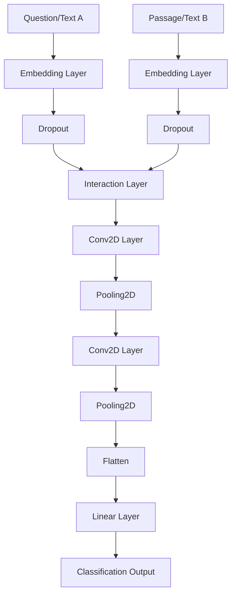
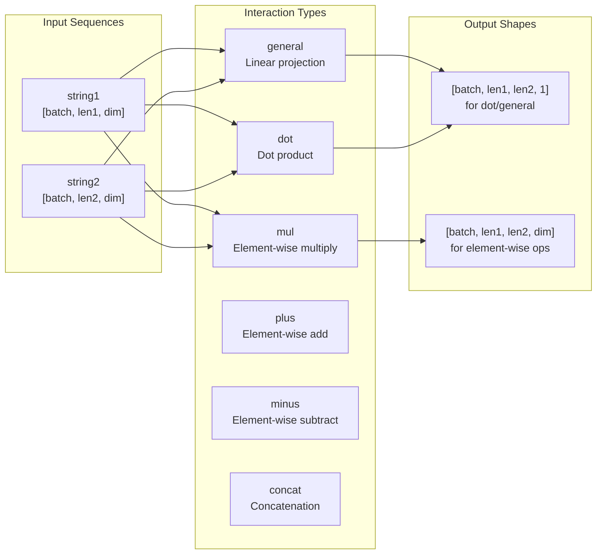
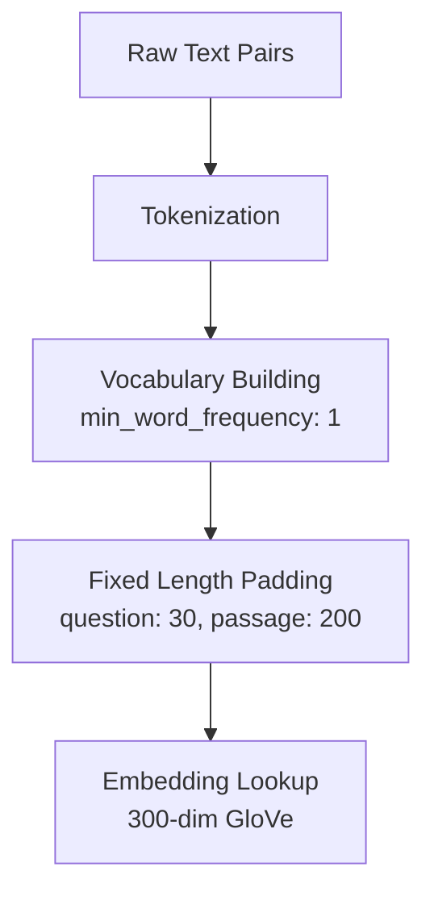

<!-- source: DeepWiki mcp.deepwiki.com · repo microsoft/NeuronBlocks · page 5.3 Text Matching · fetched 2026-10-26 -->

# Text Matching

<details>
<summary>Relevant source files</summary>

The following files were used as context for generating this wiki page:

- [autotest/dataset/QQP/dev_autotest.tsv](autotest/dataset/QQP/dev_autotest.tsv)
- [autotest/dataset/QQP/train_autotest.tsv](autotest/dataset/QQP/train_autotest.tsv)
- [autotest/dataset/knowledge_distillation/text_matching_data/test_autotest.tsv](autotest/dataset/knowledge_distillation/text_matching_data/test_autotest.tsv)
- [autotest/dataset/knowledge_distillation/text_matching_data/train_autotest.tsv](autotest/dataset/knowledge_distillation/text_matching_data/train_autotest.tsv)
- [block_zoo/attentions/Interaction.py](block_zoo/attentions/Interaction.py)
- [block_zoo/attentions/__init__.py](block_zoo/attentions/__init__.py)
- [block_zoo/op/Flatten.py](block_zoo/op/Flatten.py)
- [model_zoo/nlp_tasks/question_answer_matching/conf_question_answer_matching_pyramid.json](model_zoo/nlp_tasks/question_answer_matching/conf_question_answer_matching_pyramid.json)

</details>


Text matching in NeuronBlocks refers to neural network models that compare pairs of text sequences to determine their semantic similarity, relatedness, or answer relationships. This includes tasks such as question-answer matching, paraphrase identification, and semantic textual similarity.

For sequence labeling tasks, see [Sequence Tagging](#5.2). For single text classification, see [Text Classification](#5.1).

## Overview

Text matching models in NeuronBlocks follow a general architecture pattern where two text sequences are processed through embedding layers, then compared using interaction mechanisms, and finally classified to determine their relationship. The framework supports various matching paradigms from simple element-wise operations to sophisticated attention-based interactions.

**Text Matching Architecture Flow**



Sources: [model_zoo/nlp_tasks/question_answer_matching/conf_question_answer_matching_pyramid.json:63-161]()

## Core Components

### Interaction Layer

The `Interaction` layer is the central component for text matching, implementing various methods to compare two sequences element-wise or through learned projections.

**Interaction Layer Architecture**



The `InteractionConf` class defines the configuration with `matching_type` parameter supporting: `'general'`, `'mul'`, `'plus'`, `'minus'`, `'dot'`, `'concat'`.

Sources: [block_zoo/attentions/Interaction.py:15-56](), [block_zoo/attentions/Interaction.py:64-134]()

### Supporting Layers

Text matching models typically use additional layers for feature extraction and dimensionality reduction:

- **Flatten Layer**: Converts multi-dimensional interaction matrices to vectors for classification
- **Conv2D/Pooling2D**: Extract local patterns from interaction matrices  
- **Linear Layers**: Final classification with configurable hidden dimensions

Sources: [block_zoo/op/Flatten.py:48-72](), [model_zoo/nlp_tasks/question_answer_matching/conf_question_answer_matching_pyramid.json:100-160]()

## Model Examples

### Question-Answer Matching (WikiQA)

The WikiQA model demonstrates a pyramid CNN architecture for question-answer matching:

**WikiQA Model Configuration**

| Component | Configuration | Purpose |
|-----------|---------------|---------|
| Embedding | 300-dim GloVe, fixed weights | Word representations |
| Dropout | 0.2 rate | Regularization |
| Interaction | `matching_type: "general"` | Question-passage comparison |
| Conv2D Layers | 3x3 and 5x5 kernels, 8 channels | Feature extraction |
| Pooling2D | Max pooling | Dimensionality reduction |
| Linear | Hidden dims [128, 2] | Binary classification |

**Data Format**: TSV files with columns for question_id, question_text, document_id, document_title, passage_id, passage_text, and label.

Sources: [model_zoo/nlp_tasks/question_answer_matching/conf_question_answer_matching_pyramid.json:1-175]()

### Question-Question Pairs (QQP)

The QQP dataset format supports duplicate question detection with binary labels:

```
id	qid1	qid2	question1	question2	is_duplicate
133273	213221	213222	How is the life of a math student?	Which level of prepration is enough for the exam jlpt5?	0
402555	536040	536041	How do I control my horny emotions?	How do you control your horniness?	1
```

Sources: [autotest/dataset/QQP/train_autotest.tsv:1-10]()

## Training Configuration

### Data Preprocessing

Text matching models require specific preprocessing:

- **Fixed Sequence Lengths**: Questions and passages are truncated/padded to fixed lengths
- **Vocabulary Building**: Minimum word frequency filtering for vocabulary construction
- **Embedding Integration**: Pre-trained embeddings (GloVe, Word2Vec) can be loaded and optionally fine-tuned

**Preprocessing Parameters**



Sources: [model_zoo/nlp_tasks/question_answer_matching/conf_question_answer_matching_pyramid.json:42-61]()

### Loss Functions and Metrics

Text matching models commonly use:

- **CrossEntropyLoss**: With class weights to handle imbalanced datasets (e.g., `[0.1, 0.9]` for negative/positive classes)
- **Evaluation Metrics**: AUC and accuracy for binary classification tasks

The weighted loss addresses the common problem where negative pairs significantly outnumber positive pairs in matching datasets.

Sources: [model_zoo/nlp_tasks/question_answer_matching/conf_question_answer_matching_pyramid.json:162-174]()

## Knowledge Distillation

Text matching supports knowledge distillation for model compression, where a large teacher model's knowledge is transferred to a smaller student model. This is particularly useful for deploying text matching models in resource-constrained environments.

**Knowledge Distillation Data Format**:
```
query	passage	label
best testosterone booster for men	Here are 10 of the best ways to increase your T levels naturally...	1
Current APEL list	the army s authorized protective eyewear list...	0
```

The label represents the similarity score or binary match decision from the teacher model.

Sources: [autotest/dataset/knowledge_distillation/text_matching_data/test_autotest.tsv:1-5]()

## Available Attention Mechanisms

NeuronBlocks provides various attention mechanisms that can be used in text matching architectures:

- **FullAttention**: Complete attention matrix computation
- **LinearAttention**: Linear complexity attention
- **BiAttFlow**: Bidirectional attention flow for reading comprehension
- **MatchAttention**: Specialized matching attention
- **BilinearAttention**: Bilinear similarity computation

These can be used as alternatives or complements to the basic `Interaction` layer for more sophisticated matching.

Sources: [block_zoo/attentions/__init__.py:3-10]()

---

