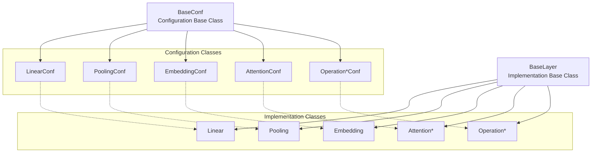
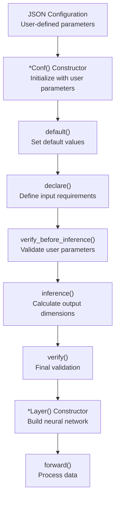
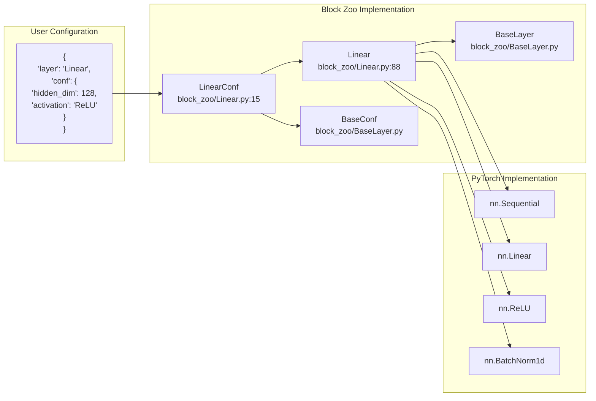
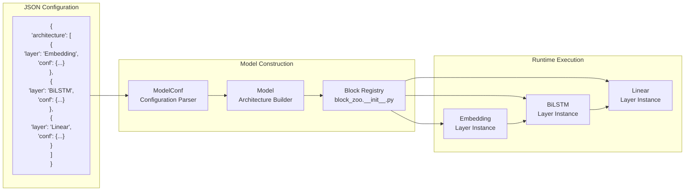

<!-- source: DeepWiki mcp.deepwiki.com · repo microsoft/NeuronBlocks · page 6 Block Reference · fetched 2026-10-26 -->

# Block Reference

<details>
<summary>Relevant source files</summary>

The following files were used as context for generating this wiki page:

- [block_zoo/Linear.py](block_zoo/Linear.py)
- [block_zoo/Pooling1D.py](block_zoo/Pooling1D.py)
- [block_zoo/__init__.py](block_zoo/__init__.py)
- [block_zoo/op/__init__.py](block_zoo/op/__init__.py)

</details>


This document provides a comprehensive reference for all neural network blocks available in the NeuronBlocks toolkit. Blocks are the fundamental building units used to construct neural network architectures declaratively through JSON configuration files. Each block encapsulates a specific neural computation pattern and can be combined with others to create complex models.

For specific implementation examples using blocks in different tasks, see [Model Examples](#5). For guidance on creating custom blocks, see [Custom Blocks](#8.2). For understanding how blocks fit into the overall training pipeline, see [Core Architecture](#3).

## Block Architecture

All blocks in NeuronBlocks follow a consistent two-class architecture pattern: a configuration class (`*Conf`) that defines parameters and validation logic, and an implementation class that contains the actual neural network computation.

### Block Class Hierarchy



**Sources:** [block_zoo/__init__.py:1-58](), [block_zoo/Linear.py:15-24](), [block_zoo/Pooling1D.py:14-23]()

### Configuration Lifecycle



**Sources:** [block_zoo/Linear.py:28-86](), [block_zoo/Pooling1D.py:28-68]()

## Block Categories

The NeuronBlocks toolkit organizes blocks into distinct functional categories, each serving specific roles in neural architecture construction:

| Category | Purpose | Key Blocks | Reference |
|----------|---------|------------|-----------|
| **Core Layers** | Fundamental building blocks for basic transformations | `Linear`, `Pooling`, `Conv`, `Dropout` | [Core Layers](#6.1) |
| **Attention Mechanisms** | Attention-based interaction and alignment | `FullAttention`, `BiAttFlow`, `LinearAttention` | [Attention Mechanisms](#6.2) |
| **Operations** | Tensor manipulation and combination | `Combination`, `Match`, `CalculateDistance` | [Operations](#6.3) |
| **Embedding Layers** | Text representation and encoding | `Embedding`, `CNNCharEmbedding`, `LSTMCharEmbedding` | [Embedding Layers](#6.4) |

### Block-to-Code Mapping



**Sources:** [block_zoo/__init__.py:8](), [block_zoo/Linear.py:88-126]()

## Common Block Patterns

### Input/Output Specification

All blocks declare their input requirements and calculate output dimensions automatically:

```python
# Configuration pattern from LinearConf
def declare(self):
    self.num_of_inputs = 1        # Number of input tensors
    self.input_ranks = [-1]       # Expected tensor ranks (-1 = any rank)

def inference(self):
    # Calculate output dimensions based on input dimensions
    self.output_dim = copy.deepcopy(self.input_dims[0])
    self.output_dim[-1] = self.hidden_dim
```

### Forward Pass Interface

All block implementations follow a consistent forward pass signature:

```python
def forward(self, string, string_len=None):
    """
    Args:
        string (Tensor): Input tensor with arbitrary shape
        string_len (Tensor): Length information for variable-length sequences
    
    Returns:
        Tuple[Tensor, Tensor]: (output_tensor, length_tensor)
    """
```

**Sources:** [block_zoo/Linear.py:127-152](), [block_zoo/Pooling1D.py:87-102]()

## Available Blocks by Category

### Core Layers
- **Linear Transformations**: `Linear`, `HighwayLinear`
- **Convolution**: `Conv`, `Conv2D`, `ConvPooling`
- **Pooling**: `Pooling`, `Pooling1D`, `Pooling2D`
- **Regularization**: `Dropout`, `LayerNorm`
- **Recurrent**: `BiLSTM`, `BiLSTMLast`, `BiGRU`, `BiGRULast`, `BiLSTMAtt`, `BiQRNN`

### Attention Mechanisms
- **Full Attention**: `FullAttention`, `Attention`
- **Specialized Attention**: `Seq2SeqAttention`, `LinearAttention`, `BiAttFlow`
- **Matching Attention**: `MatchAttention`, `BilinearAttention`, `Interaction`

### Operations
- **Concatenation**: `Concat2D`, `Concat3D`
- **Combination**: `Combination`, `Match`
- **Transformation**: `Flatten`, `Expand_plus`
- **Distance**: `CalculateDistance`

### Advanced Blocks
- **Transformer**: `Transformer`, `EncoderDecoder`
- **Sequence Modeling**: `CRF`
- **Mathematical Operations**: `Add2D`, `Add3D`, `Minus2D`, `Minus3D`, `ElementWisedMultiply2D`, `ElementWisedMultiply3D`, `MatrixMultiply`

**Sources:** [block_zoo/__init__.py:3-57](), [block_zoo/op/__init__.py:3-9]()

## Block Usage in Models

Blocks are instantiated and connected through JSON configuration files. The Model class automatically handles block instantiation, connection, and data flow based on the configuration:



For detailed information about specific block categories, see the following sub-pages:
- [Core Layers](#6.1) - Basic building blocks and fundamental layers
- [Attention Mechanisms](#6.2) - Attention layer types and configurations  
- [Operations](#6.3) - Tensor manipulation and combination operations
- [Embedding Layers](#6.4) - Text representation and encoding layers

**Sources:** [block_zoo/__init__.py:1-58](), [block_zoo/op/__init__.py:1-9]()

---

