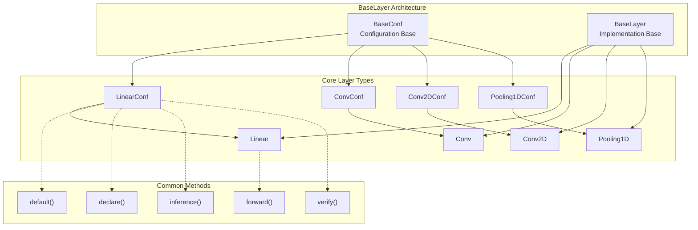
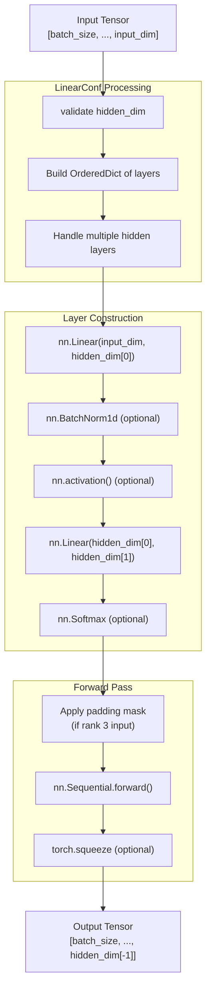
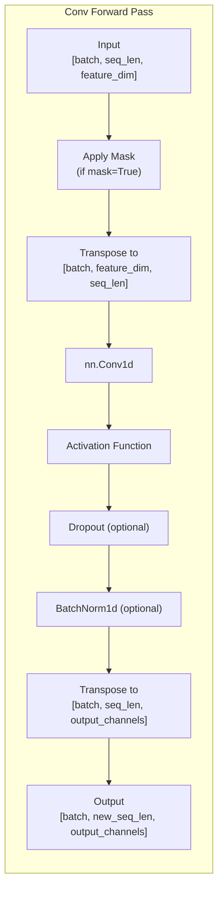
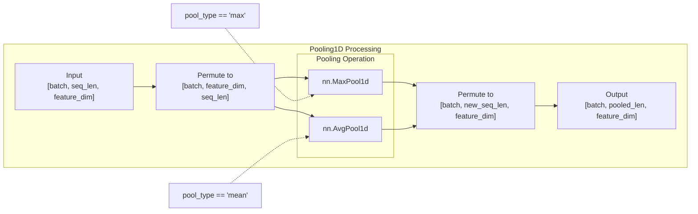
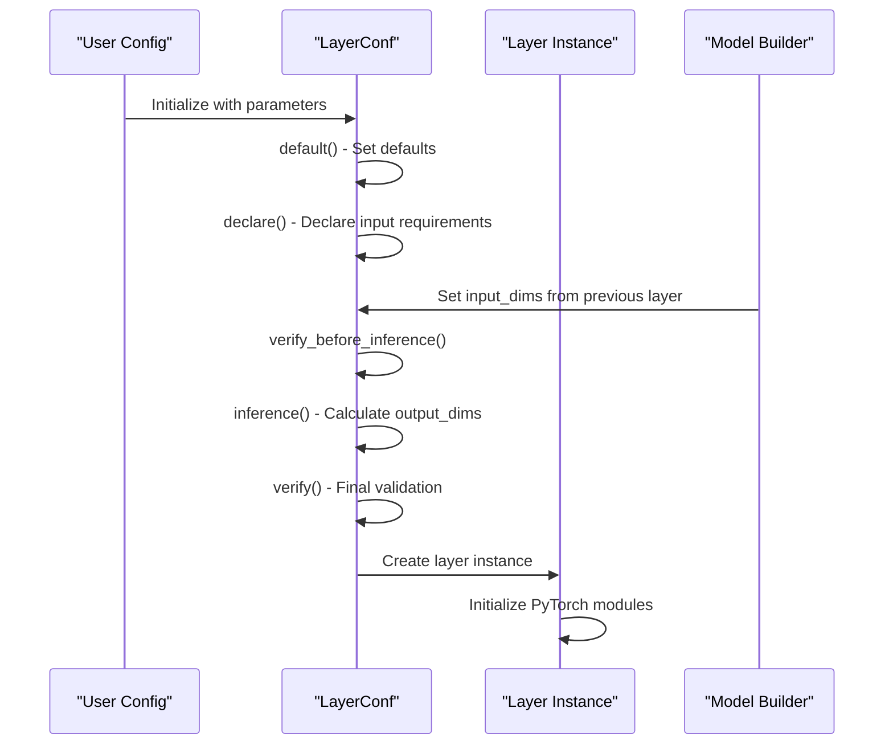

<!-- source: DeepWiki mcp.deepwiki.com · repo microsoft/NeuronBlocks · page 6.1 Core Layers · fetched 2026-10-26 -->

# Core Layers

Relevant source files

The following files were used as context for generating this wiki page:

- [block_zoo/Conv.py](block_zoo/Conv.py)
- [block_zoo/Conv2D.py](block_zoo/Conv2D.py)
- [block_zoo/Linear.py](block_zoo/Linear.py)
- [block_zoo/Pooling1D.py](block_zoo/Pooling1D.py)
- [block_zoo/embedding/LSTMCharEmbedding.py](block_zoo/embedding/LSTMCharEmbedding.py)

This document covers the fundamental neural network building blocks available in NeuronBlocks' Block Zoo. Core layers provide essential operations like linear transformations, convolutions, and pooling that serve as the foundation for more complex architectures. For attention mechanisms, see [Attention Mechanisms](#6.2). For tensor operations and combinations, see [Operations](#6.3). For embedding layers, see [Embedding Layers](#6.4).

## Overview

Core layers in NeuronBlocks implement the most commonly used neural network operations. Each layer follows the Block Zoo architecture pattern with a configuration class and implementation class, providing standardized interfaces for dimension inference, validation, and GPU support.

### Core Layer Architecture

Sources: [block_zoo/Linear.py:15-87](), [block_zoo/Conv.py:13-87](), [block_zoo/Conv2D.py:13-89](), [block_zoo/Pooling1D.py:14-69]()

## Linear Layer

The `Linear` layer implements fully connected transformations, supporting multiple hidden layers, various activation functions, and optional batch normalization.

### Linear Layer Configuration

| Parameter | Type | Default | Description |
|-----------|------|---------|-------------|
| `hidden_dim` | `int` or `list` | `128` | Dimensions of linear layers |
| `activation` | `str` | `'PReLU'` | Activation function name |
| `batch_norm` | `bool` | `True` | Apply batch normalization |
| `last_hidden_activation` | `bool` | `True` | Apply activation to final layer |
| `last_hidden_softmax` | `bool` | `False` | Apply softmax to final layer |
| `keep_dim` | `bool` | `True` | Preserve output dimensions |

### Linear Layer Implementation Details

Sources: [block_zoo/Linear.py:88-153]()

The `Linear` class supports complex multi-layer configurations through the `hidden_dim` parameter. When passed an integer, it creates a single linear layer. When passed a list, it creates multiple sequential layers with optional batch normalization and activation between them.

**Key Implementation Features:**
- Automatic padding mask application for rank-3 inputs [block_zoo/Linear.py:137-148]()
- Dynamic layer construction using `OrderedDict` [block_zoo/Linear.py:106-125]()
- Configurable final layer activation and softmax [block_zoo/Linear.py:111-121]()

## Convolution Layers

NeuronBlocks provides two convolution implementations: `Conv` for 1D convolutions commonly used in NLP, and `Conv2D` for 2D convolutions used in vision-like tasks.

### Conv (1D Convolution)

The `Conv` layer performs 1D convolution along the sequence dimension, suitable for text processing tasks.

### Conv Configuration Parameters

| Parameter | Type | Default | Description |
|-----------|------|---------|-------------|
| `window_size` | `int` | `3` | Convolution kernel size |
| `output_channel_num` | `int` | `16` | Number of output channels |
| `stride` | `int` | `1` | Convolution stride |
| `padding` | `int` or `str` | `0` | Padding size or 'SAME' |
| `activation` | `str` | `'ReLU'` | Activation function |
| `batch_norm` | `bool` | `True` | Apply batch normalization |
| `dropout` | `float` | `0` | Dropout rate |

Sources: [block_zoo/Conv.py:124-163]()

### Conv2D (2D Convolution)

The `Conv2D` layer performs 2D convolution operations, useful for tasks requiring spatial feature extraction.

**Key Differences from Conv:**
- Operates on 4D tensors `[batch_size, height, width, channels]`
- Uses `nn.Conv2d` and `nn.BatchNorm2d` [block_zoo/Conv2D.py:104-107]()
- Supports 2D window sizes, strides, and padding [block_zoo/Conv2D.py:42-56]()

Sources: [block_zoo/Conv2D.py:90-136]()

## Pooling Layers

The `Pooling1D` layer provides pooling operations to reduce sequence dimensionality while preserving important features.

### Pooling1D Configuration

| Parameter | Type | Default | Description |
|-----------|------|---------|-------------|
| `pool_type` | `str` | `'max'` | Pooling type: 'max' or 'mean' |
| `window_size` | `int` | `3` | Pooling window size |
| `stride` | `int` | `1` | Pooling stride |
| `padding` | `int` | `0` | Padding size |

### Pooling Implementation

Sources: [block_zoo/Pooling1D.py:70-102]()

The pooling layer automatically handles tensor dimension reordering, converting from NeuronBlocks' standard `[batch, seq_len, feature]` format to PyTorch's expected `[batch, feature, seq_len]` format for pooling operations.

## Configuration Pattern

All core layers follow a consistent configuration pattern that enables automatic dimension inference and validation.

### Standard Configuration Flow

Sources: [block_zoo/Linear.py:28-85](), [block_zoo/Conv.py:29-87](), [block_zoo/Pooling1D.py:28-68]()

### Common Configuration Methods

Each core layer configuration implements these essential methods:

- **`default()`** - Sets default parameter values [block_zoo/Linear.py:29-35]()
- **`declare()`** - Specifies input requirements and tensor ranks [block_zoo/Linear.py:38-40]()
- **`inference()`** - Calculates output dimensions from input dimensions [block_zoo/Linear.py:43-57]()
- **`verify()`** - Validates configuration parameters [block_zoo/Linear.py:67-85]()

This pattern ensures consistent behavior across all Block Zoo components and enables automatic model architecture validation before training begins.

Sources: [block_zoo/BaseLayer.py](), [block_zoo/Linear.py:15-87](), [block_zoo/Conv.py:13-87](), [block_zoo/Conv2D.py:13-89](), [block_zoo/Pooling1D.py:14-69]()

---

