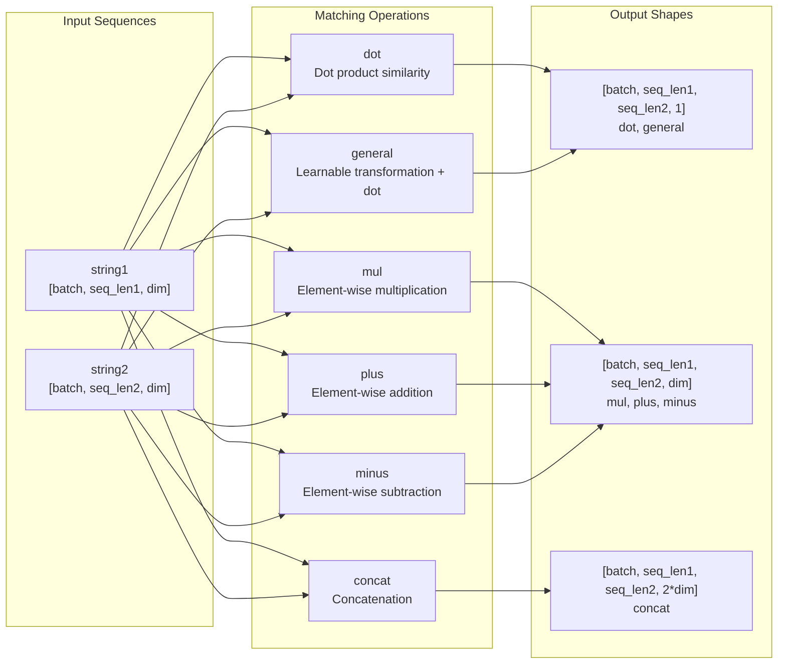
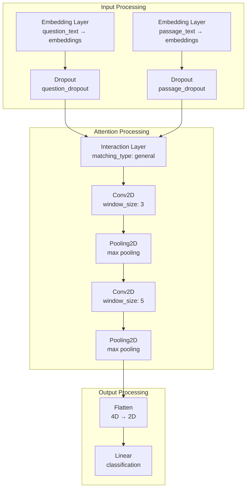
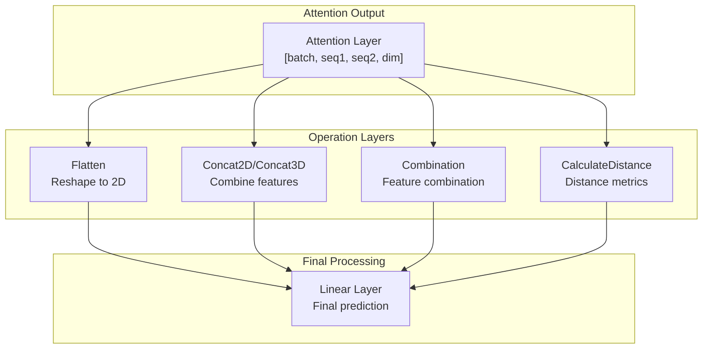

<!-- source: DeepWiki mcp.deepwiki.com · repo microsoft/NeuronBlocks · page 6.2 Attention Mechanisms · fetched 2026-10-26 -->

# Attention Mechanisms

<details>
<summary>Relevant source files</summary>

The following files were used as context for generating this wiki page:

- [block_zoo/__init__.py](block_zoo/__init__.py)
- [block_zoo/attentions/Interaction.py](block_zoo/attentions/Interaction.py)
- [block_zoo/attentions/__init__.py](block_zoo/attentions/__init__.py)
- [block_zoo/op/Flatten.py](block_zoo/op/Flatten.py)
- [block_zoo/op/__init__.py](block_zoo/op/__init__.py)
- [model_zoo/nlp_tasks/question_answer_matching/conf_question_answer_matching_pyramid.json](model_zoo/nlp_tasks/question_answer_matching/conf_question_answer_matching_pyramid.json)

</details>


This page provides comprehensive documentation for all attention mechanism implementations available in NeuronBlocks. These layers enable models to focus on relevant parts of input sequences through learned weighting mechanisms.

For basic building blocks like linear and pooling layers, see [Core Layers](#6.1). For tensor manipulation operations used alongside attention, see [Operations](#6.3).

## Overview

NeuronBlocks provides a comprehensive suite of attention mechanisms designed for various NLP tasks including text matching, sequence-to-sequence modeling, and reading comprehension. All attention layers inherit from `BaseLayer` and follow the standard configuration pattern with corresponding `*Conf` classes.

The attention mechanisms are organized into specialized categories:
- **Self-attention layers** for sequence encoding
- **Cross-attention layers** for sequence matching
- **Interaction layers** for computing sequence relationships
- **Specialized attention** for specific architectures

## Attention Layer Architecture

```mermaid
graph TD
    BaseLayer["BaseLayer<br/>Base class for all layers"]
    BaseConf["BaseConf<br/>Base configuration class"]
    
    subgraph "Core Attention Classes"
        Attention["Attention<br/>Generic attention mechanism"]
        AttentionConf["AttentionConf<br/>Generic attention config"]
        
        FullAttention["FullAttention<br/>Full sequence attention"]
        FullAttentionConf["FullAttentionConf<br/>Full attention config"]
        
        LinearAttention["LinearAttention<br/>Linear attention projection"]
        LinearAttentionConf["LinearAttentionConf<br/>Linear attention config"]
    end
    
    subgraph "Sequence-to-Sequence Attention"
        Seq2SeqAttention["Seq2SeqAttention<br/>Seq2seq attention layer"]
        Seq2SeqAttentionConf["Seq2SeqAttentionConf<br/>Seq2seq config"]
    end
    
    subgraph "Matching Attention"
        MatchAttention["MatchAttention<br/>Matching attention layer"]
        MatchAttentionConf["MatchAttentionConf<br/>Matching config"]
        
        BilinearAttention["BilinearAttention<br/>Bilinear attention"]
        BilinearAttentionConf["BilinearAttentionConf<br/>Bilinear config"]
        
        BiAttFlow["BiAttFlow<br/>Bidirectional attention flow"]
        BiAttFlowConf["BiAttFlowConf<br/>BiAttFlow config"]
    end
    
    subgraph "Interaction Layer"
        Interaction["Interaction<br/>Sequence interaction layer"]
        InteractionConf["InteractionConf<br/>Interaction config"]
    end
    
    BaseLayer --> Attention
    BaseLayer --> FullAttention
    BaseLayer --> LinearAttention
    BaseLayer --> Seq2SeqAttention
    BaseLayer --> MatchAttention
    BaseLayer --> BilinearAttention
    BaseLayer --> BiAttFlow
    BaseLayer --> Interaction
    
    BaseConf --> AttentionConf
    BaseConf --> FullAttentionConf
    BaseConf --> LinearAttentionConf
    BaseConf --> Seq2SeqAttentionConf
    BaseConf --> MatchAttentionConf
    BaseConf --> BilinearAttentionConf
    BaseConf --> BiAttFlowConf
    BaseConf --> InteractionConf
```



Sources: [block_zoo/__init__.py:27-34](), [block_zoo/attentions/__init__.py:1-10]()

## Attention Layer Categories

### Core Attention Layers

| Layer | Class | Purpose | Input Rank | Output Rank |
|-------|-------|---------|------------|-------------|
| `Attention` | `Attention` | Generic attention mechanism | 3 | 3 |
| `FullAttention` | `FullAttention` | Full sequence attention | 3 | 3 |
| `LinearAttention` | `LinearAttention` | Linear attention with projection | 3 | 2 or 3 |

### Sequence-to-Sequence Attention

| Layer | Class | Purpose | Input Rank | Output Rank |
|-------|-------|---------|------------|-------------|
| `Seq2SeqAttention` | `Seq2SeqAttention` | Encoder-decoder attention | 3 | 3 |

### Matching and Interaction Layers

| Layer | Class | Purpose | Input Rank | Output Rank |
|-------|-------|---------|------------|-------------|
| `MatchAttention` | `MatchAttention` | Sequence matching attention | 3 | Variable |
| `BilinearAttention` | `BilinearAttention` | Bilinear attention mechanism | 3 | Variable |
| `BiAttFlow` | `BiAttFlow` | Bidirectional attention flow | 3 | Variable |
| `Interaction` | `Interaction` | Sequence interaction layer | 3 | 4 |

Sources: [block_zoo/__init__.py:27-34](), [block_zoo/attentions/__init__.py:1-10]()

## Interaction Layer Implementation

The `Interaction` layer provides a comprehensive example of attention mechanism implementation with multiple matching strategies.

### Matching Types

The `Interaction` layer supports six different matching types:



Sources: [block_zoo/attentions/Interaction.py:43-53](), [block_zoo/attentions/Interaction.py:100-131]()

### Configuration Structure

The `InteractionConf` class defines the configuration interface:

| Parameter | Type | Default | Description |
|-----------|------|---------|-------------|
| `matching_type` | string | 'general' | Type of matching operation |
| `num_of_inputs` | int | 2 | Number of input sequences |
| `input_ranks` | list | [3, 3] | Expected input tensor ranks |

**Valid matching_type values:**
- `'general'`: Learnable linear transformation followed by dot product
- `'dot'`: Direct dot product similarity
- `'mul'`: Element-wise multiplication
- `'plus'`: Element-wise addition  
- `'minus'`: Element-wise subtraction
- `'concat'`: Concatenation along feature dimension

Sources: [block_zoo/attentions/Interaction.py:15-31](), [block_zoo/attentions/Interaction.py:58-62]()

### Implementation Details

The forward pass implementation varies by matching type:

#### Dot Product Operations
For `'dot'` and `'general'` matching types:
```python
# General matching includes learnable transformation
if self.matching_type=='general':
    x1 = x1.view(-1, seq_dim1)
    x1 = self.linear_in(x1)  # Linear transformation
    x1 = x1.view(-1, padded_seq_len1, seq_dim2)

result = torch.bmm(x1, x2.transpose(1, 2).contiguous())
result = torch.unsqueeze(result, -1)  # Add channel dimension
```

#### Element-wise Operations
For `'mul'`, `'plus'`, `'minus'`, and `'concat'`:
```python
x1_exp = torch.stack([x1] * padded_seq_len2, dim=2)  # Expand x1
x2_exp = torch.stack([x2] * padded_seq_len1, dim=1)  # Expand x2
result = func(x1_exp, x2_exp)  # Apply matching function
```

Sources: [block_zoo/attentions/Interaction.py:100-131]()

## Configuration Patterns

### Basic Attention Configuration

Most attention layers follow this configuration pattern:

```json
{
  "layer_id": "attention_layer",
  "layer": "LinearAttention", 
  "conf": {
    "hidden_dim": 128,
    "dropout": 0.1
  },
  "inputs": ["input_sequence"]
}
```

### Interaction Layer Configuration

```json
{
  "layer_id": "interaction",
  "layer": "Interaction",
  "conf": {
    "dropout": 0.2,
    "matching_type": "general"
  },
  "inputs": ["question_dropout", "passage_dropout"]
}
```

Sources: [model_zoo/nlp_tasks/question_answer_matching/conf_question_answer_matching_pyramid.json:91-98]()

## Usage in Model Architectures

### Text Matching Pipeline



Sources: [model_zoo/nlp_tasks/question_answer_matching/conf_question_answer_matching_pyramid.json:63-161]()

## Input and Output Specifications

### Standard Input Format

All attention layers expect inputs with consistent tensor shapes:

| Input | Shape | Description |
|-------|-------|-------------|
| `string` | `[batch_size, seq_len, dim]` | Input sequence tensor |
| `string_len` | `[batch_size]` | Actual sequence lengths |

For dual-input attention layers like `Interaction`:

| Input | Shape | Description |
|-------|-------|-------------|
| `string1` | `[batch_size, seq_len1, dim]` | First sequence tensor |
| `string1_len` | `[batch_size]` | First sequence lengths |
| `string2` | `[batch_size, seq_len2, dim]` | Second sequence tensor |
| `string2_len` | `[batch_size]` | Second sequence lengths |

### Output Specifications

Output shapes depend on the attention mechanism:

| Attention Type | Output Shape | Description |
|----------------|--------------|-------------|
| Self-attention | `[batch_size, seq_len, dim]` | Attended sequence |
| Cross-attention | `[batch_size, seq_len1, dim]` | Query-attended features |
| Interaction | `[batch_size, seq_len1, seq_len2, channels]` | Interaction matrix |

Sources: [block_zoo/attentions/Interaction.py:78-89](), [block_zoo/attentions/Interaction.py:132-133]()

## Integration with Other Components

### Embedding Integration

Attention layers typically follow embedding layers:

```mermaid
graph LR
    subgraph "Preprocessing"
        TEXT["Raw Text Input"]
        TOKEN["Tokenization"]
        VOCAB["Vocabulary Mapping"]
    end
    
    subgraph "Embedding Stage"
        EMBED["Embedding Layer<br/>word/char embeddings"]
        DROP["Dropout Layer<br/>regularization"]
    end
    
    subgraph "Attention Stage"
        ATT["Attention Mechanism<br/>focus computation"]
        NORM["Layer Normalization<br/>stabilization"]
    end
    
    subgraph "Downstream"
        POOL["Pooling Layer<br/>aggregation"]
        LINEAR["Linear Layer<br/>classification"]
    end
    
    TEXT --> TOKEN
    TOKEN --> VOCAB
    VOCAB --> EMBED
    EMBED --> DROP
    DROP --> ATT
    ATT --> NORM
    NORM --> POOL
    POOL --> LINEAR
```



Sources: [model_zoo/nlp_tasks/question_answer_matching/conf_question_answer_matching_pyramid.json:64-88]()

### Operation Layer Integration

Attention outputs often feed into operation layers for further processing:



Sources: [block_zoo/op/__init__.py:1-9](), [block_zoo/op/Flatten.py:48-71]()

## Error Handling and Validation

### Configuration Validation

The attention layer configurations include comprehensive validation:

- **Input rank validation**: Ensures tensors have expected dimensions
- **Sequence length validation**: Verifies fixed-length requirements for certain operations  
- **Parameter validation**: Checks required configuration parameters
- **Matching type validation**: Validates supported operation types

### Common Configuration Errors

| Error Type | Cause | Solution |
|------------|-------|----------|
| `ConfigurationError` | Variable sequence length | Set `fixed_lengths` in training params |
| `ValueError` | Invalid matching_type | Use supported matching types |
| Dimension mismatch | Incompatible input dimensions | Check input tensor shapes |

Sources: [block_zoo/attentions/Interaction.py:40-41](), [block_zoo/attentions/Interaction.py:50-53](), [block_zoo/attentions/Interaction.py:58-62]()

---

