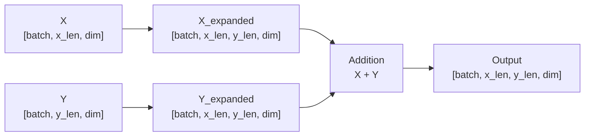
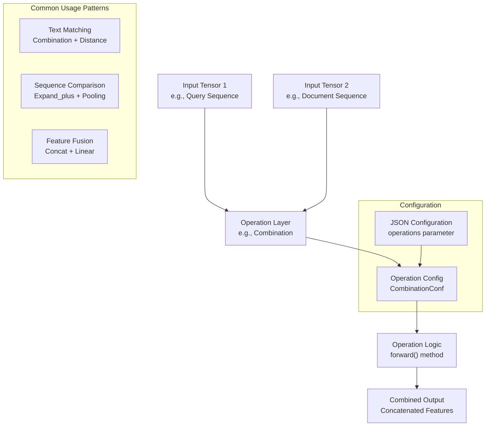

<!-- source: DeepWiki mcp.deepwiki.com · repo microsoft/NeuronBlocks · page 6.3 Operations · fetched 2026-10-26 -->

# Operations

<details>
<summary>Relevant source files</summary>

The following files were used as context for generating this wiki page:

- [block_zoo/__init__.py](block_zoo/__init__.py)
- [block_zoo/op/CalculateDistance.py](block_zoo/op/CalculateDistance.py)
- [block_zoo/op/Combination.py](block_zoo/op/Combination.py)
- [block_zoo/op/Expand_plus.py](block_zoo/op/Expand_plus.py)
- [block_zoo/op/__init__.py](block_zoo/op/__init__.py)

</details>


This section covers tensor manipulation operations available in the Block Zoo. Operations are specialized layers that perform mathematical transformations, combinations, and calculations on tensor inputs. These operations serve as building blocks for complex neural network architectures, enabling tasks like sequence matching, feature combination, and distance measurement.

For core neural network layers like Linear and Pooling, see [Core Layers](#6.1). For attention mechanisms, see [Attention Mechanisms](#6.2).

## Operation Categories

Operations in NeuronBlocks are organized into several functional categories, each serving specific purposes in neural network architectures:

### Operation Class Hierarchy

```mermaid
graph TD
    BaseLayer["BaseLayer<br/>block_zoo.BaseLayer"] --> CombOp["Combination Operations"]
    BaseLayer --> DistOp["Distance Operations"] 
    BaseLayer --> TensorOp["Tensor Manipulation"]
    BaseLayer --> MathOp["Mathematical Operations"]
    
    CombOp --> Combination["Combination<br/>block_zoo.op.Combination"]
    CombOp --> Match["Match<br/>block_zoo.op.Match"]
    
    DistOp --> CalculateDistance["CalculateDistance<br/>block_zoo.op.CalculateDistance"]
    
    TensorOp --> Concat2D["Concat2D<br/>block_zoo.op.Concat2D"]
    TensorOp --> Concat3D["Concat3D<br/>block_zoo.op.Concat3D"]
    TensorOp --> Flatten["Flatten<br/>block_zoo.op.Flatten"]
    TensorOp --> ExpandPlus["Expand_plus<br/>block_zoo.op.Expand_plus"]
    
    MathOp --> Add2D["Add2D<br/>block_zoo.math.Add2D"]
    MathOp --> Add3D["Add3D<br/>block_zoo.math.Add3D"]
    MathOp --> Minus2D["Minus2D<br/>block_zoo.math.Minus2D"]
    MathOp --> Minus3D["Minus3D<br/>block_zoo.math.Minus3D"]
    MathOp --> ElementWise2D["ElementWisedMultiply2D<br/>block_zoo.math.ElementWisedMultiply2D"]
    MathOp --> ElementWise3D["ElementWisedMultiply3D<br/>block_zoo.math.ElementWisedMultiply3D"]
    MathOp --> MatrixMult["MatrixMultiply<br/>block_zoo.math.MatrixMultiply"]
```



Sources: [block_zoo/__init__.py:36-46](), [block_zoo/op/__init__.py:1-9]()

## Combination Operations

Combination operations merge multiple input representations using various mathematical strategies. These are essential for text matching and sequence comparison tasks.

### Combination Layer

The `Combination` layer merges representations of two or more sequences using configurable operations:

| Operation | Description | Formula | Use Case |
|-----------|-------------|---------|----------|
| `"origin"` | Concatenate original inputs | `[input1; input2; ...]` | Feature combination |
| `"difference"` | Absolute difference | `abs(input1 - input2)` | Dissimilarity measurement |
| `"dot_multiply"` | Element-wise product | `input1 ⊙ input2` | Interaction modeling |

**Configuration Example:**
```json
{
  "layer": "Combination",
  "conf": {
    "operations": ["origin", "difference", "dot_multiply"]
  }
}
```

**Key Implementation Details:**
- Returns length of first input as sequence length
- Requires equal dimensions for `difference` and `dot_multiply` operations
- Supports variable number of inputs for `origin` and `dot_multiply`

Sources: [block_zoo/op/Combination.py:17-50](), [block_zoo/op/Combination.py:79-123]()

## Distance Calculations

Distance operations compute similarity and dissimilarity metrics between tensor representations, commonly used in matching and ranking tasks.

### CalculateDistance Layer

The `CalculateDistance` layer computes various distance metrics between two 2D tensor inputs:

| Distance Type | Formula | Range | Characteristics |
|---------------|---------|--------|-----------------|
| `"cos"` | Cosine similarity | [-1, 1] | Angle-based, normalized |
| `"euclidean"` | L2 distance | [0, ∞) | Geometric distance |
| `"manhattan"` | L1 distance | [0, ∞) | Sum of absolute differences |
| `"chebyshev"` | L∞ distance | [0, ∞) | Maximum absolute difference |

**Implementation Details:**
```python
# Cosine similarity
result = F.cosine_similarity(x, y)

# Euclidean distance  
result = torch.sqrt(torch.sum((x-y)**2, dim=1))

# Manhattan distance
result = torch.sum(torch.abs((x - y)), dim=1)

# Chebyshev distance
result = torch.abs((x - y)).max(dim=1)
```

Sources: [block_zoo/op/CalculateDistance.py:15-97]()

## Tensor Manipulation Operations

These operations handle tensor reshaping, concatenation, and dimensional transformations essential for connecting different network components.

### Concatenation Operations

| Operation | Input Shapes | Output Shape | Purpose |
|-----------|--------------|--------------|---------|
| `Concat2D` | Multiple [batch, dim] | [batch, sum(dims)] | Feature fusion |
| `Concat3D` | Multiple [batch, seq, dim] | [batch, seq, sum(dims)] | Sequence feature fusion |

### Expand_plus Operation

The `Expand_plus` layer creates interaction matrices between two sequences by expanding and adding them:



**Transformation Process:**
1. Expand X along y_len dimension: `[batch, x_len, dim]` → `[batch, x_len, y_len, dim]`
2. Expand Y along x_len dimension: `[batch, y_len, dim]` → `[batch, x_len, y_len, dim]`
3. Element-wise addition to create interaction matrix

Sources: [block_zoo/op/Expand_plus.py:43-75]()

## Mathematical Operations

Basic mathematical operations for tensor arithmetic, supporting both 2D and 3D tensors:

### Available Math Operations

| Operation Class | Supported Tensors | Function |
|-----------------|-------------------|----------|
| `Add2D` / `Add3D` | 2D/3D tensors | Element-wise addition |
| `Minus2D` / `Minus3D` | 2D/3D tensors | Element-wise subtraction |
| `ElementWisedMultiply2D` / `ElementWisedMultiply3D` | 2D/3D tensors | Element-wise multiplication |
| `MatrixMultiply` | 2D tensors | Matrix multiplication |

Sources: [block_zoo/__init__.py:40-46]()

## Operation Integration Patterns

Operations integrate into the NeuronBlocks architecture as modular components that can be chained and configured:



**Typical Usage Workflow:**
1. Define operation type and parameters in JSON configuration
2. Operation layer processes multiple tensor inputs
3. Mathematical transformations applied based on operation type
4. Output tensors feed into downstream layers

Sources: [block_zoo/op/Combination.py:91-122](), [block_zoo/op/CalculateDistance.py:71-97](), [block_zoo/BaseLayer.py]()

---

