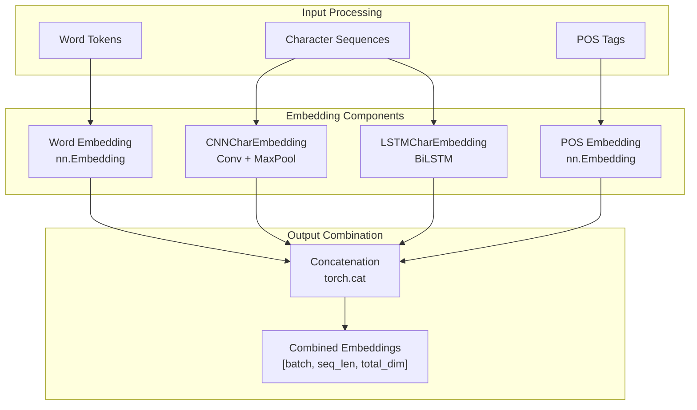
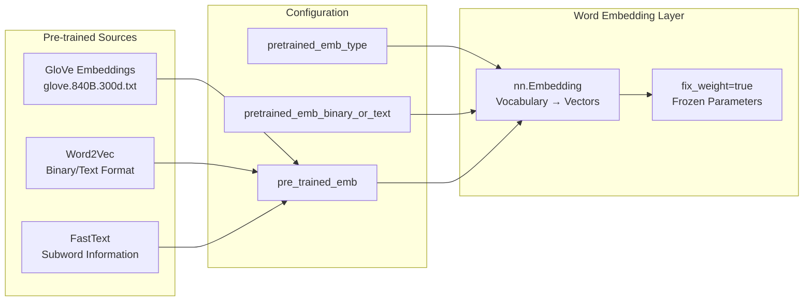
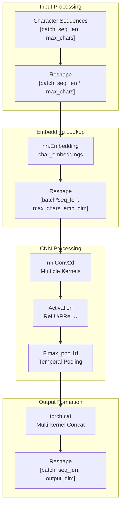
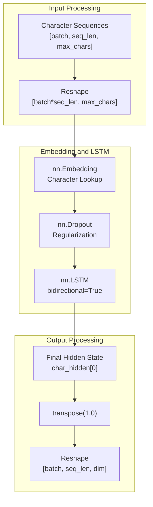
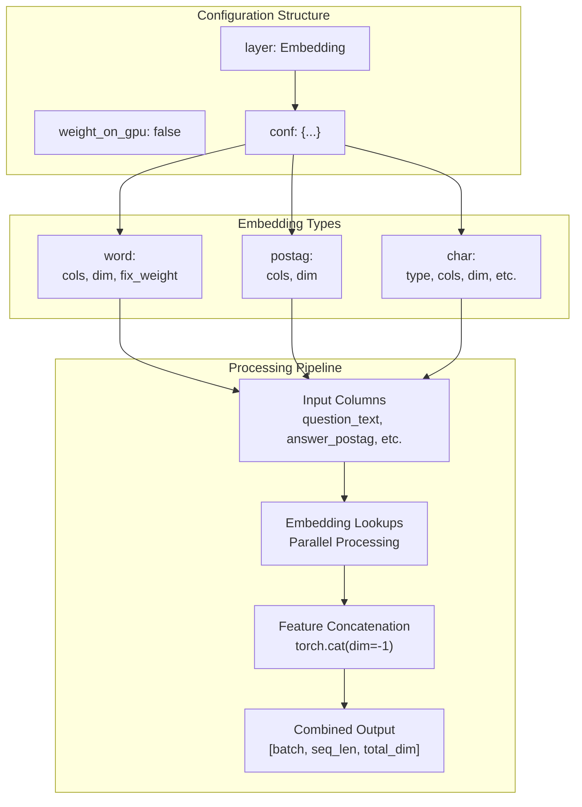

<!-- source: DeepWiki mcp.deepwiki.com · repo microsoft/NeuronBlocks · page 6.4 Embedding Layers · fetched 2026-10-26 -->

# Embedding Layers

<details>
<summary>Relevant source files</summary>

The following files were used as context for generating this wiki page:

- [block_zoo/Conv.py](block_zoo/Conv.py)
- [block_zoo/embedding/CNNCharEmbedding.py](block_zoo/embedding/CNNCharEmbedding.py)
- [block_zoo/embedding/LSTMCharEmbedding.py](block_zoo/embedding/LSTMCharEmbedding.py)
- [model_zoo/advanced/conf.json](model_zoo/advanced/conf.json)
- [settings.py](settings.py)

</details>


This document covers the embedding layer implementations in NeuronBlocks' Block Zoo, including word embeddings, character-level embeddings, and part-of-speech tag embeddings. These layers convert discrete tokens into dense vector representations that serve as input to downstream neural network components.

For information about other neural network layers, see [Core Layers](#6.1). For attention mechanisms that often work with embeddings, see [Attention Mechanisms](#6.2).

## Overview

NeuronBlocks provides a unified `Embedding` layer that can handle multiple embedding types simultaneously within a single configuration. The embedding system supports:

- **Word embeddings**: Pre-trained embeddings (GloVe, Word2Vec, FastText) and trainable word vectors
- **Character embeddings**: CNN-based and LSTM-based character-level representations  
- **POS tag embeddings**: Part-of-speech tag embeddings for syntactic information

## Embedding Architecture

The embedding layer architecture processes different input types and combines them into unified representations:



**Sources:** [model_zoo/advanced/conf.json:77-102](), [block_zoo/embedding/CNNCharEmbedding.py:64-133]()

## Word Embeddings

Word embeddings convert word tokens into dense vector representations. The system supports both pre-trained and trainable embeddings.

### Configuration

| Parameter | Type | Description |
|-----------|------|-------------|
| `cols` | list | Input column names containing word tokens |
| `dim` | int | Embedding dimension (e.g., 300 for GloVe) |
| `fix_weight` | bool | Whether to freeze pre-trained weights |

### Pre-trained Embedding Support

The system integrates with common pre-trained embeddings through configuration:



**Sources:** [model_zoo/advanced/conf.json:13-18](), [model_zoo/advanced/conf.json:82-86]()

## Character Embeddings

Character-level embeddings capture sub-word information and handle out-of-vocabulary words. NeuronBlocks provides two character embedding implementations.

### CNN Character Embedding

The `CNNCharEmbedding` class implements character-level embeddings using convolutional neural networks:



**Sources:** [block_zoo/embedding/CNNCharEmbedding.py:93-132]()

### CNN Character Embedding Configuration

| Parameter | Type | Description |
|-----------|------|-------------|
| `type` | string | "CNNCharEmbedding" |
| `dim` | list | Output dimensions for each CNN kernel |
| `embedding_matrix_dim` | int | Character embedding dimension |
| `window_size` | list | Convolution kernel widths |
| `stride` | list | Convolution strides |
| `activation` | string | Activation function (ReLU, PReLU) |
| `dropout` | float | Dropout rate |

**Sources:** [block_zoo/embedding/CNNCharEmbedding.py:15-36]()

### LSTM Character Embedding

The `LSTMCharEmbedding` class uses bidirectional LSTM for character-level representations:



**Sources:** [block_zoo/embedding/LSTMCharEmbedding.py:80-104]()

### LSTM Character Embedding Configuration

| Parameter | Type | Description |
|-----------|------|-------------|
| `dim` | int | Output dimension (split for bidirectional) |
| `embedding_matrix_dim` | int | Character embedding dimension |
| `dropout` | float | Dropout rate |
| `bidirect_flag` | bool | Use bidirectional LSTM |

**Sources:** [block_zoo/embedding/LSTMCharEmbedding.py:15-35]()

## POS Tag Embeddings

Part-of-speech tag embeddings provide syntactic information through trainable embeddings:

```json
"postag": {
  "cols": ["question_postag","answer_postag"],
  "dim": 20
}
```

POS embeddings use standard `nn.Embedding` layers with smaller dimensions (typically 10-50) compared to word embeddings.

**Sources:** [model_zoo/advanced/conf.json:87-90]()

## Multi-Type Embedding Configuration

The unified embedding layer combines multiple embedding types in a single configuration:



**Sources:** [model_zoo/advanced/conf.json:79-101]()

## Implementation Details

### Base Classes and Inheritance

Both character embedding implementations inherit from `BaseLayer` and use corresponding configuration classes:

- `CNNCharEmbedding` ← `BaseLayer`
- `CNNCharEmbeddingConf` ← `BaseConf`
- `LSTMCharEmbedding` ← `BaseLayer`  
- `LSTMCharEmbeddingConf` ← `BaseConf`

**Sources:** [block_zoo/embedding/CNNCharEmbedding.py:11](), [block_zoo/embedding/LSTMCharEmbedding.py:11]()

### GPU Support

Embedding layers automatically handle GPU placement based on configuration:

```python
if self.is_cuda():
    self.char_embeddings = self.char_embeddings.cuda()
    self.char_lstm = self.char_lstm.cuda()
```

**Sources:** [block_zoo/embedding/LSTMCharEmbedding.py:75-78]()

### Weight Initialization

Character embeddings use uniform initialization for embedding matrices:

```python
nn.init.uniform_(self.char_embeddings.weight, -0.001, 0.001)
```

**Sources:** [block_zoo/embedding/CNNCharEmbedding.py:77](), [block_zoo/embedding/LSTMCharEmbedding.py:68]()

---

