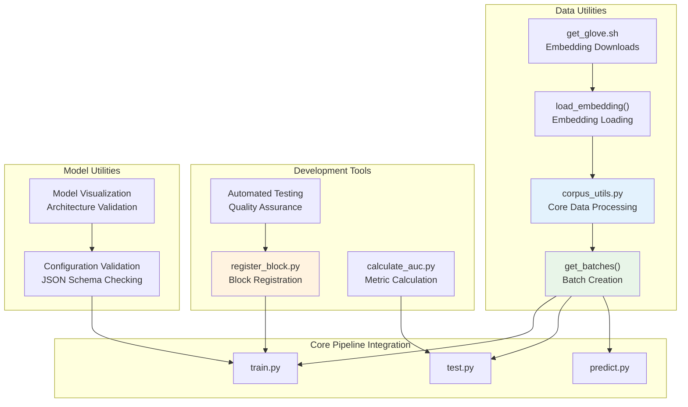
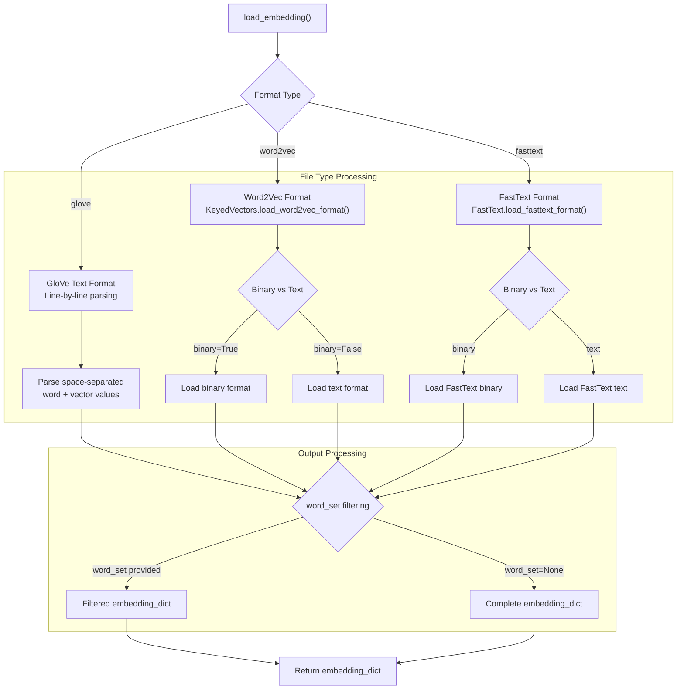
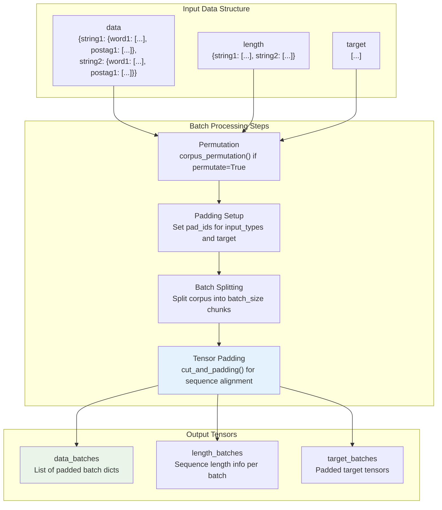
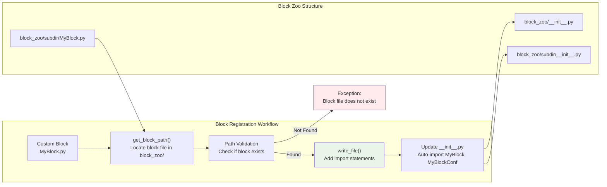
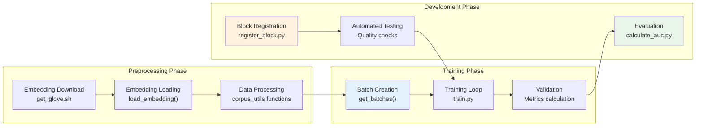

<!-- source: DeepWiki mcp.deepwiki.com · repo microsoft/NeuronBlocks · page 7 Utilities and Tools · fetched 2026-10-26 -->

# Utilities and Tools

<details>
<summary>Relevant source files</summary>

The following files were used as context for generating this wiki page:

- [dataset/get_glove.sh](dataset/get_glove.sh)
- [dataset/get_glove_6B.sh](dataset/get_glove_6B.sh)
- [model_zoo/nlp_tasks/slot_tagging/conf_slot_tagging.json](model_zoo/nlp_tasks/slot_tagging/conf_slot_tagging.json)
- [register_block.py](register_block.py)
- [tools/calculate_auc.py](tools/calculate_auc.py)
- [utils/corpus_utils.py](utils/corpus_utils.py)

</details>


This section covers the supporting utilities, tools, and helper functions that facilitate development, testing, and data processing within the NeuronBlocks toolkit. These utilities provide essential functionality for corpus processing, embedding management, model registration, evaluation metrics calculation, and automated testing workflows.

For information about the core training and evaluation pipeline, see [Training and Evaluation](#4). For details about data preprocessing within the main pipeline, see [Data Processing](#4.3).

## Overview

The NeuronBlocks toolkit includes several categories of utilities that support the main machine learning pipeline:



Sources: [utils/corpus_utils.py:1-443](), [tools/calculate_auc.py:1-48](), [register_block.py:1-64](), [dataset/get_glove.sh:1-21]()

## Data Processing Utilities

The `corpus_utils.py` module serves as the primary data processing utility, providing functions for embedding loading, text preprocessing, batch creation, and tensor operations.

### Embedding Management

The `load_embedding()` function supports multiple embedding formats and provides flexible loading capabilities:



Sources: [utils/corpus_utils.py:28-72]()

Key parameters for `load_embedding()`:
- `embedding_path`: Path to embedding file
- `embedding_dim`: Expected vector dimensionality  
- `format`: One of 'glove', 'word2vec', 'fasttext'
- `file_type`: 'text' or 'binary'
- `word_set`: Optional set for vocabulary filtering

### Batch Processing Pipeline

The `get_batches()` function transforms preprocessed data into training-ready batches with proper padding and tensor conversion:



Sources: [utils/corpus_utils.py:177-399]()

The `get_batches()` function handles multiple data scenarios:
- **Character-level data**: Applies 2D padding for [batch_size, seq_len, word_len] tensors
- **Sequence tagging**: Pads target sequences to match input sequence lengths
- **Classification**: Handles scalar targets without sequence padding
- **Multi-GPU support**: Converts to `torch.LongTensor` for `nn.DataParallel` compatibility

### Array and Sequence Utilities

Several helper functions support data manipulation:

| Function | Purpose | Key Parameters |
|----------|---------|----------------|
| `split_array()` | Chunk arrays into fixed-size pieces | `arr`, `n`, `small_chunk_threshold` |
| `split_array_averagely()` | Split arrays into equal-sized chunks | `arr`, `m` |
| `cut_and_padding()` | Truncate or pad sequences to fixed length | `seq`, `max_len`, `pad` |
| `get_seq_mask()` | Generate padding masks for sequences | `seq_len`, `max_seq_len` |
| `to_categorical()` | Convert class indices to one-hot vectors | `y`, `nb_classes` |

Sources: [utils/corpus_utils.py:75-135](), [utils/corpus_utils.py:402-418]()

## Development and Registration Tools

### Block Registration System

The `register_block.py` utility automates the process of registering custom neural network blocks within the Block Zoo architecture:



Sources: [register_block.py:8-55]()

Usage example:
```bash
python register_block.py --block_name MyCustomBlock
```

The registration process:
1. **Search**: `get_block_path()` recursively searches `block_zoo/` subdirectories
2. **Validation**: Ensures the `.py` file exists before registration
3. **Import Generation**: Creates import statements for both the block class and configuration class
4. **Hierarchy Update**: Updates all relevant `__init__.py` files in the directory hierarchy

### Evaluation Metrics Tools

The `calculate_auc.py` utility provides standalone AUC calculation for model evaluation:

| Parameter | Description | Example |
|-----------|-------------|---------|
| `--input_file` | TSV file with predictions and labels | `predictions.tsv` |
| `--predict_index` | Column index for model predictions | `0` |
| `--label_index` | Column index for ground truth labels | `1` |
| `--header` | Whether file contains header row | `--header` |

Sources: [tools/calculate_auc.py:7-48]()

Example usage:
```bash
python tools/calculate_auc.py --input_file results.tsv --predict_index 0 --label_index 1 --header
```

## Embedding Download Utilities

The toolkit includes shell scripts for automated embedding downloads:

### GloVe Embedding Scripts

Two scripts are provided for different GloVe embedding sets:

| Script | Embeddings Downloaded | Size |
|--------|----------------------|------|
| `get_glove.sh` | GloVe 840B.300d + 6B | Large-scale embeddings |
| `get_glove_6B.sh` | GloVe 6B only | Smaller embedding set |

Sources: [dataset/get_glove.sh:1-21](), [dataset/get_glove_6B.sh:1-16]()

Both scripts:
1. Create a `GloVe/` directory structure
2. Download embeddings via `curl` from Stanford NLP servers
3. Extract using `unzip`
4. Clean up temporary ZIP files

The downloaded embeddings integrate with the embedding loading system via:
```json
{
  "data_paths": {
    "pre_trained_emb": "dataset/GloVe/glove.6B.100d.txt"
  }
}
```

Sources: [model_zoo/nlp_tasks/slot_tagging/conf_slot_tagging.json:13]()

## Integration with Core Pipeline

These utilities integrate seamlessly with the main NeuronBlocks pipeline:



Sources: [utils/corpus_utils.py:177-399](), [register_block.py:38-55](), [tools/calculate_auc.py:30-34]()

The utilities provide essential infrastructure that enables:
- **Flexible data loading** supporting multiple embedding formats
- **Efficient batch processing** with automatic padding and tensor conversion  
- **Streamlined development** through automated block registration
- **Comprehensive evaluation** with standalone metric calculation tools
- **Reproducible experiments** through standardized data processing pipelines

---

