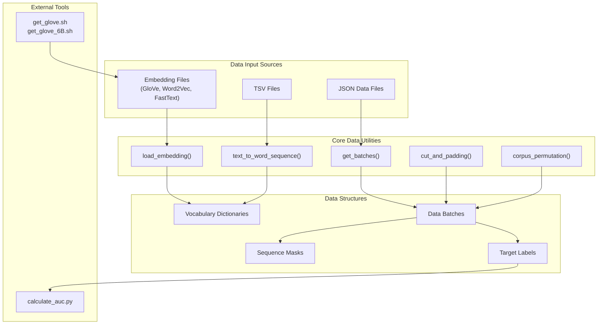
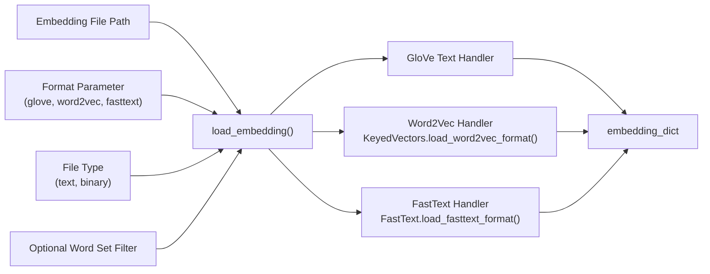
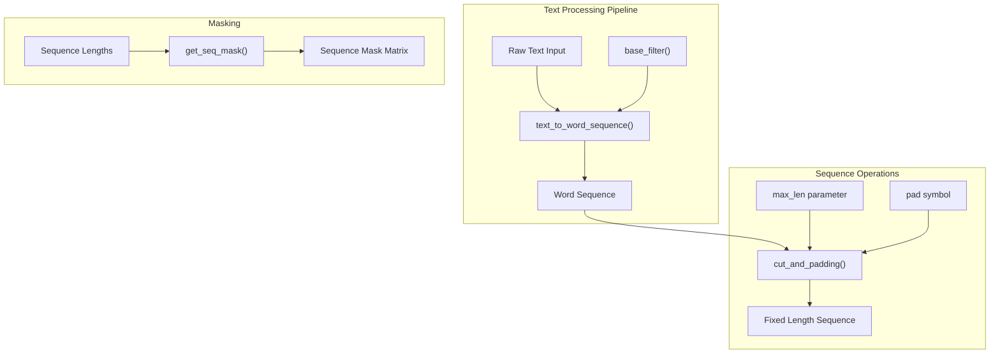
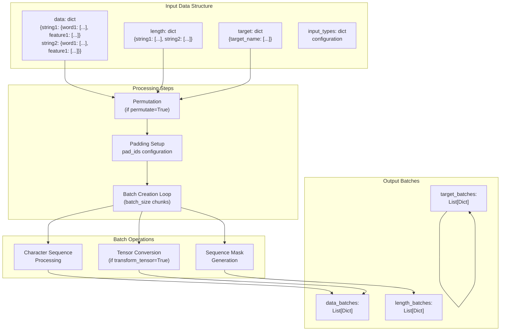
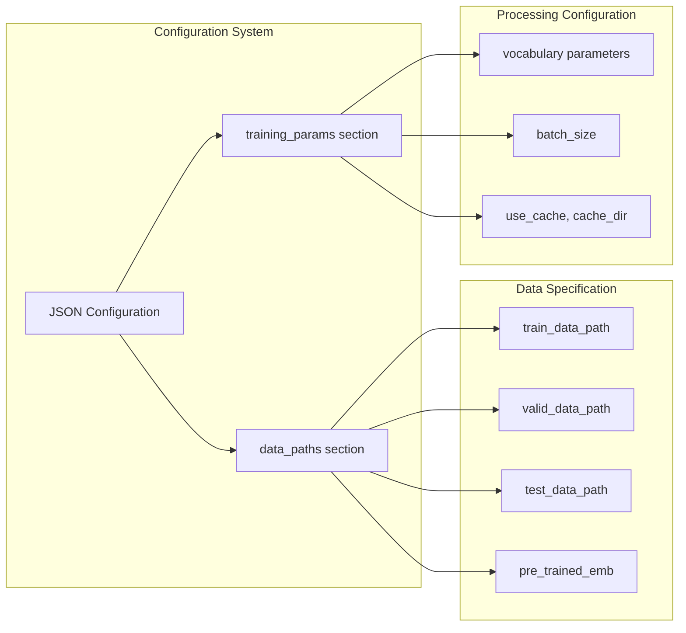

<!-- source: DeepWiki mcp.deepwiki.com · repo microsoft/NeuronBlocks · page 7.1 Data Utilities · fetched 2026-10-26 -->

# Data Utilities

<details>
<summary>Relevant source files</summary>

The following files were used as context for generating this wiki page:

- [dataset/get_glove.sh](dataset/get_glove.sh)
- [dataset/get_glove_6B.sh](dataset/get_glove_6B.sh)
- [model_zoo/nlp_tasks/slot_tagging/conf_slot_tagging.json](model_zoo/nlp_tasks/slot_tagging/conf_slot_tagging.json)
- [register_block.py](register_block.py)
- [tools/calculate_auc.py](tools/calculate_auc.py)
- [utils/corpus_utils.py](utils/corpus_utils.py)

</details>


This page covers the data processing utilities that support corpus handling, embedding management, and data preparation within the NeuronBlocks toolkit. These utilities provide the foundational data operations required for training, testing, and evaluation workflows.

For information about the model training pipeline that consumes these utilities, see [Training Pipeline](#4.1). For details about the Problem class that orchestrates data preprocessing, see [Data Processing](#4.3).

## Overview

The data utilities in NeuronBlocks provide a comprehensive set of functions for managing different aspects of data processing in NLP workflows. The utilities are primarily implemented in the `corpus_utils` module and support various data formats, embedding types, and preprocessing operations.



**Sources:** [utils/corpus_utils.py:1-443](), [dataset/get_glove.sh:1-22](), [tools/calculate_auc.py:1-48]()

## Embedding Management

The embedding management system provides unified loading and processing for multiple embedding formats commonly used in NLP tasks.

### Embedding Loading Function

The `load_embedding()` function serves as the primary interface for loading pre-trained embeddings:



**Function Signature and Parameters:**

| Parameter | Type | Description |
|-----------|------|-------------|
| `embedding_path` | str | File path to embedding file |
| `embedding_dim` | int | Expected embedding dimension |
| `format` | str | Format type: 'glove', 'word2vec', 'fasttext' |
| `file_type` | str | File encoding: 'text' or 'binary' |
| `with_head` | bool | Whether file contains header line |
| `word_set` | set | Optional vocabulary filter |

**Sources:** [utils/corpus_utils.py:28-72]()

### Embedding Download Scripts

Automated scripts are provided for acquiring common embedding datasets:

- `get_glove.sh`: Downloads GloVe 840B.300d and 6B embeddings
- `get_glove_6B.sh`: Downloads GloVe 6B embeddings only

**Sources:** [dataset/get_glove.sh:1-22](), [dataset/get_glove_6B.sh:1-16]()

## Core Data Processing Functions

### Sequence Processing

The sequence processing utilities handle text tokenization, padding, and length management:



**Key Functions:**

- `text_to_word_sequence()`: Tokenizes text with configurable filters
- `cut_and_padding()`: Truncates or pads sequences to fixed length
- `get_seq_mask()`: Generates attention masks for variable-length sequences

**Sources:** [utils/corpus_utils.py:110-124](), [utils/corpus_utils.py:146-154](), [utils/corpus_utils.py:402-419]()

### Data Structure Utilities

Additional utilities support common data transformations:

| Function | Purpose | Parameters |
|----------|---------|------------|
| `to_categorical()` | Convert class indices to one-hot vectors | `y`: class vector, `nb_classes`: number of classes |
| `split_array()` | Split arrays into chunks of fixed size | `arr`: array, `n`: chunk size, `small_chunk_threshold`: merge threshold |
| `split_array_averagely()` | Split arrays into equal-sized chunks | `arr`: array, `m`: number of chunks |
| `corpus_permutation()` | Shuffle multiple corpora consistently | `*corpora`: variable number of corpus arrays |

**Sources:** [utils/corpus_utils.py:126-136](), [utils/corpus_utils.py:75-94](), [utils/corpus_utils.py:96-108](), [utils/corpus_utils.py:156-175]()

## Batch Processing System

The `get_batches()` function implements the core batching mechanism that transforms processed data into training-ready batches:



### Batch Processing Parameters

| Parameter | Type | Description |
|-----------|------|-------------|
| `problem` | Problem | Problem instance for configuration |
| `data` | dict | Nested data structure with input sequences |
| `length` | dict | Sequence length information |
| `target` | dict | Target labels/values |
| `batch_size` | int | Number of samples per batch |
| `input_types` | dict | Input type configuration |
| `pad_ids` | dict | Padding token IDs for each input type |
| `permutate` | bool | Whether to shuffle data |
| `transform_tensor` | bool | Convert to PyTorch tensors |
| `predict_mode` | str | Processing mode ('batch' or other) |

### Problem Type Handling

The batching system adapts its behavior based on the problem type defined in the `ProblemTypes` enum:

- **Classification**: Handles categorical targets with optional padding
- **Sequence Tagging**: Manages sequence-level targets with tag alignment
- **Regression**: Processes continuous target values
- **MRC** (Machine Reading Comprehension): Supports complex question-answer structures

**Sources:** [utils/corpus_utils.py:177-399]()

## Integration with Model Configuration

Data utilities integrate with the broader NeuronBlocks system through configuration files that specify data paths and processing parameters:



**Sources:** [model_zoo/nlp_tasks/slot_tagging/conf_slot_tagging.json:9-14](), [model_zoo/nlp_tasks/slot_tagging/conf_slot_tagging.json:35-55]()

## Evaluation Utilities

The `calculate_auc.py` tool provides standalone evaluation capabilities for binary classification tasks:

### AUC Calculation Tool

**Command Line Interface:**
```
python tools/calculate_auc.py \
    --input_file predictions.tsv \
    --predict_index 0 \
    --label_index 1 \
    --header
```

**Functionality:**
- Reads TSV format prediction files
- Calculates ROC AUC scores using scikit-learn
- Supports flexible column indexing
- Optional header row handling

**Sources:** [tools/calculate_auc.py:1-48]()

---

