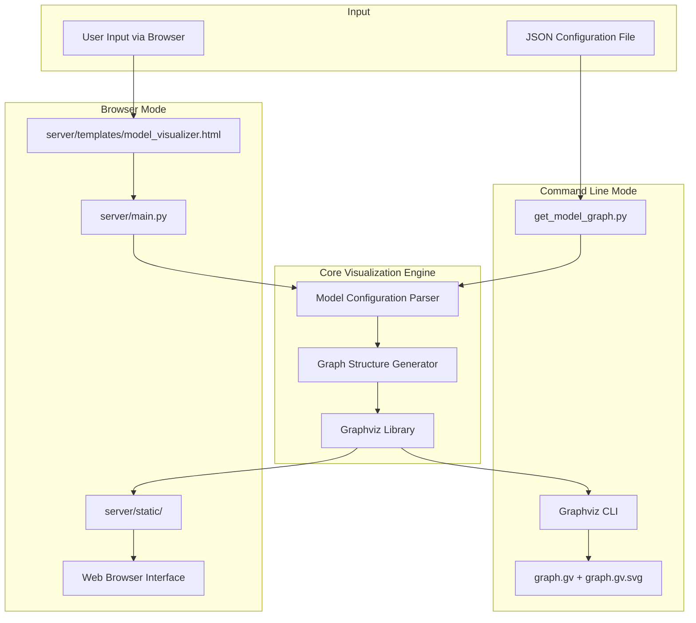
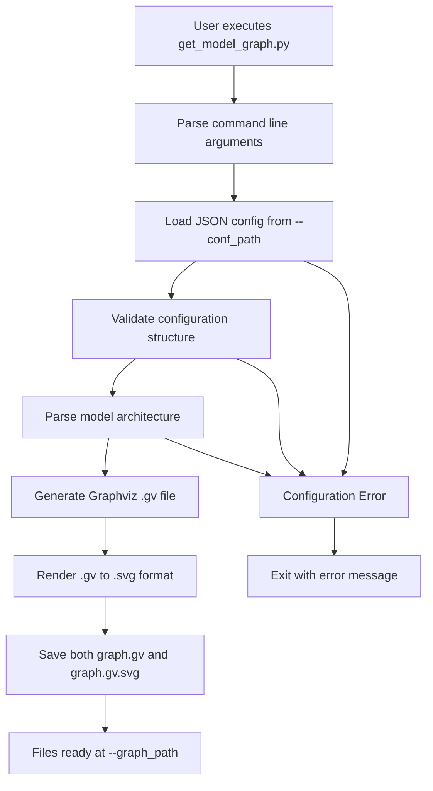
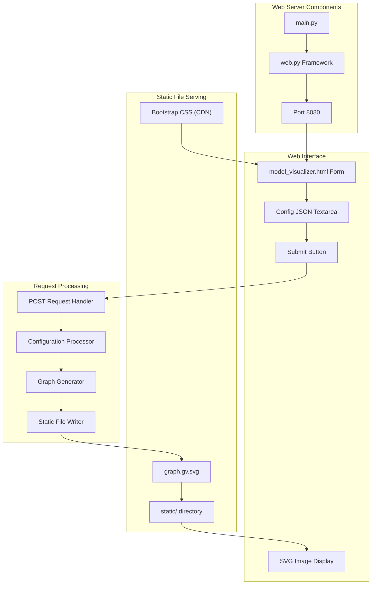
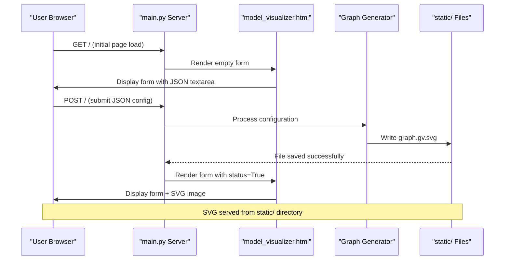

<!-- source: DeepWiki mcp.deepwiki.com · repo microsoft/NeuronBlocks · page 7.2 Model Visualization · fetched 2026-10-26 -->

# Model Visualization

<details>
<summary>Relevant source files</summary>

The following files were used as context for generating this wiki page:

- [.nojekyll](.nojekyll)
- [model_visualizer/README.md](model_visualizer/README.md)
- [model_visualizer/server/templates/model_visualizer.html](model_visualizer/server/templates/model_visualizer.html)

</details>


The Model Visualization system provides tools for visualizing neural network model architectures and validating configuration correctness in NeuronBlocks. This system helps users debug and understand their model configurations by generating visual representations of the model structure defined in JSON configuration files.

For information about configuration files themselves, see [Configuration System](#3.3). For details about the blocks that make up the visualized models, see [Block Zoo](#3.1).

## System Overview

The Model Visualization system operates in two distinct modes, each serving different use cases and deployment scenarios.

### System Architecture



*Sources: [model_visualizer/README.md:1-53](), [model_visualizer/server/templates/model_visualizer.html:1-33]()*

## Command Line Mode

The command line interface provides a direct way to generate model visualizations from JSON configuration files without requiring a web server.

### Usage Pattern

The command line mode is accessed through the `get_model_graph.py` script with the following parameters:

| Parameter | Required | Default | Description |
|-----------|----------|---------|-------------|
| `--conf_path` | Yes | - | Path to the input JSON configuration file |
| `--graph_path` | No | `./graph` | Path for the output model graph files |

### Command Line Workflow



### Output Files

The command line mode generates two files:

- **graph.gv**: Raw Graphviz DOT format file containing the graph structure
- **graph.gv.svg**: SVG rendering of the model architecture suitable for viewing in browsers or image viewers

*Sources: [model_visualizer/README.md:25-37]()*

## Browser Mode

The browser mode provides a web-based interface for interactive model visualization, allowing users to input configurations directly through a web form.

### Server Architecture



### Web Interface Components

The browser interface consists of several key elements defined in the HTML template:

| Component | Element | Purpose |
|-----------|---------|---------|
| Form Container | `<form method="POST">` | Handles configuration submission |
| JSON Input | `<textarea name="json">` | User input for model configuration |
| Submit Button | `<button type="submit">` | Triggers visualization generation |
| Result Display | `` | Shows generated model diagram |

### Browser Mode Workflow



*Sources: [model_visualizer/README.md:39-52](), [model_visualizer/server/templates/model_visualizer.html:18-28]()*

## Installation and Dependencies

The Model Visualization system requires two external dependencies:

### Required Libraries

| Library | Version | Purpose |
|---------|---------|---------|
| `graphviz` | Latest | Graph generation and rendering engine |
| `web.py` | `0.40.dev0` | Lightweight web framework for browser mode |

### Platform-Specific Installation

**Linux/macOS**:
```bash
pip install graphviz
pip install web.py==0.40.dev0
```

**Windows**:
- Install Graphviz from [Graphviz Windows Packages](https://graphviz.gitlab.io/_pages/Download/Download_windows.html)
- Add Graphviz to system PATH variable
- Install web.py via pip as above

### Server Deployment

To start the browser mode server:

```bash
cd server/
python main.py 8080
```

Access URLs:
- **Linux**: `http://<machine_ip>:8080`
- **Windows**: `http://localhost:8080`

*Sources: [model_visualizer/README.md:6-17](), [model_visualizer/README.md:41-49]()*

## Configuration Integration

The Model Visualization system integrates directly with NeuronBlocks' JSON configuration system, parsing the same configuration files used for training and testing.

### Supported Configuration Elements

The visualizer processes standard NeuronBlocks configuration sections:

- **Architecture**: Block connections and layer definitions
- **Inputs**: Input layer specifications
- **Outputs**: Output layer configurations  
- **Block definitions**: Individual block parameters and connections

### Validation and Error Checking

The visualization process includes configuration validation that helps identify:

- Malformed JSON syntax
- Missing required configuration sections
- Invalid block connections
- Unsupported block types
- Dimension mismatches between connected blocks

*Sources: [model_visualizer/README.md:3-4]()*

---

