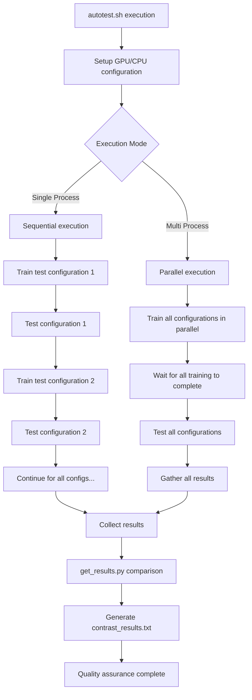
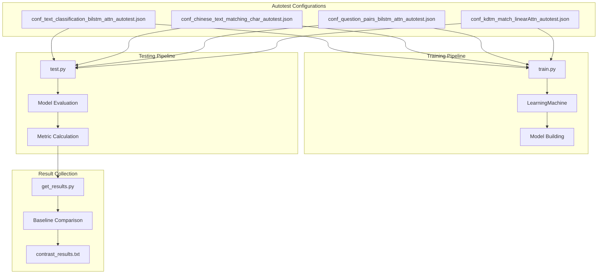
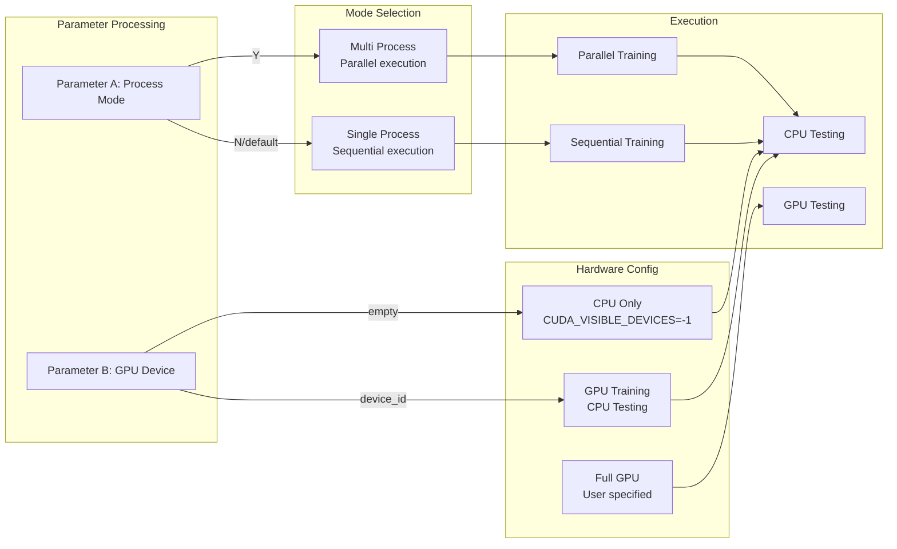

<!-- source: DeepWiki mcp.deepwiki.com · repo microsoft/NeuronBlocks · page 7.3 Automated Testing · fetched 2026-10-26 -->

# Automated Testing

<details>
<summary>Relevant source files</summary>

The following files were used as context for generating this wiki page:

- [autotest.sh](autotest.sh)
- [autotest/README.md](autotest/README.md)

</details>


## Purpose and Scope

The automated testing system in NeuronBlocks provides continuous integration and quality assurance capabilities for verifying that code changes do not introduce regressions in model performance. This system runs predefined test configurations across multiple NLP tasks and compares results against baseline metrics to ensure code reliability.

This document covers the autotest framework implementation and usage. For information about model evaluation and testing individual trained models, see [Testing and Prediction](#4.2). For general training procedures, see [Training Pipeline](#4.1).

## System Overview

The automated testing system is built around a shell script orchestrator that executes training and testing pipelines on predefined configurations, then compares results against established baselines to detect performance regressions.

### Autotest Workflow



Sources: [autotest.sh:1-29](), [autotest/README.md:1-45]()

## Test Configuration System

The autotest system executes four predefined test configurations that cover different NLP tasks and language processing scenarios:

| Configuration File | Task Type | Language | Model Architecture | Purpose |
|-------------------|-----------|----------|-------------------|---------|
| `conf_text_classification_bilstm_attn_autotest.json` | Text Classification | English | BiLSTM + Attention | Basic classification testing |
| `conf_chinese_text_matching_char_autotest.json` | Text Matching | Chinese | Character-level | Multi-language support testing |
| `conf_question_pairs_bilstm_attn_autotest.json` | Question Matching | English | BiLSTM + Attention | Complex matching task testing |
| `conf_kdtm_match_linearAttn_autotest.json` | Knowledge Distillation | English | Linear Attention | Model compression testing |

### Test Configuration Architecture



Sources: [autotest.sh:10-27](), [autotest/README.md:32-44]()

## Execution Modes

The autotest system supports two execution modes controlled by command-line parameters to `autotest.sh`:

### Single Process Mode (Sequential)
Executes test configurations one after another, completing training and testing for each configuration before proceeding to the next. This mode is memory-efficient but slower.

### Multi-Process Mode (Parallel)
Launches all training processes simultaneously using background execution and shell job control (`&` and `wait`), then runs testing sequentially. This mode is faster but requires more system resources.

### GPU/CPU Configuration
The system supports flexible hardware configuration:
- **CPU-only testing**: Uses `CUDA_VISIBLE_DEVICES=-1` for all operations
- **GPU training with CPU testing**: Trains on specified GPU(s) but tests on CPU for consistency
- **Full GPU testing**: Uses specified GPU devices for both training and testing

### Execution Flow Control



Sources: [autotest.sh:3-27]()

## Quality Assurance and Results Comparison

The autotest system implements regression detection by comparing current test results against established baselines stored in the system.

### Baseline Comparison Process

The `get_results.py` tool processes test outputs and generates a comparison report showing:

- **Task identification**: Maps test configurations to human-readable task names
- **Hardware context**: Distinguishes between GPU and CPU test results  
- **Metric comparison**: Compares new results against historical baselines
- **Regression detection**: Identifies significant performance drops

### Results Format

The system outputs results in `contrast_results.txt` with the following structure:

```
tasks                   GPU/CPU old accuracy/AUC    new accuracy/AUC 
english_text_matching       GPU     0.96655         0.97375
chinese_text_matching       GPU     0.70001         0.7 
quora_question_pairs        GPU     0.72596         0.727864
knowledge_distillation      CPU     0.66329         0.6695541666666667
```

### Quality Gates

The automated testing serves as a quality gate for:
- **Performance regression detection**: Identifies when changes negatively impact model accuracy
- **Cross-platform consistency**: Verifies that models behave consistently across CPU/GPU environments
- **Multi-language support**: Ensures changes don't break Chinese text processing capabilities
- **Architecture compatibility**: Tests different neural network configurations remain functional

Sources: [autotest/README.md:32-44](), [autotest.sh:28]()

## Prerequisites and Setup

Before running the automated testing system, several dependencies must be satisfied:

### Data Dependencies
1. **GloVe embeddings**: Required for English text processing tasks
   ```bash
   cd PROJECT_ROOT/dataset
   sh get_glove.sh
   ```

2. **20 Newsgroups dataset**: Required for text classification testing
   ```bash
   cd PROJECT_ROOT/dataset
   python get_20_newsgroups.py
   ```

### System Requirements
- Sufficient disk space for model outputs in `./autotest/models/` (automatically cleared before each run)
- GPU access (optional, but recommended for faster execution)
- Python environment with NeuronBlocks dependencies installed

Sources: [autotest/README.md:3-12]()

## Usage Examples

### Basic Usage Patterns

```bash
# Single process with CPU only
sh autotest.sh N

# Single process with GPU 0
sh autotest.sh N 0

# Multiple processes with CPU only  
sh autotest.sh Y

# Multiple processes with GPU 0
sh autotest.sh Y 0

# Multiple processes with multiple GPUs
sh autotest.sh Y 0,1
```

### Integration with CI/CD

The autotest system is designed for integration with continuous integration pipelines:

1. **Pre-commit testing**: Run before merging pull requests
2. **Nightly regression testing**: Scheduled execution to catch issues early
3. **Release validation**: Verify release candidates maintain quality standards

The `--force=True` parameter in the training commands ensures that existing model outputs are overwritten, making the system suitable for automated environments.

Sources: [autotest/README.md:15-31](), [autotest.sh:13-26]()

---

