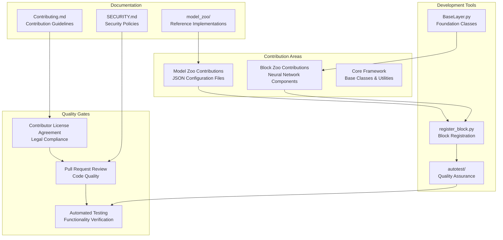
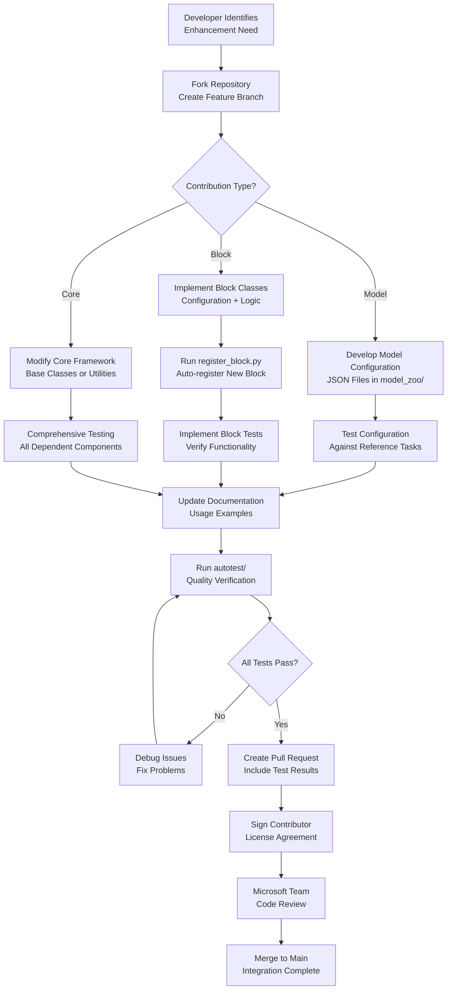
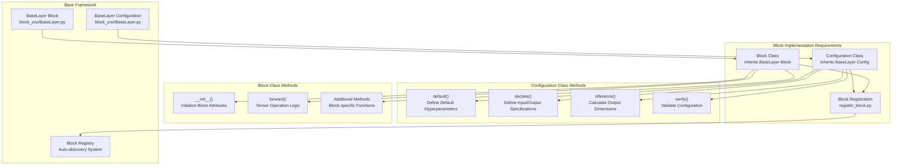
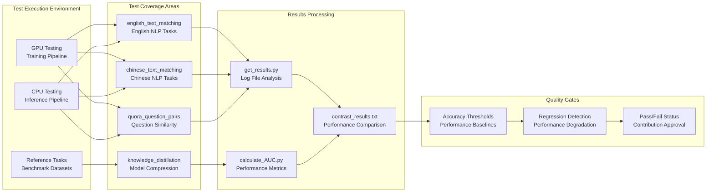
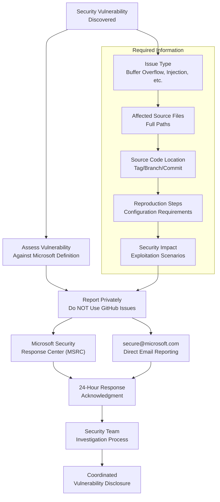

<!-- source: DeepWiki mcp.deepwiki.com · repo microsoft/NeuronBlocks · page 8 Development · fetched 2026-10-26 -->

# Development

Relevant source files

The following files were used as context for generating this wiki page:

- [Contributing.md](Contributing.md)
- [SECURITY.md](SECURITY.md)
- [autotest/tools/get_results.py](autotest/tools/get_results.py)

This document provides comprehensive guidance for developing, extending, and contributing to the NeuronBlocks toolkit. It covers the development ecosystem, contribution workflows, custom block creation, quality assurance processes, and security considerations.

For specific information about using existing blocks and models, see [Block Reference](#6). For examples of implementing different NLP tasks, see [Model Examples](#5).

## Development Ecosystem Overview

The NeuronBlocks development ecosystem is designed to support collaborative contributions while maintaining code quality and consistency. The framework provides structured processes for extending functionality through custom blocks and pre-configured models.

### Development Components

Sources: [Contributing.md:1-82](), [autotest/tools/get_results.py:1-51](), [SECURITY.md:1-42]()

### Contribution Workflow

The development process follows Microsoft's open source contribution model with specific adaptations for NeuronBlocks' modular architecture.

Sources: [Contributing.md:4-11](), [Contributing.md:74-82]()

## Block Development Process

Creating custom blocks follows a structured three-step process that ensures consistency and integration with the existing framework.

### Block Architecture Components

Sources: [Contributing.md:24-79]()

### Block Development Steps

| Step | Component | Requirements | Purpose |
|------|-----------|-------------|----------|
| 1 | Configuration Class | Inherit from BaseLayer, implement required methods | Define block behavior and validation |
| 2 | Block Implementation | Inherit from BaseLayer, implement `__init__` and `forward` | Implement tensor operations and logic |
| 3 | Registration | Run `register_block.py --block_name=new_block_name` | Auto-register for framework discovery |

The configuration class methods serve specific purposes:

- **`default()`**: Defines default hyperparameters read from JSON configuration files
- **`declare()`**: Specifies input ranks and number of inputs the block accepts  
- **`inference()`**: Calculates output dimensions based on input specifications
- **`verify()`**: Performs validation checks during model definition

Sources: [Contributing.md:27-60]()

## Quality Assurance Framework

The autotest system provides comprehensive quality assurance for contributions, ensuring functionality and performance standards are maintained.

### Automated Testing Pipeline

Sources: [autotest/tools/get_results.py:4-50]()

### Test Result Analysis

The automated testing system processes results from multiple task configurations and compares them against established baselines:

| Task | Baseline Performance | Test Environment | Metric |
|------|---------------------|------------------|---------|
| English Text Matching | 0.96655 | GPU/CPU | Accuracy |
| Chinese Text Matching | 0.70001 | GPU/CPU | Accuracy |
| Quora Question Pairs | 0.72596 | GPU/CPU | Accuracy |
| Knowledge Distillation | 0.66329 | CPU | AUC |

The testing framework extracts performance metrics from log files and generates comparison reports in `contrast_results.txt` to detect performance regressions.

Sources: [autotest/tools/get_results.py:7-50]()

## Security Considerations

NeuronBlocks follows Microsoft's comprehensive security policies and coordinated vulnerability disclosure principles.

### Security Reporting Process

Sources: [SECURITY.md:9-40]()

### Security Best Practices

- **Never report security vulnerabilities through public GitHub issues**
- **Encrypt sensitive communications** using Microsoft's PGP key when possible
- **Provide comprehensive details** including proof-of-concept code and impact analysis
- **Follow coordinated disclosure** principles to protect users during remediation

The security framework emphasizes protecting user data and maintaining system integrity while supporting the open-source development model.

Sources: [SECURITY.md:11-39]()

---

