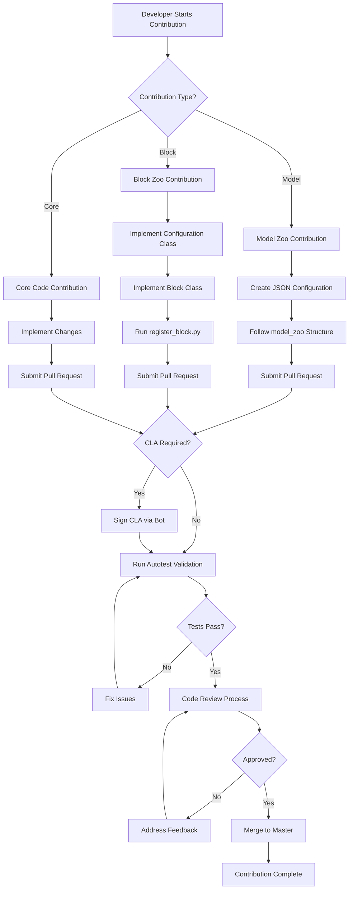
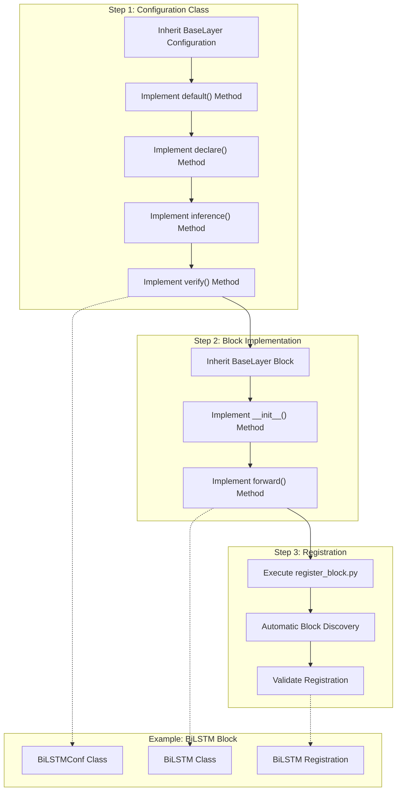
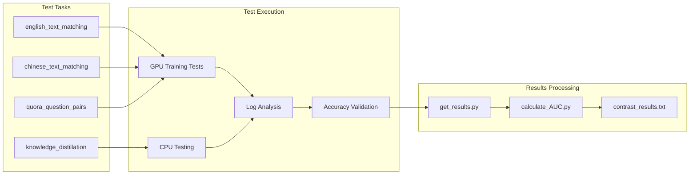

<!-- source: DeepWiki mcp.deepwiki.com · repo microsoft/NeuronBlocks · page 8.1 Contributing Guide · fetched 2026-10-26 -->

# Contributing Guide

<details>
<summary>Relevant source files</summary>

The following files were used as context for generating this wiki page:

- [Contributing.md](Contributing.md)
- [autotest/tools/get_results.py](autotest/tools/get_results.py)

</details>


This document provides comprehensive guidance for contributing to the NeuronBlocks project, including how to add new models, blocks, and improvements to the codebase. It covers the contribution workflow, technical requirements, and quality assurance processes.

For information about creating custom blocks after they've been accepted, see [Custom Blocks](#8.2). For security considerations when contributing, see [Security](#8.3). For details about the automated testing system, see [Automated Testing](#7.3).

## Contribution Types and Prerequisites

NeuronBlocks welcomes several types of contributions that extend the toolkit's capabilities:

| Contribution Type | Description | Target Location |
|-------------------|-------------|-----------------|
| **Model Zoo** | Pre-configured JSON models for specific NLP tasks | `model_zoo/` directory |
| **Block Zoo** | Custom neural network components and layers | `block_zoo/` directory |
| **Core Improvements** | Bug fixes, performance optimizations, new features | Various core modules |
| **Documentation** | Wiki updates, examples, tutorials | Documentation files |
| **Testing** | New test cases, autotest improvements | `autotest/` directory |

### Microsoft Contributor License Agreement (CLA)

All contributions require agreement to Microsoft's Contributor License Agreement (CLA). When you submit a pull request, a CLA-bot automatically determines if you need to provide a CLA and decorates the PR with appropriate instructions. This is a one-time requirement across all Microsoft repositories.

The project follows the [Microsoft Open Source Code of Conduct](https://opensource.microsoft.com/codeofconduct/). For questions, contact [opencode@microsoft.com](mailto:opencode@microsoft.com).

**Sources:** [Contributing.md:1-15]()

## Contribution Workflow Overview



**Sources:** [Contributing.md:1-82]()

## Model Zoo Contributions

Contributing models to the Model Zoo involves creating JSON configuration files that define complete NLP model architectures for specific tasks.

### Requirements

- **JSON Configuration**: Complete model definition following NeuronBlocks configuration schema
- **Task Alignment**: Model should address a specific NLP task (classification, matching, etc.)
- **Documentation**: Clear description of the model's purpose and expected performance
- **Structure Compliance**: Follow existing `model_zoo/` directory organization

### Process

1. **Choose Target Task**: Identify the NLP task your model addresses
2. **Create Configuration**: Write a JSON file defining the model architecture using Block Zoo components
3. **Follow Structure**: Place the configuration in the appropriate `model_zoo/` subdirectory
4. **Submit PR**: Create a pull request with your model configuration

The Model Zoo provides templates for common tasks like text classification, sequence tagging, and text matching. Review existing configurations to understand the expected format and structure.

**Sources:** [Contributing.md:17-19]()

## Block Zoo Contributions

Contributing to the Block Zoo requires implementing new neural network components that can be reused across different model architectures. This is a three-step process involving configuration class implementation, block class implementation, and registration.

### Block Development Process



**Sources:** [Contributing.md:20-79]()

### Step 1: Configuration Class Implementation

Create a configuration class that inherits from `BaseLayer` and implements required methods:

#### Required Methods

| Method | Purpose | Implementation Details |
|--------|---------|----------------------|
| `default()` | Define default hyperparameters | Read block parameters from JSON configuration |
| `declare()` | Define input requirements | Specify `input_ranks` and `num_of_inputs` |
| `inference()` | Calculate output dimensions | Determine `output_dim` based on inputs and parameters |
| `verify()` | Validate configuration | Check parameter validity and compatibility |

#### Input Rank System

The rank system defines tensor dimensionality requirements:
- **Rank 0**: Scalar values
- **Rank 1**: Vector (1D tensor)
- **Rank 2**: Matrix (2D tensor)  
- **Rank 3**: 3D tensor (e.g., batch × sequence × features)

#### Input Number Specifications

- **Positive integer**: Accepts exactly N inputs (e.g., `num_of_inputs = 2`)
- **-1**: Accepts any number of inputs with same rank

**Sources:** [Contributing.md:24-60]()

### Step 2: Block Class Implementation

Implement the actual neural network block by inheriting from `BaseLayer` and defining the computation logic:

#### Required Methods

| Method | Purpose | Key Responsibilities |
|--------|---------|---------------------|
| `__init__()` | Initialize block | Set up PyTorch modules, parameters, and internal state |
| `forward()` | Define computation | Implement tensor operations and forward pass logic |

The block class should handle tensor operations efficiently and maintain compatibility with PyTorch's automatic differentiation system.

**Sources:** [Contributing.md:61-72]()

### Step 3: Block Registration

NeuronBlocks provides automated block registration to integrate new blocks into the system:

```bash
cd PROJECT_ROOT
python register_block.py --block_name=new_block_name
```

This script automatically:
- Discovers the new block class and configuration
- Registers the block in the Block Zoo registry
- Enables the block for use in JSON configurations
- Validates the registration process

**Sources:** [Contributing.md:73-79]()

## Testing and Quality Assurance

All contributions must pass automated testing before acceptance. The autotest system validates functionality and maintains code quality standards.

### Autotest System Components



### Validation Requirements

Before submitting contributions, run the autotest system to verify:

1. **Functional Correctness**: Models train and test without errors
2. **Performance Standards**: Accuracy meets expected benchmarks
3. **Compatibility**: Integration with existing components works properly
4. **Resource Usage**: Memory and computation requirements are reasonable

The autotest system compares new results against established baselines and generates detailed reports for review.

**Sources:** [autotest/tools/get_results.py:1-51](), [Contributing.md:81-82]()

### Test Result Analysis

The autotest system tracks performance across multiple dimensions:

| Task Type | GPU Training | CPU Testing | Metric Type |
|-----------|--------------|-------------|-------------|
| English Text Matching | ✓ | ✓ | Accuracy |
| Chinese Text Matching | ✓ | ✓ | Accuracy |
| Question Pairs | ✓ | ✓ | Accuracy |
| Knowledge Distillation | - | ✓ | AUC |

Results are automatically compared against baseline performance to detect regressions or improvements.

**Sources:** [autotest/tools/get_results.py:7-51]()

## Code Quality Standards

Contributions should adhere to established coding standards and best practices:

### Block Implementation Guidelines

- **Clear Documentation**: Include docstrings explaining block purpose and parameters
- **Error Handling**: Implement proper validation and error messages
- **Efficiency**: Optimize tensor operations for performance
- **Modularity**: Design blocks for reusability across different models
- **Compatibility**: Ensure integration with existing Block Zoo components

### Testing Best Practices

- **Comprehensive Coverage**: Test various input configurations and edge cases
- **Performance Validation**: Verify computational efficiency and memory usage
- **Integration Testing**: Ensure blocks work properly within complete model architectures
- **Regression Testing**: Maintain compatibility with existing functionality

**Sources:** [Contributing.md:20-82]()

---

