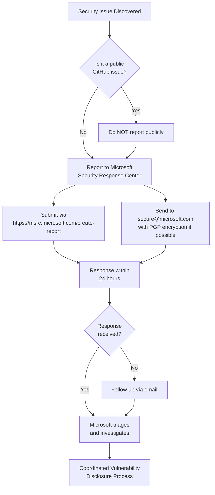
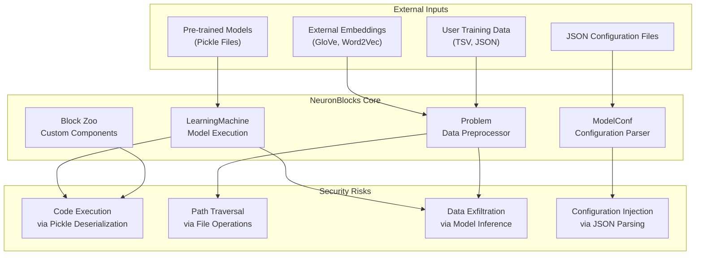

<!-- source: DeepWiki mcp.deepwiki.com · repo microsoft/NeuronBlocks · page 8.3 Security · fetched 2026-10-26 -->

# Security

Relevant source files

The following files were used as context for generating this wiki page:

- [SECURITY.md](SECURITY.md)

This document covers security policies, vulnerability reporting procedures, and safe usage guidelines for the NeuronBlocks toolkit. It outlines Microsoft's security stance, the process for reporting security issues, and best practices for secure development and deployment.

For information about contributing code and extensions, see [Contributing Guide](#8.1). For details about custom block development, see [Custom Blocks](#8.2).

## Security Policy

NeuronBlocks follows Microsoft's comprehensive security policy for open source projects. Microsoft takes the security of software products and services seriously, including all source code repositories managed through GitHub organizations.

### Vulnerability Definition and Scope

Security vulnerabilities in NeuronBlocks are defined according to [Microsoft's definition of a security vulnerability](https://aka.ms/opensource/security/definition). This includes issues that could compromise the confidentiality, integrity, or availability of the system or its data.

**Sources: [SECURITY.md:1-42]()**

## Vulnerability Reporting Process

### Reporting Security Issues

### Required Information for Reports

When reporting security vulnerabilities, include the following details to help with triage:

| Information Type | Description |
|------------------|-------------|
| **Issue Type** | Buffer overflow, injection, XSS, etc. |
| **Source Files** | Full paths of affected files |
| **Location** | Tag/branch/commit or direct URL |
| **Configuration** | Special setup required to reproduce |
| **Reproduction Steps** | Step-by-step instructions |
| **Proof of Concept** | Exploit code if available |
| **Impact Assessment** | How an attacker might exploit the issue |

### Communication Guidelines

- **Primary Language**: English preferred for all communications
- **Response Time**: Expect response within 24 hours
- **Follow-up**: If no response received, follow up via email
- **Bug Bounty**: More complete reports may contribute to higher bounty awards

**Sources: [SECURITY.md:9-42]()**

## Security Considerations in NeuronBlocks

### Model and Data Security Attack Vectors

### Safe Usage Guidelines

#### Model Files and Serialization
- **Never load untrusted model files**: Python pickle files can execute arbitrary code during deserialization
- **Verify model sources**: Only use models from trusted sources or train your own
- **Isolate model loading**: Consider running model loading in sandboxed environments

#### Configuration Security
- **Validate JSON configurations**: Ensure configuration files come from trusted sources
- **Restrict file paths**: Avoid user-controlled file paths in configuration
- **Sanitize input paths**: Validate all file path inputs to prevent directory traversal

#### Data Handling
- **Sensitive data protection**: Be cautious when processing sensitive or personal text data
- **Data residuals**: Models may retain information from training data
- **Access controls**: Implement appropriate access controls for training data and models

#### External Dependencies
- **Embedding sources**: Verify integrity of downloaded pre-trained embeddings
- **Dependency scanning**: Regularly scan dependencies for known vulnerabilities
- **Version pinning**: Use specific versions of dependencies to avoid supply chain attacks

**Sources: [SECURITY.md:1-42]()**

## Development Security Practices

### Secure Coding Guidelines

For developers extending NeuronBlocks or contributing custom blocks:

#### Input Validation
- Validate all configuration parameters in custom blocks
- Sanitize file paths and user inputs
- Implement bounds checking for tensor operations

#### Safe Deserialization
- Avoid pickle for saving/loading custom models when possible
- Use safer serialization formats like JSON for configuration
- Implement signature verification for model files

#### Resource Management
- Implement proper resource cleanup in custom blocks
- Add memory and computation limits where appropriate
- Handle exceptions gracefully to prevent information disclosure

### Code Review Security Checklist

When reviewing contributions:

- [ ] No hardcoded credentials or secrets
- [ ] Safe file handling with path validation
- [ ] Proper input sanitization
- [ ] No unsafe deserialization patterns
- [ ] Resource limits and cleanup implemented
- [ ] Error handling doesn't leak sensitive information

**Sources: [SECURITY.md:1-42]()**

## Coordinated Vulnerability Disclosure

Microsoft follows the principle of Coordinated Vulnerability Disclosure (CVD). This means:

1. **Responsible Disclosure**: Security researchers work with Microsoft to address vulnerabilities before public disclosure
2. **Timeline Coordination**: Disclosure timing balances public safety with time needed for fixes
3. **Credit Attribution**: Security researchers receive appropriate credit for their findings
4. **Bug Bounty Program**: Eligible vulnerabilities may qualify for bounty rewards

### Microsoft Security Response Center (MSRC)

The MSRC coordinates all security response activities for Microsoft products, including NeuronBlocks. Key contacts and resources:

- **Report Portal**: https://msrc.microsoft.com/create-report
- **Email Contact**: secure@microsoft.com
- **PGP Key**: Available at Microsoft Security Response Center PGP Key page
- **Program Information**: microsoft.com/msrc

**Sources: [SECURITY.md:37-42]()**