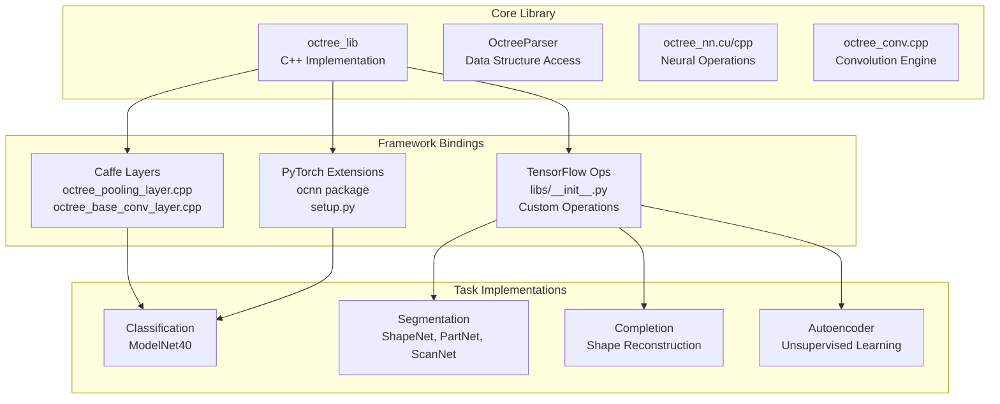
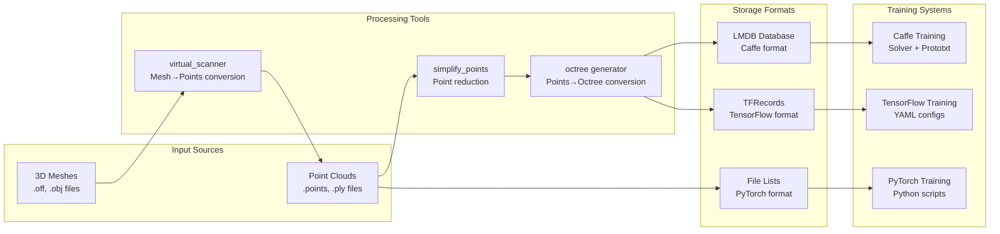
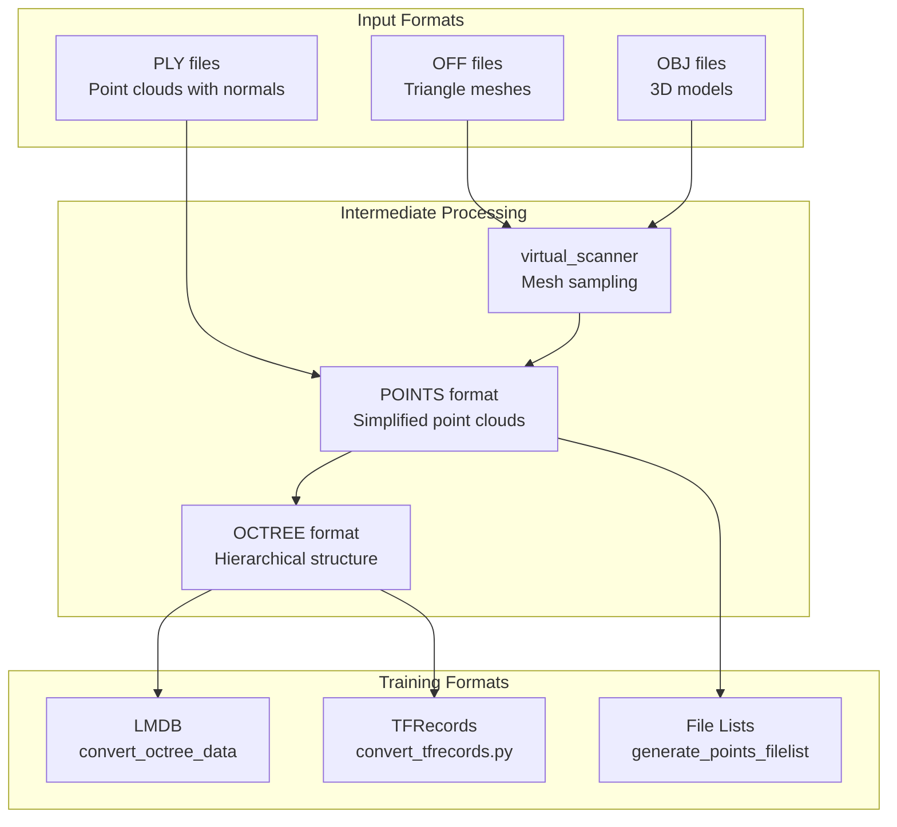

<!-- source: DeepWiki mcp.deepwiki.com · repo microsoft/O-CNN · page 1 Overview · fetched 2026-10-26 -->

# Overview

Relevant source files

The following files were used as context for generating this wiki page:

- [README.md](README.md)
- [docs/classification.md](docs/classification.md)
- [docs/completion.md](docs/completion.md)
- [docs/segmentation.md](docs/segmentation.md)
- [docs/unsupervised.md](docs/unsupervised.md)
- [tensorflow/data/seg_shapenet.py](tensorflow/data/seg_shapenet.py)

This document provides a comprehensive introduction to the O-CNN repository, explaining the octree-based convolutional neural network system for 3D deep learning. It covers the core architecture, supported tasks, framework integrations, and data processing pipeline.

For detailed installation instructions, see [Installation and Setup](#2). For specific task implementations, see [Tasks and Applications](#5). For framework-specific usage, see [Framework Integration](#4).

## What is O-CNN

O-CNN (Octree-based Convolutional Neural Networks) is a deep learning framework specifically designed for efficient 3D shape analysis. Unlike traditional approaches that work with voxel grids or point clouds directly, O-CNN uses octree data structures to hierarchically represent 3D shapes, enabling memory-efficient processing of high-resolution 3D data.

The system implements several key innovations:
- **Octree-based convolution**: Specialized convolution operations that work directly on octree nodes
- **Hierarchical processing**: Multi-resolution analysis through octree levels
- **Adaptive representation**: Support for both regular and adaptive octrees
- **Multi-framework support**: Implementations across Caffe, TensorFlow, and PyTorch

**Sources:** [README.md:1-79]()

## System Architecture

The O-CNN system consists of three main layers: a core C++ octree library, framework-specific bindings, and task-specific implementations.

### Core System Components

The core `octree_lib` provides fundamental data structures and operations, ensuring consistency across all framework integrations. Each framework has dedicated bindings while sharing the same underlying octree operations.

**Sources:** [README.md:1-79](), [docs/classification.md:1-207]()

### Data Processing Pipeline

The system handles the complete workflow from raw 3D data to training-ready formats across multiple frameworks. Tools like `virtual_scanner` and `simplify_points` process raw meshes, while format-specific converters prepare data for each framework.

**Sources:** [docs/classification.md:12-44](), [tensorflow/data/seg_shapenet.py:27-134]()

## Supported Tasks

O-CNN supports four primary 3D learning tasks, each with specialized implementations and pre-configured datasets:

| Task | Primary Datasets | Frameworks | Key Features |
|------|------------------|------------|--------------|
| **Classification** | ModelNet40 | Caffe, TensorFlow, PyTorch | Object category recognition, voting strategies |
| **Segmentation** | ShapeNet, PartNet, ScanNet | TensorFlow, PyTorch | Part-level and scene-level segmentation |
| **Completion** | Custom completion dataset | TensorFlow | Shape reconstruction with skip connections |
| **Unsupervised Learning** | ShapeNetCore.v1 | TensorFlow | Self-supervised pretraining, instance discrimination |

### Classification Pipeline
The classification system processes 3D objects from ModelNet40 dataset through the following stages:
1. Mesh conversion using `virtual_scanner`
2. Point cloud simplification with `simplify_points`
3. Octree generation and database creation
4. Training with framework-specific networks (LeNet, ResNet, HRNet architectures)

### Segmentation Pipeline  
Segmentation tasks support both shape parts (ShapeNet, PartNet) and scene parsing (ScanNet):
- **Shape Segmentation**: Uses HRNet architecture for fine-grained part segmentation
- **Scene Segmentation**: Processes large-scale indoor scenes with UNet-like structures
- **Multi-scale Processing**: Leverages octree hierarchy for efficient scene analysis

**Sources:** [README.md:34-44](), [docs/classification.md:1-207](), [docs/segmentation.md:48-98](), [docs/unsupervised.md:1-100]()

## Framework Integration

O-CNN provides native support for three major deep learning frameworks, each with distinct advantages:

### Framework Comparison

| Framework | Implementation | Primary Use Cases | Key Components |
|-----------|---------------|-------------------|-----------------|
| **Caffe** | Custom layers | Research prototyping | `octree_pooling_layer.cpp`, `octree_base_conv_layer.cpp` |
| **TensorFlow** | Custom operators | Production deployment | `libs/__init__.py`, YAML configuration system |
| **PyTorch** | Extension modules | Modern research | `ocnn` package, `setup.py` installation |

### TensorFlow Integration
The TensorFlow implementation offers the most comprehensive feature set:
- Custom operators built through `build.py` → `libocnn.so`
- YAML-based configuration system for experiments
- Support for all task types including completion and unsupervised learning
- HRNet and UNet architectures for advanced applications

### PyTorch Integration
The PyTorch implementation focuses on modern deep learning workflows:
- Native extension through `setup.py` → `ocnn.nn` module
- Direct Python integration with standard PyTorch patterns
- ResNet architectures and standard classification/segmentation pipelines
- File list-based data loading for flexibility

**Sources:** [README.md:49-74](), [docs/classification.md:76-207]()

## Data Formats and Conversion

The system uses a standardized data processing pipeline that converts between multiple formats:

Key conversion tools:
- `virtual_scanner`: Converts meshes to dense point clouds with normal vectors
- `simplify_points`: Reduces point density while preserving shape details
- `octree`: Generates hierarchical octree representations from point clouds
- `convert_octree_data`: Creates LMDB databases for Caffe training
- `convert_tfrecords.py`: Generates TFRecords for TensorFlow workflows

**Sources:** [tensorflow/data/seg_shapenet.py:36-86](), [docs/classification.md:12-44]()

## Performance and Benchmarks

O-CNN achieves state-of-the-art performance across multiple 3D learning benchmarks:

| Task | Dataset | Performance | Framework |
|------|---------|-------------|-----------|
| Classification | ModelNet40 | 89.6% accuracy (92.4% with ResNet) | All frameworks |
| Segmentation | PartNet | 58.4 mIoU | TensorFlow + HRNet |
| Scene Segmentation | ScanNet | 76.2 mIoU | PyTorch + UNet |
| Unsupervised | Various | SOTA on multiple benchmarks | TensorFlow |

The octree representation provides significant memory efficiency compared to voxel grids while maintaining high-resolution details. The hierarchical structure enables multi-scale processing that scales well to large scenes and complex shapes.

**Sources:** [README.md:50-74](), [docs/segmentation.md:52-56]()

---

