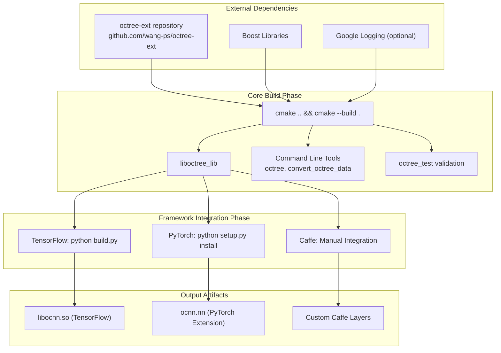
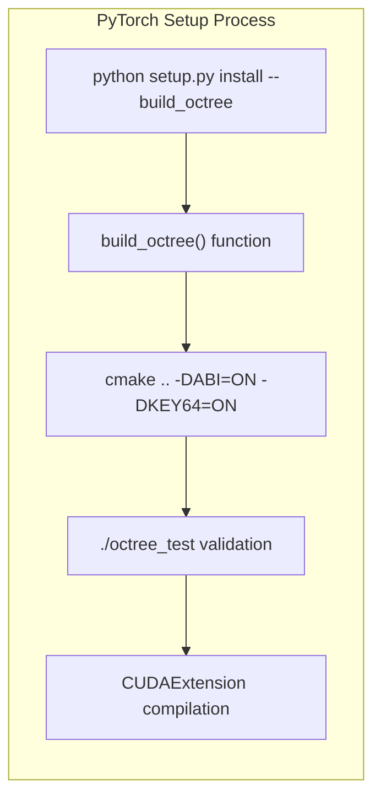
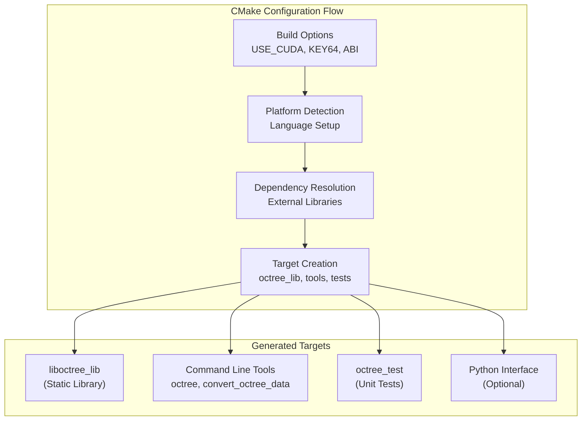

<!-- source: DeepWiki mcp.deepwiki.com · repo microsoft/O-CNN · page 2 Installation and Setup · fetched 2026-10-26 -->

# Installation and Setup

<details>
<summary>Relevant source files</summary>

The following files were used as context for generating this wiki page:

- [docs/installation.md](docs/installation.md)
- [octree/CMakeLists.txt](octree/CMakeLists.txt)
- [pytorch/setup.py](pytorch/setup.py)

</details>


This document covers the complete installation process for O-CNN, including building the core octree library and setting up integrations with major deep learning frameworks. The installation consists of two main phases: building the foundational octree library with its command-line tools, and then compiling framework-specific bindings for TensorFlow, PyTorch, or Caffe.

For information about using the installed system for specific tasks, see [Tasks and Applications](#5). For details about the core octree data structures being built, see [Core Architecture](#3).

## System Requirements

O-CNN supports multiple platforms and framework configurations with the following requirements:

| Component | Requirements |
|-----------|-------------|
| **Operating System** | Ubuntu 16.04/18.04, Windows 10 x64 |
| **Build Tools** | CMake 3.12.3+, Git |
| **CUDA** | CUDA 8.0+ (Caffe), CUDA 10.1+ (TensorFlow), CUDA 10.2+ (PyTorch) |
| **Python** | Python 3.x via Anaconda (recommended) |
| **Compiler** | GCC 4.8+ (Linux), MSVC (Windows) |

Sources: [docs/installation.md:63-66](), [docs/installation.md:30-32](), [octree/CMakeLists.txt:1]()

## Installation Process Overview



Sources: [docs/installation.md:10-25](), [docs/installation.md:75-79](), [pytorch/setup.py:16-38]()

## Core Octree Library Installation

The octree library forms the foundation for all framework integrations and must be built first.

### Step 1: Clone External Dependencies

```bash
cd octree/external
git clone --recursive https://github.com/wang-ps/octree-ext.git
```

The external dependencies include essential libraries used throughout the codebase:

| Library | Purpose | CMake Option |
|---------|---------|--------------|
| **miniball** | Bounding sphere computation | `USE_MINIBALL` |
| **happly** | PLY file I/O | Always included |
| **nanoflann** | K-nearest neighbor search | Always included |
| **rply** | Advanced PLY processing | `USE_RPLY` |
| **glog** | Logging framework | `USE_GLOG` |
| **googletest** | Unit testing | Always included |

Sources: [octree/CMakeLists.txt:47-52](), [octree/CMakeLists.txt:94-98](), [docs/installation.md:12]()

### Step 2: Configure and Build

```bash
cd octree
mkdir build && cd build
cmake .. && cmake --build . --config Release
```

The CMake configuration supports several important options defined in [octree/CMakeLists.txt:3-13]():

```bash
# Common configuration options
cmake .. -DUSE_CUDA=ON -DKEY64=ON -DUSE_OPENMP=ON
```

| Option | Default | Description |
|--------|---------|-------------|
| `USE_CUDA` | ON | Enable CUDA acceleration |
| `KEY64` | OFF | Support deeper octrees with 64-bit keys |
| `USE_OPENMP` | OFF | Enable OpenMP parallelization |
| `ABI` | OFF | CXX11_ABI compatibility mode |

Sources: [octree/CMakeLists.txt:3-13](), [docs/installation.md:13-15]()

### Step 3: Add Tools to System Path

After successful compilation, add the built executables to your system path:

**Windows:**
```cmd
set PATH=the\absolute\path\octree\build\Release;%PATH%
```

**Linux:**
```bash
export PATH=`pwd`:$PATH
```

The build process generates several command-line tools in [octree/CMakeLists.txt:137-147]():

- `octree` - Main octree construction tool (from `build_octree.cpp`)
- `convert_octree_data` - Data format conversion utility
- `simplify_points` - Point cloud simplification
- `virtual_scanner` - Mesh to point cloud conversion

Sources: [docs/installation.md:17-25](), [octree/CMakeLists.txt:137-147]()

## Framework-Specific Installation

### TensorFlow Integration

The TensorFlow integration creates custom operators for octree processing.

#### Prerequisites
```bash
conda create -n tf-1.14.0 tensorflow-gpu==1.14.0
conda activate tf-1.14.0
conda install -c conda-forge yacs tqdm
```

#### Build Process
```bash
cd tensorflow/libs
python build.py
```

The build script compiles custom TensorFlow operations and produces `libocnn.so` containing octree-specific operators.

**Build Dependencies:**
- CUDA 10.1+
- TensorFlow headers and libraries
- Compatible GCC version (4.8 for pip/docker installations)

Sources: [docs/installation.md:63-84]()

### PyTorch Integration

The PyTorch integration uses `torch.utils.cpp_extension` to create native extensions.

#### Environment Setup
```bash
conda create --name pytorch-1.7.0 python=3.7
conda activate pytorch-1.7.0
conda install pytorch==1.7.0 torchvision==0.8.0 cudatoolkit=10.2 -c pytorch
pip install -r requirements.txt
```

#### Build and Install
```bash
python setup.py install --build_octree
```

The `--build_octree` flag triggers automatic building of the core octree library through [pytorch/setup.py:36-38]():



The setup process creates the `ocnn.nn` extension module by compiling sources from [pytorch/setup.py:41-44]():

Sources: [docs/installation.md:87-116](), [pytorch/setup.py:16-38](), [pytorch/setup.py:45-64]()

#### Verification
```bash
python -W ignore test/test_all.py -v
```

### Caffe Integration

Caffe integration requires manual code integration with the official Caffe repository.

#### Prerequisites
- CUDA 8.0 and cuDNN 6.0
- Specific Caffe revision `6bfc5ca`

#### Integration Steps
1. **Clone Caffe:**
   ```bash
   git clone https://github.com/BVLC/caffe.git caffe-official
   cd caffe-official && git checkout 6bfc5ca
   ```

2. **Override with O-CNN Code:**
   Copy contents from the `caffe` directory into `caffe-official` to override the standard Caffe implementation.

3. **Build:**
   Follow standard Caffe build instructions to generate:
   - `caffe` executable
   - `convert_octree_data` utility
   - `feature_pooling` tool

The Caffe integration provides custom layers for octree-based operations but sacrifices some performance for improved readability and memory efficiency compared to the original research implementation.

Sources: [docs/installation.md:28-51]()

## Build Configuration Details

### CMake Build System

The core build system uses CMake with multiple configuration options:



Key configuration decisions made in [octree/CMakeLists.txt:16-44]():

- **Language Selection:** CUDA support enables GPU acceleration
- **C++ Standard:** C++11 with position-independent code
- **ABI Compatibility:** Configurable for different library versions

Sources: [octree/CMakeLists.txt:16-44](), [octree/CMakeLists.txt:127-164]()

### Library Dependencies

The build system manages several categories of dependencies:

| Category | Libraries | Integration Method |
|----------|-----------|-------------------|
| **Core** | miniball, happly, nanoflann | Header-only inclusion |
| **Optional** | glog, rply | Conditional compilation |
| **Testing** | googletest | Git submodule |
| **Framework** | TensorFlow, PyTorch, Caffe | External linking |

Sources: [octree/CMakeLists.txt:46-98](), [octree/CMakeLists.txt:156-164]()

## Verification and Testing

### Core Library Testing
```bash
cd octree/build
./octree_test
```

The test suite validates core octree operations and data structure integrity.

### Framework-Specific Testing

**TensorFlow:**
Verify through TensorFlow import and basic operations.

**PyTorch:**
```bash
python -W ignore test/test_all.py -v
```

**Caffe:**
Test through model training workflows using provided prototxt configurations.

Sources: [pytorch/setup.py:30-33](), [docs/installation.md:113-116]()

## Common Installation Issues

### Version Compatibility
- **TensorFlow:** Requires specific GCC versions when installed via pip
- **PyTorch:** CUDA toolkit version must match PyTorch's CUDA version
- **Caffe:** Strict dependency on CUDA 8.0 and cuDNN 6.0

### Build Failures
- Missing external dependencies: Ensure `octree-ext` is properly cloned
- CUDA compilation errors: Verify CUDA toolkit installation and PATH configuration
- ABI compatibility issues: Use `-DABI=ON` for older library versions

### Performance Notes
The current implementation prioritizes code maintainability over raw performance, resulting in approximately 10% slower execution compared to the original research code, while being more memory-efficient.

Sources: [docs/installation.md:47-51](), [docs/installation.md:81-84]()

---

