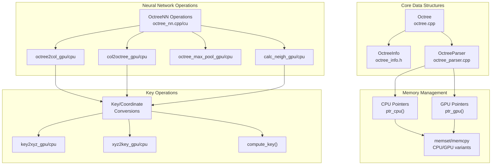
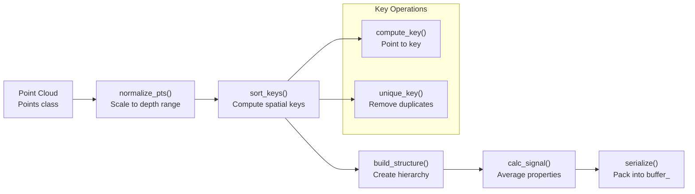
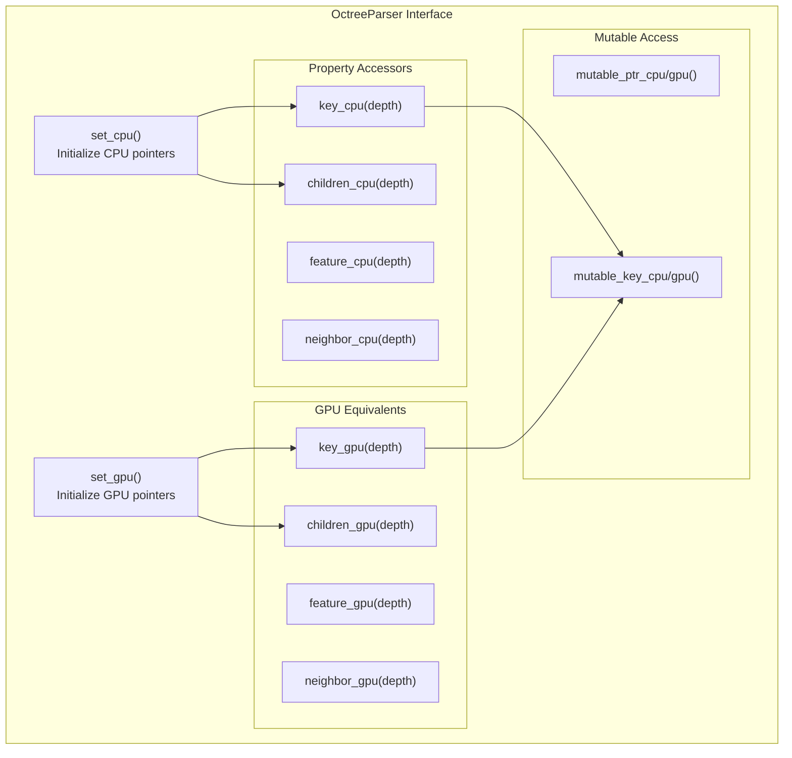
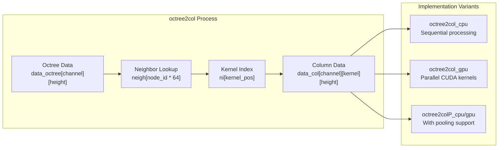
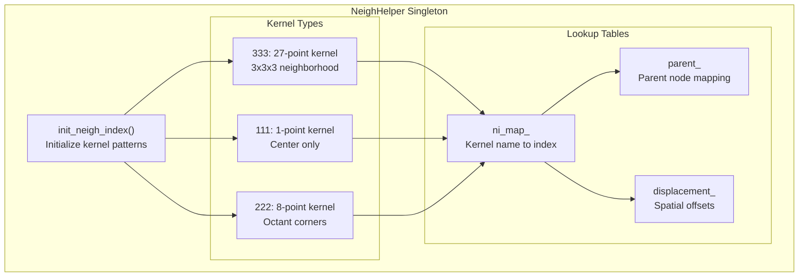
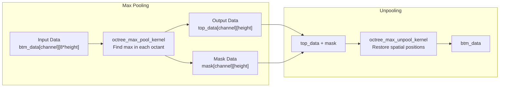
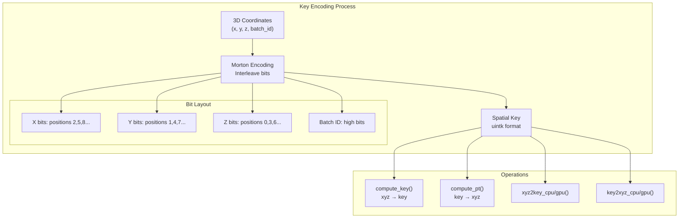

<!-- source: DeepWiki mcp.deepwiki.com · repo microsoft/O-CNN · page 3 Core Architecture · fetched 2026-10-26 -->

# Core Architecture

Relevant source files

The following files were used as context for generating this wiki page:

- [octree/octree/octree.cpp](octree/octree/octree.cpp)
- [octree/octree/octree_nn.cpp](octree/octree/octree_nn.cpp)
- [octree/octree/octree_nn.cu](octree/octree/octree_nn.cu)
- [octree/octree/octree_nn.h](octree/octree/octree_nn.h)
- [octree/octree/octree_parser.cpp](octree/octree/octree_parser.cpp)
- [octree/octree/octree_parser.h](octree/octree/octree_parser.h)
- [octree/test/test_util.cpp](octree/test/test_util.cpp)
- [octree/tools/chamfer_distance.cpp](octree/tools/chamfer_distance.cpp)
- [octree/tools/octree_bbox.cpp](octree/tools/octree_bbox.cpp)

This document explains the fundamental data structures and neural network operations that form the foundation of the O-CNN system. The core architecture provides the essential octree data structures, specialized neural network operations for processing octree data, and unified interfaces for accessing octree properties across CPU and GPU execution contexts.

For information about framework-specific integrations (TensorFlow, PyTorch, Caffe), see [Framework Integration](#4). For details about octree construction and point cloud processing, see [Point Cloud Processing](#3.3).

## System Overview

The O-CNN core architecture is built around three primary components: the octree data structure itself, specialized neural network operations that can process octree data efficiently, and a unified parser interface that provides consistent access to octree properties.

### Core Architecture Components

Sources: [octree/octree/octree.cpp:1-1569](), [octree/octree/octree_nn.h:1-255](), [octree/octree/octree_parser.h:1-86]()

## Fundamental Data Structures

### Octree Class

The `Octree` class serves as the primary container for octree data and provides methods for building, serializing, and manipulating octree structures.

| Component | Purpose | Key Methods |
|-----------|---------|-------------|
| `buffer_` | Raw octree data storage | `resize_octree()`, `get_binary_string()` |
| `keys_` | Spatial keys for each level | `sort_keys()`, `unique_key()` |
| `children_` | Child node relationships | `build_structure()` |
| `avg_normals_`, `avg_features_` | Averaged node properties | `calc_signal()` |

The octree building process follows this workflow:

Sources: [octree/octree/octree.cpp:74-121](), [octree/octree/octree.cpp:172-203](), [octree/octree/octree.cpp:205-283]()

### OctreeParser Interface

The `OctreeParser` class provides a unified interface for accessing octree data across different execution contexts, supporting both CPU and GPU memory layouts.

Sources: [octree/octree/octree_parser.cpp:8-91](), [octree/octree/octree_parser.h:13-83]()

## Neural Network Operations

### Core Convolution Operations

The heart of octree-based CNNs lies in the `octree2col` and `col2octree` operations, which enable efficient convolution by transforming octree data into a format suitable for standard matrix operations.

#### octree2col Operation

The `octree2col_kernel` implementation processes each thread in parallel:

| Parameter | Purpose | Range |
|-----------|---------|-------|
| `height` | Current octree level height | `[0, node_count]` |
| `kernel_sdim` | Kernel spatial dimension | Typically 27 for 3³ kernel |
| `stride` | Convolution stride | 1 or 2 |
| `neigh` | Neighborhood lookup table | 64 entries per node |
| `ni` | Kernel index mapping | Maps kernel positions to neighbor indices |

Sources: [octree/octree/octree_nn.cu:109-159](), [octree/octree/octree_nn.cpp:188-241]()

#### Neighborhood Calculation

The `NeighHelper` singleton manages kernel patterns and neighborhood relationships:

Sources: [octree/octree/octree_nn.cpp:6-108](), [octree/octree/octree_nn.h:15-47]()

### Pooling Operations

Octree-specific pooling operations maintain the hierarchical structure while downsampling features:

The pooling operations exploit the octree's natural 8-to-1 hierarchy where each parent node corresponds to exactly 8 children nodes.

Sources: [octree/octree/octree_nn.cu:257-327](), [octree/octree/octree_nn.cpp:301-354]()

## Key and Coordinate Systems

### Spatial Key Encoding

The system uses a sophisticated key encoding scheme to map 3D coordinates to linear indices that preserve spatial locality:

The key encoding ensures that spatially adjacent octree nodes have similar key values, enabling efficient neighbor lookup and spatial operations.

Sources: [octree/octree/octree_nn.cpp:551-575](), [octree/octree/octree_nn.cu:593-649]()

## Memory Management and Device Abstraction

The architecture provides consistent interfaces across CPU and GPU execution contexts through template-based memory operations:

| Operation | CPU Version | GPU Version | Purpose |
|-----------|-------------|-------------|---------|
| Memory Set | `memset_cpu<T>()` | `memset_gpu<T>()` | Initialize arrays |
| Memory Copy | `memcpy_cpu<T>()` | `memcpy_gpu<T>()` | Transfer data |
| Padding | `pad_forward_cpu<T>()` | `pad_forward_gpu<T>()` | Handle sparse data |
| Gather/Scatter | `align_forward_gpu<T>()` | `octree_gather_gpu<T>()` | Reorder data |

The GPU implementations use CUDA kernels with thread-level parallelism, while CPU versions provide sequential fallbacks for debugging and smaller datasets.

Sources: [octree/octree/octree_nn.cu:38-106](), [octree/octree/octree_nn.cpp:143-185](), [octree/octree/octree_nn.h:56-78]()

---

