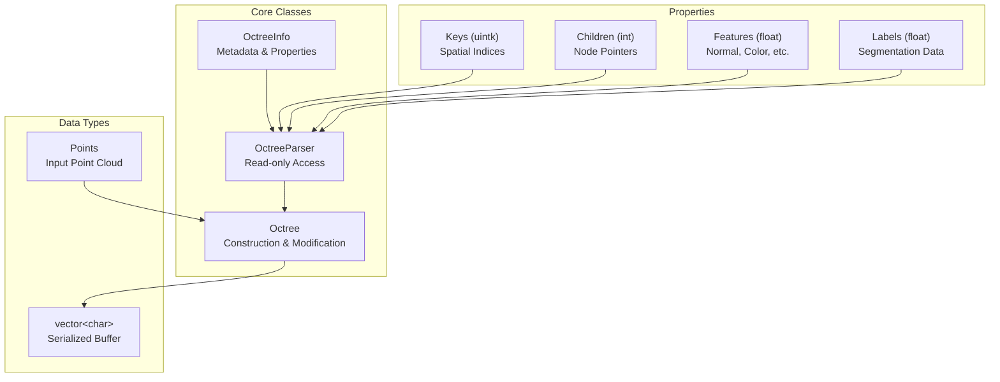
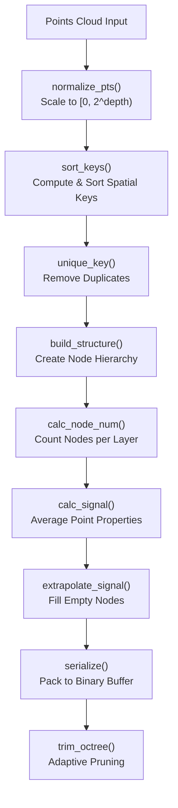
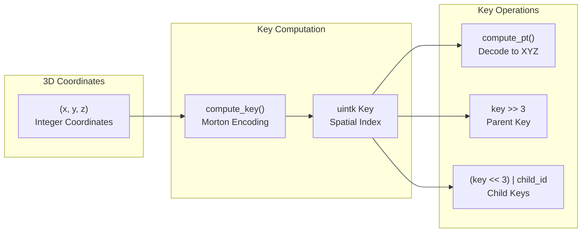
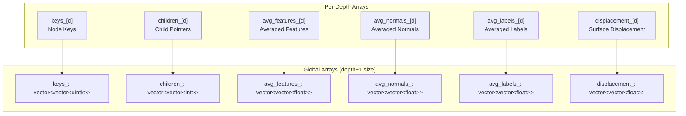
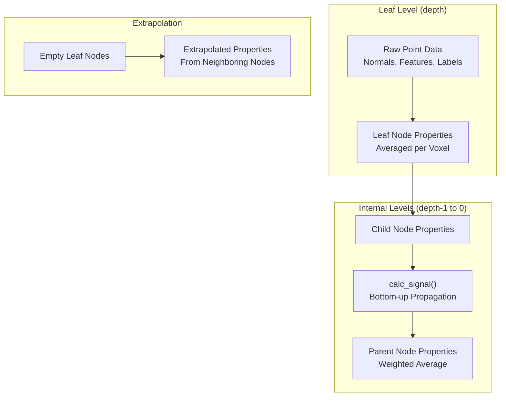
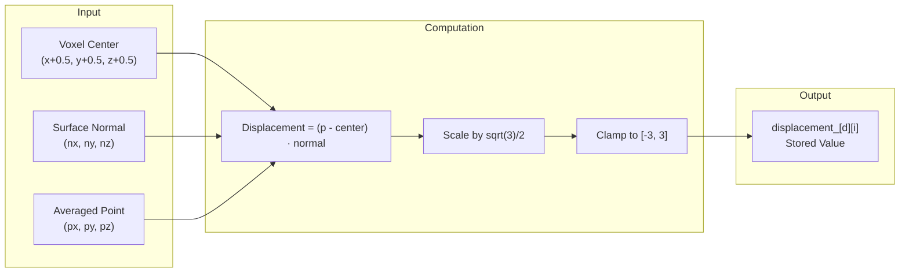
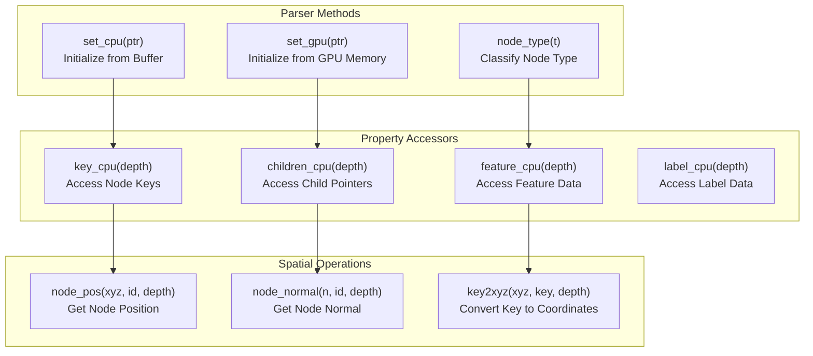
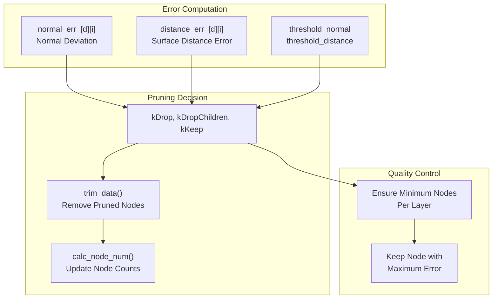

<!-- source: DeepWiki mcp.deepwiki.com · repo microsoft/O-CNN · page 3.1 Octree Data Structure · fetched 2026-10-26 -->

# Octree Data Structure

Relevant source files

The following files were used as context for generating this wiki page:

- [octree/octree/octree.cpp](octree/octree/octree.cpp)
- [octree/octree/octree_parser.cpp](octree/octree/octree_parser.cpp)
- [octree/octree/octree_parser.h](octree/octree/octree_parser.h)
- [octree/test/test_util.cpp](octree/test/test_util.cpp)
- [octree/tools/chamfer_distance.cpp](octree/tools/chamfer_distance.cpp)
- [octree/tools/octree_bbox.cpp](octree/tools/octree_bbox.cpp)

This document covers the core octree data structure implementation in O-CNN, including construction, serialization, and property management. The octree serves as the fundamental spatial indexing mechanism that enables efficient 3D convolutional neural network operations on irregular 3D data.

For information about neural network operations on octrees, see [Neural Network Operations](#3.2). For point cloud processing and conversion to octrees, see [Point Cloud Processing](#3.3).

## Overview

The octree data structure in O-CNN provides a hierarchical spatial subdivision of 3D space that enables efficient storage and processing of sparse 3D data. The implementation consists of two primary classes: `Octree` for construction and modification, and `OctreeParser` for read-only access to serialized octree data.

## Core Classes and Architecture

### Class Hierarchy

**Sources:** [octree/octree/octree_parser.h:13-83](), [octree/octree/octree.cpp:1-120]()

### Node Types and Representation

The octree uses a hierarchical node system with three distinct node types:

| Node Type | Value | Description |
|-----------|-------|-------------|
| `kLeaf` | -1 | Empty leaf node with no data |
| `kNonEmptyLeaf` | -2 | Leaf node containing point data |
| `kInternelNode` | ≥0 | Internal node with child pointer |

**Sources:** [octree/octree/octree_parser.h:16](), [octree/octree/octree_parser.cpp:23-28]()

## Octree Construction Process

### Build Pipeline

**Sources:** [octree/octree/octree.cpp:74-121]()

### Key Encoding System

The octree uses Morton codes (Z-order curve) for spatial indexing. Each node's position is encoded as a `uintk` value that preserves spatial locality:

**Sources:** [octree/octree/octree.cpp:172-203](), [octree/octree/octree.cpp:227-283]()

## Data Organization and Storage

### Memory Layout

The octree stores data in multiple arrays organized by depth level:

**Sources:** [octree/octree/octree.cpp:123-153]()

### Serialization Format

The octree serializes all data into a contiguous binary buffer for efficient storage and network transfer:

| Component | Data Type | Description |
|-----------|-----------|-------------|
| `OctreeInfo` | Header | Metadata, dimensions, property flags |
| Keys | `uintk[]` | Spatial indices for all nodes |
| Children | `int[]` | Child pointers for all nodes |
| Features | `float[]` | Concatenated feature vectors |
| Labels | `float[]` | Segmentation labels |
| Split Labels | `float[]` | Subdivision indicators |

**Sources:** [octree/octree/octree.cpp:907-945]()

## Property Management

### Signal Averaging

The octree computes averaged properties at each level by aggregating point data:

**Sources:** [octree/octree/octree.cpp:311-451](), [octree/octree/octree.cpp:454-664](), [octree/octree/octree.cpp:666-806]()

### Displacement Computation

For surface reconstruction, the octree computes displacement values that encode distance to the actual surface:

**Sources:** [octree/octree/octree.cpp:403-451](), [octree/octree/octree.cpp:586-605]()

## OctreeParser Interface

### Read-Only Access

The `OctreeParser` class provides efficient read-only access to serialized octree data without requiring full reconstruction:

**Sources:** [octree/octree/octree_parser.h:30-64](), [octree/octree/octree_parser.cpp:8-92](), [octree/octree/octree_parser.cpp:95-168]()

### Node Position Computation

The parser computes 3D positions from keys and optionally applies displacement for surface reconstruction:

**Sources:** [octree/octree/octree_parser.cpp:95-124]()

## File I/O Operations

### Binary Format

The octree supports direct binary serialization for efficient storage:

| Operation | Method | Description |
|-----------|--------|-------------|
| Read | `read_octree(filename)` | Load from binary file |
| Write | `write_octree(filename)` | Save to binary file |
| Buffer | `get_binary_string()` | Export as string |
| Memory | `set_octree(data, size)` | Load from memory |

**Sources:** [octree/octree/octree.cpp:41-72]()

### Legacy Format Support

The implementation includes legacy format support for backward compatibility with older octree files:

**Sources:** [octree/octree/octree.cpp:808-868]()

## Adaptive Octree Features

### Error-Based Pruning

For adaptive octrees, the system computes error metrics and prunes nodes that don't contribute significantly to surface representation:

**Sources:** [octree/octree/octree.cpp:1004-1127]()

---

