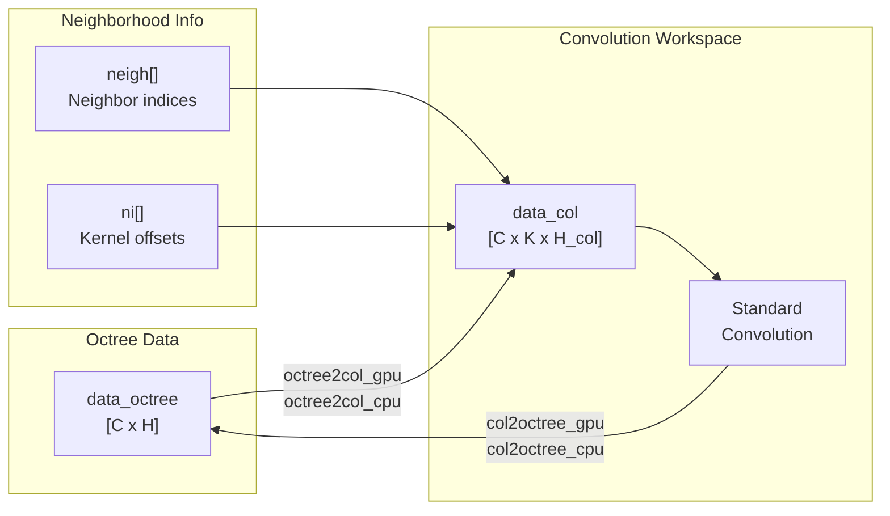
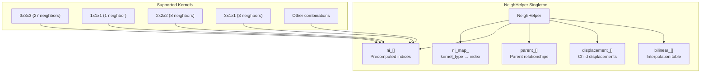
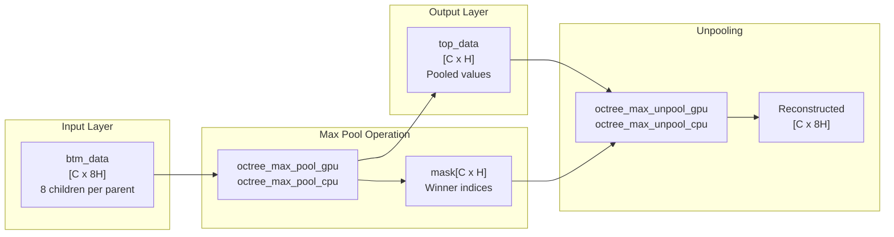
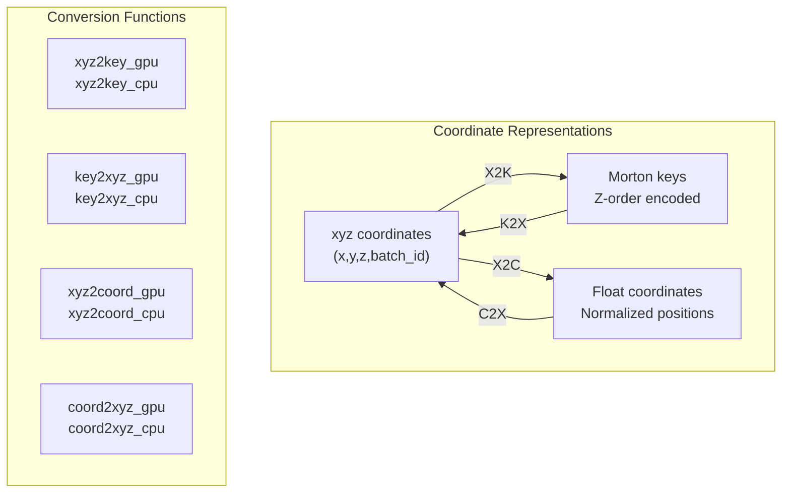
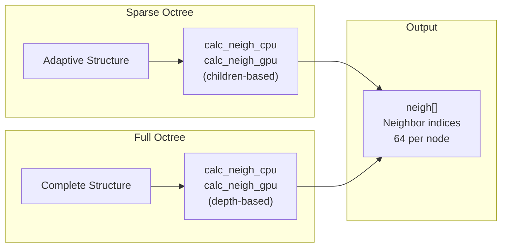
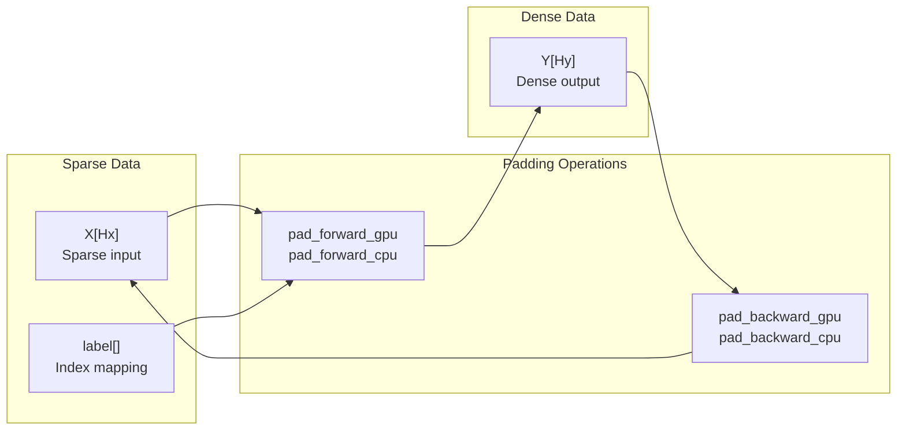
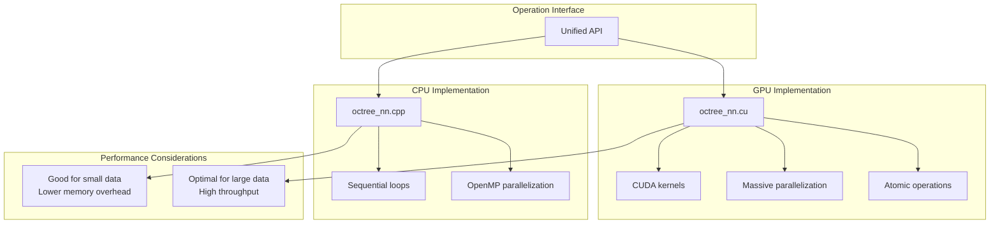

<!-- source: DeepWiki mcp.deepwiki.com · repo microsoft/O-CNN · page 3.2 Neural Network Operations · fetched 2026-10-26 -->

# Neural Network Operations

Relevant source files

The following files were used as context for generating this wiki page:

- [octree/octree/octree_nn.cpp](octree/octree/octree_nn.cpp)
- [octree/octree/octree_nn.cu](octree/octree/octree_nn.cu)
- [octree/octree/octree_nn.h](octree/octree/octree_nn.h)

This document explains the core neural network operations that enable convolutional neural networks (CNNs) to process octree data structures. These operations transform the hierarchical octree representation into formats compatible with standard CNN computations while preserving spatial relationships.

For information about the octree data structure itself, see [Octree Data Structure](#3.1). For framework-specific implementations of these operations, see [Framework Integration](#4).

## Core Transformation Operations

The fundamental challenge in octree-based CNNs is transforming the sparse, hierarchical octree structure into dense matrix formats that can be processed by standard convolution operations. The system accomplishes this through a family of `octree2col` and `col2octree` operations.

### octree2col and col2octree

The `octree2col` operation transforms octree data into column format for efficient convolution processing, similar to the classical `im2col` operation for images. The `col2octree` operation performs the reverse transformation.

The core functions handle different scenarios:
- **Standard convolution**: `octree2col_gpu`/`octree2col_cpu` and `col2octree_gpu`/`col2octree_cpu`
- **Pooling convolution**: `octree2colP_gpu`/`octree2colP_cpu` and `col2octreeP_gpu`/`col2octreeP_cpu`

Sources: [octree/octree/octree_nn.h:80-120](), [octree/octree/octree_nn.cu:110-175](), [octree/octree/octree_nn.cpp:188-298]()

### Neighborhood Index Management

The `NeighHelper` singleton class manages kernel neighborhood information for different convolution kernel sizes. It precomputes neighbor indices for various kernel configurations to optimize runtime performance.

Sources: [octree/octree/octree_nn.h:15-47](), [octree/octree/octree_nn.cpp:6-108]()

## Pooling Operations

Octree neural networks support several pooling strategies designed to work with the hierarchical structure while maintaining spatial coherence.

### Max Pooling

Max pooling in octrees operates on groups of 8 child nodes, selecting the maximum value and recording its position for later unpooling.

### Mask-based Pooling

Mask pooling uses precomputed indices to select specific values, useful for handling irregular octree structures.

Sources: [octree/octree/octree_nn.h:122-139](), [octree/octree/octree_nn.cu:258-327](), [octree/octree/octree_nn.cpp:301-354]()

## Spatial Operations

### Key Generation and Coordinate Conversion

The system uses Morton encoding (Z-order curve) to convert between 3D coordinates and linear keys for efficient spatial indexing and neighbor finding.

### Neighborhood Calculation

Neighborhood relationships are computed differently for sparse octrees versus full octrees:

Sources: [octree/octree/octree_nn.h:142-147](), [octree/octree/octree_nn.cu:331-413](), [octree/octree/octree_nn.cpp:357-424]()

## Memory and Utility Operations

### Memory Management

The system provides unified memory operations that work across CPU and GPU:

| Operation | CPU Function | GPU Function | Purpose |
|-----------|--------------|--------------|---------|
| Memory set | `memset_cpu` | `memset_gpu` | Initialize arrays |
| Memory copy | `memcpy_cpu` | `memcpy_gpu` | Copy data between arrays |
| Sequence generation | `sequence_cpu` | `sequence_gpu` | Generate sequential indices |

### Padding and Alignment

Padding operations handle boundary conditions and sparse data:

Sources: [octree/octree/octree_nn.h:56-77](), [octree/octree/octree_nn.cu:46-106](), [octree/octree/octree_nn.cpp:144-185]()

## GPU vs CPU Implementation Strategy

The system provides dual implementations for all core operations:

### Key GPU Optimizations

- **Thread allocation**: `CUDA_KERNEL_LOOP` macro distributes work across GPU threads
- **Atomic operations**: `caffe_gpu_atomic_add` handles concurrent writes in `col2octree` operations
- **Memory coalescing**: Data layouts optimized for GPU memory access patterns
- **Kernel fusion**: Multiple operations combined in single kernel launches

Sources: [octree/octree/octree_nn.cu:1-926](), [octree/octree/octree_nn.cpp:1-743](), [octree/octree/octree_nn.h:50-254]()

---

