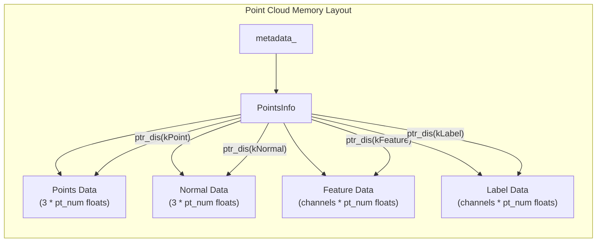
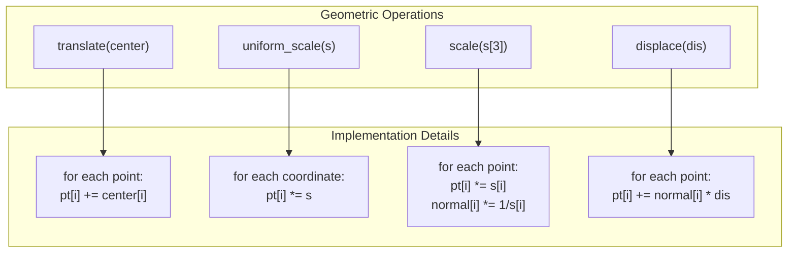
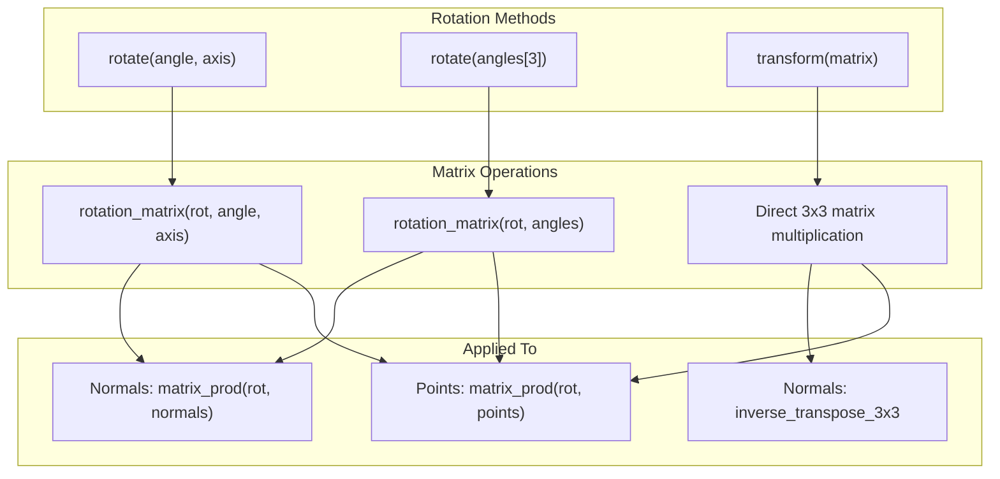
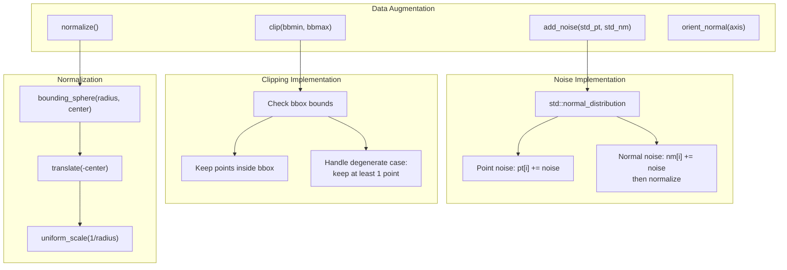
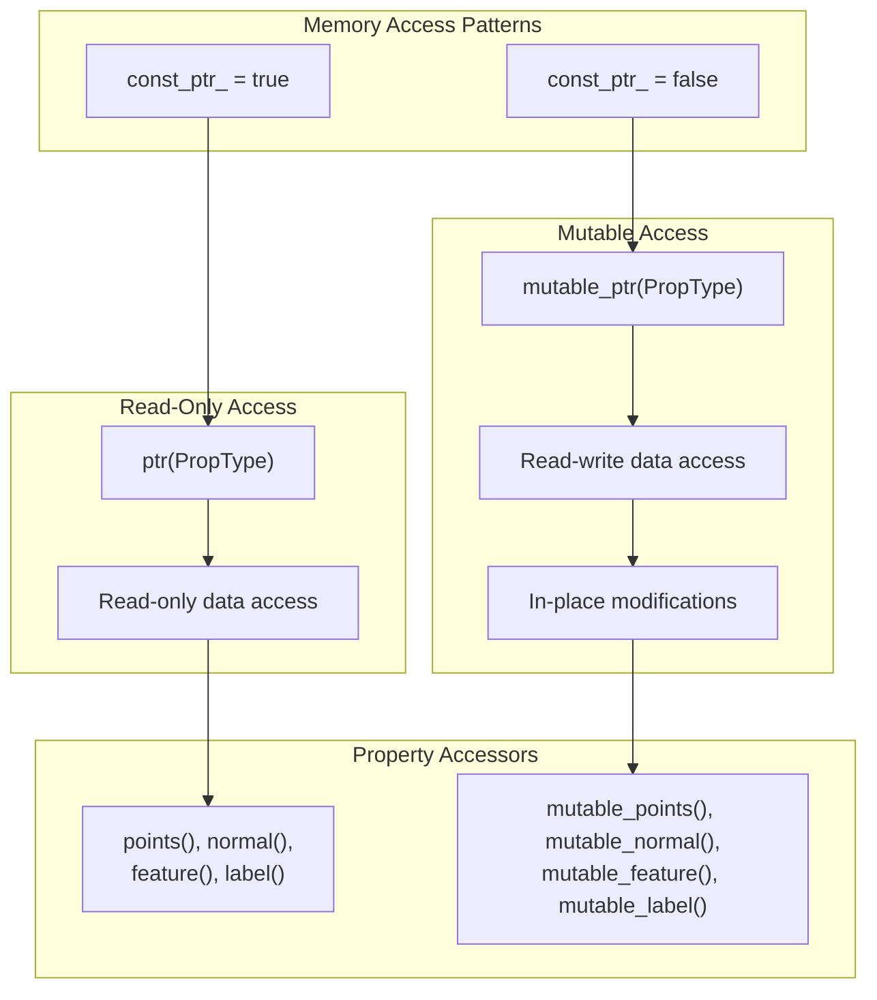

<!-- source: DeepWiki mcp.deepwiki.com · repo microsoft/O-CNN · page 3.3 Point Cloud Processing · fetched 2026-10-26 -->

# Point Cloud Processing

<details>
<summary>Relevant source files</summary>

The following files were used as context for generating this wiki page:

- [octree/octree/octree_conv.cpp](octree/octree/octree_conv.cpp)
- [octree/octree/octree_conv.h](octree/octree/octree_conv.h)
- [octree/octree/octree_info.h](octree/octree/octree_info.h)
- [octree/octree/points_parser.cpp](octree/octree/points_parser.cpp)
- [octree/octree/points_parser.h](octree/octree/points_parser.h)

</details>


This page covers the core point cloud manipulation, transformation, and preprocessing capabilities in the O-CNN system. The point cloud processing module provides essential functionality for loading, transforming, and preparing 3D point data before conversion to octree representations. For neural network operations on octrees, see [Neural Network Operations](#3.2). For complete data processing pipelines from datasets to training-ready formats, see [Data Processing Pipeline](#6).

## Core Data Structure

The point cloud processing system centers around the `PointsParser` class, which provides a unified interface for accessing and manipulating point cloud data with multiple properties.

### PointsParser Architecture

```mermaid
classDiagram
    class PointsParser {
        -char* metadata_
        -PointsInfo* info_
        -bool const_ptr_
        +set(void* ptr)
        +set(void* ptr, PointsInfo* ptsinfo)
        +points() float*
        +normal() float*
        +feature() float*
        +label() float*
        +mutable_points() float*
        +mutable_normal() float*
        +mutable_feature() float*
        +mutable_label() float*
        +translate(float* center)
        +scale(float* s)
        +rotate(float angle, float* axis)
        +transform(float* matrix)
        +normalize()
        +add_noise(float std_pt, float std_nm)
        +clip(float* bbmin, float* bbmax)
        +orient_normal(string axis)
    }
    
    class PointsInfo {
        +kPoint PropType
        +kNormal PropType
        +kFeature PropType
        +kLabel PropType
        +pt_num() int
        +channel(PropType) int
        +ptr_dis(PropType) int
        +has_property(PropType) bool
    }
    
    PointsParser --> PointsInfo : "manages metadata"
    PointsParser --> "float* arrays" : "accesses property data"
```

The `PointsParser` acts as a smart pointer wrapper around raw point cloud data, providing type-safe access to different point properties and transformation operations.

**Sources:** [octree/octree/points_parser.h:11-58](), [octree/octree/points_parser.cpp:10-26]()

### Point Cloud Properties

Point clouds in O-CNN can contain multiple types of data stored as separate property arrays:

| Property Type | PointsInfo Constant | Description | Channels |
|---------------|-------------------|-------------|----------|
| Points | `kPoint` | 3D coordinates (x, y, z) | 3 |
| Normals | `kNormal` | Surface normal vectors | 3 |
| Features | `kFeature` | Additional attributes (color, etc.) | Variable |
| Labels | `kLabel` | Classification or segmentation labels | Variable |

The `PointsInfo` metadata tracks which properties are present and their memory layout:



**Sources:** [octree/octree/points_parser.h:22-32](), [octree/octree/points_parser.cpp:29-40]()

## Transformation Operations

The `PointsParser` provides a comprehensive set of geometric transformation and data manipulation operations:

### Geometric Transformations

#### Translation and Scaling


**Translation** moves all points by a constant offset, while **scaling** operations resize the point cloud. Non-uniform scaling requires special handling of normals to maintain geometric correctness.

**Sources:** [octree/octree/points_parser.cpp:42-101]()

#### Rotation and General Transformations


**Sources:** [octree/octree/points_parser.cpp:103-151]()

### Data Augmentation and Preprocessing

#### Noise Addition and Clipping


The `clip` operation is particularly important as it handles edge cases where no points fall within the specified bounding box by keeping at least one point to avoid degenerate cases.

**Sources:** [octree/octree/points_parser.cpp:153-226](), [octree/octree/points_parser.cpp:197-259]()

## Integration with Octree Processing

Point cloud data serves as input to the octree generation process, where the `PointsParser` provides the interface for accessing preprocessed point data:

```mermaid
graph LR
    subgraph "Point Cloud Processing"
        RAW["Raw Point Data"]
        PP["PointsParser"]
        TRANS["Transformations"]
        NORM["Normalization"]
    end
    
    subgraph "Octree Generation"
        OG["Octree Generation"]
        ON["Octree Nodes"]
        OCT["OctreeParser"]
    end
    
    subgraph "Neural Operations"
        CONV["Octree Convolution"]
        O2C["octree2col"]
        GEMM["GEMM Operations"]
    end
    
    RAW --> PP
    PP --> TRANS
    TRANS --> NORM
    NORM --> OG
    OG --> ON
    ON --> OCT
    OCT --> CONV
    CONV --> O2C
    O2C --> GEMM
```



The point cloud processing creates the foundation for octree-based neural network operations by ensuring point data is properly formatted, normalized, and augmented before conversion to hierarchical octree representations.

**Sources:** [octree/octree/octree_conv.h:66](), [octree/octree/octree_conv.cpp:125-139]()

## Memory Management and Data Access

The `PointsParser` supports both const and mutable access patterns:



This design allows efficient in-place transformations while maintaining memory safety through the const/mutable access distinction.

**Sources:** [octree/octree/points_parser.cpp:10-23](), [octree/octree/points_parser.h:22-32]()

---

