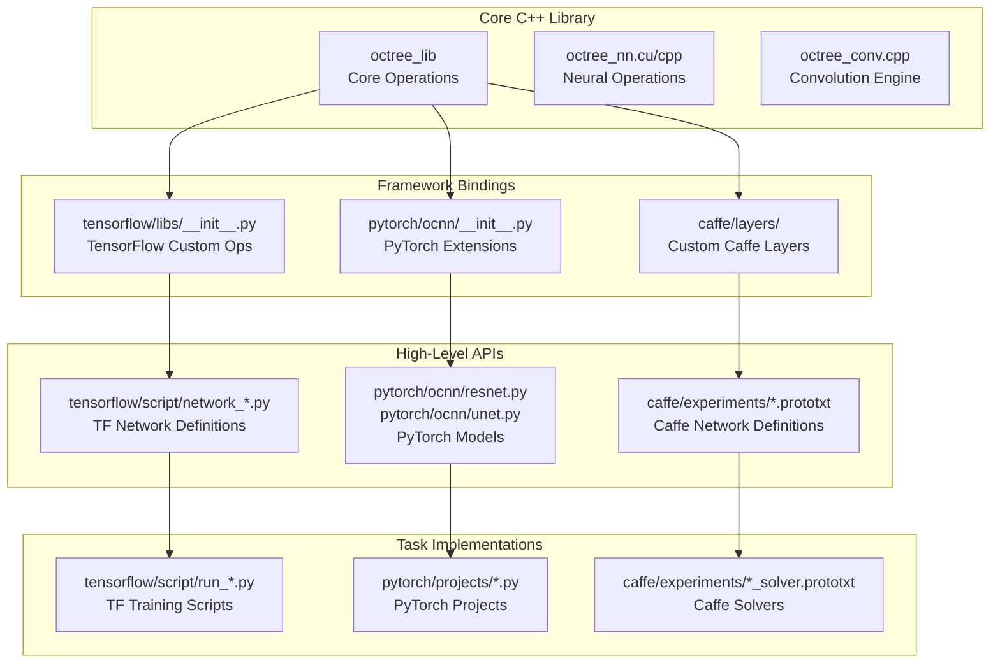
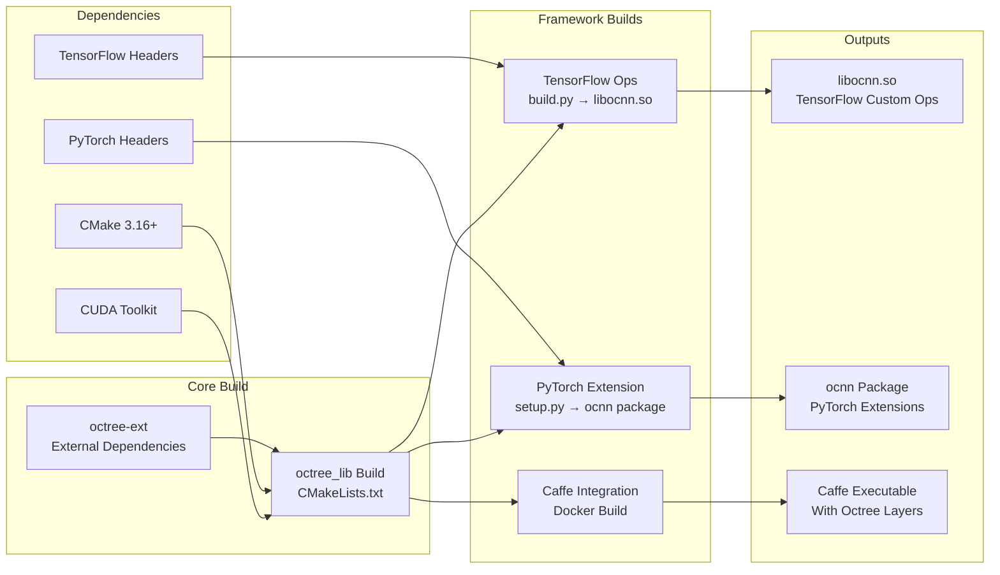
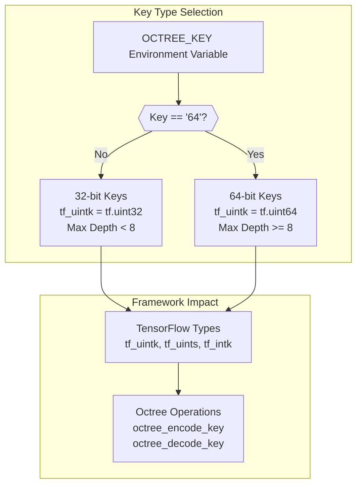
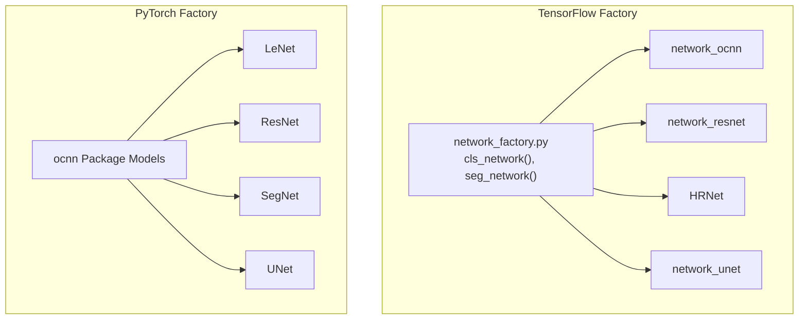

<!-- source: DeepWiki mcp.deepwiki.com · repo microsoft/O-CNN · page 4 Framework Integration · fetched 2026-10-26 -->

# Framework Integration

<details>
<summary>Relevant source files</summary>

The following files were used as context for generating this wiki page:

- [caffe/docker/gpu/Dockerfile](caffe/docker/gpu/Dockerfile)
- [caffe/experiments/aocnn_m40_5.prototxt](caffe/experiments/aocnn_m40_5.prototxt)
- [caffe/experiments/aocnn_m40_5_solver.prototxt](caffe/experiments/aocnn_m40_5_solver.prototxt)
- [caffe/experiments/dataset/README.md](caffe/experiments/dataset/README.md)
- [caffe/experiments/ocnn_m40_5.prototxt](caffe/experiments/ocnn_m40_5.prototxt)
- [caffe/experiments/ocnn_m40_6.prototxt](caffe/experiments/ocnn_m40_6.prototxt)
- [caffe/experiments/ocnn_m40_6_solver.prototxt](caffe/experiments/ocnn_m40_6_solver.prototxt)
- [octree/external/readme.md](octree/external/readme.md)
- [pytorch/ocnn/__init__.py](pytorch/ocnn/__init__.py)
- [pytorch/ocnn/octree_pool.py](pytorch/ocnn/octree_pool.py)
- [pytorch/ocnn/segnet.py](pytorch/ocnn/segnet.py)
- [pytorch/projects/classification.py](pytorch/projects/classification.py)
- [tensorflow/libs/__init__.py](tensorflow/libs/__init__.py)
- [tensorflow/script/dataset/README.md](tensorflow/script/dataset/README.md)
- [tensorflow/script/network_factory.py](tensorflow/script/network_factory.py)
- [tensorflow/script/network_segnet.py](tensorflow/script/network_segnet.py)
- [tensorflow/script/run_seg_shapenet.py](tensorflow/script/run_seg_shapenet.py)

</details>


This document covers how O-CNN integrates with major deep learning frameworks including TensorFlow, PyTorch, and Caffe. It explains the build processes, API structures, and usage patterns for each framework integration.

For specific task implementations using these frameworks, see [Tasks and Applications](#5). For details on the underlying octree operations, see [Core Architecture](#3).

## Overview

O-CNN provides native integrations with three major deep learning frameworks, each offering different trade-offs in terms of performance, ease of use, and experimental flexibility. The integration architecture follows a common pattern where a shared C++ octree library provides the core functionality, while framework-specific bindings expose these operations through each framework's native APIs.

### Framework Integration Architecture



Sources: [tensorflow/libs/__init__.py:1-21](), [pytorch/ocnn/__init__.py:1-43](), [caffe/experiments/ocnn_m40_5.prototxt:1-280]()

### Build and Integration Flow



Sources: [octree/external/readme.md:1-8](), [caffe/docker/gpu/Dockerfile:60-83]()

## API Layer Mapping

Each framework provides access to the same underlying octree operations through framework-specific APIs that follow the conventions and patterns of that framework.

### Operation Mapping Across Frameworks

| Core Operation | TensorFlow API | PyTorch API | Caffe Layer |
|----------------|----------------|-------------|-------------|
| Octree Convolution | `octree_conv_fast()` | `OctreeConv` | `OctreeConv` |
| Octree Pooling | `octree_max_pool()` | `OctreeMaxPool` | `OctreePooling` |
| Points to Octree | `points2octree()` | `points2octree()` | N/A (preprocessing) |
| Octree to Column | `octree2col()` | `octree2col()` | Internal |
| Octree Property | `octree_property()` | `octree_property()` | `OctreeProperty` |

Sources: [tensorflow/libs/__init__.py:22-62](), [pytorch/ocnn/__init__.py:4-26](), [caffe/experiments/ocnn_m40_5.prototxt:40-60]()

### Key Type Management

The framework integrations handle different octree key types (32-bit vs 64-bit) to support different octree depths:



Sources: [tensorflow/libs/__init__.py:5-17]()

## Framework-Specific Features

### TensorFlow Integration Features

The TensorFlow integration provides both memory-optimized and speed-optimized implementations of key operations:

**Gradient Registration**: Custom gradient functions enable backpropagation through octree operations
```python
@ops.RegisterGradient('OctreeConv')
def _OctreeConvGrad(op, grad):
    # Custom gradient computation for octree convolution
```

**Dual Implementation Paths**:
- `octree_conv_fast()`: Matrix multiplication approach for speed
- `octree_conv_memory()`: Direct convolution for memory efficiency

**Bilinear Interpolation Variants**: Multiple implementations (`octree_bilinear_v1`, `octree_bilinear_v2`, `octree_bilinear_v3`) with different performance characteristics

Sources: [tensorflow/libs/__init__.py:137-142](), [tensorflow/libs/__init__.py:195-226](), [tensorflow/libs/__init__.py:314-448]()

### PyTorch Integration Features

The PyTorch integration follows PyTorch conventions with autograd support and modular design:

**Autograd Functions**: Custom autograd functions for automatic differentiation
```python
class OctreeMaxPoolFunction(Function):
    @staticmethod
    def forward(ctx, data_in, octree, depth):
        # Forward pass implementation
    
    @staticmethod
    def backward(ctx, grad_in, mask_grad):
        # Backward pass implementation
```

**Module Hierarchy**: Object-oriented design with base classes and specialized modules
- `OctreePoolBase`: Base class for pooling operations
- `OctreeMaxPool`, `OctreeAvgPool`: Specialized pooling implementations
- `OctreeConvBnRelu`: Composite modules combining operations

**Transform Pipeline**: Data transformation system for preprocessing
- `TransformCompose`: Composition of multiple transformations
- `Points2Octree`: Point cloud to octree conversion
- `NormalizePoints`: Point cloud normalization

Sources: [pytorch/ocnn/octree_pool.py:7-23](), [pytorch/ocnn/octree_pool.py:70-88](), [pytorch/ocnn/__init__.py:14-16]()

### Caffe Integration Features

The Caffe integration extends Caffe with custom octree layers that integrate seamlessly with existing Caffe workflows:

**Custom Layer Types**:
- `OctreeDataBase`: Data input layer for octree data
- `OctreeConv`: Octree convolution layer
- `OctreePooling`: Octree pooling layer  
- `Octree2FullVoxel`: Conversion from octree to full voxel representation

**Prototxt Configuration**: Network definitions using Caffe's prototxt format with octree-specific parameters
```protobuf
layer {
  name: "conv1"
  type: "OctreeConv"
  bottom: "data"
  top: "conv1"
  octree_param {
    curr_depth: 5
  }
}
```

**Docker-based Setup**: Containerized build environment ensuring reproducible Caffe integration

Sources: [caffe/experiments/ocnn_m40_5.prototxt:40-65](), [caffe/experiments/aocnn_m40_5.prototxt:1-37](), [caffe/docker/gpu/Dockerfile:71-83]()

## Usage Patterns

### Network Factory Pattern

Both TensorFlow and PyTorch implementations use factory patterns to create different network architectures:



Sources: [tensorflow/script/network_factory.py:8-28](), [pytorch/ocnn/__init__.py:36-42]()

### Task Implementation Patterns

Each framework follows consistent patterns for implementing specific tasks:

**TensorFlow Task Pattern**:
1. Configuration parsing via YAML files
2. Dataset factory for data loading  
3. Network factory for model creation
4. Compute graph definition class
5. TFSolver for training coordination

**PyTorch Task Pattern**:
1. Solver base class inheritance
2. Model definition via `get_model()`
3. Dataset definition via `get_dataset()`
4. Training/testing step definitions
5. Main function orchestration

**Caffe Task Pattern**:
1. Prototxt network definition
2. Solver prototxt configuration
3. Docker containerized execution
4. LMDB data format

Sources: [tensorflow/script/run_seg_shapenet.py:29-60](), [pytorch/projects/classification.py:7-46](), [caffe/experiments/aocnn_m40_5_solver.prototxt:1-32]()

## Performance Considerations

### Memory vs Speed Trade-offs

The framework integrations provide different approaches to balance memory usage and computational speed:

| Framework | Memory Optimization | Speed Optimization | Use Case |
|-----------|-------------------|-------------------|----------|
| TensorFlow | `octree_conv_memory()` | `octree_conv_fast()` | Configurable per layer |
| PyTorch | Gradient checkpointing | Native autograd | Automatic optimization |
| Caffe | Layer-specific optimization | GPU memory pools | Fixed at compile time |

### Framework Selection Guidelines

**Choose TensorFlow when**:
- Need fine-grained control over memory/speed trade-offs
- Working with large-scale distributed training
- Require production deployment capabilities

**Choose PyTorch when**:
- Rapid prototyping and research
- Dynamic graph requirements
- Pythonic API preferences

**Choose Caffe when**:
- Legacy system integration
- Minimalist deployment requirements  
- Proven stability for specific tasks

Sources: [tensorflow/libs/__init__.py:194-261](), [pytorch/ocnn/octree_pool.py:1-116](), [caffe/experiments/README.md:1-4]()

---

