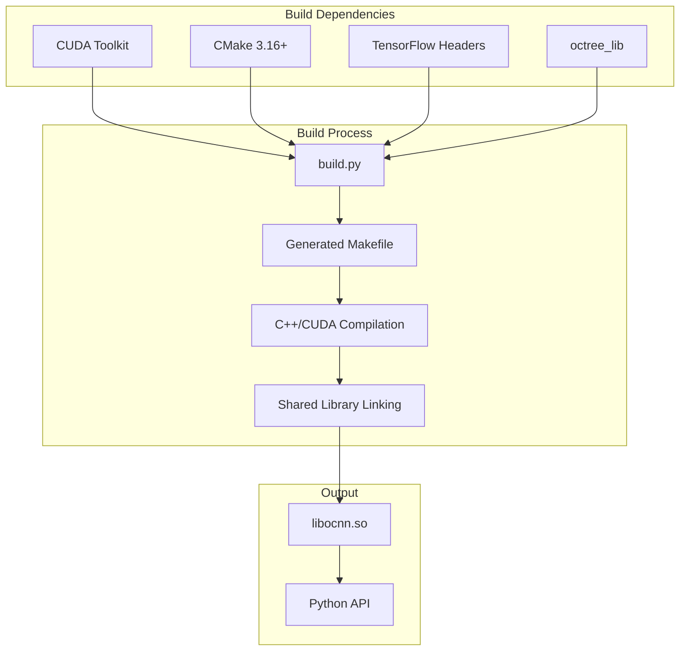
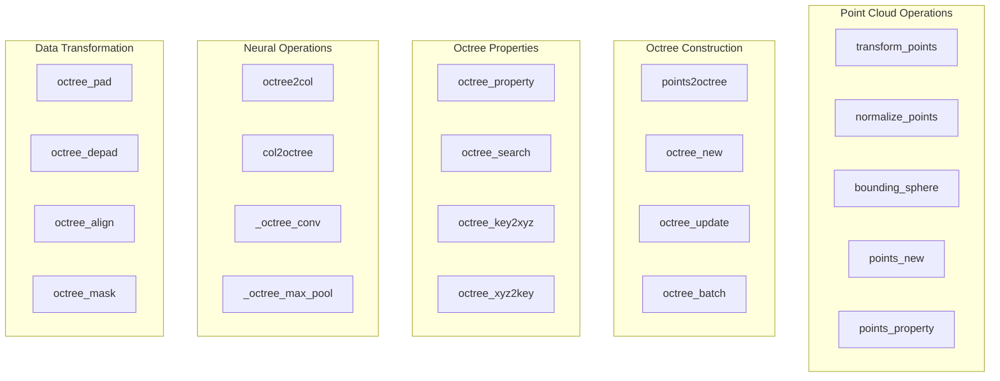
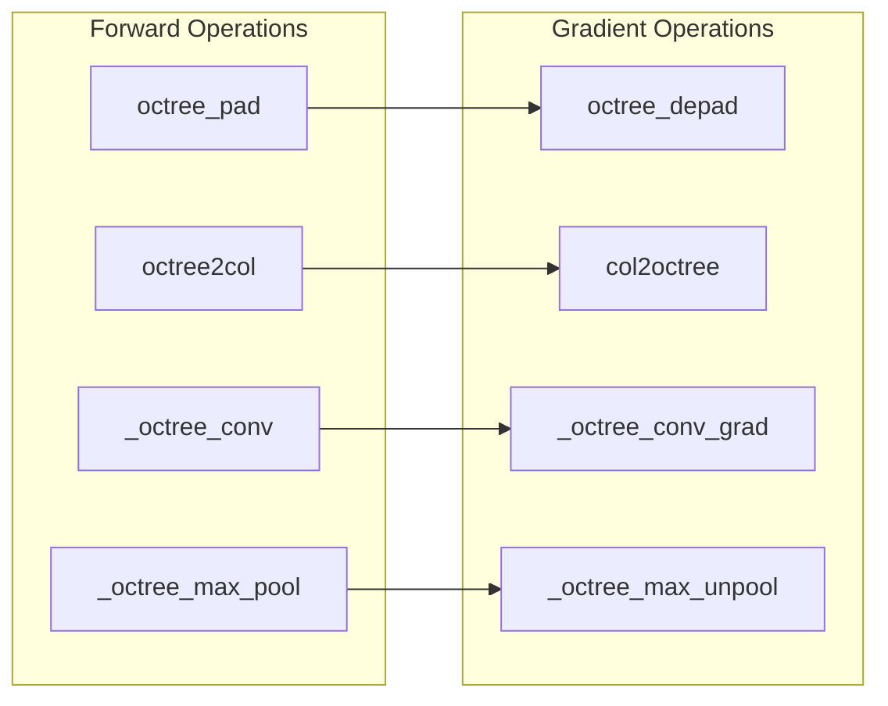
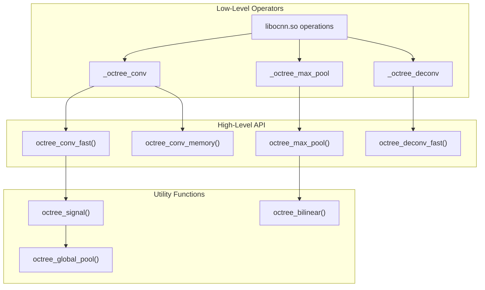
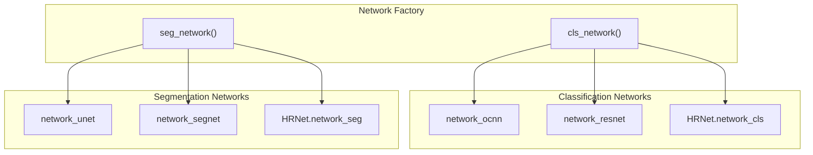
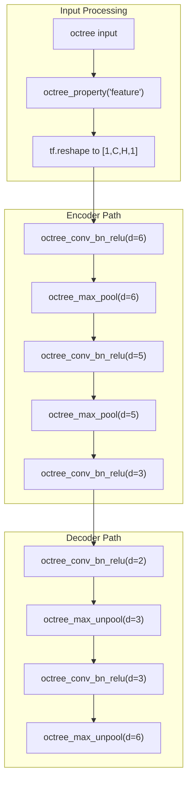
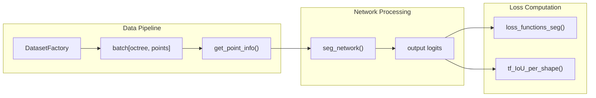

<!-- source: DeepWiki mcp.deepwiki.com · repo microsoft/O-CNN · page 4.1 TensorFlow Integration · fetched 2026-10-26 -->

# TensorFlow Integration

<details>
<summary>Relevant source files</summary>

The following files were used as context for generating this wiki page:

- [octree/external/readme.md](octree/external/readme.md)
- [tensorflow/libs/__init__.py](tensorflow/libs/__init__.py)
- [tensorflow/libs/build.py](tensorflow/libs/build.py)
- [tensorflow/libs/octree_samples.cc](tensorflow/libs/octree_samples.cc)
- [tensorflow/libs/points2octree_op.cc](tensorflow/libs/points2octree_op.cc)
- [tensorflow/libs/transform_octree_op.cc](tensorflow/libs/transform_octree_op.cc)
- [tensorflow/libs/transform_points_op.cc](tensorflow/libs/transform_points_op.cc)
- [tensorflow/script/network_factory.py](tensorflow/script/network_factory.py)
- [tensorflow/script/network_segnet.py](tensorflow/script/network_segnet.py)
- [tensorflow/script/run_seg_shapenet.py](tensorflow/script/run_seg_shapenet.py)

</details>


## Purpose and Scope

The TensorFlow integration provides custom operators and Python bindings that enable octree-based neural network operations within TensorFlow. This integration allows researchers to leverage TensorFlow's automatic differentiation and distributed training capabilities while using the specialized octree data structures and algorithms implemented in the core C++ library.

For information about PyTorch integration, see [PyTorch Integration](#4.2). For details about the underlying octree operations, see [Neural Network Operations](#3.2).

## Build System and Custom Operator Compilation

The TensorFlow integration uses a custom build system that compiles C++ and CUDA source files into a shared library (`libocnn.so`) containing TensorFlow custom operators.

### Build Process Overview



The build script [tensorflow/libs/build.py:1-167]() handles the complete compilation pipeline:

1. **Dependency Setup**: Configures TensorFlow compilation flags and CUDA paths
2. **Octree Library Build**: Compiles the core octree library with appropriate ABI settings
3. **Makefile Generation**: Creates a dynamic makefile based on source files
4. **Custom Operator Compilation**: Compiles C++ and CUDA source files into object files
5. **Library Linking**: Links all object files into `libocnn.so`

Sources: [tensorflow/libs/build.py:1-167]()

### Key Build Configuration

| Component | Configuration | Purpose |
|-----------|--------------|---------|
| ABI Compatibility | `_GLIBCXX_USE_CXX11_ABI` detection | Ensures compatibility with TensorFlow |
| 64-bit Keys | `KEY64` flag | Enables larger octree structures |
| CUDA Support | NVCC compilation | GPU acceleration for operations |
| TensorFlow Flags | `TF_CFLAGS`, `TF_LFLAGS` | Integration with TensorFlow framework |

Sources: [tensorflow/libs/build.py:53-77]()

## Custom Operations Library

The TensorFlow integration exposes over 50 custom operations through the `libocnn.so` shared library. These operations are loaded and registered in the Python API.

### Core Operation Categories



Sources: [tensorflow/libs/__init__.py:22-61]()

### Operation Registration and Gradient Support

The integration defines custom gradients for differentiable operations:



Key gradient registrations include:
- `@ops.RegisterGradient('OctreePad')` - Padding/depadding operations [tensorflow/libs/__init__.py:90-99]()
- `@ops.RegisterGradient('OctreeConv')` - Convolution backpropagation [tensorflow/libs/__init__.py:137-142]()
- `@ops.RegisterGradient('OctreeMaxPool')` - Max pooling gradients [tensorflow/libs/__init__.py:116-120]()

Sources: [tensorflow/libs/__init__.py:90-169]()

## Python API Design

The Python API provides high-level functions that wrap the low-level custom operators, handling common parameter patterns and data flow.

### API Architecture



### Key API Functions

| Function | Purpose | Implementation |
|----------|---------|----------------|
| `octree_conv_fast()` | Memory-efficient convolution | Uses `octree2col` + matrix multiplication |
| `octree_conv_memory()` | Direct convolution | Uses `_octree_conv` operator |
| `octree_max_pool()` | Max pooling with padding | Combines pooling + padding operations |
| `octree_bilinear()` | Trilinear interpolation | Supports multiple precision levels |

Sources: [tensorflow/libs/__init__.py:194-466]()

### Convolution Implementation Comparison

The API provides two convolution implementations with different memory/speed tradeoffs:

**Fast Implementation** [tensorflow/libs/__init__.py:195-210]():
```
data → octree2col → reshape → matmul → reshape → octree_pad
```

**Memory Implementation** [tensorflow/libs/__init__.py:213-225]():
```
data → _octree_conv → octree_pad
```

Sources: [tensorflow/libs/__init__.py:194-261]()

## Network Integration Patterns

The TensorFlow integration supports multiple network architectures through the network factory system and specialized layer implementations.

### Network Factory Architecture



The factory pattern allows dynamic network selection based on configuration flags [tensorflow/script/network_factory.py:8-28]().

Sources: [tensorflow/script/network_factory.py:1-31]()

### Example Network Implementation

The SegNet implementation demonstrates typical usage patterns:



Key implementation details from [tensorflow/script/network_segnet.py:5-33]():
- Encoder preserves max pooling indices for unpooling
- Channel dimensions follow `2^(9-d)` pattern
- Final output uses `predict_module` for classification

Sources: [tensorflow/script/network_segnet.py:1-34]()

### Data Flow in Training Pipeline



The training pipeline in [tensorflow/script/run_seg_shapenet.py:29-52]() demonstrates:
- Point cloud property extraction using `points_property()`
- Conditional masking for training acceleration
- Integration with TensorFlow's automatic differentiation

Sources: [tensorflow/script/run_seg_shapenet.py:1-61]()

---

