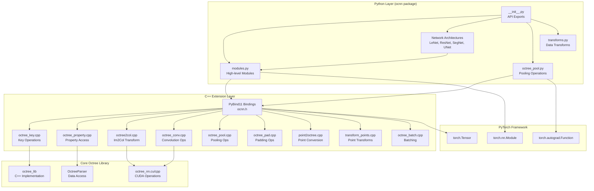
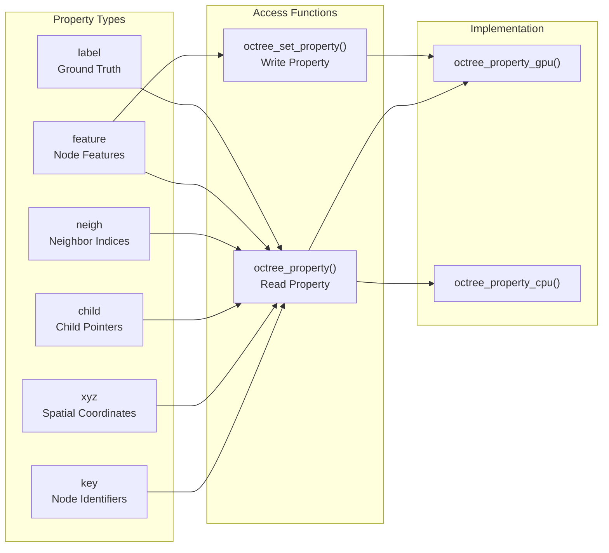
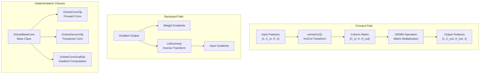
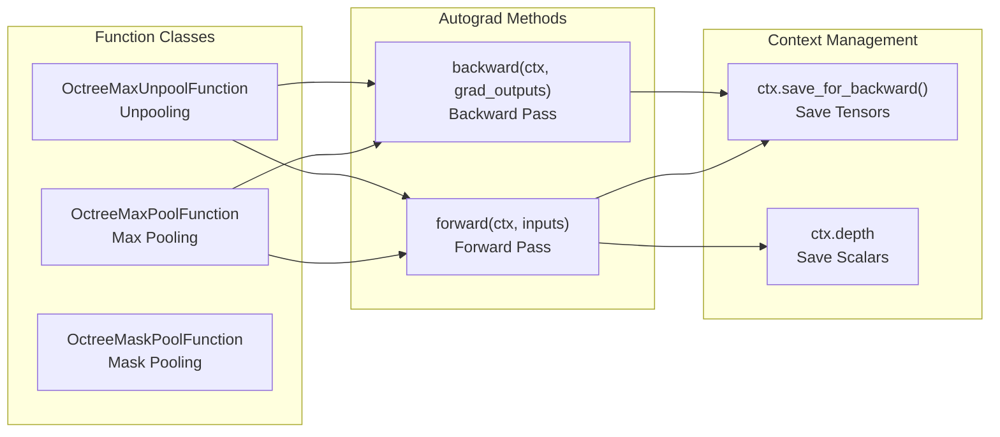
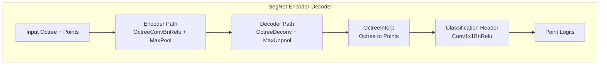

<!-- source: DeepWiki mcp.deepwiki.com · repo microsoft/O-CNN · page 4.2 PyTorch Integration · fetched 2026-10-26 -->

# PyTorch Integration

<details>
<summary>Relevant source files</summary>

The following files were used as context for generating this wiki page:

- [pytorch/cpp/octree2col.cpp](pytorch/cpp/octree2col.cpp)
- [pytorch/cpp/octree_batch.cpp](pytorch/cpp/octree_batch.cpp)
- [pytorch/cpp/octree_conv.cpp](pytorch/cpp/octree_conv.cpp)
- [pytorch/cpp/octree_key.cpp](pytorch/cpp/octree_key.cpp)
- [pytorch/cpp/octree_pad.cpp](pytorch/cpp/octree_pad.cpp)
- [pytorch/cpp/octree_pool.cpp](pytorch/cpp/octree_pool.cpp)
- [pytorch/cpp/octree_property.cpp](pytorch/cpp/octree_property.cpp)
- [pytorch/cpp/octree_samples.cpp](pytorch/cpp/octree_samples.cpp)
- [pytorch/cpp/point2octree.cpp](pytorch/cpp/point2octree.cpp)
- [pytorch/cpp/transform_points.cpp](pytorch/cpp/transform_points.cpp)
- [pytorch/ocnn/__init__.py](pytorch/ocnn/__init__.py)
- [pytorch/ocnn/octree_pool.py](pytorch/ocnn/octree_pool.py)
- [pytorch/ocnn/segnet.py](pytorch/ocnn/segnet.py)
- [pytorch/projects/classification.py](pytorch/projects/classification.py)

</details>


This document covers the PyTorch integration for O-CNN, which provides native PyTorch tensor operations for octree-based neural networks. The integration consists of C++ extensions that wrap the core octree library and a Python package that provides PyTorch modules and functions.

For TensorFlow integration, see [TensorFlow Integration](#4.1). For the core octree operations that underlie all framework integrations, see [Core Architecture](#3).

## Architecture Overview

The PyTorch integration follows a layered architecture that bridges the core C++ octree library with PyTorch's tensor system:



Sources: [pytorch/cpp/octree_key.cpp:1-127](), [pytorch/cpp/octree_property.cpp:1-344](), [pytorch/ocnn/__init__.py:1-43](), [pytorch/ocnn/octree_pool.py:1-116]()

## C++ Extension Layer

The C++ extension layer provides the core tensor operations that bridge PyTorch tensors with the octree library. Each operation is implemented as a function that accepts and returns PyTorch tensors.

### Key Operations

The key management system handles the spatial indexing fundamental to octree operations:

| Function | Purpose | Input Types | Output Types |
|----------|---------|-------------|--------------|
| `octree_encode_key` | Encode xyz coordinates to 64-bit keys | `Tensor(int16)` | `Tensor(int64)` |
| `octree_decode_key` | Decode 64-bit keys to xyz coordinates | `Tensor(int64)` | `Tensor(int16)` |
| `octree_xyz2key` | Convert xyz to Morton keys at depth | `Tensor(int64), int` | `Tensor(int64)` |
| `octree_key2xyz` | Convert Morton keys to xyz at depth | `Tensor(int64), int` | `Tensor(int64)` |
| `octree_search_key` | Binary search for keys in octree | `Tensor, Tensor, int` | `Tensor(int32)` |

Sources: [pytorch/cpp/octree_key.cpp:11-126]()

### Property Access

The property system provides read/write access to octree data structures:



Sources: [pytorch/cpp/octree_property.cpp:11-344]()

### Convolution Operations

The convolution system implements octree-specific convolution through the `octree2col` transformation:



Sources: [pytorch/cpp/octree2col.cpp:1-238](), [pytorch/cpp/octree_conv.cpp:1-283]()

## Python Package Structure

The `ocnn` package provides a PyTorch-native interface organized into several layers:

### Low-Level Operations

Direct tensor operations exposed from C++ extensions:

```python
# Core octree operations
from ocnn.nn import octree_property, octree_set_property, points2octree
from ocnn.nn import octree_conv, octree_deconv, octree2col, col2octree
from ocnn.nn import octree_max_pool, octree_max_unpool, octree_pad, octree_depad
```

Sources: [pytorch/ocnn/__init__.py:4-12]()

### PyTorch Module Wrappers

High-level `nn.Module` classes that integrate with PyTorch's autograd system:

| Module Class | Purpose | Key Methods |
|--------------|---------|-------------|
| `OctreeConv` | Octree convolution layer | `forward(data, octree)` |
| `OctreeMaxPool` | Max pooling with indices | `forward(data, octree)` |
| `OctreeMaxUnpool` | Unpooling from indices | `forward(data, mask, octree)` |
| `OctreeConvBnRelu` | Conv + BatchNorm + ReLU | `forward(data, octree)` |
| `OctreeResBlock` | Residual block | `forward(data, octree)` |

Sources: [pytorch/ocnn/__init__.py:18-34]()

### Autograd Integration

PyTorch autograd functions handle gradient computation:



Sources: [pytorch/ocnn/octree_pool.py:7-66]()

## Network Architectures

The package includes complete network implementations for common 3D learning tasks:

### Classification Networks


Sources: [pytorch/ocnn/__init__.py:37-38](), [pytorch/projects/classification.py:8-16]()

### Segmentation Networks

The SegNet architecture implements encoder-decoder structure for point-wise prediction:



Sources: [pytorch/ocnn/segnet.py:5-57]()

## Build and Installation

The PyTorch extension uses `setuptools` with C++ compilation:

### Build Configuration

The extension compiles C++ source files against PyTorch and CUDA libraries:

```python
# Key build components (conceptual)
sources = [
    "cpp/octree_key.cpp",
    "cpp/octree_property.cpp", 
    "cpp/octree_conv.cpp",
    "cpp/octree_pool.cpp"
    # ... other cpp files
]
```

The build process:
1. Compiles C++ extensions with PyTorch headers
2. Links against octree_lib static library
3. Creates Python package with native extensions
4. Installs as `ocnn` package

Sources: [pytorch/cpp/octree_key.cpp:1-5](), [pytorch/cpp/octree_property.cpp:1-7]()

## Usage Patterns

### Basic Workflow

A typical PyTorch training workflow with O-CNN:

```python
# From classification example
import ocnn
import torch

# Data loading with transforms
transform = ocnn.TransformCompose(flags)
dataset = Dataset(flags.location, flags.filelist, transform)
dataloader = torch.utils.data.DataLoader(dataset, collate_fn=ocnn.collate_octrees)

# Model definition
model = ocnn.ResNet(depth=5, channel=4, nout=40, resblock_num=3)

# Training step
for batch in dataloader:
    octree, label = batch['octree'].cuda(), batch['label'].cuda()
    logits = model(octree)
    loss = torch.nn.functional.nll_loss(
        torch.nn.functional.log_softmax(logits, dim=1), label)
```

Sources: [pytorch/projects/classification.py:18-28]()

### Memory Management

The integration handles GPU memory efficiently:
- Tensors maintain device placement (CPU/GPU) 
- Operations automatically dispatch to appropriate implementations
- Temporary workspace allocation is managed internally

### Integration with PyTorch Ecosystem

The O-CNN PyTorch integration supports:
- Automatic differentiation through `torch.autograd`
- DataParallel and DistributedDataParallel training
- Mixed precision training with `torch.cuda.amp`
- TorchScript compilation for deployment
- Integration with PyTorch Lightning

Sources: [pytorch/cpp/octree_conv.cpp:30-45](), [pytorch/ocnn/octree_pool.py:7-23]()

---

