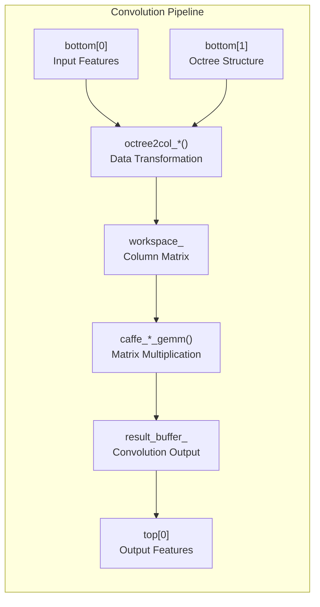
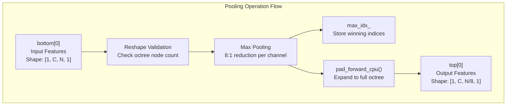
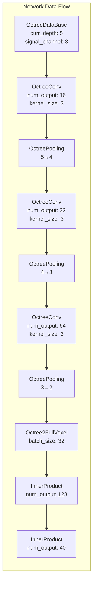
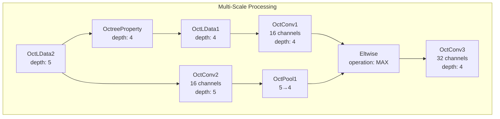
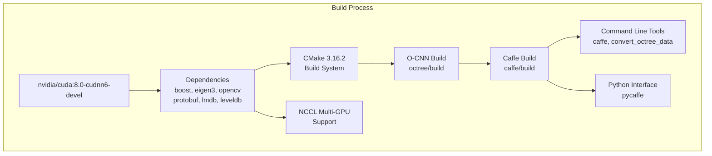
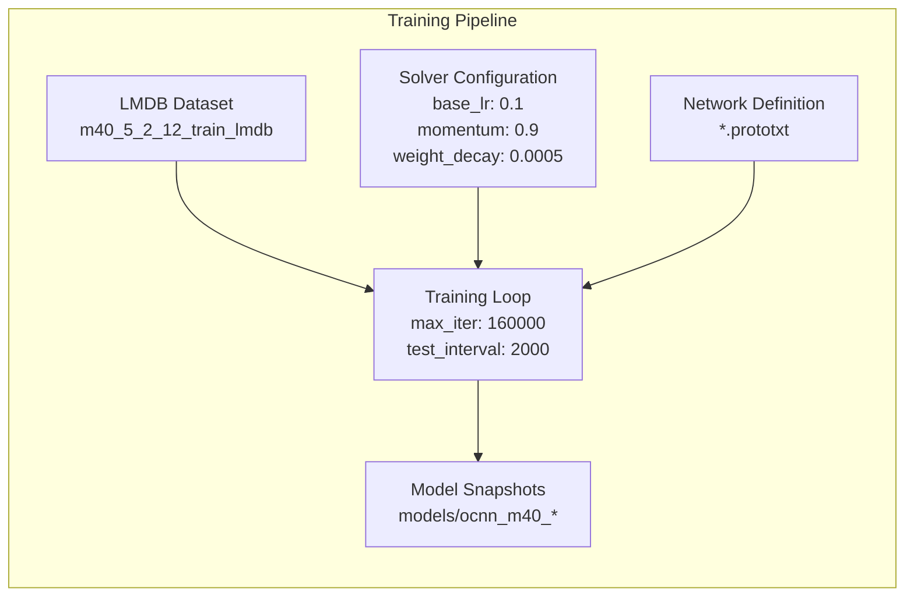
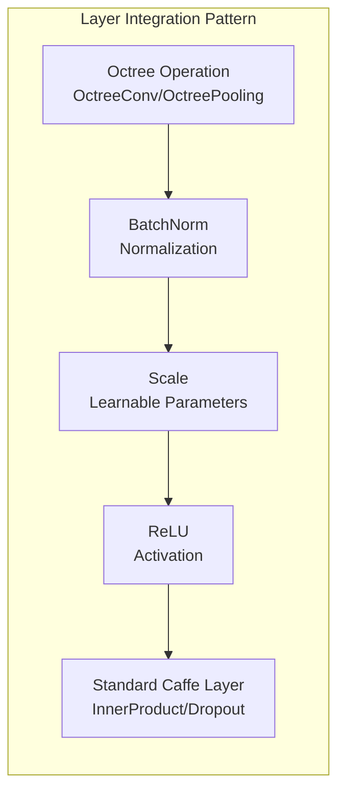

<!-- source: DeepWiki mcp.deepwiki.com · repo microsoft/O-CNN · page 4.3 Caffe Integration · fetched 2026-10-26 -->

# Caffe Integration

<details>
<summary>Relevant source files</summary>

The following files were used as context for generating this wiki page:

- [caffe/docker/gpu/Dockerfile](caffe/docker/gpu/Dockerfile)
- [caffe/experiments/aocnn_m40_5.prototxt](caffe/experiments/aocnn_m40_5.prototxt)
- [caffe/experiments/aocnn_m40_5_solver.prototxt](caffe/experiments/aocnn_m40_5_solver.prototxt)
- [caffe/experiments/dataset/README.md](caffe/experiments/dataset/README.md)
- [caffe/experiments/ocnn_m40_5.prototxt](caffe/experiments/ocnn_m40_5.prototxt)
- [caffe/experiments/ocnn_m40_6.prototxt](caffe/experiments/ocnn_m40_6.prototxt)
- [caffe/experiments/ocnn_m40_6_solver.prototxt](caffe/experiments/ocnn_m40_6_solver.prototxt)
- [caffe/src/caffe/layers/octree_base_conv_layer.cpp](caffe/src/caffe/layers/octree_base_conv_layer.cpp)
- [caffe/src/caffe/layers/octree_pooling_layer.cpp](caffe/src/caffe/layers/octree_pooling_layer.cpp)
- [caffe/src/caffe/layers/octree_set_feature_layer.cpp](caffe/src/caffe/layers/octree_set_feature_layer.cpp)
- [caffe/src/caffe/layers/octree_tile_layer.cpp](caffe/src/caffe/layers/octree_tile_layer.cpp)
- [tensorflow/script/dataset/README.md](tensorflow/script/dataset/README.md)

</details>


This page covers the Caffe framework integration for O-CNN, which provides custom layers and experimental configurations for octree-based deep learning. The Caffe integration includes specialized layer implementations for octree operations, pre-configured network architectures for 3D classification tasks, and Docker-based deployment tools.

For TensorFlow integration details, see [TensorFlow Integration](#4.1). For PyTorch integration, see [PyTorch Integration](#4.2). For general framework comparison and selection guidance, see [Framework Integration](#4).

## Architecture Overview

The Caffe integration implements octree-specific layers that extend the standard Caffe framework with spatial data structure operations. These layers work together to enable efficient 3D convolutions and pooling on octree-encoded data.

```mermaid
graph TB
    subgraph "Caffe Layer Hierarchy"
        BaseLayer["caffe::Layer<Dtype>"]
        OctreeBaseConv["OctreeBaseConvLayer<Dtype>"]
        OctreeConv["OctreeConvLayer"]
        OctreeDeconv["OctreeDeconvLayer"]
        OctreePooling["OctreePoolingLayer<Dtype>"]
        OctreeSetFeature["OctreeSetFeatureLayer<Dtype>"]
        OctreeTile["OctreeTileLayer<Dtype>"]
        OctreeDataBase["OctreeDataBaseLayer"]
        OctreeProperty["OctreePropertyLayer"]
        Octree2FullVoxel["Octree2FullVoxelLayer"]
    end
    
    subgraph "Core Operations"
        octree2col["octree2col_cpu/gpu"]
        col2octree["col2octree_cpu/gpu"]
        pad_forward["pad_forward_cpu/gpu"]
        pad_backward["pad_backward_cpu/gpu"]
    end
    
    BaseLayer --> OctreeBaseConv
    BaseLayer --> OctreePooling
    BaseLayer --> OctreeSetFeature
    BaseLayer --> OctreeTile
    BaseLayer --> OctreeDataBase
    BaseLayer --> OctreeProperty
    BaseLayer --> Octree2FullVoxel
    
    OctreeBaseConv --> OctreeConv
    OctreeBaseConv --> OctreeDeconv
    
    OctreeBaseConv --> octree2col
    OctreeBaseConv --> col2octree
    OctreePooling --> pad_forward
    OctreePooling --> pad_backward
```



Sources: [caffe/src/caffe/layers/octree_base_conv_layer.cpp:1-457](), [caffe/src/caffe/layers/octree_pooling_layer.cpp:1-136](), [caffe/src/caffe/layers/octree_set_feature_layer.cpp:1-98](), [caffe/src/caffe/layers/octree_tile_layer.cpp:1-128]()

## Core Layer Implementations

### OctreeBaseConvLayer

The `OctreeBaseConvLayer` class serves as the foundation for octree convolution operations, implementing both CPU and GPU execution paths with optimized memory management.

| Component | Purpose | Key Methods |
|-----------|---------|-------------|
| **Weight Management** | Handles convolution kernels and bias terms | `LayerSetUp()`, parameter initialization |
| **Workspace Management** | Manages memory buffers for intermediate computations | `workspace_`, `result_buffer_`, `data_buffer_` |
| **GEMM Operations** | Matrix multiplication implementations | `forward_cpu_gemm()`, `backward_cpu_gemm()`, `weight_cpu_gemm()` |
| **Octree Transformations** | Data layout conversions | `octree2col_cpu/gpu()`, `col2octree_cpu/gpu()` |

The layer supports kernel sizes up to 3×3×3 and implements stride-2 operations for hierarchical processing across octree levels.



Sources: [caffe/src/caffe/layers/octree_base_conv_layer.cpp:18-221](), [caffe/src/caffe/layers/octree_base_conv_layer.cpp:224-316]()

### OctreePoolingLayer

The `OctreePoolingLayer` implements max pooling operations that reduce data across octree hierarchical levels, performing 8-to-1 reduction by selecting maximum values from each group of 8 child nodes.



The pooling operation maintains spatial relationships within the octree structure while reducing the feature resolution by one octree level (depth decreases by 1).

Sources: [caffe/src/caffe/layers/octree_pooling_layer.cpp:21-61](), [caffe/src/caffe/layers/octree_pooling_layer.cpp:63-97]()

## Network Configurations

### Standard O-CNN Architecture

The standard O-CNN configuration implements a hierarchical CNN that processes octree data from fine to coarse resolution levels.

| Layer Type | Input Depth | Output Channels | Kernel Size | Purpose |
|------------|-------------|-----------------|-------------|---------|
| `OctreeConv` | 5 | 16 | 3×3×3 | Initial feature extraction |
| `OctreePooling` | 5→4 | - | - | Spatial downsampling |
| `OctreeConv` | 4 | 32 | 3×3×3 | Mid-level features |
| `OctreePooling` | 4→3 | - | - | Further downsampling |
| `OctreeConv` | 3 | 64 | 3×3×3 | High-level features |
| `Octree2FullVoxel` | 2 | - | - | Convert to dense representation |
| `InnerProduct` | - | 128 | - | Classification head |



Sources: [caffe/experiments/ocnn_m40_5.prototxt:1-280](), [caffe/experiments/ocnn_m40_6.prototxt:1-328]()

### Adaptive O-CNN Architecture

The adaptive O-CNN (AO-CNN) implements multi-scale feature fusion by processing different octree depth levels in parallel and combining their outputs.



The adaptive architecture enables processing of both fine-grained (depth 5) and coarse-grained (depth 4) features simultaneously, improving classification accuracy through multi-scale feature integration.

Sources: [caffe/experiments/aocnn_m40_5.prototxt:1-340]()

## Build and Deployment

### Docker Environment

The Caffe integration provides a complete Docker environment that includes all dependencies and build configurations for GPU-accelerated training.

| Component | Version/Commit | Purpose |
|-----------|----------------|---------|
| **Base Image** | `nvidia/cuda:8.0-cudnn6-devel-ubuntu16.04` | CUDA runtime environment |
| **Caffe** | `6bfc5ca8f7c2a4b7de09dfe7a01cf9d3470d22b3` | Caffe framework |
| **O-CNN** | Latest from Microsoft/O-CNN | Octree extensions |
| **CMake** | 3.16.2 | Build system |
| **NCCL** | `286916a1a37ca1fe8cd43e280f5c42ec29569fc5` | Multi-GPU support |



Sources: [caffe/docker/gpu/Dockerfile:1-93]()

### Training Configuration

Training configurations are specified through Caffe solver files that define learning parameters and training schedules.



The solver implements step-based learning rate decay with gamma=0.1 every 40,000 iterations, providing stable convergence over approximately 40 epochs.

Sources: [caffe/experiments/ocnn_m40_5_solver.prototxt:1-32](), [caffe/experiments/aocnn_m40_5_solver.prototxt:1-32]()

## Usage Patterns

### Data Loading

The `OctreeDataBase` layer handles loading of octree data from LMDB databases, automatically parsing octree structures and associated labels.

```cpp
// Example layer configuration in prototxt
layer {
  name: "data"
  type: "OctreeDataBase"
  top: "data"
  top: "label"
  data_param {
    source: "dataset/m40_5_2_12_train_lmdb"
    batch_size: 32
    backend: LMDB
  }
  octree_param {
    curr_depth: 5
    signal_channel: 3
  }
}
```

### Custom Layer Integration

Custom octree layers integrate seamlessly with standard Caffe layers like `BatchNorm`, `Scale`, `ReLU`, and `InnerProduct`, enabling hybrid network architectures.



This integration pattern allows octree-specific operations to be combined with standard deep learning components for flexible network design.

Sources: [caffe/experiments/ocnn_m40_5.prototxt:40-280](), [caffe/experiments/aocnn_m40_5.prototxt:38-340]()

---

