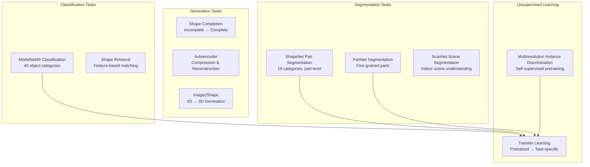
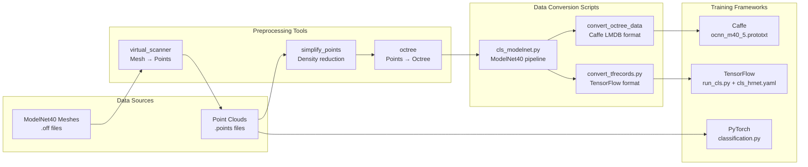
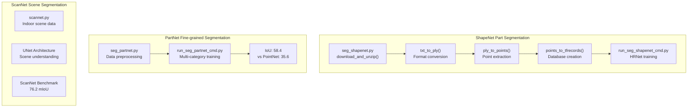
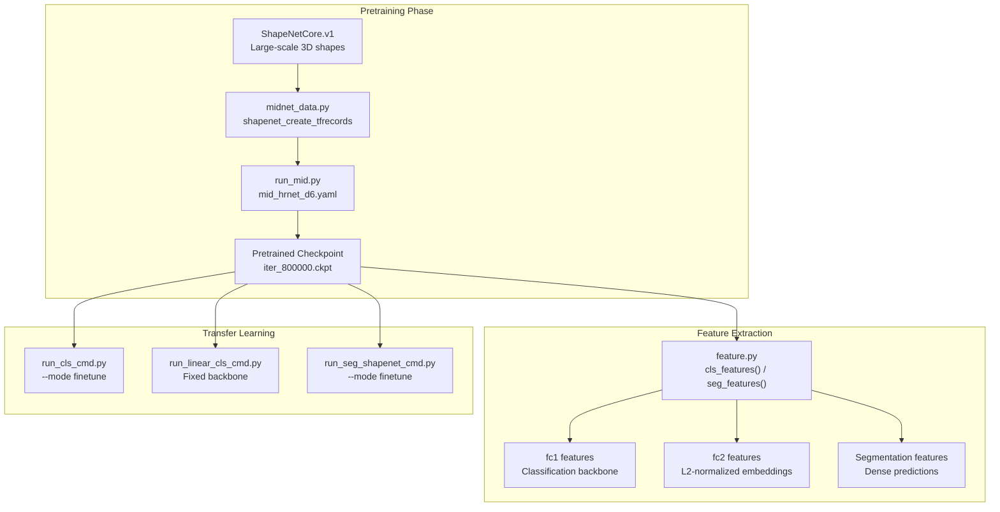
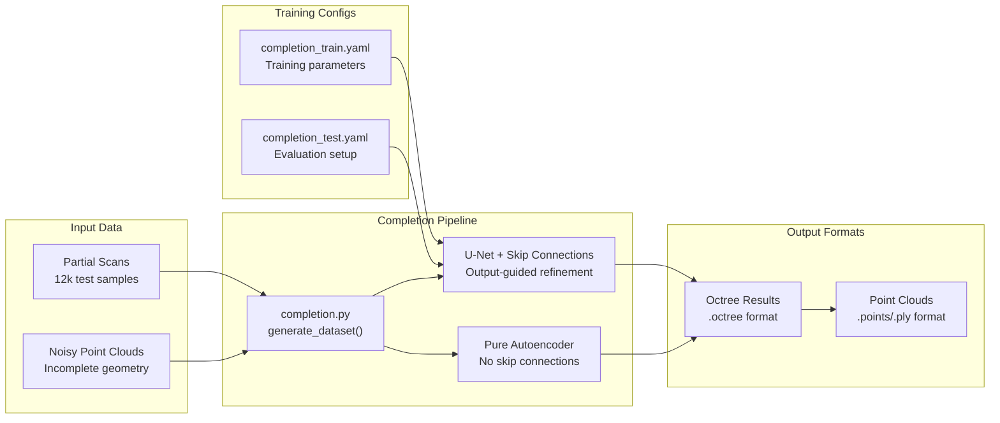

<!-- source: DeepWiki mcp.deepwiki.com · repo microsoft/O-CNN · page 5 Tasks and Applications · fetched 2026-10-26 -->

# Tasks and Applications

Relevant source files

The following files were used as context for generating this wiki page:

- [README.md](README.md)
- [docs/classification.md](docs/classification.md)
- [docs/completion.md](docs/completion.md)
- [docs/segmentation.md](docs/segmentation.md)
- [docs/unsupervised.md](docs/unsupervised.md)
- [tensorflow/data/cls_modelnet.py](tensorflow/data/cls_modelnet.py)
- [tensorflow/data/seg_shapenet.py](tensorflow/data/seg_shapenet.py)
- [tensorflow/script/configs/cls_hrnet.yaml](tensorflow/script/configs/cls_hrnet.yaml)
- [tensorflow/script/feature.py](tensorflow/script/feature.py)
- [tensorflow/script/run_cls_cmd.py](tensorflow/script/run_cls_cmd.py)
- [tensorflow/script/run_cls_finetune.py](tensorflow/script/run_cls_finetune.py)
- [tensorflow/script/run_linear_cls.py](tensorflow/script/run_linear_cls.py)
- [tensorflow/script/run_linear_cls_cmd.py](tensorflow/script/run_linear_cls_cmd.py)

This document provides an overview of the main 3D learning tasks and applications supported by the O-CNN framework. It covers the specific implementations, datasets, and code components for each task type, along with their relationships to the underlying octree-based CNN architecture.

For detailed information about the core octree data structures and neural operations that enable these tasks, see [Core Architecture](#3). For framework-specific implementation details, see [Framework Integration](#4). For data preprocessing pipelines, see [Data Processing Pipeline](#6).

## Supported Task Categories

The O-CNN framework supports several categories of 3D learning tasks, each with multiple dataset implementations and framework variations. The tasks are designed to leverage the hierarchical nature of octree representations for efficient 3D processing.

**Sources:** [README.md:34-44](), [docs/classification.md:1-10](), [docs/segmentation.md:1-10](), [docs/completion.md:1-10](), [docs/unsupervised.md:1-10]()

## Classification Implementation Pipeline

The classification tasks demonstrate the basic O-CNN workflow from mesh input to trained models. The implementation spans multiple frameworks with shared data preprocessing.

**Sources:** [tensorflow/data/cls_modelnet.py:36-49](), [docs/classification.md:7-56](), [docs/classification.md:76-139](), [docs/classification.md:156-207]()

### ModelNet40 Classification Implementation

The ModelNet40 classification task is implemented across all three frameworks with consistent preprocessing but different network architectures:

| Framework | Network Architecture | Configuration File | Accuracy |
|-----------|---------------------|-------------------|----------|
| Caffe | O-CNN (LeNet-style) | `ocnn_m40_5_solver.prototxt` | 89.6% |
| TensorFlow | HRNet | `cls_hrnet.yaml` | 92.4% |
| PyTorch | ResNet | `cls_m40.yaml` | Various |

The TensorFlow implementation in [tensorflow/script/configs/cls_hrnet.yaml:1-55]() shows the configuration for the HRNet-based classifier, including data augmentation parameters and training hyperparameters.

**Sources:** [docs/classification.md:47-55](), [docs/classification.md:115-138](), [docs/classification.md:193-206](), [tensorflow/script/configs/cls_hrnet.yaml:1-55]()

## Segmentation Task Implementations

Segmentation tasks require more complex architectures and dataset handling due to the need for dense prediction at the point level.

**Sources:** [tensorflow/data/seg_shapenet.py:27-134](), [docs/segmentation.md:48-79](), [docs/segmentation.md:82-98](), [README.md:50-54]()

### PartNet Segmentation Pipeline

The PartNet segmentation implementation demonstrates fine-grained part segmentation with significant performance improvements over existing methods. The preprocessing pipeline in [tensorflow/data/seg_shapenet.py:87-129]() handles the conversion from the original annotation format to TensorFlow records.

The segmentation results show substantial improvements:
- **O-CNN (HRNet)**: 58.4 IoU
- **PointNet**: 35.6 IoU  
- **PointNet++**: 42.5 IoU
- **SpiderCNN**: 37.0 IoU
- **PointCNN**: 46.5 IoU

**Sources:** [docs/segmentation.md:48-79](), [tensorflow/data/seg_shapenet.py:87-129](), [README.md:66-69]()

## Unsupervised Learning and Transfer

The unsupervised learning framework enables pretraining on large unlabeled datasets and transfer to downstream tasks.

**Sources:** [docs/unsupervised.md:3-24](), [tensorflow/script/feature.py:52-86](), [tensorflow/script/run_linear_cls_cmd.py:1-121](), [tensorflow/script/run_cls_cmd.py:1-54]()

### Linear Classification Protocol

The linear classification protocol in [tensorflow/script/run_linear_cls_cmd.py:33-119]() implements the standard evaluation for unsupervised representations. It extracts features using [tensorflow/script/feature.py:52-62]() and trains only a linear classifier on top of frozen backbone features.

The training pipeline supports different data ratios for few-shot learning experiments:

| Data Ratio | Training Samples | Learning Rate Multiplier |
|------------|------------------|-------------------------|
| 1% | 116 | 4x |
| 2% | 214 | 4x |
| 5% | 511 | 2x |
| 10% | 1000 | 2x |
| 20% | 1980 | 1x |
| 50% | 4931 | 1x |
| 100% | 9842 | 1x |

**Sources:** [tensorflow/script/run_linear_cls_cmd.py:23-26](), [tensorflow/script/feature.py:52-62]()

## Shape Completion and Generation

Shape completion tasks focus on reconstructing complete 3D shapes from partial or noisy input using encoder-decoder architectures with skip connections.

**Sources:** [docs/completion.md:10-61]()

The completion framework implements output-guided skip connections as described in the CVPR 2020 workshop paper. The architecture can be configured with or without skip connections using the `MODEL.skip_connections` parameter in the training configuration.

**Sources:** [docs/completion.md:20-31]()

## Task Performance Summary

The following table summarizes the performance achievements across different tasks and datasets:

| Task | Dataset | Architecture | Performance Metric | Score |
|------|---------|--------------|-------------------|-------|
| Classification | ModelNet40 | O-CNN (Caffe) | Accuracy | 89.6% |
| Classification | ModelNet40 | HRNet (TensorFlow) | Accuracy | 92.4% |
| Part Segmentation | ShapeNet | HRNet | mIoU | Various |
| Part Segmentation | PartNet | HRNet | mIoU | 58.4% |
| Scene Segmentation | ScanNet | UNet | mIoU | 76.2% |
| Shape Completion | Custom Dataset | UNet + Skip | Visual Quality | SOTA |

The unsupervised pretraining provides consistent improvements across downstream tasks, with the PartNet segmentation showing a +2.4 mIoU improvement (58.4 → 60.8) when using pretrained weights compared to random initialization.

**Sources:** [README.md:50-73](), [docs/classification.md:51](), [docs/classification.md:134-135](), [docs/segmentation.md:52-55](), [docs/unsupervised.md:80-82]()

---

