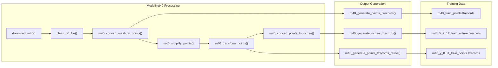
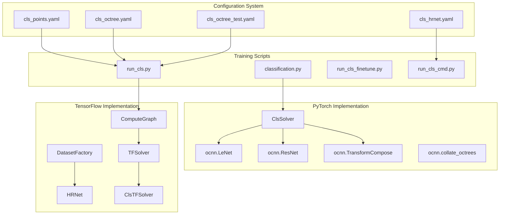
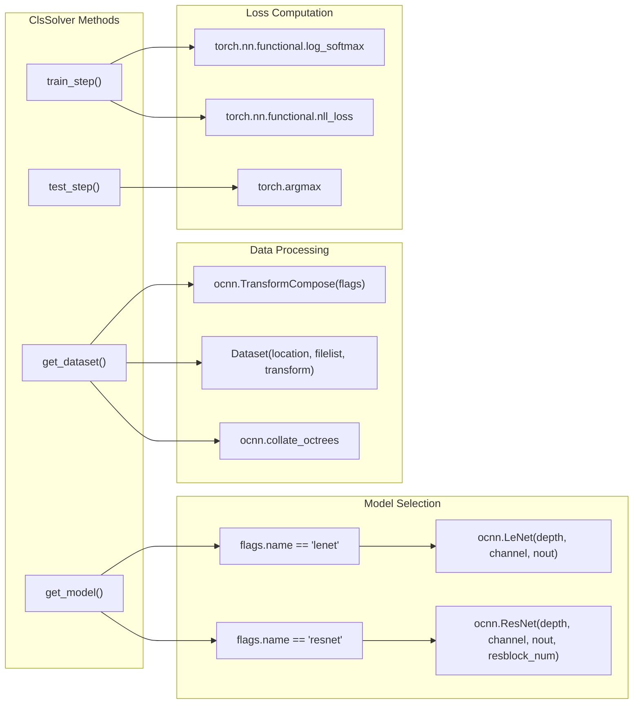
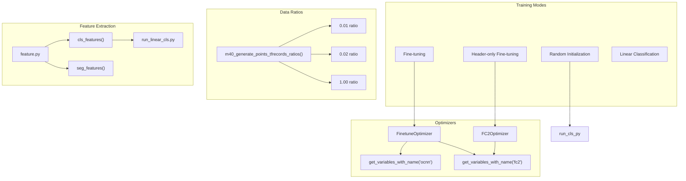

<!-- source: DeepWiki mcp.deepwiki.com · repo microsoft/O-CNN · page 5.1 3D Object Classification · fetched 2026-10-26 -->

# 3D Object Classification

<details>
<summary>Relevant source files</summary>

The following files were used as context for generating this wiki page:

- [pytorch/ocnn/__init__.py](pytorch/ocnn/__init__.py)
- [pytorch/ocnn/octree_pool.py](pytorch/ocnn/octree_pool.py)
- [pytorch/ocnn/segnet.py](pytorch/ocnn/segnet.py)
- [pytorch/projects/classification.py](pytorch/projects/classification.py)
- [tensorflow/data/cls_modelnet.py](tensorflow/data/cls_modelnet.py)
- [tensorflow/script/configs/cls_hrnet.yaml](tensorflow/script/configs/cls_hrnet.yaml)
- [tensorflow/script/configs/cls_octree.yaml](tensorflow/script/configs/cls_octree.yaml)
- [tensorflow/script/configs/cls_octree_test.yaml](tensorflow/script/configs/cls_octree_test.yaml)
- [tensorflow/script/configs/cls_points.yaml](tensorflow/script/configs/cls_points.yaml)
- [tensorflow/script/feature.py](tensorflow/script/feature.py)
- [tensorflow/script/run_cls_cmd.py](tensorflow/script/run_cls_cmd.py)
- [tensorflow/script/run_cls_finetune.py](tensorflow/script/run_cls_finetune.py)
- [tensorflow/script/run_linear_cls.py](tensorflow/script/run_linear_cls.py)
- [tensorflow/script/run_linear_cls_cmd.py](tensorflow/script/run_linear_cls_cmd.py)

</details>


This page covers 3D object classification using octree-based CNNs in the O-CNN system. The classification task involves training neural networks to predict object categories from 3D shape data, primarily using the ModelNet40 dataset. The system supports multiple frameworks (TensorFlow, PyTorch, Caffe) and various model architectures optimized for octree representations.

For 3D segmentation tasks, see [3D Segmentation](#5.2). For shape completion and generation, see [Shape Completion and Generation](#5.3).

## Classification Data Pipeline

The 3D classification workflow transforms raw 3D meshes into training-ready formats through a multi-stage pipeline:



Sources: [tensorflow/data/cls_modelnet.py:36-299]()

## Framework-Specific Implementation Architecture

The classification system provides unified interfaces across different deep learning frameworks while maintaining framework-specific optimizations:



Sources: [pytorch/projects/classification.py:1-46](), [tensorflow/script/run_cls_finetune.py:1-68](), [tensorflow/script/run_cls_cmd.py:1-54]()

## Model Architectures and Data Types

The system supports multiple model architectures with different input data representations:

| Architecture | Framework | Input Type | Configuration | Model Class |
|-------------|-----------|------------|---------------|-------------|
| ResNet | PyTorch | Points/Octree | `resblock_num: 3` | `ocnn.ResNet` |
| ResNet | TensorFlow | Points | `cls_points.yaml` | `resnet` |
| LeNet | PyTorch | Points/Octree | `depth: 5` | `ocnn.LeNet` |
| O-CNN | TensorFlow | Octree | `cls_octree.yaml` | `ocnn` |
| HRNet | TensorFlow | Points | `cls_hrnet.yaml` | `hrnet` |

Sources: [pytorch/projects/classification.py:8-16](), [tensorflow/script/configs/cls_points.yaml:40-46](), [tensorflow/script/configs/cls_octree.yaml:27-32](), [tensorflow/script/configs/cls_hrnet.yaml:42-51]()

## PyTorch Classification Implementation

The PyTorch implementation centers around the `ClsSolver` class that handles training and evaluation:



Sources: [pytorch/projects/classification.py:7-37]()

## TensorFlow Training Pipeline

The TensorFlow implementation provides multiple training modes and optimization strategies:



Sources: [tensorflow/script/run_cls_finetune.py:9-67](), [tensorflow/script/run_linear_cls_cmd.py:28-120](), [tensorflow/script/feature.py:52-88]()

## Configuration Examples

### Points-based ResNet Configuration
```yaml
# cls_points.yaml
MODEL:
  name: resnet
  channel: 3
  nout: 40
  depth: 5
  resblock_num: 3

DATA:
  train:
    dtype: points
    distort: True
    depth: 5
    batch_size: 32
    location: dataset/ModelNet40/m40_train_points.tfrecords
```

### Octree-based O-CNN Configuration
```yaml
# cls_octree.yaml  
MODEL:
  name: ocnn
  channel: 3
  nout: 40
  depth: 5

DATA:
  train:
    dtype: octree
    depth: 5
    batch_size: 32
    location: dataset/ModelNet40/m40_5_2_12_train_octree.tfrecords
```

Sources: [tensorflow/script/configs/cls_points.yaml:40-49](), [tensorflow/script/configs/cls_octree.yaml:27-36]()

## Training Execution

The system provides automated training scripts that handle multiple data ratios and training configurations:

| Script | Purpose | Key Parameters |
|--------|---------|----------------|
| `run_cls_cmd.py` | Batch training across ratios | `ratios = [0.01, 0.02, 0.05, 0.10, 0.20, 0.50, 1.00]` |
| `run_linear_cls_cmd.py` | Linear probe evaluation | `train_nums = [116, 214, 511, 1000, 1980, 4931, 9842]` |
| `classification.py` | PyTorch single experiment | `ClsSolver.main(FLAGS, ClsSolver)` |

The training process automatically adjusts hyperparameters based on data size, with smaller datasets receiving longer training with higher learning rate multipliers.

Sources: [tensorflow/script/run_cls_cmd.py:24-53](), [tensorflow/script/run_linear_cls_cmd.py:22-119](), [pytorch/projects/classification.py:40-46]()

---

