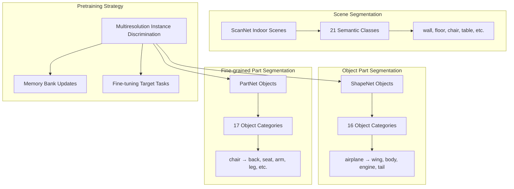
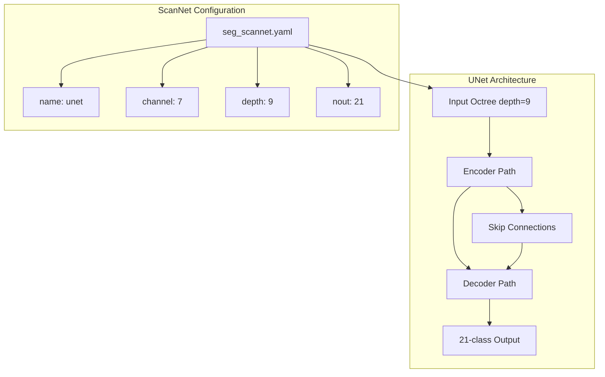
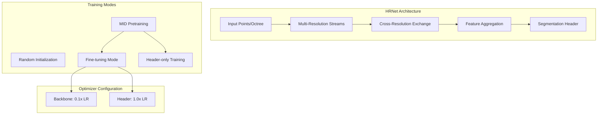
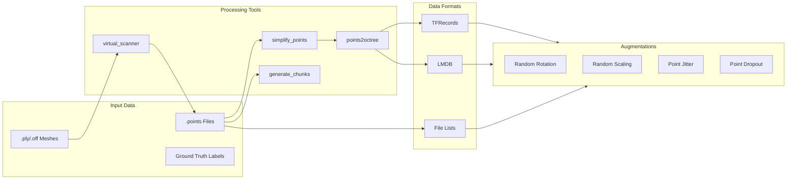
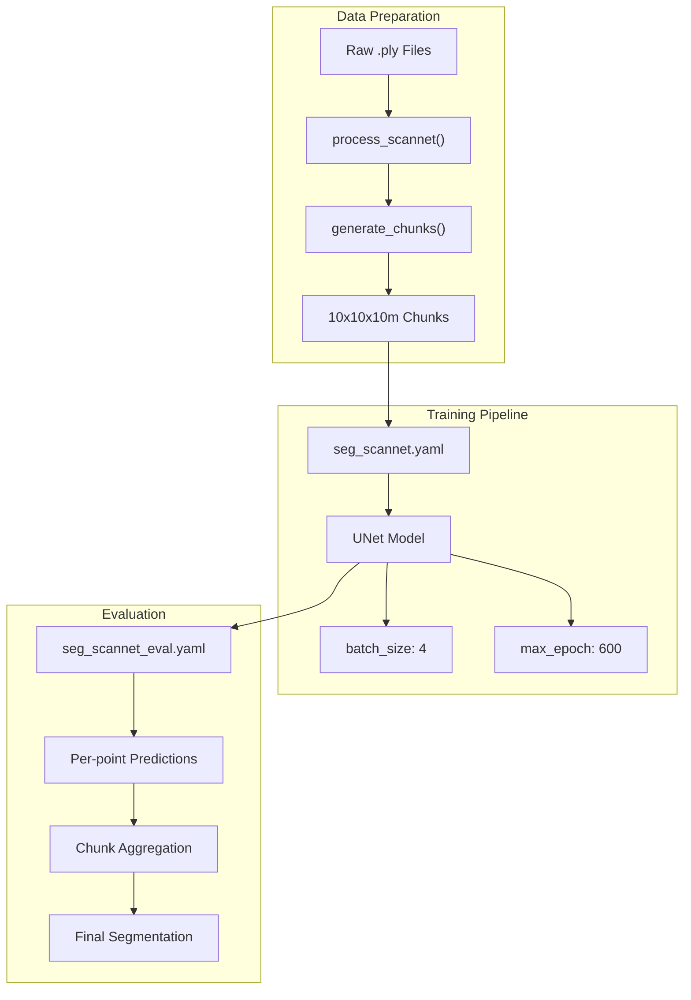
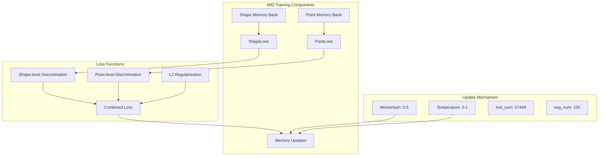
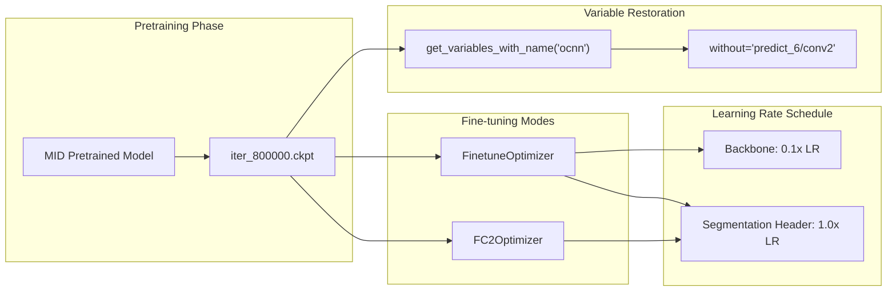
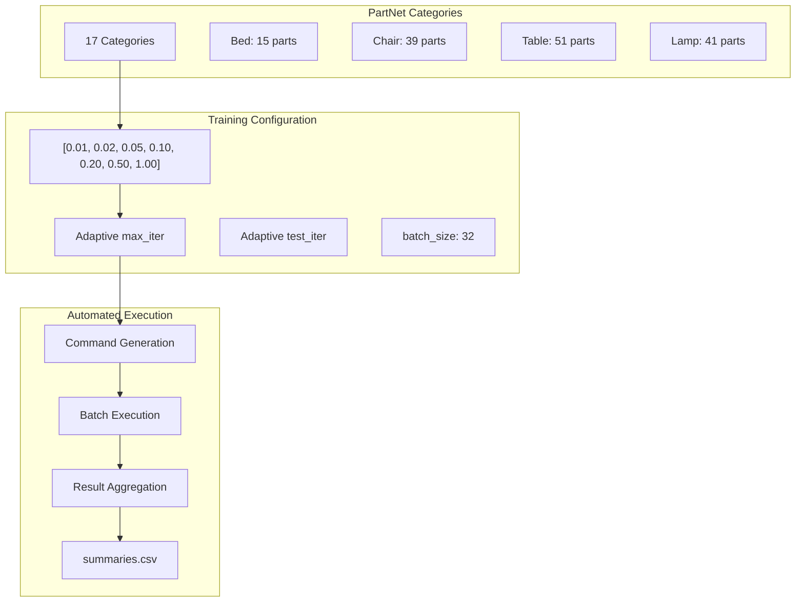

<!-- source: DeepWiki mcp.deepwiki.com · repo microsoft/O-CNN · page 5.2 3D Segmentation · fetched 2026-10-26 -->

# 3D Segmentation

Relevant source files

The following files were used as context for generating this wiki page:

- [.gitignore](.gitignore)
- [docs/citation.md](docs/citation.md)
- [docs/scannet.md](docs/scannet.md)
- [pytorch/projects/configs/seg_scannet.yaml](pytorch/projects/configs/seg_scannet.yaml)
- [pytorch/projects/configs/seg_scannet_d8.yaml](pytorch/projects/configs/seg_scannet_d8.yaml)
- [pytorch/projects/configs/seg_scannet_eval.yaml](pytorch/projects/configs/seg_scannet_eval.yaml)
- [pytorch/projects/tools/scannet.py](pytorch/projects/tools/scannet.py)
- [tensorflow/data/midnet_data.py](tensorflow/data/midnet_data.py)
- [tensorflow/script/configs/mid_hrnet_d6.yaml](tensorflow/script/configs/mid_hrnet_d6.yaml)
- [tensorflow/script/configs/seg_hrnet_shapenet_pts.yaml](tensorflow/script/configs/seg_hrnet_shapenet_pts.yaml)
- [tensorflow/script/mid_loss.py](tensorflow/script/mid_loss.py)
- [tensorflow/script/run_mid.py](tensorflow/script/run_mid.py)
- [tensorflow/script/run_seg_partnet_cmd.py](tensorflow/script/run_seg_partnet_cmd.py)
- [tensorflow/script/run_seg_partnet_finetune.py](tensorflow/script/run_seg_partnet_finetune.py)
- [tensorflow/script/run_seg_shapenet_cmd.py](tensorflow/script/run_seg_shapenet_cmd.py)
- [tensorflow/script/run_seg_shapenet_finetune.py](tensorflow/script/run_seg_shapenet_finetune.py)

This section covers the 3D segmentation capabilities of O-CNN, which enable per-point semantic classification of 3D shapes and scenes. The system supports three main segmentation tasks: scene segmentation of indoor environments (ScanNet), object part segmentation (ShapeNet), and fine-grained part segmentation (PartNet). For 3D object classification tasks, see [3D Object Classification](#5.1). For shape completion and generation, see [Shape Completion and Generation](#5.3).

## Segmentation Task Types

O-CNN supports three distinct types of 3D segmentation tasks, each with different characteristics and applications:

**Scene Segmentation** processes complete indoor environments, classifying each point into semantic categories like walls, furniture, and fixtures. **Object Part Segmentation** divides individual 3D objects into their constituent parts. **Fine-grained Part Segmentation** provides more detailed part decomposition with hierarchical part relationships.

Sources: [pytorch/projects/tools/scannet.py:21-30](), [tensorflow/script/run_seg_shapenet_cmd.py:28-36](), [tensorflow/script/run_seg_partnet_cmd.py:31-45]()

## Network Architectures

Different segmentation tasks employ specialized neural network architectures optimized for their specific requirements:

### U-Net for Scene Segmentation

The U-Net architecture handles the varying scales and complex spatial relationships in indoor scenes, using skip connections to preserve fine-grained spatial details during upsampling.

Sources: [pytorch/projects/configs/seg_scannet.yaml:59-67](), [pytorch/projects/configs/seg_scannet_eval.yaml:31-37]()

### HRNet for Part Segmentation

HRNet maintains high-resolution representations throughout the network, making it effective for precise part boundary detection. The architecture supports different training modes with specialized optimizers for transfer learning scenarios.

Sources: [tensorflow/script/run_seg_partnet_finetune.py:13-32](), [tensorflow/script/configs/seg_hrnet_shapenet_pts.yaml:49-57]()

## Data Processing Pipeline

The segmentation pipeline transforms raw 3D data through several stages to create training-ready datasets:

The pipeline supports different data formats for each framework integration, with consistent preprocessing steps across all segmentation tasks.

Sources: [pytorch/projects/tools/scannet.py:110-136](), [tensorflow/data/midnet_data.py:105-164]()

## ScanNet Scene Segmentation

ScanNet segmentation processes indoor scene point clouds to classify each point into one of 21 semantic categories:

| Class ID | Semantic Label | Class ID | Semantic Label |
|----------|----------------|----------|----------------|
| 0 | wall | 11 | counter |
| 1 | floor | 12 | desk |
| 2 | cabinet | 14 | curtain |
| 3 | bed | 16 | refrigerator |
| 4 | chair | 24 | shower curtain |
| 5 | sofa | 28 | toilet |
| 6 | table | 33 | sink |
| 7 | door | 34 | bathtub |
| 8 | window | 36 | otherfurniture |
| 9 | bookshelf | 39 | (unlabeled) |
| 10 | picture | | |

### Scene Processing Workflow

The system processes large indoor scenes by dividing them into manageable chunks, training on these chunks, and then aggregating predictions back to complete scenes.

Sources: [pytorch/projects/tools/scannet.py:138-171](), [docs/scannet.md:20-52]()

## Part Segmentation with Transfer Learning

Part segmentation tasks leverage unsupervised pretraining through Multiresolution Instance Discrimination (MID) for improved performance:

### MID Pretraining Architecture

The MID framework learns shape and point-level representations through contrastive learning, using memory banks to maintain feature representations across training iterations.

Sources: [tensorflow/script/mid_loss.py:4-124](), [tensorflow/script/configs/mid_hrnet_d6.yaml:44-50]()

### Fine-tuning Strategy

The fine-tuning process selectively updates different parts of the network with different learning rates, preserving learned representations while adapting to specific segmentation tasks.

Sources: [tensorflow/script/run_seg_partnet_finetune.py:50-60](), [tensorflow/script/run_seg_shapenet_finetune.py:43-56]()

## Multi-Dataset Training Pipeline

The segmentation system supports automated training across multiple datasets with different data ratios and hyperparameters:

The system automatically generates training commands for different data ratios and object categories, enabling comprehensive evaluation across varying data availability scenarios.

Sources: [tensorflow/script/run_seg_partnet_cmd.py:46-96](), [tensorflow/script/run_seg_shapenet_cmd.py:47-99]()

## Framework-Specific Implementation

### TensorFlow Implementation

The TensorFlow implementation provides the most complete segmentation pipeline with support for all three segmentation tasks:

| Component | File | Key Classes/Functions |
|-----------|------|--------------------|
| Base Solver | `run_seg_partnet.py` | `PartNetSolver`, `ComputeGraphSeg` |
| Fine-tuning | `run_seg_partnet_finetune.py` | `FinetuneOptimizer`, `FC2Optimizer` |
| MID Training | `run_mid.py` | `MidTFSolver`, `compute_graph` |
| Loss Functions | `mid_loss.py` | `ShapeLoss`, `PointLoss` |

### PyTorch Implementation

The PyTorch implementation focuses on ScanNet scene segmentation with U-Net architecture:

| Configuration | Purpose | Key Parameters |
|---------------|---------|----------------|
| `seg_scannet.yaml` | Training | `depth: 9`, `batch_size: 4`, `max_epoch: 600` |
| `seg_scannet_eval.yaml` | Evaluation | `run: evaluate`, `batch_size: 1` |
| `seg_scannet_d8.yaml` | Lower Resolution | `depth: 8` for faster training |

The PyTorch implementation includes specialized data loading and evaluation tools optimized for large-scale scene processing.

Sources: [pytorch/projects/configs/seg_scannet.yaml:1-73](), [pytorch/projects/tools/scannet.py:188-233]()

---

