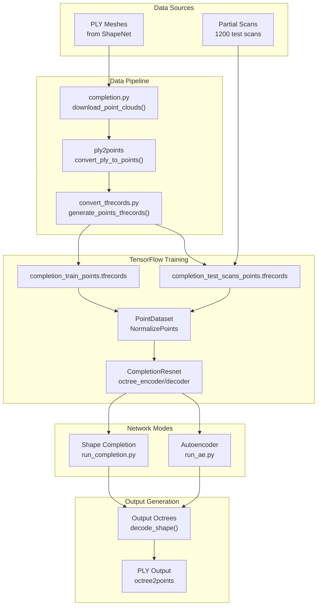
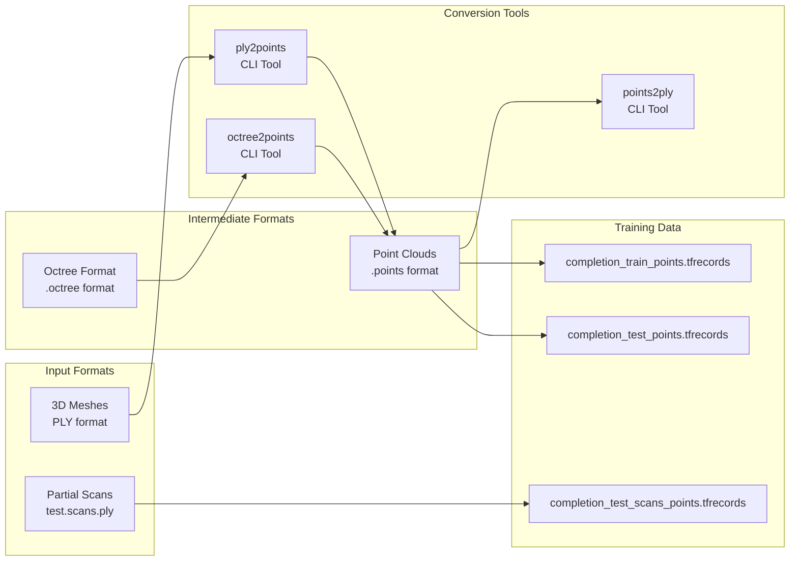
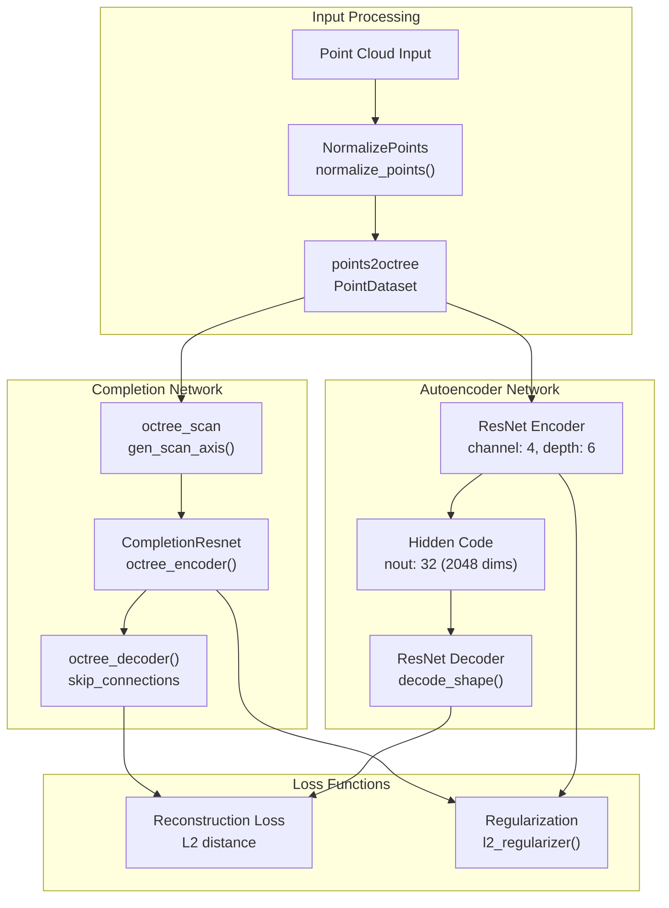
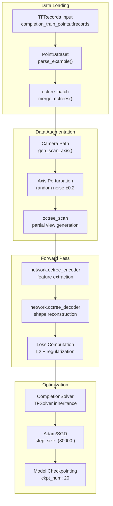
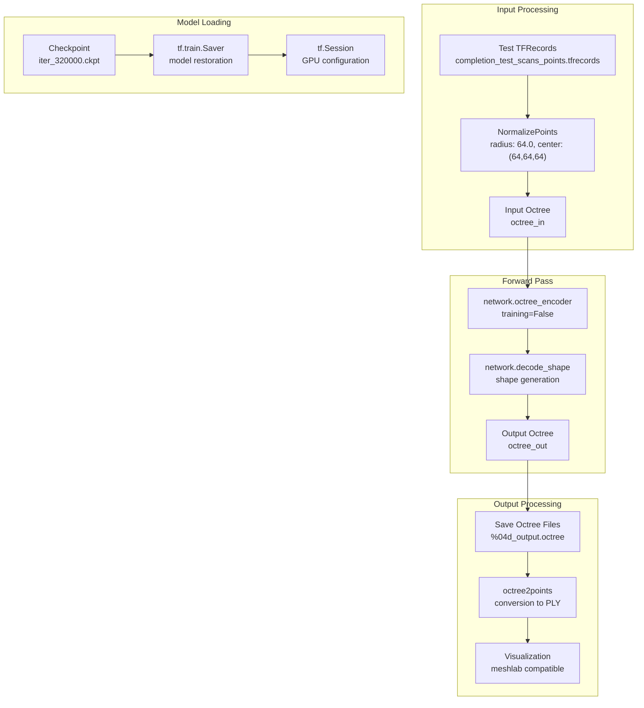

<!-- source: DeepWiki mcp.deepwiki.com · repo microsoft/O-CNN · page 5.3 Shape Completion and Generation · fetched 2026-10-26 -->

# Shape Completion and Generation

<details>
<summary>Relevant source files</summary>

The following files were used as context for generating this wiki page:

- [docs/autoencoder.md](docs/autoencoder.md)
- [tensorflow/data/completion.py](tensorflow/data/completion.py)
- [tensorflow/script/configs/ae_resnet.yaml](tensorflow/script/configs/ae_resnet.yaml)
- [tensorflow/script/configs/ae_resnet_decode.yaml](tensorflow/script/configs/ae_resnet_decode.yaml)
- [tensorflow/script/configs/ae_resnet_test.yaml](tensorflow/script/configs/ae_resnet_test.yaml)
- [tensorflow/script/configs/completion_test.yaml](tensorflow/script/configs/completion_test.yaml)
- [tensorflow/script/configs/completion_train.yaml](tensorflow/script/configs/completion_train.yaml)
- [tensorflow/script/run_completion.py](tensorflow/script/run_completion.py)

</details>


This page covers the shape completion and generation capabilities of O-CNN, including autoencoder architectures for learning 3D shape representations and completion pipelines for reconstructing partial 3D shapes. Shape completion takes partial observations (e.g., from depth scans) and reconstructs complete 3D objects, while shape generation involves learning latent representations that can synthesize new shapes.

For general 3D classification tasks, see [3D Object Classification](#5.1). For shape and scene segmentation, see [3D Segmentation](#5.2).

## System Overview

The shape completion and generation system consists of three main components: data preparation pipelines that convert 3D meshes to training-ready formats, encoder-decoder networks that learn shape representations, and inference workflows that reconstruct complete shapes from partial inputs.

**Shape Completion and Generation Architecture**


Sources: [tensorflow/data/completion.py:1-198](), [tensorflow/script/run_completion.py:1-139](), [docs/autoencoder.md:1-62]()

## Data Pipeline

The data preparation pipeline transforms raw 3D meshes into training-ready octree representations. The system supports both complete shapes for autoencoder training and partial scans for completion tasks.

**Data Processing Flow**


The data pipeline includes several key processing functions:

| Function | Purpose | Input | Output |
|----------|---------|-------|--------|
| `download_point_clouds()` | Downloads completion dataset | URL | ZIP archive |
| `convert_ply_to_points()` | Converts PLY to points format | PLY files | .points files |
| `generate_points_tfrecords()` | Creates TensorFlow records | .points files | .tfrecords |
| `rename_output_octree()` | Organizes inference output | Generated octrees | Renamed octrees |
| `convert_octree_to_points()` | Converts octrees to visualization format | .octree files | PLY/points files |

Sources: [tensorflow/data/completion.py:19-140](), [tensorflow/data/completion.py:164-194]()

## Network Architectures

The system implements two main architectural patterns: shape completion networks that reconstruct complete shapes from partial inputs, and autoencoders that learn compact shape representations for generation tasks.

**Network Architecture Components**


### Completion Architecture

The completion network uses a ResNet-based encoder-decoder with skip connections. Key configuration parameters:

| Parameter | Value | Description |
|-----------|-------|-------------|
| `depth` | 6 | Octree depth for hierarchical processing |
| `channel` | 4 | Input channel count (coordinates + features) |
| `skip_connections` | True | Enables feature reuse between encoder/decoder |
| `batch_size` | 16 | Training batch size |
| `node_dis` | True | Enables node displacement features |

### Autoencoder Architecture  

The autoencoder compresses 3D shapes into fixed-size latent codes:

| Parameter | Value | Description |
|-----------|-------|-------------|
| `nout` | 32 | Hidden code channels (4×4×4×32 = 2048 dims) |
| `depth` | 6 | Maximum octree resolution |
| `channel` | 4 | Point feature dimensions |

Sources: [tensorflow/script/run_completion.py:80-98](), [tensorflow/script/configs/completion_train.yaml:1-48](), [tensorflow/script/configs/ae_resnet.yaml:1-41]()

## Training Workflows

The training process varies between completion and autoencoder tasks, with different data handling and loss computation strategies.

**Training Process Flow**


### Training Configuration

Key training parameters from the configuration files:

| Setting | Completion | Autoencoder | Description |
|---------|------------|-------------|-------------|
| `max_iter` | 320000 | 320000 | Maximum training iterations |
| `test_every_iter` | 2000 | 2000 | Validation frequency |
| `step_size` | (80000,) | (80000,) | Learning rate decay schedule |
| `weight_decay` | 0.0005 | 0.0005 | L2 regularization strength |
| `batch_size` | 16 | 16 | Training batch size |

### Loss Function Components

The total loss combines reconstruction and regularization terms:

```
total_loss = reconstruction_loss + regularization_loss
```

Where:
- `reconstruction_loss`: Multi-scale L2 distance between predicted and target octrees
- `regularization_loss`: L2 weight decay via `l2_regularizer('ocnn', weight_decay)`

Sources: [tensorflow/script/run_completion.py:84-97](), [tensorflow/script/configs/completion_train.yaml:1-48](), [tensorflow/script/configs/ae_resnet.yaml:1-41]()

## Inference and Testing

The inference pipeline supports both shape completion from partial scans and shape generation from learned latent codes.

**Inference Pipeline**


### Testing Modes

The system supports multiple testing configurations:

| Mode | Config File | Purpose | Output |
|------|-------------|---------|--------|
| Completion | `completion_test.yaml` | Reconstruct from partial scans | Complete shapes |
| Autoencoder | `ae_resnet_test.yaml` | Test reconstruction quality | Reconstructed shapes |
| Generation | `ae_resnet_decode.yaml` | Generate from latent codes | Novel shapes |

### Inference Implementation

The `CompletionSolver.decode_shape()` method handles the complete inference workflow:

1. **Graph Construction**: Builds inference graph with `training=False`
2. **Model Loading**: Restores trained weights from checkpoint
3. **Batch Processing**: Processes test samples iteratively
4. **Output Serialization**: Saves octrees in binary format for post-processing

Sources: [tensorflow/script/run_completion.py:105-133](), [tensorflow/script/configs/completion_test.yaml:1-29](), [tensorflow/script/configs/ae_resnet_decode.yaml:1-27]()

## Framework Support

While the primary implementation focuses on TensorFlow, the system also supports Caffe-based experiments for comparative analysis.

### TensorFlow Implementation

The TensorFlow version provides the most complete feature set:
- Custom octree operations via `libs` module
- YAML-based configuration system
- Integrated data pipeline with TFRecords
- GPU acceleration support

### Caffe Implementation

The Caffe version supports autoencoder experiments:
- LMDB data format via `prepare_dataset.py --run=shapenet_lmdb_ae`
- Prototxt-based network definitions (`aocnn_ae_7_4.solver.prototxt`)
- Chamfer distance evaluation for shape quality assessment

| Framework | Strengths | Use Cases |
|-----------|-----------|-----------|
| TensorFlow | Full pipeline integration, modern APIs | Primary development, production |
| Caffe | Established research baseline | Comparative experiments, legacy support |

Sources: [docs/autoencoder.md:37-62](), [docs/autoencoder.md:3-35]()

---

