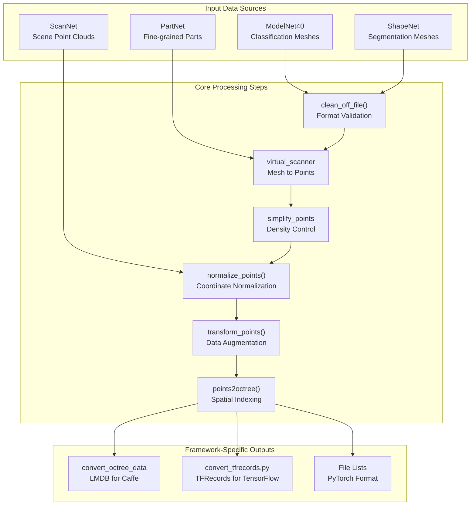
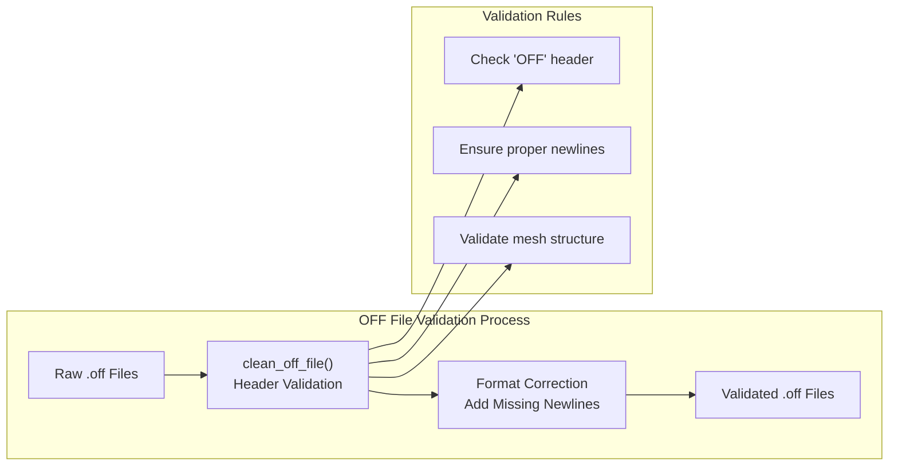
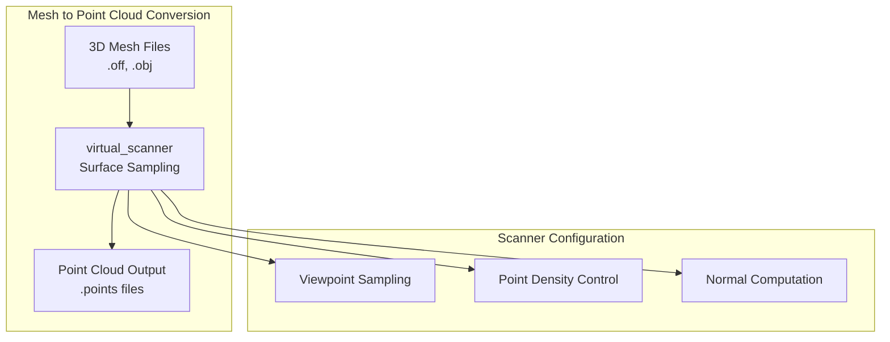
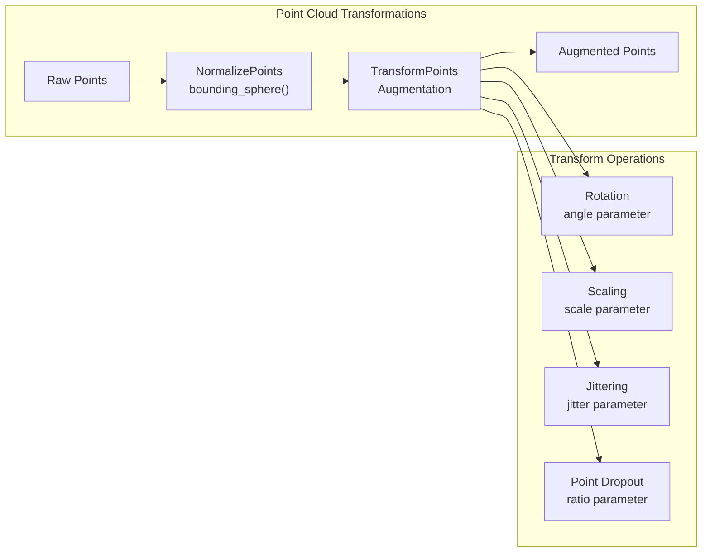
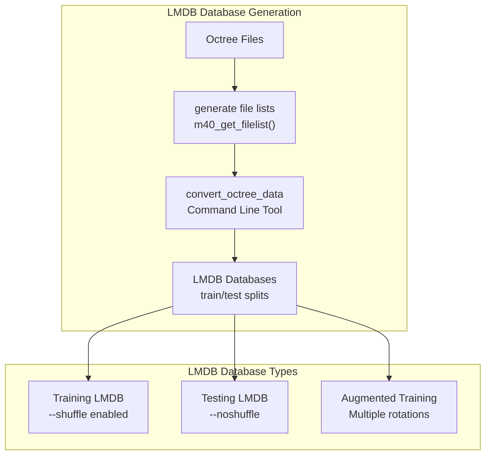
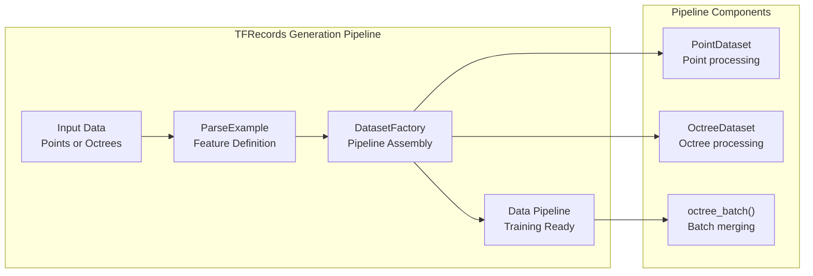
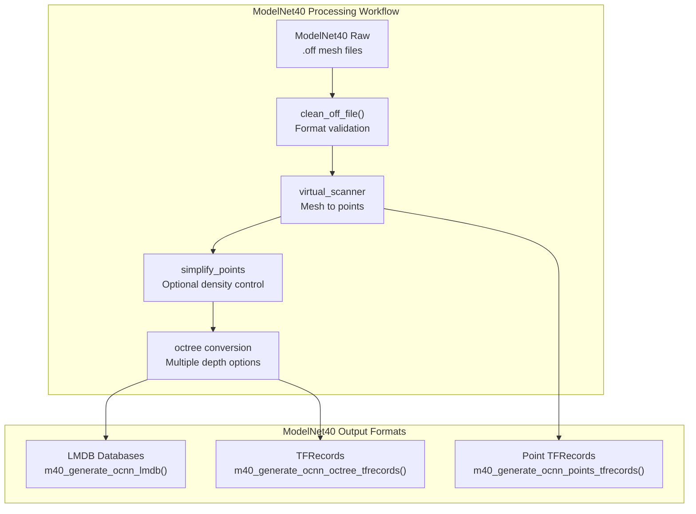
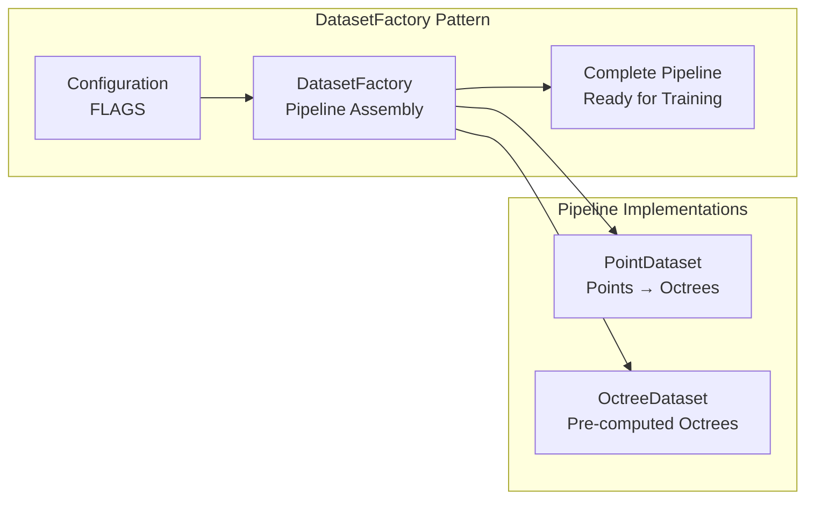

<!-- source: DeepWiki mcp.deepwiki.com · repo microsoft/O-CNN · page 6 Data Processing Pipeline · fetched 2026-10-26 -->

# Data Processing Pipeline

Relevant source files

The following files were used as context for generating this wiki page:

- [caffe/experiments/prepare_dataset.py](caffe/experiments/prepare_dataset.py)
- [tensorflow/script/config.py](tensorflow/script/config.py)
- [tensorflow/script/dataset.py](tensorflow/script/dataset.py)
- [tensorflow/script/run_ae.py](tensorflow/script/run_ae.py)
- [tensorflow/script/run_cls.py](tensorflow/script/run_cls.py)
- [tensorflow/script/tfsolver.py](tensorflow/script/tfsolver.py)

This document covers the comprehensive data processing pipeline in O-CNN that transforms raw 3D datasets into training-ready formats across different deep learning frameworks. The pipeline handles the complete workflow from raw mesh files to framework-specific data containers (LMDB, TFRecords, file lists) with support for data augmentation, octree generation, and multi-dataset processing.

For information about the core octree data structure implementation, see [Octree Data Structure](#3.1). For framework-specific usage of processed data during training, see [Framework Integration](#4).

## Pipeline Overview

The O-CNN data processing pipeline follows a consistent multi-stage approach regardless of the target framework or dataset. The pipeline transforms 3D data through several standardized steps while maintaining flexibility for dataset-specific requirements.

Sources: [caffe/experiments/prepare_dataset.py:245-257](), [tensorflow/script/dataset.py:20-41](), [tensorflow/script/dataset.py:108-137]()

## Input Data Sources and Formats

The pipeline supports multiple 3D dataset formats and automatically handles format-specific preprocessing requirements. Each dataset type requires different initial processing steps based on its native format and structure.

| Dataset | Input Format | Typical Use Case | Processing Entry Point |
|---------|--------------|------------------|----------------------|
| ModelNet40 | `.off` mesh files | 3D object classification | `m40_convert_mesh_to_points()` |
| ShapeNet | `.off` mesh files + renderings | Shape completion, segmentation | `shapenet_convert_points_to_octree_ae()` |
| PartNet | Various mesh formats | Fine-grained segmentation | Custom preprocessing |
| ScanNet | `.ply` point clouds | Scene segmentation | Direct point processing |

### Mesh File Validation

The `clean_off_file()` function ensures proper OFF file formatting by validating headers and fixing common format issues that can cause downstream processing failures.

Sources: [caffe/experiments/prepare_dataset.py:246-257]()

## Core Processing Steps

### Mesh to Point Cloud Conversion

The `virtual_scanner` tool converts 3D meshes to point clouds using virtual scanning techniques. This step is essential for creating uniform point cloud representations from diverse mesh formats.

Sources: [caffe/experiments/prepare_dataset.py:307-314]()

### Point Cloud Simplification

The `simplify_points` tool reduces point cloud density while preserving geometric features. This step is crucial for managing computational complexity and memory usage during training.

### Point Cloud Normalization and Augmentation

The TensorFlow implementation provides sophisticated point cloud transformations through the `TransformPoints` and `NormalizePoints` classes.

Sources: [tensorflow/script/dataset.py:42-49](), [tensorflow/script/dataset.py:52-105]()

### Octree Generation

The final processing step converts normalized point clouds to octree representations using the `points2octree()` function or the octree command-line tool.

| Parameter | Purpose | Typical Values |
|-----------|---------|----------------|
| `depth` | Maximum octree depth | 5-7 |
| `full_depth` | Full octree depth | 2 |
| `adaptive` | Enable adaptive octrees | 0/1 |
| `node_dis` | Store node displacement | 0/1 |
| `split_label` | Store splitting labels | 0/1 |

Sources: [caffe/experiments/prepare_dataset.py:320-340](), [tensorflow/script/dataset.py:20-40]()

## Framework-Specific Output Generation

### Caffe LMDB Format

The Caffe framework uses LMDB databases created by the `convert_octree_data` tool. The process generates train/test splits with optional data shuffling.

Sources: [caffe/experiments/prepare_dataset.py:370-390](), [caffe/experiments/prepare_dataset.py:184-199]()

### TensorFlow TFRecords Format

TensorFlow uses TFRecords for efficient data storage and streaming. The pipeline supports both point cloud and octree TFRecords generation.

Sources: [tensorflow/script/dataset.py:8-17](), [tensorflow/script/dataset.py:157-173]()

### PyTorch File Lists

PyTorch implementations use simple file lists that reference individual data files, providing maximum flexibility for custom data loading strategies.

## Dataset-Specific Workflows

### ModelNet40 Classification Pipeline

The ModelNet40 processing workflow demonstrates the complete pipeline from mesh files to training-ready formats across all frameworks.

Sources: [caffe/experiments/prepare_dataset.py:289-317](), [caffe/experiments/prepare_dataset.py:370-413](), [caffe/experiments/prepare_dataset.py:416-454]()

### ShapeNet Autoencoder Pipeline

The ShapeNet processing workflow includes additional steps for autoencoder training and evaluation, including chamfer distance computation for reconstruction quality assessment.

Sources: [caffe/experiments/prepare_dataset.py:107-243]()

## Configuration and Customization

### Data Processing Parameters

The TensorFlow configuration system provides extensive control over data processing parameters through YAML configuration files.

| Configuration Section | Key Parameters | Purpose |
|----------------------|----------------|---------|
| `DATA.train` | `depth`, `full_depth`, `adaptive` | Octree generation control |
| `DATA.train` | `distort`, `scale`, `jitter`, `angle` | Data augmentation settings |
| `DATA.train` | `batch_size`, `shuffle`, `take` | Training data control |
| `DATA.train` | `location`, `dtype` | Data source specification |

### Runtime Data Pipeline

The `DatasetFactory` class assembles complete data processing pipelines based on configuration parameters, automatically selecting appropriate processing steps for the specified data type.

Sources: [tensorflow/script/dataset.py:157-173](), [tensorflow/script/config.py:29-66]()

The data processing pipeline provides a robust foundation for 3D deep learning experiments, handling the complexity of 3D data formats while maintaining consistency across different frameworks and datasets. The modular design allows researchers to customize processing steps while benefiting from tested, optimized implementations of common operations.

---

