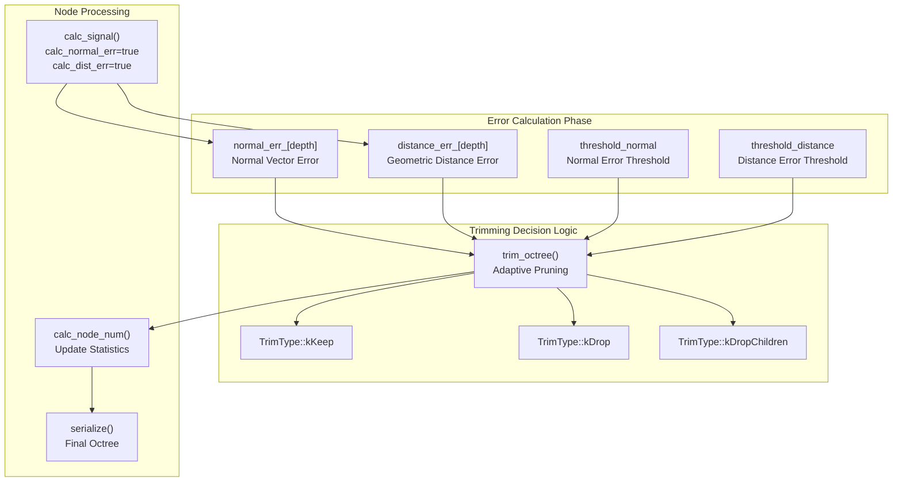
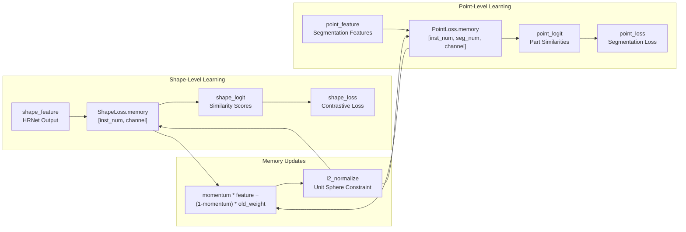
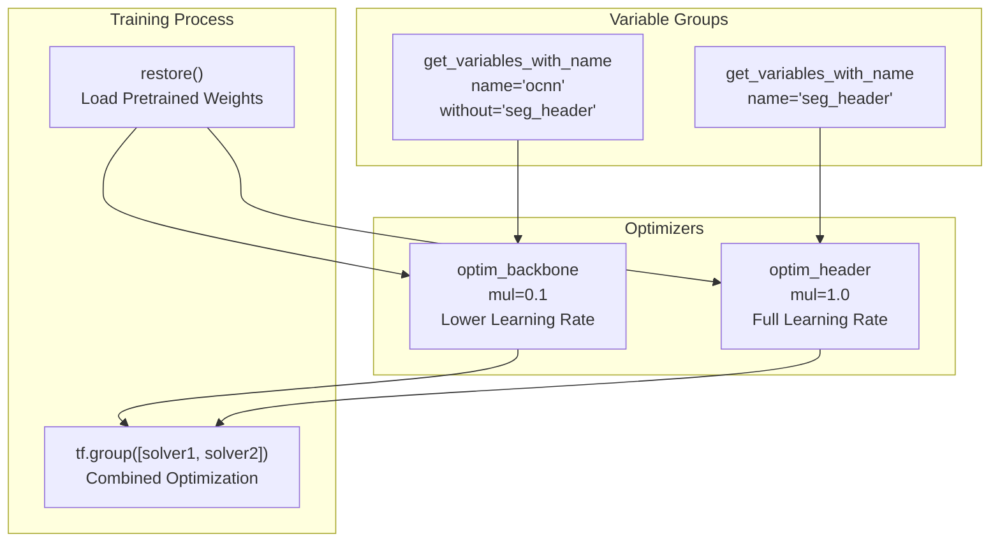
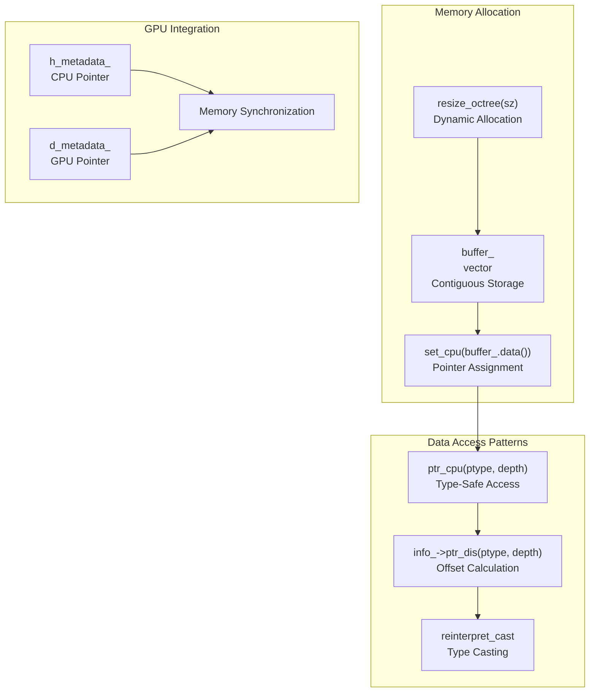
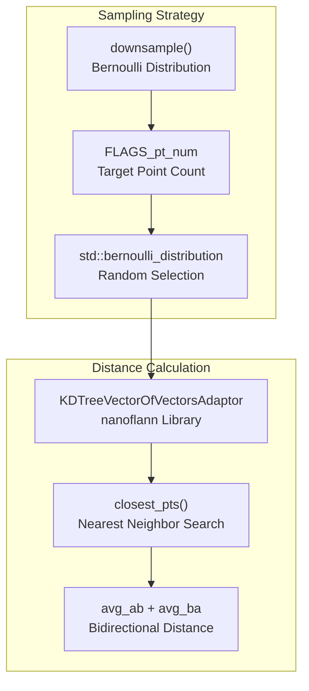

<!-- source: DeepWiki mcp.deepwiki.com · repo microsoft/O-CNN · page 7 Advanced Topics · fetched 2026-10-26 -->

# Advanced Topics

<details>
<summary>Relevant source files</summary>

The following files were used as context for generating this wiki page:

- [octree/octree/octree.cpp](octree/octree/octree.cpp)
- [octree/octree/octree_parser.cpp](octree/octree/octree_parser.cpp)
- [octree/octree/octree_parser.h](octree/octree/octree_parser.h)
- [octree/test/test_util.cpp](octree/test/test_util.cpp)
- [octree/tools/chamfer_distance.cpp](octree/tools/chamfer_distance.cpp)
- [octree/tools/octree_bbox.cpp](octree/tools/octree_bbox.cpp)
- [tensorflow/data/midnet_data.py](tensorflow/data/midnet_data.py)
- [tensorflow/script/configs/mid_hrnet_d6.yaml](tensorflow/script/configs/mid_hrnet_d6.yaml)
- [tensorflow/script/mid_loss.py](tensorflow/script/mid_loss.py)
- [tensorflow/script/run_mid.py](tensorflow/script/run_mid.py)
- [tensorflow/script/run_seg_partnet_cmd.py](tensorflow/script/run_seg_partnet_cmd.py)
- [tensorflow/script/run_seg_partnet_finetune.py](tensorflow/script/run_seg_partnet_finetune.py)

</details>


This page covers advanced features and optimization techniques in the O-CNN system, including adaptive octrees, unsupervised pretraining, fine-tuning strategies, and performance optimization. These topics build upon the core architecture and basic usage patterns described in earlier sections.

For basic octree operations, see [Core Architecture](#3). For standard training workflows, see [Tasks and Applications](#5). For data pipeline setup, see [Data Processing Pipeline](#6).

## Adaptive Octrees

The O-CNN system supports adaptive octrees that can dynamically adjust their structure based on geometric error metrics. This enables more efficient representation of complex shapes by allocating detail only where needed.

### Error-Based Trimming

Adaptive octrees use two primary error metrics to determine which nodes to keep or discard during construction:



The trimming process evaluates nodes starting from the adaptive layer depth and propagates decisions upward. Nodes are kept if their error exceeds thresholds, indicating important geometric features.

**Sources:** [octree/octree/octree.cpp:1004-1127]()

### Adaptive Layer Configuration

The adaptive octree system allows configuration of which layers participate in adaptive behavior:

| Parameter | Type | Description |
|-----------|------|-------------|
| `adaptive_layer()` | `int` | Deepest layer where adaptive trimming begins |
| `threshold_normal()` | `float` | Error threshold for normal vector deviations |
| `threshold_distance()` | `float` | Error threshold for geometric distance |
| `is_adaptive()` | `bool` | Enable/disable adaptive behavior |

The system ensures at least one node remains in each layer to maintain octree connectivity, even when all nodes would normally be trimmed.

**Sources:** [octree/octree/octree.cpp:454-664](), [octree/octree/octree_parser.h:13-83]()

## Unsupervised Pretraining

The O-CNN system includes sophisticated unsupervised pretraining capabilities using Mutual Information Disentanglement (MID) techniques. This approach learns meaningful shape representations without requiring labeled data.

### Memory Bank Architecture

The MID approach uses memory banks to store prototypical representations at both shape and point levels:



The memory banks are updated using exponential moving averages, ensuring stable learning of prototypical features while adapting to new data.

**Sources:** [tensorflow/script/mid_loss.py:1-124](), [tensorflow/script/run_mid.py:1-86]()

### MID Training Configuration

The MID training process uses specific hyperparameters to balance shape-level and point-level learning:

```yaml
LOSS:
  sigma: 0.1          # Temperature parameter for similarity
  momentum: 0.5       # Memory bank update rate
  inst_num: 57449     # Number of shape instances
  seg_num: 100        # Number of point clusters
  weights: [1.0, 1.0] # Shape vs point loss weights
```

The system supports masking strategies to improve robustness during training, randomly dropping point features to prevent overfitting.

**Sources:** [tensorflow/script/configs/mid_hrnet_d6.yaml:1-50](), [tensorflow/script/run_mid.py:17-30]()

## Advanced Fine-tuning Strategies

The O-CNN system provides sophisticated fine-tuning capabilities that enable transfer learning from unsupervised pretraining to downstream tasks.

### Multi-Rate Optimization

Fine-tuning uses different learning rates for different network components:



This approach allows the pretrained backbone to adapt slowly while the task-specific header learns quickly.

**Sources:** [tensorflow/script/run_seg_partnet_finetune.py:1-70]()

### Progressive Training Schedules

The system supports systematic hyperparameter sweeps across different data ratios:

| Data Ratio | Iteration Multiplier | Purpose |
|------------|---------------------|---------|
| 0.01-0.10  | 2x | Extended training for small data |
| 0.20-1.00  | 1x | Standard training schedule |

This enables studies of data efficiency and few-shot learning scenarios.

**Sources:** [tensorflow/script/run_seg_partnet_cmd.py:46-76]()

## Performance Optimization

### Memory Management

The octree system uses careful memory management to handle large-scale datasets efficiently:



The system maintains both CPU and GPU memory pointers, enabling efficient data transfers and computation.

**Sources:** [octree/octree/octree.cpp:20-40](), [octree/octree/octree_parser.cpp:8-91]()

### Batch Processing Optimization

Advanced batch processing techniques handle variable-sized octrees efficiently:

- **Segmented Operations**: Use `tf.segment_sum` and `tf.split` for variable-length sequences
- **Dynamic Batching**: Adjust batch sizes based on octree complexity
- **Memory Pooling**: Reuse allocated memory across batches

**Sources:** [tensorflow/script/mid_loss.py:65-88]()

## Advanced Data Processing

### Clustering-Based Segmentation

The system supports automated clustering for unsupervised part discovery:

```mermaid
graph LR
    subgraph "Point Cloud Processing"
        PC["Points.points()<br/>3D Coordinates"]
        KMEANS["KMeans(n_clusters=100)<br/>Spatial Clustering"]
        LABELS["y_pred.tolist()<br/>Cluster Assignments"]
    end
    
    subgraph "Data Augmentation"
        NORM["normalize_points<br/>Center & Scale"]
        JITTER["jitter: 0.25<br/>Noise Addition"]
        ROT["angle: (180,180,180)<br/>Random Rotation"]
    end
    
    subgraph "Octree Generation"
        OCT_CONV["points2octree<br/>Spatial Indexing"]
        SERIAL["serialize()<br/>Compact Storage"]
        TFRECORD["TFRecords<br/>Training Format"]
    end
    
    PC --> KMEANS
    KMEANS --> LABELS
    LABELS --> NORM
    NORM --> JITTER
    JITTER --> ROT
    ROT --> OCT_CONV
    OCT_CONV --> SERIAL
    SERIAL --> TFRECORD
```



This pipeline enables unsupervised learning on large-scale datasets without manual annotation.

**Sources:** [tensorflow/data/midnet_data.py:167-202](), [tensorflow/data/midnet_data.py:225-232]()

### Quality Assessment

The system includes tools for evaluating reconstruction quality using Chamfer distance:



This enables quantitative evaluation of shape completion and generation tasks.

**Sources:** [octree/tools/chamfer_distance.cpp:1-234]()

## Integration Patterns

Advanced usage often combines multiple techniques:

1. **Pretraining + Fine-tuning**: Train with MID, then fine-tune on specific tasks
2. **Adaptive + Clustering**: Use adaptive octrees with automatic part discovery
3. **Multi-scale Training**: Train across different octree depths simultaneously

These patterns enable state-of-the-art performance on challenging 3D learning tasks while maintaining computational efficiency.

**Sources:** [tensorflow/script/run_seg_partnet_finetune.py:63-69](), [tensorflow/script/configs/mid_hrnet_d6.yaml:1-50]()